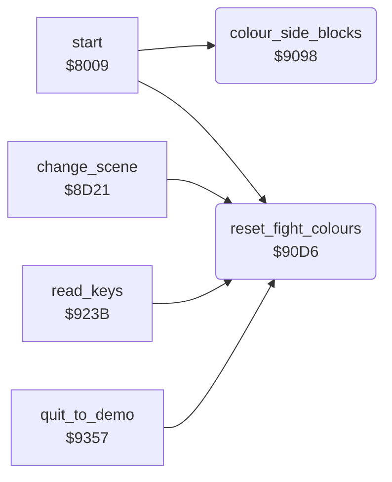

<!-- Generated by c64-docs from knowledge revision 20261025T232349.329-h2a3yw and .c64-re-tools/local/generated/src/source-map.json. Do not edit: change the knowledge, generate the source again, then run docs.ts generate. -->
# screen/colours.asm: Colours of screen areas

Range `$9098-$910F`. Source: [screen/colours.asm](../../../../src/screen/colours.asm). Index: [the reference](../../index.md).

## Routines

| Routine | Address | Reached from | Summary |
|---|---|---|---|
| [`colour_side_blocks`](colours.md#colour_side_blocks) | `$9098` | [`start`](../init/init.md#start) | Sets the colours of rows 2-5. |
| [`reset_fight_colours`](colours.md#reset_fight_colours) | `$90D6` | [`start`](../init/init.md#start), [`change_scene`](scene.md#change_scene), [`read_keys`](../input/keyboard.md#read_keys), [`quit_to_demo`](../main/quit_to_demo.md#quit_to_demo) | Sets the colours of the fight area, rows 14-21, columns 4-35: screen RAM $c0 and colour RAM $0a. |

## Call graph

A solid arrow is a call, a thick arrow a table entry. Rounded nodes are in this file.

## Details

### [`colour_side_blocks`](../../../../src/screen/colours.asm#L6) `$9098`

*routine*

Sets the colours of rows 2-5. Columns 0-3 get screen $73 and colour RAM $0e. Columns 36-39 get $7d and $05.

- **Called from:** [`start`](../init/init.md#start)
- **Writes:** [`$D850`](../../../../src/graphics/arena2_bitmap.asm#L251), [`$D878`](../../../../src/graphics/arena2_bitmap.asm#L256), [`$D8A0`](../../../../src/graphics/arena2_bitmap.asm#L261), [`$D8C8`](../../../../src/graphics/arena2_bitmap.asm#L266), [`$D874`](../../../../src/graphics/arena2_bitmap.asm#L255), [`$D89C`](../../../../src/graphics/arena2_bitmap.asm#L260), [`$D8C4`](../../../../src/graphics/arena2_bitmap.asm#L265), [`$D8EC`](../../../../src/graphics/arena2_bitmap.asm#L270), [`screen_corner_left_row2`](screen_ram.md#screen_corner_left_row2), [`screen_corner_left_row3`](screen_ram.md#screen_corner_left_row3), [`screen_corner_left_row4`](screen_ram.md#screen_corner_left_row4), [`screen_corner_left_row5`](screen_ram.md#screen_corner_left_row5) and 4 more

| Label | Address | Comment |
|---|---|---|
| [`colour_side_blocks_loop`](../../../../src/screen/colours.asm#L8) | `$909A` |  |

### [`reset_fight_colours`](../../../../src/screen/colours.asm#L33) `$90D6`

*routine*

Sets the colours of the fight area, rows 14-21, columns 4-35: screen RAM $c0 and colour RAM $0a. Removes the colours of a text there.

- **Called from:** [`start`](../init/init.md#start), [`change_scene`](scene.md#change_scene), [`read_keys`](../input/keyboard.md#read_keys), [`quit_to_demo`](../main/quit_to_demo.md#quit_to_demo)
- **Writes:** [`$DA34`](../../../../src/graphics/arena2_bitmap.asm#L311), [`$DA5C`](../../../../src/graphics/arena2_bitmap.asm#L316), [`$DA84`](../../../../src/graphics/arena2_bitmap.asm#L321), [`$DAAC`](../../../../src/graphics/arena2_bitmap.asm#L325), [`$DAD4`](../../../../src/graphics/arena2_bitmap.asm#L330), [`$DAFC`](../../../../src/graphics/arena2_bitmap.asm#L335), [`$DB24`](../../../../src/graphics/arena2_bitmap.asm#L340), [`$DB4C`](../../../../src/graphics/arena2_bitmap.asm#L343), [`screen_arena_row14`](screen_ram.md#screen_arena_row14), [`screen_arena_row15`](screen_ram.md#screen_arena_row15), [`screen_arena_row16`](screen_ram.md#screen_arena_row16), [`screen_arena_row17`](screen_ram.md#screen_arena_row17) and 4 more

| Label | Address | Comment |
|---|---|---|
| [`reset_fight_colours_loop`](../../../../src/screen/colours.asm#L35) | `$90D8` |  |
