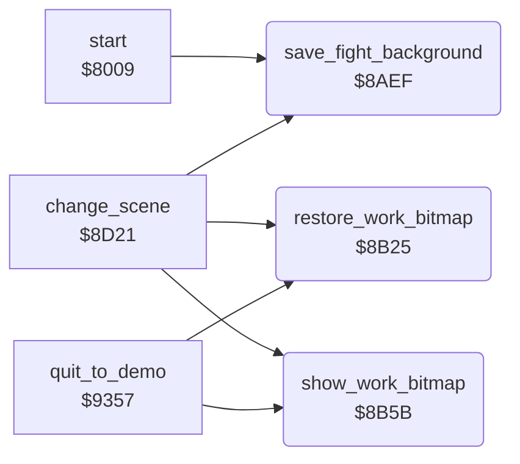

<!-- Generated by c64-docs from knowledge revision 20261025T232349.329-h2a3yw and .c64-re-tools/local/generated/src/source-map.json. Do not edit: change the knowledge, generate the source again, then run docs.ts generate. -->
# screen/fight_area.asm: Background copy and work bitmap of the fight area

Range `$8AEF-$8B90`. Source: [screen/fight_area.asm](../../../../src/screen/fight_area.asm). Index: [the reference](../../index.md).

## Routines

| Routine | Address | Reached from | Summary |
|---|---|---|---|
| [`save_fight_background`](fight_area.md#save_fight_background) | `$8AEF` | [`start`](../init/init.md#start), [`change_scene`](scene.md#change_scene) | Copies the fight area of the bitmap to $af50: character rows 14-21, columns 4-35, 256 bytes for each row. |
| [`restore_work_bitmap`](fight_area.md#restore_work_bitmap) | `$8B25` | [`change_scene`](scene.md#change_scene), [`quit_to_demo`](../main/quit_to_demo.md#quit_to_demo), [`$80D0`](../../../../src/main/main_loop.asm#L14) | Copies the saved background at $af50 into the work bitmap at $a550. |
| [`show_work_bitmap`](fight_area.md#show_work_bitmap) | `$8B5B` | [`change_scene`](scene.md#change_scene), [`quit_to_demo`](../main/quit_to_demo.md#quit_to_demo), [`$80E2`](../../../../src/main/main_loop.asm#L20) | Copies the work bitmap at $a550 to the fight area of the screen bitmap at $71a0. |

## Call graph

A solid arrow is a call, a thick arrow a table entry. Rounded nodes are in this file.

## Details

### [`save_fight_background`](../../../../src/screen/fight_area.asm#L6) `$8AEF`

*routine*

Copies the fight area of the bitmap to $af50: character rows 14-21, columns 4-35, 256 bytes for each row. The copy uses $af50-$b90f with $140 bytes between the rows.

- **Called from:** [`start`](../init/init.md#start), [`change_scene`](scene.md#change_scene)
- **Reads:** [`bitmap_arena_row14`](../graphics/background_bitmap.md#bitmap_arena_row14), [`bitmap_arena_row15`](../graphics/background_bitmap.md#bitmap_arena_row15), [`bitmap_arena_row16`](../graphics/background_bitmap.md#bitmap_arena_row16), [`bitmap_arena_row17`](../graphics/background_bitmap.md#bitmap_arena_row17), [`bitmap_arena_row18`](../graphics/background_bitmap.md#bitmap_arena_row18), [`bitmap_arena_row19`](../graphics/background_bitmap.md#bitmap_arena_row19), [`bitmap_arena_row20`](../graphics/background_bitmap.md#bitmap_arena_row20), [`bitmap_arena_row21`](../graphics/background_bitmap.md#bitmap_arena_row21)
- **Writes:** [`bg_strip0`](../data/fight_background.md#bg_strip0), [`bg_strip1`](../data/fight_background.md#bg_strip1), [`bg_strip2`](../data/fight_background.md#bg_strip2), [`bg_strip3`](../data/fight_background.md#bg_strip3), [`bg_strip4`](../data/fight_background.md#bg_strip4), [`bg_strip5`](../data/fight_background.md#bg_strip5), [`bg_strip6`](../data/fight_background.md#bg_strip6), [`bg_strip7`](../data/fight_background.md#bg_strip7)

| Label | Address | Comment |
|---|---|---|
| [`save_fight_background_loop`](../../../../src/screen/fight_area.asm#L8) | `$8AF1` |  |

### [`restore_work_bitmap`](../../../../src/screen/fight_area.asm#L29) `$8B25`

*routine*

Copies the saved background at $af50 into the work bitmap at $a550. This erases the fighters of the last frame.

- **Called from:** [`$80D0`](../../../../src/main/main_loop.asm#L14), [`change_scene`](scene.md#change_scene), [`quit_to_demo`](../main/quit_to_demo.md#quit_to_demo)
- **Reads:** [`bg_strip0`](../data/fight_background.md#bg_strip0), [`bg_strip1`](../data/fight_background.md#bg_strip1), [`bg_strip2`](../data/fight_background.md#bg_strip2), [`bg_strip3`](../data/fight_background.md#bg_strip3), [`bg_strip4`](../data/fight_background.md#bg_strip4), [`bg_strip5`](../data/fight_background.md#bg_strip5), [`bg_strip6`](../data/fight_background.md#bg_strip6), [`bg_strip7`](../data/fight_background.md#bg_strip7)
- **Writes:** [`work_strip0`](../data/work_bitmap.md#work_strip0), [`work_strip1`](../data/work_bitmap.md#work_strip1), [`work_strip2`](../data/work_bitmap.md#work_strip2), [`work_strip3`](../data/work_bitmap.md#work_strip3), [`work_strip4`](../data/work_bitmap.md#work_strip4), [`work_strip5`](../data/work_bitmap.md#work_strip5), [`work_strip6`](../data/work_bitmap.md#work_strip6), [`work_strip7`](../data/work_bitmap.md#work_strip7)

| Label | Address | Comment |
|---|---|---|
| [`restore_work_bitmap_loop`](../../../../src/screen/fight_area.asm#L31) | `$8B27` |  |

### [`show_work_bitmap`](../../../../src/screen/fight_area.asm#L52) `$8B5B`

*routine*

Copies the work bitmap at $a550 to the fight area of the screen bitmap at $71a0.

- **Called from:** [`$80E2`](../../../../src/main/main_loop.asm#L20), [`change_scene`](scene.md#change_scene), [`quit_to_demo`](../main/quit_to_demo.md#quit_to_demo)
- **Reads:** [`work_strip0`](../data/work_bitmap.md#work_strip0), [`work_strip1`](../data/work_bitmap.md#work_strip1), [`work_strip2`](../data/work_bitmap.md#work_strip2), [`work_strip3`](../data/work_bitmap.md#work_strip3), [`work_strip4`](../data/work_bitmap.md#work_strip4), [`work_strip5`](../data/work_bitmap.md#work_strip5), [`work_strip6`](../data/work_bitmap.md#work_strip6), [`work_strip7`](../data/work_bitmap.md#work_strip7)
- **Writes:** [`bitmap_arena_row14`](../graphics/background_bitmap.md#bitmap_arena_row14), [`bitmap_arena_row15`](../graphics/background_bitmap.md#bitmap_arena_row15), [`bitmap_arena_row16`](../graphics/background_bitmap.md#bitmap_arena_row16), [`bitmap_arena_row17`](../graphics/background_bitmap.md#bitmap_arena_row17), [`bitmap_arena_row18`](../graphics/background_bitmap.md#bitmap_arena_row18), [`bitmap_arena_row19`](../graphics/background_bitmap.md#bitmap_arena_row19), [`bitmap_arena_row20`](../graphics/background_bitmap.md#bitmap_arena_row20), [`bitmap_arena_row21`](../graphics/background_bitmap.md#bitmap_arena_row21)

| Label | Address | Comment |
|---|---|---|
| [`show_work_bitmap_loop`](../../../../src/screen/fight_area.asm#L54) | `$8B5D` |  |
