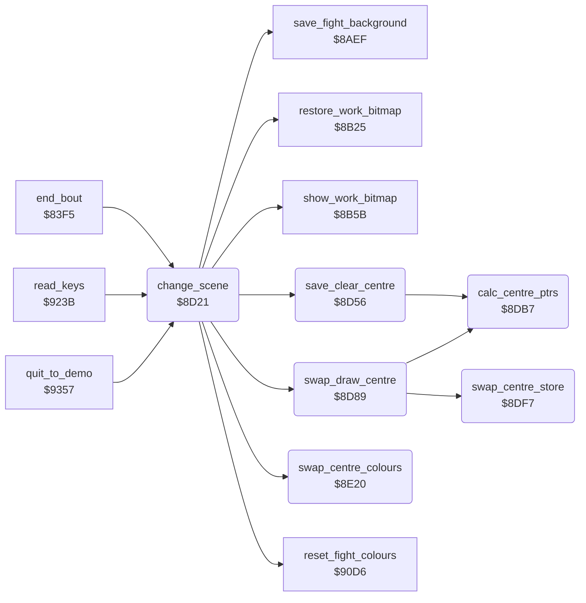

<!-- Generated by c64-docs from knowledge revision 20261025T232349.329-h2a3yw and .c64-re-tools/local/generated/src/source-map.json. Do not edit: change the knowledge, generate the source again, then run docs.ts generate. -->
# screen/scene.asm: Change of the background picture

Range `$8D21-$8E79`. Source: [screen/scene.asm](../../../../src/screen/scene.asm). Index: [the reference](../../index.md).

## Routines

| Routine | Address | Reached from | Summary |
|---|---|---|---|
| [`change_scene`](scene.md#change_scene) | `$8D21` | [`end_bout`](../combat/end_of_bout.md#end_bout), [`read_keys`](../input/keyboard.md#read_keys), [`quit_to_demo`](../main/quit_to_demo.md#quit_to_demo) | Changes the centre of the background picture (rows 7-22, columns 4-35) to the other stored picture. |
| [`save_clear_centre`](scene.md#save_clear_centre) | `$8D56` | [`change_scene`](scene.md#change_scene) | Copies the bitmap rows 7-22, columns 4-35 to the buffer $a530-$b52f and clears them in the bitmap. |
| [`swap_draw_centre`](scene.md#swap_draw_centre) | `$8D89` | [`change_scene`](scene.md#change_scene) | Swaps the buffer $a530-$b52f with the stored picture centre at $d000-$dfff. |
| [`calc_centre_ptrs`](scene.md#calc_centre_ptrs) | `$8DB7` | [`save_clear_centre`](scene.md#save_clear_centre), [`swap_draw_centre`](scene.md#swap_draw_centre) | Calculates the addresses of one bitmap character and its buffer copy. |
| [`swap_centre_store`](scene.md#swap_centre_store) | `$8DF7` | [`swap_draw_centre`](scene.md#swap_draw_centre) | Swaps the 16 pages $a530-$b52f with $d000-$dfff. |
| [`swap_centre_colours`](scene.md#swap_centre_colours) | `$8E20` | [`change_scene`](scene.md#change_scene) | Swaps the colours of rows 7-22, columns 4-35: screen RAM $451c with $e11c and colour RAM $d91c with $e51c. |

## Call graph

A solid arrow is a call, a thick arrow a table entry. Rounded nodes are in this file.

## Details

### [`change_scene`](../../../../src/screen/scene.asm#L6) `$8D21`

*routine*

Changes the centre of the background picture (rows 7-22, columns 4-35) to the other stored picture. Fades the sound out and in again. Toggles scene_index.
Asks the IRQ to fade the volume out.

- **Called from:** [`end_bout`](../combat/end_of_bout.md#end_bout), [`read_keys`](../input/keyboard.md#read_keys), [`quit_to_demo`](../main/quit_to_demo.md#quit_to_demo)
- **Calls:** [`restore_work_bitmap`](fight_area.md#restore_work_bitmap), [`show_work_bitmap`](fight_area.md#show_work_bitmap), [`save_clear_centre`](scene.md#save_clear_centre), [`swap_centre_colours`](scene.md#swap_centre_colours), [`reset_fight_colours`](colours.md#reset_fight_colours), [`swap_draw_centre`](scene.md#swap_draw_centre), [`save_fight_background`](fight_area.md#save_fight_background)
- **Reads:** [`fade_out_request`](../../memory-map.md#fade_out_request), [`scene_index`](../../memory-map.md#scene_index)
- **Writes:** [`fade_out_request`](../../memory-map.md#fade_out_request), [`BGCOL0`](../../memory-map.md#BGCOL0), [`SPENA`](../../memory-map.md#SPENA), [`scene_index`](../../memory-map.md#scene_index), [`fade_in_request`](../../memory-map.md#fade_in_request)

| Label | Address | Comment |
|---|---|---|
| [`change_scene_wait`](../../../../src/screen/scene.asm#L9) | `$8D25` | Waits until the IRQ clears bit 7: the volume is 0. |

### [`save_clear_centre`](../../../../src/screen/scene.asm#L32) `$8D56`

*routine*

Copies the bitmap rows 7-22, columns 4-35 to the buffer $a530-$b52f and clears them in the bitmap. Runs with all RAM ($01 = $20).

- **Called from:** [`change_scene`](scene.md#change_scene)
- **Calls:** [`calc_centre_ptrs`](scene.md#calc_centre_ptrs)
- **Reads:** [`R6510`](../../memory-map.md#R6510), [`copy_dst_ptr`](../../memory-map.md#copy_dst_ptr), [`copy_src_ptr`](../../memory-map.md#copy_src_ptr), [`mirror_row_count`](../../memory-map.md#mirror_row_count), [`draw_row`](../../memory-map.md#draw_row)
- **Writes:** [`R6510`](../../memory-map.md#R6510), [`draw_row`](../../memory-map.md#draw_row), [`mirror_row_count`](../../memory-map.md#mirror_row_count)

| Label | Address | Comment |
|---|---|---|
| [`save_clear_centre_row`](../../../../src/screen/scene.asm#L39) | `$8D61` |  |
| [`save_clear_centre_line`](../../../../src/screen/scene.asm#L42) | `$8D65` | 32 columns. |
| [`save_clear_centre_col`](../../../../src/screen/scene.asm#L44) | `$8D67` |  |

### [`swap_draw_centre`](../../../../src/screen/scene.asm#L64) `$8D89`

*routine*

Swaps the buffer $a530-$b52f with the stored picture centre at $d000-$dfff. Then copies the buffer into the bitmap rows 7-22, columns 4-35.

- **Called from:** [`change_scene`](scene.md#change_scene)
- **Calls:** [`swap_centre_store`](scene.md#swap_centre_store), [`calc_centre_ptrs`](scene.md#calc_centre_ptrs)
- **Reads:** [`R6510`](../../memory-map.md#R6510), [`copy_src_ptr`](../../memory-map.md#copy_src_ptr), [`copy_dst_ptr`](../../memory-map.md#copy_dst_ptr), [`mirror_row_count`](../../memory-map.md#mirror_row_count), [`draw_row`](../../memory-map.md#draw_row)
- **Writes:** [`R6510`](../../memory-map.md#R6510), [`draw_row`](../../memory-map.md#draw_row), [`mirror_row_count`](../../memory-map.md#mirror_row_count)

| Label | Address | Comment |
|---|---|---|
| [`swap_draw_centre_row`](../../../../src/screen/scene.asm#L72) | `$8D97` | Pixel lines 7 down to 0. |
| [`swap_draw_centre_line`](../../../../src/screen/scene.asm#L75) | `$8D9B` | 32 columns. |
| [`swap_draw_centre_col`](../../../../src/screen/scene.asm#L77) | `$8D9D` |  |

### [`calc_centre_ptrs`](../../../../src/screen/scene.asm#L93) `$8DB7`

*routine*

Calculates the addresses of one bitmap character and its buffer copy. Input: row_index, line_index, X = column 0-31. Output: $77 bitmap, $75 buffer, Y = line_index.

- **Called from:** [`save_clear_centre`](scene.md#save_clear_centre), [`swap_draw_centre`](scene.md#swap_draw_centre)
- **Reads:** [`draw_row`](../../memory-map.md#draw_row), [`bitmap_row_addr`](address_tables.md#bitmap_row_addr), [`bitmap_row_addr_hi`](address_tables.md#bitmap_row_addr_hi), [`copy_dst_ptr`](../../memory-map.md#copy_dst_ptr), [`times8_table`](address_tables.md#times8_table), [`times8_table_hi`](address_tables.md#times8_table_hi), [`copy_src_ptr`](../../memory-map.md#copy_src_ptr), [`mirror_row_count`](../../memory-map.md#mirror_row_count)
- **Writes:** [`copy_dst_ptr`](../../memory-map.md#copy_dst_ptr), [`copy_src_ptr`](../../memory-map.md#copy_src_ptr)
- **Refers to:** [`copy_dst_ptr`](../../memory-map.md#copy_dst_ptr), [`copy_src_ptr`](../../memory-map.md#copy_src_ptr)

### [`swap_centre_store`](../../../../src/screen/scene.asm#L128) `$8DF7`

*routine*

Swaps the 16 pages $a530-$b52f with $d000-$dfff. The caller sets $01 = $20 so that $d000 is RAM.

- **Called from:** [`swap_draw_centre`](scene.md#swap_draw_centre)
- **Reads:** [`copy_dst_ptr`](../../memory-map.md#copy_dst_ptr), [`copy_src_ptr`](../../memory-map.md#copy_src_ptr)
- **Writes:** [`copy_dst_ptr`](../../memory-map.md#copy_dst_ptr), [`copy_src_ptr`](../../memory-map.md#copy_src_ptr)
- **Refers to:** [`copy_dst_ptr`](../../memory-map.md#copy_dst_ptr), [`arena2_bitmap`](../graphics/arena2_bitmap.md#arena2_bitmap), [`copy_src_ptr`](../../memory-map.md#copy_src_ptr)

| Label | Address | Comment |
|---|---|---|
| [`swap_centre_store_page`](../../../../src/screen/scene.asm#L138) | `$8E09` |  |
| [`swap_centre_store_byte`](../../../../src/screen/scene.asm#L140) | `$8E0B` |  |

### [`swap_centre_colours`](../../../../src/screen/scene.asm#L155) `$8E20`

*routine*

Swaps the colours of rows 7-22, columns 4-35: screen RAM $451c with $e11c and colour RAM $d91c with $e51c.

- **Called from:** [`change_scene`](scene.md#change_scene)
- **Reads:** [`copy_dst_ptr`](../../memory-map.md#copy_dst_ptr), [`copy_src_ptr`](../../memory-map.md#copy_src_ptr)
- **Writes:** [`copy_dst_ptr`](../../memory-map.md#copy_dst_ptr), [`copy_src_ptr`](../../memory-map.md#copy_src_ptr)
- **Refers to:** [`screen_ram`](screen_ram.md#screen_ram), [`copy_dst_ptr`](../../memory-map.md#copy_dst_ptr), [`arena2_screen`](../graphics/arena2_screen.md#arena2_screen), [`copy_src_ptr`](../../memory-map.md#copy_src_ptr)

| Label | Address | Comment |
|---|---|---|
| [`swap_centre_colours_row`](../../../../src/screen/scene.asm#L165) | `$8E32` | 32 columns. |
| [`swap_centre_colours_col`](../../../../src/screen/scene.asm#L167) | `$8E34` | Swaps the screen RAM byte. |
| [`swap_centre_colours_add`](../../../../src/screen/scene.asm#L202) | `$8E6C` | Store pointer + 40. |
| [`swap_centre_colours_next`](../../../../src/screen/scene.asm#L208) | `$8E76` |  |
