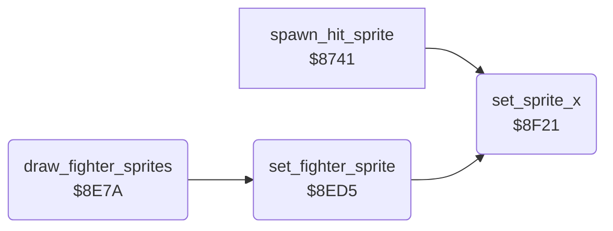

<!-- Generated by c64-docs from knowledge revision 20261025T232349.329-h2a3yw and .c64-re-tools/local/generated/src/source-map.json. Do not edit: change the knowledge, generate the source again, then run docs.ts generate. -->
# sprites/fighter_sprites.asm: Fighter frames to sprites

Range `$8E7A-$8F60`. Source: [sprites/fighter_sprites.asm](../../../../src/sprites/fighter_sprites.asm). Index: [the reference](../../index.md).

## Routines

| Routine | Address | Reached from | Summary |
|---|---|---|---|
| [`draw_fighter_sprites`](fighter_sprites.md#draw_fighter_sprites) | `$8E7A` | [`$80DF`](../../../../src/main/main_loop.asm#L19) | Builds the sprites of both fighters from their frames. |
| [`set_fighter_sprite`](fighter_sprites.md#set_fighter_sprite) | `$8ED5` | [`draw_fighter_sprites`](fighter_sprites.md#draw_fighter_sprites) | Sets sprite slot sprite_slot from one 4-byte frame entry at ($89),Y: shape, colour, Y position, X offset. |
| [`set_sprite_x`](fighter_sprites.md#set_sprite_x) | `$8F21` | [`spawn_hit_sprite`](../combat/hits.md#spawn_hit_sprite), [`set_fighter_sprite`](fighter_sprites.md#set_fighter_sprite) | Sets the X position of sprite slot sprite_slot. |

## Call graph

A solid arrow is a call, a thick arrow a table entry. Rounded nodes are in this file.

## Details

### [`draw_fighter_sprites`](../../../../src/sprites/fighter_sprites.asm#L6) `$8E7A`

*routine*

Builds the sprites of both fighters from their frames. Fighter 1 first, from sprite 7 down. Switches off each free sprite without an animation.

- **Called from:** [`$80DF`](../../../../src/main/main_loop.asm#L19)
- **Calls:** [`set_fighter_sprite`](fighter_sprites.md#set_fighter_sprite)
- **Reads:** [`fighter_pose`](../../memory-map.md#fighter_pose), [`pose_ptrs`](../fighter/poses.md#pose_ptrs), [`fighter_x`](../../memory-map.md#fighter_x), [`record_ptr`](../../memory-map.md#record_ptr), [`loop_count`](../../memory-map.md#loop_count), [`sprite_slot`](../../memory-map.md#sprite_slot), [`cur_fighter`](../../memory-map.md#cur_fighter), [`sprite_anim`](../../memory-map.md#sprite_anim), [`sprite_enable_shadow`](../../memory-map.md#sprite_enable_shadow), [`bit_masks_inverted`](../data/bit_masks.md#bit_masks_inverted)
- **Writes:** [`sprite_slot`](../../memory-map.md#sprite_slot), [`record_ptr`](../../memory-map.md#record_ptr), [`cur_fighter`](../../memory-map.md#cur_fighter), [`loop_count`](../../memory-map.md#loop_count), [`sprite_enable_shadow`](../../memory-map.md#sprite_enable_shadow)
- **Refers to:** [`record_ptr`](../../memory-map.md#record_ptr)

| Label | Address | Comment |
|---|---|---|
| [`draw_fighter_sprites_fighter`](../../../../src/sprites/fighter_sprites.asm#L11) | `$8E81` | Pose record pointer from the table $bc51, indexed by fighter_pose. |
| [`draw_fighter_sprites_part`](../../../../src/sprites/fighter_sprites.asm#L38) | `$8EB4` |  |
| [`draw_fighter_sprites_next`](../../../../src/sprites/fighter_sprites.asm#L43) | `$8EBD` |  |
| [`draw_fighter_sprites_free`](../../../../src/sprites/fighter_sprites.asm#L48) | `$8EC4` | Keeps a sprite that has an animation. |
| [`draw_fighter_sprites_free_next`](../../../../src/sprites/fighter_sprites.asm#L54) | `$8ED0` |  |

### [`set_fighter_sprite`](../../../../src/sprites/fighter_sprites.asm#L60) `$8ED5`

*routine*

Sets sprite slot sprite_slot from one 4-byte frame entry at ($89),Y: shape, colour, Y position, X offset. Input: cur_fighter. Output: Y past the entry.

- **Called from:** [`draw_fighter_sprites`](fighter_sprites.md#draw_fighter_sprites)
- **Calls:** [`set_sprite_x`](fighter_sprites.md#set_sprite_x)
- **Reads:** [`cur_fighter`](../../memory-map.md#cur_fighter), [`fighter_facing`](../../memory-map.md#fighter_facing), [`record_ptr`](../../memory-map.md#record_ptr), [`facing_sprite_offset`](../data/fighter_constants.md#facing_sprite_offset), [`sprite_slot`](../../memory-map.md#sprite_slot), [`sprite_enable_shadow`](../../memory-map.md#sprite_enable_shadow), [`bit_masks`](../data/bit_masks.md#bit_masks), [`SPMC`](../../memory-map.md#SPMC), [`opponent_index`](../../memory-map.md#opponent_index), [`fighter_colours`](fighter_colours.md#fighter_colours), [`bit_masks_inverted`](../data/bit_masks.md#bit_masks_inverted)
- **Writes:** [`sprite_pointer_shadow`](../../memory-map.md#sprite_pointer_shadow), [`sprite_enable_shadow`](../../memory-map.md#sprite_enable_shadow), [`sprite_colour_shadow`](../../memory-map.md#sprite_colour_shadow), [`SPMC`](../../memory-map.md#SPMC), [`sprite_y_shadow`](../../memory-map.md#sprite_y_shadow)

| Label | Address | Comment |
|---|---|---|
| [`set_fighter_sprite_ptr`](../../../../src/sprites/fighter_sprites.asm#L70) | `$8EE6` | Stores the sprite pointer and switches the sprite on. |
| [`set_fighter_sprite_own`](../../../../src/sprites/fighter_sprites.asm#L79) | `$8EF6` |  |
| [`set_fighter_sprite_level`](../../../../src/sprites/fighter_sprites.asm#L84) | `$8F01` | Colour of the opponent level from the table $c771, single colour. |
| [`set_fighter_sprite_mc`](../../../../src/sprites/fighter_sprites.asm#L91) | `$8F10` |  |

### [`set_sprite_x`](../../../../src/sprites/fighter_sprites.asm#L104) `$8F21`

*routine*

Sets the X position of sprite slot sprite_slot. X = fighter column * 8 + offset ($89),Y + $18. Mirrors the offset for a fighter that faces left. Input: cur_fighter.

- **Called from:** [`spawn_hit_sprite`](../combat/hits.md#spawn_hit_sprite), [`set_fighter_sprite`](fighter_sprites.md#set_fighter_sprite)
- **Reads:** [`cur_fighter`](../../memory-map.md#cur_fighter), [`fighter_facing`](../../memory-map.md#fighter_facing), [`record_ptr`](../../memory-map.md#record_ptr), [`fighter_x`](../../memory-map.md#fighter_x), [`sprite_slot`](../../memory-map.md#sprite_slot), [`times8_table`](../screen/address_tables.md#times8_table), [`sprite_x_offset`](../../memory-map.md#sprite_x_offset), [`times8_table_hi`](../screen/address_tables.md#times8_table_hi), [`sprite_x_msb_shadow`](../../memory-map.md#sprite_x_msb_shadow), [`bit_masks`](../data/bit_masks.md#bit_masks), [`bit_masks_inverted`](../data/bit_masks.md#bit_masks_inverted), [`saved_y`](../../memory-map.md#saved_y)
- **Writes:** [`sprite_x_offset`](../../memory-map.md#sprite_x_offset), [`saved_y`](../../memory-map.md#saved_y), [`sprite_xy_shadow`](../../memory-map.md#sprite_xy_shadow), [`sprite_x_msb_shadow`](../../memory-map.md#sprite_x_msb_shadow)

| Label | Address | Comment |
|---|---|---|
| [`set_sprite_x_add`](../../../../src/sprites/fighter_sprites.asm#L114) | `$8F30` |  |
| [`set_sprite_x_msb_on`](../../../../src/sprites/fighter_sprites.asm#L133) | `$8F4F` |  |
| [`set_sprite_x_msb_off`](../../../../src/sprites/fighter_sprites.asm#L137) | `$8F57` |  |
| [`set_sprite_x_msb_store`](../../../../src/sprites/fighter_sprites.asm#L140) | `$8F5C` |  |
