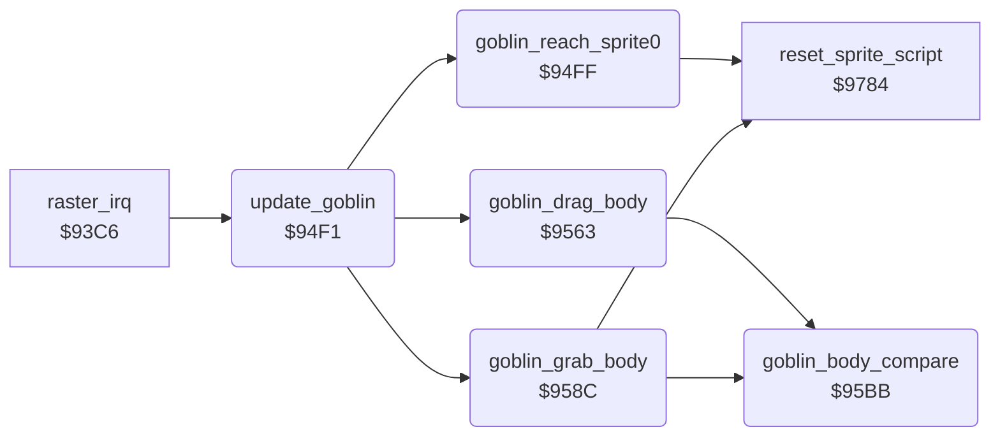

<!-- Generated by c64-docs from knowledge revision 20261029T165720.369-auoxqk and .c64-re-tools/local/generated/src/source-map.json. Do not edit: change the knowledge, generate the source again, then run docs.ts generate. -->
# story/goblin.asm: Sprites 3 and 4 take away the dead fighter

Range `$94F1-$95D7`. Source: [story/goblin.asm](../../../../src/story/goblin.asm). Index: [the reference](../../index.md).

## Routines

| Routine | Address | Reached from | Summary |
|---|---|---|---|
| [`update_goblin`](goblin.md#update_goblin) | `$94F1` | [`raster_irq`](../irq/irq_handler.md#raster_irq) | Runs the goblin events while goblin_active bit 7 is set. |
| [`goblin_reach_sprite0`](goblin.md#goblin_reach_sprite0) | `$94FF` | [`update_goblin`](goblin.md#update_goblin) | When sprite 3 reaches sprite 0 and the dead fighter has state $88, sprites 0 and 1 get new scripts. |
| [`goblin_drag_body`](goblin.md#goblin_drag_body) | `$9563` | [`update_goblin`](goblin.md#update_goblin) | While goblin_drags bit 7 is set: plays sounds $d4-$d6 and moves the dead fighter one column with sprite 3. |
| [`goblin_grab_body`](goblin.md#goblin_grab_body) | `$958C` | [`update_goblin`](goblin.md#update_goblin) | When sprite 3 reaches the dead fighter, sprites 4 and 3 get new scripts and goblin_drags is set. |
| [`goblin_body_compare`](goblin.md#goblin_body_compare) | `$95BB` | [`goblin_drag_body`](goblin.md#goblin_drag_body), [`goblin_grab_body`](goblin.md#goblin_grab_body) | Compares dead fighter column + 5 with sprite 3 column - 3. |

## Call graph

A solid arrow is a call, a thick arrow a table entry. Rounded nodes are in this file.

## Details

### [`update_goblin`](../../../../src/story/goblin.asm#L6) `$94F1`

*routine*

Runs the goblin events while goblin_active bit 7 is set. $9045 starts the goblin as sprites 3 and 4.

- **Called from:** [`raster_irq`](../irq/irq_handler.md#raster_irq)
- **Calls:** [`goblin_reach_sprite0`](goblin.md#goblin_reach_sprite0), [`goblin_drag_body`](goblin.md#goblin_drag_body), [`goblin_grab_body`](goblin.md#goblin_grab_body)
- **Reads:** [`goblin_active`](../../memory-map.md#goblin_active)

| Label | Address | Comment |
|---|---|---|
| [`update_goblin_exit`](../../../../src/story/goblin.asm#L12) | `$94FE` |  |

### [`goblin_reach_sprite0`](../../../../src/story/goblin.asm#L15) `$94FF`

*routine*

When sprite 3 reaches sprite 0 and the dead fighter has state $88, sprites 0 and 1 get new scripts.

- **Called from:** [`update_goblin`](goblin.md#update_goblin)
- **Calls:** [`reset_sprite_script`](../sprites/sprite_script.md#reset_sprite_script)
- **Reads:** [`sprite_anim`](../../memory-map.md#sprite_anim), [`bout_loser`](../../memory-map.md#bout_loser), [`fighter_move`](../../memory-map.md#fighter_move), [`sprite_x_msb_shadow`](../../memory-map.md#sprite_x_msb_shadow), [`sprite_xy_shadow`](../../memory-map.md#sprite_xy_shadow), [`sprite_y_shadow`](../../memory-map.md#sprite_y_shadow), [`goblin_x_hi`](../../memory-map.md#goblin_x_hi), [`target_x_hi`](../../memory-map.md#target_x_hi), [`target_x_lo`](../../memory-map.md#target_x_lo), [`goblin_x_lo`](../../memory-map.md#goblin_x_lo), [`pair01_motions`](../sprites/sprite_motions.md#pair01_motions), [`pair01_anims`](../sprites/sprite_motions.md#pair01_anims) and 2 more
- **Writes:** [`target_x_hi`](../../memory-map.md#target_x_hi), [`target_x_lo`](../../memory-map.md#target_x_lo), [`goblin_x_hi`](../../memory-map.md#goblin_x_hi), [`goblin_x_lo`](../../memory-map.md#goblin_x_lo), [`sprite_path`](../../memory-map.md#sprite_path), [`sprite_anim`](../../memory-map.md#sprite_anim), [`sprite_anim_timer`](../../memory-map.md#sprite_anim_timer), [`sprite_anim_pos`](../../memory-map.md#sprite_anim_pos), [`sound_request`](../../memory-map.md#sound_request)
- **Refers to:** [`sprite_xy_shadow`](../../memory-map.md#sprite_xy_shadow), [`sound_request`](../../memory-map.md#sound_request)

| Label | Address | Comment |
|---|---|---|
| [`goblin_reach_sprite0_loop`](../../../../src/story/goblin.asm#L49) | `$9539` |  |
| [`goblin_reach_sprite0_exit`](../../../../src/story/goblin.asm#L67) | `$9562` |  |

### [`goblin_drag_body`](../../../../src/story/goblin.asm#L70) `$9563`

*routine*

While goblin_drags bit 7 is set: plays sounds $d4-$d6 and moves the dead fighter one column with sprite 3.

- **Called from:** [`update_goblin`](goblin.md#update_goblin)
- **Calls:** [`goblin_body_compare`](goblin.md#goblin_body_compare)
- **Reads:** [`goblin_drags`](../../memory-map.md#goblin_drags), [`voice_tune`](../../memory-map.md#voice_tune), [`sound_request`](../../memory-map.md#sound_request), [`sprite_y_shadow`](../../memory-map.md#sprite_y_shadow), [`fighter_x`](../../memory-map.md#fighter_x)
- **Writes:** [`sound_request`](../../memory-map.md#sound_request), [`fighter_x`](../../memory-map.md#fighter_x)
- **Refers to:** [`sound_request`](../../memory-map.md#sound_request), [`sprite_xy_shadow`](../../memory-map.md#sprite_xy_shadow)

| Label | Address | Comment |
|---|---|---|
| [`goblin_drag_body_move`](../../../../src/story/goblin.asm#L84) | `$957E` | Moves the body only when sprite 3 is on a character column. |
| [`goblin_drag_body_exit`](../../../../src/story/goblin.asm#L91) | `$958B` |  |

### [`goblin_grab_body`](../../../../src/story/goblin.asm#L94) `$958C`

*routine*

When sprite 3 reaches the dead fighter, sprites 4 and 3 get new scripts and goblin_drags is set.

- **Called from:** [`update_goblin`](goblin.md#update_goblin)
- **Calls:** [`goblin_body_compare`](goblin.md#goblin_body_compare), [`reset_sprite_script`](../sprites/sprite_script.md#reset_sprite_script)
- **Reads:** [`goblin_drags`](../../memory-map.md#goblin_drags), [`pair34_motions`](../sprites/sprite_motions.md#pair34_motions), [`pair34_anims`](../sprites/sprite_motions.md#pair34_anims)
- **Writes:** [`sprite_path`](../../memory-map.md#sprite_path), [`sprite_anim`](../../memory-map.md#sprite_anim), [`sprite_anim_timer`](../../memory-map.md#sprite_anim_timer), [`sprite_anim_pos`](../../memory-map.md#sprite_anim_pos), [`goblin_drags`](../../memory-map.md#goblin_drags), [`sound_request`](../../memory-map.md#sound_request)

| Label | Address | Comment |
|---|---|---|
| [`goblin_grab_body_loop`](../../../../src/story/goblin.asm#L101) | `$9599` |  |
| [`goblin_grab_body_exit`](../../../../src/story/goblin.asm#L116) | `$95BA` |  |

### [`goblin_body_compare`](../../../../src/story/goblin.asm#L119) `$95BB`

*routine*

Compares dead fighter column + 5 with sprite 3 column - 3. Out: CMP flags, X = dead fighter.
Bit 3 of sprite_x_msb is bit 8 of the sprite 3 X.

- **Called from:** [`goblin_drag_body`](goblin.md#goblin_drag_body), [`goblin_grab_body`](goblin.md#goblin_grab_body)
- **Reads:** [`sprite_x_msb_shadow`](../../memory-map.md#sprite_x_msb_shadow), [`sprite_y_shadow`](../../memory-map.md#sprite_y_shadow), [`bout_loser`](../../memory-map.md#bout_loser), [`fighter_x`](../../memory-map.md#fighter_x), [`goblin_column`](../../memory-map.md#goblin_column)
- **Writes:** [`goblin_column`](../../memory-map.md#goblin_column)
- **Refers to:** [`sprite_xy_shadow`](../../memory-map.md#sprite_xy_shadow)
