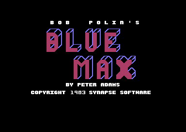

# Blue Max

*Blue Max* is a flight game for the C64. Bob Polin designed it, Peter Adams wrote the C64 version, and Synapse Software published it in 1983. You fly a biplane over a landscape that scrolls diagonally. You shoot enemy planes, bomb targets on the ground, and land on your own airfields for fuel and bombs. At the end, the plane flies into an enemy city with three special targets. This documentation is for the game image `$2800-$804C` in three cracked releases. The base release is the crack of csdb release 234766, which has no group name. The source in [src/](src/) assembles byte for byte to each release. The default build has no copy protection, no trainer and no crack change.

**Evidence.** **Observed** marks a fact that a run showed. **Code** marks a fact from the code only. **Conclusion** marks an interpretation.

The title screen of the game (**Observed**).

## The development

All three releases are memory dumps of a game that ran: the variables `$4003-$40F7` and the operands of the screen copy hold run-time values (**Code**). The start code at `$40F9` sets them again, so they do no harm. The image keeps traces of the development:

- `$2B80-$2F17` holds copies of parts of the charset at `$3000`, at an offset of `-$800`. Thus the charset was at `$2800` in an earlier build (**Conclusion**). `$2F18-$2FFF` holds PETSCII key lists, probably the memory of an editor (**Code**).
- `$8000-$804B`, at the start of the map buffer, holds a copy of the score loops of the rank code at `$7E04-$7E4F` (**Code**). The game writes over it in play.
- Three routines that nothing calls stay in the image (**Code**). One prints a hex number to the status line. One jumps to a machine code monitor at `$CFF8` when F1 is down. One plays a beep.
- A key toggle of the invincibility flag is in the key routine, but a `LDA #$78` in place of a test always skips it (**Code**).

The details are on [docs/development.md](docs/development.md).

## The copy protection

The game needs values that its original loader leaves in memory (**Code**):

- An identity table (00, 01 ... FF) at `$D100`, in the RAM under the I/O area. The start of the game copies it to `$1000`. Without it, the landscape shows as stripes (**Observed**).
- The value 4 at `$0342`. The F3 key during play tests it. Any other value ends the game at the rank screen (**Observed** on the base release).
- The bytes `05 16` at `$0100` and a 5-byte routine at `$0200`. These are bytes of the original loader file itself (**Code**).

The Bandit crack dumped pages 0-3 of a running game. Its stack page still holds the first-stage loader. The loader opens the disk with `#`, reads track 12 to `$4000` with `U1` block reads, and jumps through `$4003` (**Observed**: the bytes). Each crack supplies the values in its own way. The anonymous crack and The Bandit fail the F3 test. The Derbyshire Ram crack passes it (**Observed**). The default build has no F3 test. The details are on [docs/protection.md](docs/protection.md).

## Findings

- **F3 ends the game on two of the three cracks.** The test of `$0342` is in the main loop of all releases. Only the Derbyshire Ram crack puts 4 there (**Observed**). See [docs/protection.md](docs/protection.md).
- **The game has a hidden invincibility cheat.** With one byte changed at `$5D46`, the four F keys together toggle the flag `invincible`. A test with that byte made the plane fly on at altitude 0 (**Observed**). The rebuild has the switch `CHEAT_INVINCIBLE`, off by default. No release has this byte, so the patch is a reconstruction (**Conclusion**).
- **The Derbyshire Ram release reads SYNSOFT.** Its title line is "COPYRIGHT 1983 SYNSOFT" in place of "COPYRIGHT 1983 SYNAPSE SOFTWARE". No other game byte differs for this (**Observed**). See [docs/releases.md](docs/releases.md).
- **The original first-stage loader survives in a crack.** The page dump of The Bandit holds it, and it explains the loader values that the game reads (**Observed**: the bytes). See [docs/protection.md](docs/protection.md).
- **Three sprites show the status letters L, P and W.** The game sets them for an airfield, an enemy plane and wind. A fourth letter, R, is never shown (**Code**). See [docs/screens.md](docs/screens.md).
- **The demo mode uses an autopilot.** When the title tune ends, the game starts and a table of joystick moves flies the plane (**Observed**). See [docs/game.md](docs/game.md).
- **The rank code after a complete mission has defects.** Its score loops store into the wrong bytes (**Code**). See [docs/development.md](docs/development.md).

## How the program works

The start sets the interrupt vectors and shows the title. F7 or fire starts a game. The game start builds the charset, clears the screens and fills the map buffer. Then the main loop and the raster interrupt run the game until a crash or F7.

~~~mermaid
flowchart TB
  S["Start: vectors, title (cold_start)"] --> T["Title: logo, plane, options (title_screen)"]
  T -->|tune ends| D["Demo mode: autopilot"]
  T -->|F7 or fire| G["Game start: charset, screens, map (game_start)"]
  G --> M["Main loop: status line, keys, crash (main_loop)"]
  I["Raster interrupt: scroll, screen copy, plane, enemies (irq_frame)"] -.-> M
  M -->|crash or F3 test fails| R["Rank screen (rank_screen)"]
  R --> T
  M -->|F7| T
~~~

1. **The start runs one time.** [`cold_start` `$40F8`](src/init/game_start.asm#L6) sets the RAM vectors at `$FFFA` and `$FFFE`, and [`title_screen` `$70BD`](src/screen/title_screen.asm#L6) shows the title (**Code**).
2. **The game start sets each variable.** [`game_start` `$4126`](src/init/game_start.asm#L23) clears the screens, builds the charset at `$2000` and fills the map buffer (**Code**).
3. **The interrupt runs the game.** [`irq_frame` `$456D`](src/irq/frame_irq.asm#L6) splits the screen for the status rows, counts the frames, and runs the game routines on even frames. On odd frames it copies the next view of the map to the back screen (**Code**). See [docs/game.md](docs/game.md).
4. **The map comes row by row.** Each scroll step makes one new map row of 64 columns. The section of the map decides the content: country, airfield, city or water (**Code**). See [docs/map.md](docs/map.md).

## The pages

| Page | Content |
|---|---|
| [docs/development.md](docs/development.md) | **The development.** The memory dump, the leftovers, the debug routines, the disabled cheat and the bugs. |
| [docs/protection.md](docs/protection.md) | **The copy protection.** The loader values, the F3 test and what each crack did. |
| [docs/releases.md](docs/releases.md) | **The releases.** The three cracks, their trainers and changes, and the switches. |
| [docs/game.md](docs/game.md) | **The game.** The main loop, the interrupt, the plane states, the weapons, damage, score and rank. |
| [docs/map.md](docs/map.md) | **The map.** The map buffer, the scroll, the sections, the river, the airfields and the city. |
| [docs/enemies.md](docs/enemies.md) | **The enemies.** Enemy planes, the runway attacker, flak, boats, vehicles and special targets. |
| [docs/screens.md](docs/screens.md) | **The screens.** The title, the options, the status line, the rank screen, the charset and the sprites. |
| [docs/sound.md](docs/sound.md) | **The music and the sound.** The tune player, the tunes and the sound effects. |
| [tests/README.md](tests/README.md) | **The tests.** The recordings, the replays, the scenario and the runs. |

## The releases

| Label | File | SHA-256 |
|---|---|---|
| ANON | `original/anonymous/BlueMax.d64` | `728d314e2f8444e36f967431dddb482033bc3293ea237ea8b78e3a2cd1f2c0ae` |
| BANDIT | `original/bandit/Blue Max (Synsoft)[cr The Bandit].d64` | `c52256673ae4dd5e674f1b57e851407c4d7d3eaa6840065e468de7709189001c` |
| DR | `original/derbyshire_ram/BlueMax+2-DR.d64` | `b9c1ee2e60bf91700015fbfa70f81aee9e7972738eb0179bc8b4d46a9a6d2c5c` |

- **ANON**, csdb release 234766: a BASIC help page, the game file `.BLUEM 1` and a starter `.BLUEM 2`. The crack writes NOP over the copy of the loader table and puts the table at `$1000` itself.
- **BANDIT**, The Bandit, csdb release 174054: a memory dump in three files and a starter.
- **DR**, Derbyshire Ram "+2", csdb release 80080: one packed file with a trainer menu for unlimited bombs and fuel, and the Synsoft title line.

The details are on [docs/releases.md](docs/releases.md).

## The rebuild

The knowledge holds the capture of ANON at the game entry `$4000`: the table `$1000-$10FF` and the game `$2800-$804C`. The loader `build/clean_loader.prg` copies them and the pages `$0002-$03FF` into place, sets the VIC-II and the CIA timers, and jumps to `$4000`. Its check ran it to the jump and found the state of the capture (**Observed**). The game draws its own title, so the loader has no start screen.

| Switch | Kind | Default | Releases with the switch on |
|---|---|---|---|
| `PROTECTION_LOADER_CHECK` | protection | 0 | ANON, BANDIT, DR |
| `PROTECTION_TABLE` | protection | 0 | BANDIT, DR |
| `TRAINER_FUEL` | trainer | 0 | DR |
| `TRAINER_BOMBS` | trainer | 0 | DR |
| `CHEAT_INVINCIBLE` | cheat | 0 | none |
| `EDITION_SYNSOFT` | change | 0 | DR |
| `CRACK_DR_BOOT` | crack | 0 | DR |
| `RUN_STATE_BANDIT` | change | 0 | BANDIT |
| `RUN_STATE_DR` | change | 0 | DR |

Build the default program with `build src main.asm` of the c64-assembler skill, and each release with `--release ANON`, `BANDIT` or `DR`. Each release build is identical to its capture (**Observed**). To turn a trainer or the cheat on, set its value in `src/config.asm`.

The leftovers stay in the source: 148 bytes in six ranges. The default build and the loader leave them out (**Code**).

The recordings in [tests/recordings/](tests/recordings/) play the game with scripted input. Each one replays on the original and on the default build (**Observed**). At each pass of the main loop, the two sides have the same speed, altitude, fuel, bombs, plane state, map section, position and score. 65 ranges of code (1588 bytes) ran in no recording and no run. [tests/README.md](tests/README.md) tells how.

## Still open

- What does the second stage of the original loader do? It comes from track 12 of the original disk, and only an original disk (best as G64) can show it. Which code of the loader writes the table at `$D100` and the values 2, 3 and 4 in page 3 is also open.
- Is "SYNSOFT" the text of the U.S. Gold edition? An original of that edition can tell.
- Did the developer or a cracker disable the invincibility toggle? All three releases have the same bytes there.

## The reference

The reference of each routine, table and variable is in [docs/reference/index.md](docs/reference/index.md).
