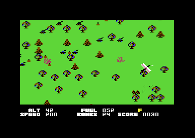
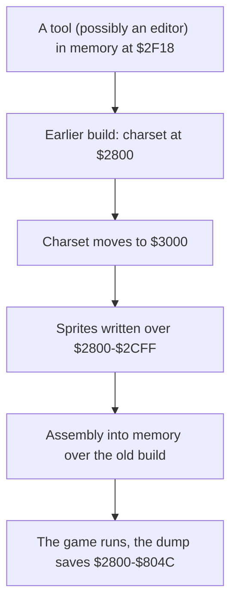

# The development of Blue Max

This page tells what the program shows about its development. The facts come from the code, the texts and the leftovers of the game image `$2800-$804C`. The image holds the bytes of the ANON release, the base release of the knowledge. All three releases hold the same build, so each leftover on this page is in each release. The [releases page](releases.md) tells about the cracks, and the [copy protection page](protection.md) tells about the loader.

**Conventions.**
- Addresses are C64 addresses. Names are the names of the knowledge.
- The *image* is the memory `$2800-$804C` of the game file. The game starts at `$4000`.
- A *leftover* is a range of bytes that the game does not use, or code that no path reaches.
- An *earlier build* is a build of the game that the authors made before the build in the image.
- A *pass* is one run of the main loop. A *frame* is one raster interrupt.
- **Observed** marks a fact that a run or a byte compare showed. **Code** marks a fact from the code or the bytes only. **Conclusion** marks an interpretation.

## The authors and the version

The title screen gives three credits. The top line shows "BOB POLIN'S" above the big logo BLUE MAX. Under the logo, the lines "BY PETER ADAMS" and "COPYRIGHT 1983 SYNAPSE SOFTWARE" follow (**Observed**: the title screen).


Bob Polin designed the game, and Peter Adams wrote the C64 version. The title has a third credit that the player sees only on request. When the player presses F1, [`title_screen` `$70BD`](../src/screen/title_screen.asm#L6) copies "MUSIC PROGRAMMED BY STEPHEN C BIGGS" over the copyright line (**Code**). F1 also opens the options, so the credit and the options come together. The text is in [`text_music_credit` `$7565`](../src/text/music_credit.asm#L6).

The program has no version text and no date other than 1983 (**Code**). The DR release shows "COPYRIGHT 1983 SYNSOFT". This text is a change of the crack, not a second version of the game. The [releases page](releases.md) tells more.

## The image is a memory dump

The image is not a file that an assembler made. It is a copy of the memory of a game that ran. The variables at `$4003-$40F7` hold run-time values in all three releases, for example the score digits and the counters of the map (**Code**). The game start writes over most of them, so the values do not change the play.

The game also needs values that only a loader can put in memory. They are the identity table at `$1000`, the bytes at `$0100-$0101`, a routine at `$0200` and the byte at `$0342` (**Code**). No release has the original loader. The [copy protection page](protection.md) explains these values.

The image has these parts (**Code**).

| Range | Content | Use |
|---|---|---|
| `$2800-$2B7F` | title plane sprites `$A0-$AD` | the title animation shows `$A0-$AB` |
| `$2B80-$2BBF` | sprite `$AE`: old charset bytes | not used |
| `$2BC0-$2BFF` | sprite `$AF`: zero bytes | the blank sprite of the status line |
| `$2C00-$2CFF` | sprites `$B0-$B3`: the letters L, R, P, W | the status line shows L, P and W |
| `$2D00-$2FFF` | old charset bytes and a text | not used |
| `$3000-$37FF` | the charset, copied to `$2000` at the game start | in use |
| `$3800-$3FFF` | the game sprites `$E0-$FF` | in use, except `$FE` and `$FF` |
| `$4000-$7FF1` | the game: entry, variables, code, texts, tunes | in use |
| `$7FF2-$7FFF` | bytes of old code | not used |
| `$8000-$804C` | a copy of the code at `$7E04` | the map buffer `$8000-$977F` writes over it |

## The old charset at `$2800`

The memory `$2B80-$2FFF` holds old charset bytes. The data shows that the charset was at `$2800` in an earlier build. The charset now starts at `$3000`, so the offset is `-$800`.

The evidence is a byte compare (**Observed**: a compare of the bytes of the image):

- [`old_chars_copy_a` `$2B80`](../src/data/graphics_leftovers.asm#L6) holds 96 bytes. They are equal to `$3380-$33DF`, the characters `$70-$7B` of the charset.
- [`old_chars_copy_b` `$2D00`](../src/data/graphics_leftovers.asm#L133) holds `$2D00-$2F17`. These bytes are equal to `$3500-$3717`, the characters `$A0-$E2`, except one character.
- In both copies, the address minus `$2800` gives the number of the character. Thus the characters sat at `$2800` + 8 × the number.

The memory `$2800-$2CFF` held the characters `$00-$9F` of the old charset. The title sprites now fill `$2800-$2B7F`, and the letter sprites fill `$2C00-$2CFF` (**Code**). **Conclusion**: the authors moved the charset to `$3000` and put sprites into its old place. The sprites wrote over the characters `$00-$6F` and `$80-$9F`. The other old characters stayed in memory, and the dump saved them.


### The old road character

The one character that is not equal is `$DA`, at `$2ED0` in the old copy. [`road_row` `$4DCE`](../src/ground/road.asm#L6) fills the map row with this character for a road (**Code**). The two versions are different (**Observed**: a compare of the bytes):

```text
old $2ED0   00 FF 00 FF 00 FF 00 FF   lines of colour 3 on the background
new $36D0   AA AA AA AA AA AA AA AA   a full cell of colour 2
```

**Conclusion**: the road was a striped surface in the earlier build. The authors later made it one flat colour.

### The text after the old characters

The bytes `$2F18-$2FFF` are not character data. They hold PETSCII text and key codes (**Code**):

```text
$2F18  55 55 55 55 FF "NN" ... "WHTTWHHWWC" F3 x21 "1" ... "16611 184"
$2F8C  "WHTTWHHWWC 20 19 18 17 16 15 14 13 12 11 10 9 8 7 6 5 4 3 2 1 0"
$2FC2  "* " CRSR-R CRSR-L CRSR-U CRSR-D HOME CLR RVS "ENMXCTPSA" F1 "LRD+-" F3 "BQOZ" INST DEL
```

The key list comes three times. The count from 20 down to 0 has 21 numbers, and a sprite has 21 rows (**Code**). **Conclusion**: the text is possibly the memory of a tool, for example a sprite or character editor. The tool was in memory before the old charset came there.

### The letter sprites and the blank sprite

[`letter_l_sprite` `$2C00`](../src/data/graphics_leftovers.asm#L40) starts four large letters: L (`$B0`), R (`$B1`), P (`$B2`) and W (`$B3`). The fourth letter, `letter_w_sprite`, is a W. The status line shows L, P and W. No code shows R.


The status line has one sprite, sprite 0 in the status rows. [`status_sprite_ptr` `$4071`](../src/data/variables.asm#L109) holds its pointer, and the frame interrupt copies it to `$0FF8` (**Code**). The game sets these values:

| Pointer | Shape | Set by | When |
|---|---|---|---|
| `$AF` | blank | `game_start`, `plane_service`, `rank_screen` and others | no message |
| `$B0` | L | `plane_landing` | the plane is over an airfield |
| `$B2` | P | `enemy_plane_draw` | an enemy plane is in sight |
| `$B3` | W | `update_wind` | the wind pushes the plane |

No code sets `$B1`, so the letter R is the only unused letter (**Code**). The ANON help page explains P, W and L, but not R (**Observed**: the BASIC help page).

The blank sprite `$AF` is at `$2BC0-$2BFF`. Its first half is the zero bytes of the old characters `$78-$7B`. Its second half is `$2BE0-$2BFF`, 31 zero bytes and `$FF` as the 64th byte (**Code**). The knowledge marks `$2BE0-$2BFF` as a leftover, but the VIC-II reads `$2BE0-$2BFE` for the blank sprite. The default build has zeros there, so the sprite stays blank (**Observed**: the bytes of the default build).

The title plane uses `$A0-$AB` and goes back to `$A0` after `$AB` (**Code**). The sprites `$AC` and `$AD` are thus never on the screen. In the game sprites, `empty_sprite` (`$FE`) and `solid_sprite` (`$FF`) have no user (**Code**).

## Stale code in the image

Three ranges hold code that does not run. Each range tells how the authors built the image.

### The copy of the rank code at `$8000`

The bytes `$8000-$804B` are equal to `$7E04-$7E4F`, byte for byte (**Observed**: a compare of the bytes). This code is a part of the score loops of [`rank_after_mission` `$7DDD`](../src/game/rank.asm#L101). The last byte, `$804C`, is `$00`. The knowledge gives the copy as `$7E04-$7E4E`.

The jumps in the copy go to `$7E02` and `$7E21`, not to `$80xx` (**Code**). Thus the bytes are code for the address `$7E04`, and they are the same as the code that runs. **Conclusion**: the bytes are a copy of the running code, not an older version of it. The cause of the copy is not known.

The range is the start of the map buffer `$8000-$977F`. The game writes map rows over it in play (**Code**). The byte `map_window` at `$802E` is also the first operand of the screen copy. The interrupt replaces it with `map_copy_ptr` (**Code**).

### The old code at `$7FF2`

[`leftover_code_bytes` `$7FF2`](../src/game/rank.asm#L317) follows the last code of the game. The bytes decode as `STA $4087`, `STA $D40B`, `RTS`, then `LDA #$00` and three more bytes (**Code**). The sound effects store their timer in `$4087`, and `$D40B` is the control of SID voice 2. The routines at `$7C6D-$7D21` end with the same stores (**Code**). **Conclusion**: the bytes are the end of a sound effect of an earlier build. That build was longer at its end.

### The older copy at `$537B`

[`city_approach_row` `$5384`](../src/ground/city_water.asm#L6) starts the approach to the city. Nine bytes before it, `$537B-$5383` hold an older form of its first instructions (**Code**):

```text
$537D  AD 41 40   LDA $4041       old copy
$5380  F0 05      BEQ +5
$5382  A9 08      LDA #$08        the old value: 8

$5384  AD 41 40   LDA $4041       the code that runs
$5387  F0 05      BEQ +5
$5389  A9 1E      LDA #$1E        the new value: 30
$538B  8D 41 40   STA $4041
```

The authors changed the value that goes to `$4041` from 8 to 30. The code also moved 7 bytes up (**Code**).

The bytes before `$537F` belong to [`city_shape_buffer` `$52F6`](../src/ground/city.asm#L418), a work buffer of the city buildings. The game fills the buffer at run time, so the file needs no bytes there (**Code**). **Conclusion**: the authors assembled into the memory over an earlier build. The assembler did not write the buffer and the gap after it. Thus these bytes kept the old code. The same method explains the stale data in the rest of the buffer.

## The debug code

Two leftovers hold three routines that no code calls (**Code**). No run executed them (**Observed**: the coverage of all runs).

- [`debug_print_hex` `$5BC2`](../src/leftovers/leftover_5bc2.asm#L6) prints A as two hex digits at `$0F7A`+X. This address is in the status rows. **Conclusion**: the authors showed values on the status line while they tested the game.
- [`debug_monitor_key` `$5CA5`](../src/leftovers/leftover_5ca5.asm#L6) reads keyboard row 0. When F1 is down, it stops the interrupts and jumps to `$CFF8`. The game uses no memory at `$C000-$CFFF`. **Conclusion**: a machine code monitor was in this RAM. F1 stopped the game and started the monitor.
- `debug_beep` at `$5CB6` sets the volume from X and plays a short beep on SID voice 1. Then it waits with `delay`.

The game does not use the keys for these routines any more. F1 now opens the options on the title.

## The disabled invincibility

[`read_keys` `$5D2B`](../src/input/keyboard.asm#L6) reads keyboard row 0 into `$FC` on every second frame. Then it holds a toggle that never runs (**Code**):

```text
$5D46  A9 78      LDA #$78        always not zero
$5D48  D0 13      BNE $5D5D       always jumps over the toggle
$5D4A  AD 80 40   LDA $4080       the toggle: invincible = invincible EOR 1
       49 01 / 8D 80 40
$5D52  8D 32 07   STA $0732       shows the value on the screen
$5D55  20 76 7C   JSR sound_beep_high
$5D58  A0 64 / 20 93 5C          wait (delay)
```

The operand `$78` is the mask of the bits 3-6 of row 0: F7, F1, F3 and F5. The keys give 0 when they are down. With `AND #$78` in place of `LDA #$78`, the result is 0 only when all four keys are down. Then the code toggles the flag `invincible` at `$4080` (**Code**). **Conclusion**: the original instruction was `AND #$78`. The authors turned the cheat off with one byte, `$29` to `$A9`.

The flag still works in the game. Five places read it (**Code**):

1. The main loop does not stop the plane after a crash.
2. The status line code does not run the crash routine.
3. [`plane_control` `$5912`](../src/plane/plane_control.asm#L6) shows the plane as `plane_wedge_sprite` (`$F4`) and clears the motor damage and the fall.
4. The flak shells do not hit the plane.
5. The title screen clears the flag.

The switch `CHEAT_INVINCIBLE` puts `AND #$78` at `$5D46`. No release has this byte, so the patch is a reconstruction. A live run with `$29` at `$5D46` held F1, F3, F5 and F7. The flag went to 1, and the plane flew on at altitude 0 with the crash flag set (**Observed**).

## The demo and the autopilot

The title plays the tune. When the tune ends, the title sets [`demo_mode` `$4093`](../src/data/variables.asm#L297) to 1 and starts a game (**Code**). The tune takes 912 ticks of 3 frames, about 2740 frames. In demo mode, `plane_control` takes the joystick value from [`autopilot_joystick` `$5C10`](../src/input/autopilot.asm#L6) (**Code**).

The autopilot is simple (**Code**):

1. Below altitude 20 it climbs when the speed is 100 or more. Else it gives no direction.
2. Above altitude 20 it keeps its last value on 15 of 16 random values.
3. Else it takes a new direction from a table of 16 values, and fire from a random bit.

The engine sound has the volume 0 in demo mode. After the demo game, the rank screen goes back to the title (**Code**). The demo run showed the plane fly by itself with the score 0030 (**Observed**).



The knowledge comment at `$5952` says "No code sets `$4093`". This is not correct: the title screen sets it (**Code**).

## The bugs of the development

### The rank after the mission

`rank_after_mission` computes the rank from the play time in frames, `play_time` at `$408B-$408D`. It subtracts the options and the score digits from the play time. A short time gives a high rank. The code has three errors (**Code**):

- At `$7DF3` it computes the low byte of play time minus the options, but it does not store it. The high byte then gets the borrow of that sum.
- The loop at [`rank_mission_sub_tens` `$7E21`](../src/game/rank.asm#L137) tests `$D3` but decrements `score_1000` at `$40BF`. When the thousands digit is not 0, the loop does not end.
- At `$7E43` it stores the low result into `play_time_hi` at `$408D`, not into `play_time_mid`.

The mission run had the score 0000, so the loop ended. It showed FLYING TIGER CLASS 2 (**Observed**). The copy at `$8000` has the same errors, so they were already in the code when the authors made that copy (**Code**).

`rank_after_crash` also uses temporary bytes without a start value (**Code**). `$D4` keeps its old value when the score is below 10000. The entry `rank_after_crash_skill` from the loader check uses the old value of `$D3`.

### Wrong table indexes

- `road_vehicle_start` uses a random value AND `#$04` as the index into [`vehicle_colours` `$637E`](../src/enemy/enemy_collision.asm#L39). The table has 4 entries, so the index 4 reads `$AD` from the code at `$6382`. A vehicle is thus black or light green (**Code**). **Conclusion**: the authors wanted `AND #$03`.
- `enemy_explosion_colours` at `$6332` has 16 entries. A collision sets the explosion timer to 20, so the values 16-19 read the code at `$6342` (**Code**).
- `clear_flak_gun` stores 0 into `$40AB` for each gun, not into `$40A9`+Y. Only the gun slot 2 gets cleared (**Code**).

### Code without an effect

- [`remove_special_target` `$6BDF`](../src/enemy/special_targets.asm#L66) computes a random wait of 3-7 and then loads 2 over it (**Code**). **Conclusion**: a test value that stayed in the game.
- The `CLC / ADC #$06` at `$4BE4` has no effect, because the next instruction loads A again (**Code**).
- [`place_trees_flash` `$4BAB`](../src/ground/country_row.asm#L94) cannot run. X is never negative after the `DEX` before it (**Code**). The code would flash the screen.
- `city_approach_row` sets `$4041` to 30 only when the value is not 0 (**Code**). The test looks inverted, but no run reached the city approach with a value that shows it.
- The main loop calls the rank screen from the loader check and has an `RTI` after the call (**Code**). The rank screen never returns, so the `RTI` does not run.

## The NTSC note table

[`music_play` `$7620`](../src/music/music_player.asm#L51) reads the 12 notes of the top octave from [`note_freq_lo` `$77E5`](../src/music/music_player.asm#L265) and `note_freq_hi`. It shifts the value right once for each octave down (**Code**). The first note is `$861E`.

| Clock | SID clock | Note `$861E` | Deviation |
|---|---|---|---|
| NTSC | 1022727 Hz | 2093.0 Hz, C7 | below 0.05 cent for all 12 notes |
| PAL | 985248 Hz | 2016.3 Hz | 65 cents low for all 12 notes |

The table is exact for the NTSC clock (**Code**: the computation of all 12 values). **Conclusion**: the authors made the table for an NTSC C64. On a PAL C64 the tunes play about 2/3 of a semitone low.

The tune advances one tick each 3 frames (`music_tempo` = 3). A PAL C64 has 50 frames each second, not 60, so the tune plays at 5/6 of the NTSC tempo (**Conclusion**).

## Other small traces

- `$43B9-$43BB` holds three NOPs after the loader check. No code reaches them (**Code**). All three releases have them (**Observed**: the captures).
- [`cold_start` `$40F8`](../src/init/game_start.asm#L6) starts with a NOP. All three releases have it (**Observed**: the captures). **Conclusion**: the authors removed one instruction there.
- `$55C3-$55E3` holds 33 zero bytes after a table of the city (**Code**).
- `$6B89` holds a NOP between two instructions (**Code**).
- Six variables have a store but no read: `$4021`, `$4022`, `$402B`, `$402C`, `$4078` and `$409D` (**Code**). The knowledge names them `unread_4021` and so on.

## The leftovers in the rebuild

The switch `LEFTOVERS` keeps 148 bytes in 6 ranges: `$2BE0-$2BFF`, `$43B9-$43BB`, `$537F-$5383`, `$55C3-$55E3`, `$5BC2-$5BD6` and `$5CA5-$5CDA`. Each release build has the leftovers. The default build leaves them out, and the assembler writes zero bytes in their place (**Code**).

The 8 recordings replay on the original and on the default build. Every checkpoint is equal, so the default build plays as the original without the leftovers (**Observed**). A second test fills the memory around the image with junk at the entry. The title, the start and the flight stay the same (**Observed**).

The other leftovers on this page stay in the default build, because the image needs their places. Examples are the old charset bytes, the code at `$8000` and the disabled cheat.

## What the development tells



**Conclusion.**

1. Bob Polin designed the game, Peter Adams wrote the C64 version, and Stephen C Biggs programmed the music.
2. The authors kept the charset at `$2800` first. Later they moved it to `$3000` and put sprites in its place. The old characters show a striped road.
3. They assembled the code into memory over the earlier build. The work buffers kept old code, for example the older `city_approach_row`.
4. They tested with a monitor in `$C000-$CFFF`, a hex print in the status line and an invincibility toggle on the four F keys. They turned off the toggle with one byte.
5. They used an NTSC C64 for the music.
6. The release file is a memory dump of a running game. The original loader put more values into memory, and the game needs them.

## Still open

- Which tool left the text at `$2F18-$2FFF`? A comparison with the C64 sprite and character editors of 1983 can tell.
- Which monitor had its entry at `$CFF8`? A search of the monitors of 1983 for this entry can tell.
- How did the copy of `$7E04-$7E4F` get to `$8000`? An original disk of Synapse can tell, because it has the file before any crack.
- What did the letter R (`$B1`) show on the status line? The Blue Max versions for other computers can possibly tell.
- Does the inverted test of `city_approach_row` change the play? A run that reaches map section 3 with `$4041` = 0 can tell.
- Did the original loader set `$0100`, `$0101`, `$0200` and `$0342` in the same way as the cracks? An original disk can tell.
