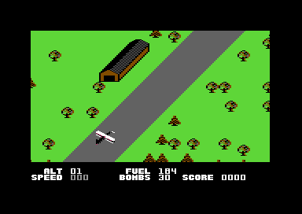
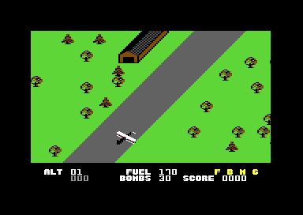

# The game

The player flies a biplane over a landscape that scrolls diagonally. The plane takes off from an airfield, shoots and bombs targets, and lands on the next airfield for fuel, bombs and repairs. This page tells how the program runs a game. It tells about the start, the main loop, the frame interrupt and the states of the plane. It also tells about the controls, the weapons, the damage, the score and the rank at the end. The map has its own page, [map.md](map.md). The enemies have [enemies.md](enemies.md), the screens have [screens.md](screens.md), and the sound has [sound.md](sound.md). The reference lists each routine and variable: [reference/index.md](reference/index.md).

**Conventions.**
- Addresses are C64 addresses. Names are the names of the knowledge.
- A *frame* is one run of the game interrupt, 1/50 second on a PAL C64. The interrupt adds 1 to `frame_count` at the start of each frame.
- An *even frame* is a frame with an even `frame_count`. An *odd frame* has an odd `frame_count`.
- A *pass* is one run of the main loop. The main loop does not wait for the raster, so a frame holds a number of passes.
- A *plane state* is the value of `plane_state`: 0 flight, 1 take-off roll, 3 landing, 4 roll-out, 5 service.
- A *map row* is one diagonal row of the landscape. The map scrolls by one map row each 8 frames.
- A *score unit* is 10 points. `add_score` adds score units, and the last digit of the score is always 0.
- **Observed** marks a fact that a run showed. **Code** marks a fact from the code only. **Conclusion** marks an interpretation.

## The start of a game

The program enters at `$4000` and jumps over the variable block to [`cold_start` `$40F8`](../src/init/game_start.asm#L6). The variable block `$4003-$40F7` holds the values of a game that ran when a cracker made the memory dump. The start code writes the values that the game needs, so the old values have no effect (**Code**).

1. **The cold start runs one time.** It clears the three options, sets the IRQ vector at `$FFFE` and the NMI vector at `$FFFA`, and sets the SID volume value (**Code**).
2. **The title screen.** [`restart_title` `$411D`](../src/init/game_start.asm#L17) turns off the sprites and calls `title_screen`. The title returns at fire, at F7, or at the end of the tune. The end of the tune starts the demo (**Observed**).
3. **The game start.** [`game_start` `$4126`](../src/init/game_start.asm#L23) clears about 70 game variables and sets the start values: 30 bombs, 180 fuel, 8 or 9 targets in `targets_left` (**Code**).
4. **The screens and the interrupt.** It clears the SID and the screens `$0400` and `$0800`, and starts the raster interrupt at line `$DB`. It copies the charset from `$3000` to `$2000` and the status text to the status rows (**Code**).
5. **The first map.** It resets the stack, sets map section 8 (airfield) and builds map rows until the airfield is on the screen. Thus each game starts on a runway (**Observed**).
6. **The loader value.** It copies `$0100` into `plane_state`. The loader leaves 5 there, so the plane starts in the service state (**Code**). [protection.md](protection.md) tells about this value.

The service state fills the fuel from 180 to 200. A game thus starts with 200 fuel, as the help page of the disk tells (**Code**, **Conclusion**).

## The main loop

The main loop does the slow work that does not need the frame clock. It draws the status rows and runs the crash and mission sequences. It also sets the difficulty values, animates characters and changes the map section. The interrupt does all the movement. [`main_loop` `$4349`](../src/game/main_loop.asm#L6) never waits for the raster (**Code**).

~~~mermaid
flowchart TB
  A["Crash or mission end: freeze the game"] --> B["SPACE: pause until fire"]
  B --> C["F7: back to the title"]
  C --> D["F3: the loader check"]
  D --> E["Status rows: score, bombs, altitude, speed, fuel, damage letters"]
  E --> F["Crash sequence or mission end sequence"]
  F --> G["Difficulty values and the next airfield gap"]
  G --> H["Animated characters"]
  H --> I["Next map section"]
  I --> A
~~~

1. **It stops the plane.** When `mission_done` or `crash_flag` is not 0, it sets `game_frozen` and the speed to 0. The flag `invincible` stops this check for a crash (**Code**).
2. **It reads the pause and the function keys.** SPACE, F7 and F3 come from `read_keys` in the interrupt. The section "Pause, F7 and F3" tells the details (**Code**).
3. **It draws the status rows.** [`main_loop_draw_status` `$43BC`](../src/screen/status_line.asm#L6) writes the score, the bombs, the altitude, the speed and the fuel. Below speed 100 the speed is grey and the word SPEED blinks (**Code**).
4. **It runs the end sequences.** With `crash_flag` set, it calls `update_crash`. With `mission_done` set, it calls `update_mission_end` (**Code**).
5. **It sets the difficulty values.** `difficulty` is the number of airfields passed plus the skill level. The gap to the next airfield and `flak_chance` grow with the skill level and the airfields (**Code**).
6. **It animates characters.** `animate_chars` builds the characters with random pixels and masks in the charset at `$2000` (**Code**).
7. **It changes the map section.** `next_map_section` selects the next section when a section ends. [map.md](map.md) tells the details (**Code**).
8. **It sets the height of the obstacles.** When `random_byte` gives 0, `obstacle_altitude` gets a random value from 16 to 19 (**Code**).

The pass also adds 1 to `loop_count`, which `random_byte` mixes into the random seed. The number of passes in a frame thus changes the random numbers (**Code**, **Conclusion**).

## The frame interrupt

[`irq_frame` `$456D`](../src/irq/frame_irq.asm#L6) is the clock of the game. It starts at raster line `$DB`, shows the status rows, and then waits for line `$F8` below the play area. There it sets the play area for the next frame and runs the game (**Code**).

~~~mermaid
flowchart TB
  A["Line $DD: status rows from screen $0C00, hires"] --> B["Wait for line $F8"]
  B --> C["Frame counter, play time, fuel"]
  C --> D["Play area: screen page, fine scroll, colours, flash"]
  D --> E["Sprites, keys"]
  E --> F{"Game frozen?"}
  F -->|"no"| G["Weapons, plane state"]
  G --> H{"Odd frame?"}
  H -->|"no"| I["New map row: swap the screens, copy 22 rows"]
  H -->|"yes"| J["Enemies, plane control, alerts, wind, new map row or drift"]
  F -->|"yes"| K["Music when music_on is set, end of interrupt"]
  I --> K
  J --> K
~~~

### The status split

The interrupt starts at line `$DB` and waits for line `$DD`. It reads the number `$DD` from `$10DD` of the identity table that the loader leaves (**Code**). Then it selects screen `$0C00`, hires characters, 24 rows and the colour of `status_bg_colour`. Fifteen NOPs delay the colour change to the edge of the play area (**Code**, **Conclusion**).

Only sprite 0 shows in the status rows, with the pointer `status_sprite_ptr`. The pointer `$B2` shows the letter P while an enemy plane flies, and `$B3` shows W during the wind. `$B0` shows L during the landing state, and `$AF` is an empty sprite (**Code**). At line `$F8` the interrupt selects the play area again: multicolour characters, the fine scroll and the screen `$0400` or `$0800`.

The wait from line `$DB` to line `$F8` takes about 29 raster lines, or about 1,800 cycles. The interrupt holds the CPU during this time in each frame (**Code**, **Conclusion**).

### The clocks of the frame

The interrupt counts three clocks before it runs the game (**Code**):

- `frame_count` adds 1 in each frame, also during the pause and the rank screen.
- `play_time` is a 24-bit count of the frames of play. It stops while `game_frozen` is 1. The rank after a mission uses it.
- `fuel_tick` counts 50 frames for each unit of fuel, or 25 frames with the fuel damage. At fuel 0 it sets `plane_failing` and stops voice 1, the motor.

200 units of fuel thus last 10,000 frames, 200 seconds. With the fuel damage they last 100 seconds (**Conclusion**).

### Even frames and odd frames

[`update_plane_state` `$6DED`](../src/plane/plane_state.asm#L6) stores bit 0 of `frame_count` in `frame_odd`. On an even frame it runs the routine of the plane state. On an odd frame it returns at once (**Code**). The interrupt then reads `frame_odd` again:

| Frame | The interrupt runs |
|---|---|
| Each frame | `update_weapons`, `read_keys`, the sprite registers, the fuel |
| Even frame | the plane state routine with one scroll step, then the screen swap and the copy after a new map row |
| Odd frame | the motor sound, the enemy plane, the flak guns and shells, `plane_control`, the altitude alert, the obstacles, the wind, the special targets |
| Odd frame with fine X scroll 4 | `build_map_row` adds a new row to the map buffer |
| Odd frame with fine X scroll 2 | `plane_drift` moves the plane |

The plane, the enemies and the alerts thus move 25 times in each second. The bullets and the bombs move 50 times in each second (**Code**, **Conclusion**).

### The scroll and the double buffer

Each even frame in flight calls [`scroll_step` `$6E22`](../src/plane/plane_states.asm#L21). It subtracts 2 from the fine X scroll and adds 2 to the fine Y scroll. The landscape thus moves down and to the left. After four steps, the fine scroll returns to X 6 and Y 0, and `scroll_next_row` moves the map pointer by one map row (**Code**).

A map row thus takes 4 even frames, which is 8 frames. The map scrolls 6.25 map rows in each second, at each speed. The speed value does not change the scroll (**Code**, **Conclusion**).

`scroll_next_row` clears `screen_copy_done`. In the same frame, [`irq_frame_swap_screen` `$46DE`](../src/irq/frame_irq.asm#L182) changes `screen_page_hi` between `$04` and `$08`. Then it writes the operands of the copy code (**Code**):

1. The high bytes of the 22 STA operands get the new screen page.
2. The 22 LDA operands get the map addresses of the rows. Each screen row starts `$80` bytes after the row above: one map row of `$7F` bytes and one column. This gives the diagonal.
3. The number of rows comes from `$0101`, a value that the loader leaves. It must be 22 (`$16`).

[`irq_frame_copy_rows` `$4788`](../src/irq/frame_irq.asm#L254) then copies 22 rows of 40 characters with unrolled LDA and STA pairs. The new page shows from the next frame, together with the reset fine scroll (**Code**). The copy moves 880 bytes in about 8,500 cycles, which is about 135 raster lines. It runs below the play area and in the top border, while the old page still shows (**Conclusion**).

The game thus draws the landscape only one time for each map row. The sprites and the animated characters make the movement between two copies (**Conclusion**).

## The plane states

The plane is on the ground or in the air. `plane_state` holds the state, and `update_plane_state` runs the routine of the state on each even frame. [`plane_service` `$6F07`](../src/plane/plane_states.asm#L133) handles the plane on the runway, and [`map_airfield_rows` `$4A59`](../src/ground/airfield_rows.asm#L6) starts a landing (**Code**).

~~~mermaid
stateDiagram-v2
  state "Flight (0)" as Fly
  state "Take-off roll (1)" as Roll
  state "Landing (3)" as Land
  state "Roll-out (4)" as Out
  state "Service (5)" as Serv
  [*] --> Serv: game start, loader value 5
  Serv --> Roll: fire, or service complete
  Roll --> Fly: speed 200
  Fly --> Land: first airfield row
  Land --> Out: altitude below 3 on the runway
  Land --> Fly: airfield passed
  Out --> Serv: speed 0
~~~

| State | Condition | Next state | Code |
|---|---|---|---|
| Service 5 | fire, or fuel, bombs and repairs complete | Take-off roll 1 | `plane_start_takeoff` |
| Take-off roll 1 | speed reaches 200 | Flight 0 | `plane_takeoff_roll` |
| Take-off roll 1 | altitude 2 or more with speed below 100 | crash | `plane_takeoff_roll` |
| Flight 0 | the first airfield row enters the map | Landing 3 | `map_airfield_rows` |
| Landing 3 | altitude below 3 | Roll-out 4, crash when the plane is not on the runway | `plane_landing` |
| Landing 3 | `airfield_countdown` is not 0 | Flight 0 | `plane_landing` |
| Roll-out 4 | speed 0 | Service 5, mission end when the player destroyed the three special targets | `plane_rollout` |
| Roll-out 4 | the plane leaves the runway | crash | `plane_check_runway` |

The states 2 and 6-255 also run the take-off roll. No code writes these values (**Code**).

### Take-off

`plane_start_takeoff` sets `takeoff_accel` to 1 or 2 at random. Each even frame of the take-off roll adds it to the speed, up to 200 (**Code**). The take-off roll thus lasts 100 or 200 even frames, 4 or 8 seconds. The speed reaches 100 after half of this time (**Conclusion**).

The joystick moves the plane also on the runway. Up climbs, and at altitude 2 or more `plane_takeoff_roll` applies the gravity and tests the speed. Below speed 100 the plane crashes. The weapons work only from speed 100 (**Code**). Up at speed 100 or more lifts the plane off the runway (**Observed**).

In flight the speed stays at 200. Only the take-off, the roll-out and a crash change it (**Code**).

### Landing and roll-out

The airfield section starts with a beep, and the plane goes to state 3. In state 3 the plane flies as in state 0 (**Code**). When the altitude goes below 3, [`plane_check_runway` `$6FCC`](../src/plane/plane_states.asm#L228) reads the character under the plane. The runway characters are `$61-$64`. Each other character sets `crash_flag` (**Code**).

In state 4 the plane rolls on the runway. Each even frame subtracts up to 4 from the speed and checks the runway again. From speed 200 the roll-out takes 50 even frames, 2 seconds (**Code**, **Conclusion**). A touch-down off the runway, or a roll past its end, crashes the plane (**Observed**: several landing attempts).

### Service

In state 5 the plane stands on the runway with altitude 1. `plane_service` does one step on each fourth frame, after a delay of 20 steps (**Code**):

1. It adds 1 to the fuel until the fuel is 200, then it beeps.
2. It adds 1 to the bombs until the bombs are 30, then it beeps.
3. It clears one damage flag each 128 frames, with a beep for each flag.
4. With no damage left, it starts the take-off itself.

Fire starts the take-off at once, also before the service is complete. The runway attacker can attack the plane during the service. [enemies.md](enemies.md) tells the details (**Code**). The landing recording lands, refuels and takes off again (**Observed**).

## Controls and options

The joystick in port 2 flies the plane. [`plane_control` `$5912`](../src/plane/plane_control.asm#L6) reads `$DC00` on each odd frame and keeps the bits in `joy_state` (**Code**).

| Stick | Plane |
|---|---|
| Up (NORMAL CONTROL) or down (PILOT CONTROL) | climb: altitude + 2 |
| The other vertical direction | dive: altitude - 2, sets `diving` |
| Left or right | bank: X - 2 or X + 2, and a crash below altitude 4 |
| Diagonal, climb side | move up on the screen, ground Y - 2 |
| Diagonal, dive side | move down on the screen, ground Y + 2 |
| Fire | shoot |
| Fire with the dive direction | drop a bomb |

The diagonal directions bank the plane and move it on the screen. They do not change the altitude (**Code**).

The plane has two sprites: sprite 0 is the plane and sprite 6 is its shadow on the ground. The X position and the ground Y belong to the shadow. The plane sprite has the Y position of the shadow minus the altitude (**Code**). Near the top of the screen, `climb_blocked` stops the climb and the move up. The plane X stays from `$1E` to `$87`, and the ground Y stays at `$B4` or less (**Code**).

On a bank below altitude 4, [`plane_low_turn` `$5C03`](../src/plane/plane_limits.asm#L6) sets `crash_flag`: the wing touches the ground (**Code**). The drift on each eighth frame moves a plane without stick input down and to the left on the screen (**Code**).

### The three options

F1 on the title shows the options. F3 selects a line, and F5 changes its value (**Observed**). [screens.md](screens.md) shows the option screen.

| Option | Variable | Values | Effect |
|---|---|---|---|
| GRAVITY OFF / ON | `opt_gravity` | 0-1 | with gravity, the plane loses 1 altitude on each eighth frame when the stick is in the centre |
| NORMAL / PILOT CONTROL | `opt_reverse_control` | 0-1 | NORMAL changes the up bit and the down bit, so up climbs |
| BEGINNER / ADVANCED / EXPERT | `opt_skill_level` | 0-2 | more wind and flak, longer gaps between the airfields, a better rank |

`plane_apply_gravity` runs on the even frames where bits 1 and 2 of `frame_count` are 0 (**Code**). With NORMAL CONTROL the code changes bit 0 and bit 1 of the joystick value. Then up climbs and down dives. PILOT CONTROL keeps the bits, so the player pulls the stick back to climb, as in a real plane (**Code**, **Conclusion**).

The skill level goes into three values that the main loop calculates in each pass (**Code**):

- `difficulty` is the airfields passed plus the skill level. The wind starts when the random seed is below it.
- The gap to the next airfield is 136, 160 or 184 map rows for the three skill levels. The main loop adds 0-7 and 8 for each airfield passed. A value of 240 or more becomes 245.
- `flak_chance` is the skill level x 16 plus the airfields passed x 8. The flak guns fire more often with a higher value.

The game thus becomes more difficult with each airfield (**Conclusion**).

### The wind

[`update_wind` `$5E3F`](../src/plane/wind.asm#L6) starts a wind at random in flight. The wind pushes the plane and the enemy plane on each eighth frame. It adds -1, 0 or +1 to X and 0 or +1 to the altitude. The status rows show the letter W while the wind blows. The wind stops on 1 of 16 random values (**Code**).

## The weapons

[`update_weapons` `$6382`](../src/plane/weapons.asm#L6) moves the bullet and the bomb in each frame. The plane has one bullet and one bomb at a time. Both start from the shadow, so they fly at the altitude of the plane (**Code**).

### The bullet

Fire starts a bullet when no bullet flies and the gun is not jammed. Each frame moves the bullet 8 lines up the screen and 4 pixels to the right, along the scroll direction. The bullet ends above line 16 or at X `$A5` (**Code**).

On each frame the bullet can hit a ground object or the enemy plane. [`check_bullet_enemy` `$657A`](../src/plane/weapons.asm#L268) hits the enemy plane only at the same altitude, when the status rows are light blue. The two planes must also be on the same diagonal line, from -2 to +1 (**Code**). A hit gives 10 score units, 100 points. [enemies.md](enemies.md) tells about the targets of the bullet (**Code**).

### The bomb

Fire with the dive direction drops a bomb when no bomb falls, the release is not jammed and `bombs` is not 0. The bomb falls from the altitude minus 6, one unit in each frame (**Code**). [`update_weapons_bomb_lands` `$6444`](../src/plane/weapons.asm#L107) then reads the two map characters under the bomb and selects the effect (**Code**):

- An object character `$80` or more destroys the object. A bridge, a building, a road or an airfield gives points.
- Two characters `$01` show the burst characters `$74` and `$75` for 8 frames.
- Each other ground character makes a crater, character `$6A`, and a short flash.

The bomb on an airfield sets `airfield_bombed`. When the plane is on the ground, the same bomb also hits the plane (**Code**). [map.md](map.md) lists the characters and their effects.

### Jams

The bomb damage and the gun damage do not stop the weapons. They jam them at random. In each frame, a damaged weapon changes its jam flag on 1 of 128 random values (**Code**). A damaged weapon is thus jammed for about half of the time, in periods of about 2.5 seconds (**Conclusion**).

## Damage and crash

### The four damage flags

A flak shell that hits the plane calls [`plane_hit_by_shell` `$6974`](../src/plane/shell_damage.asm#L6). The plane and the border become red, and one of the four damage flags gets set. The search starts at a random flag (**Code**).

| Flag | Letter | Effect |
|---|---|---|
| `damage_fuel` | F | the fuel goes down each 25 frames, not each 50 frames |
| `damage_bombs` | B | the bomb release jams at random |
| `damage_motor` | M | the plane does not move on half of the odd frames |
| `damage_gun` | G | the gun jams at random |

The status rows show the letters, and they blink white and yellow. A hit with all four flags set puts 2 into `plane_failing`: the plane falls with the spin images and crashes (**Code**). The service on an airfield clears the flags (**Observed**).

### The failing plane

`plane_failing` has three values. 0 is normal flight, 1 is a plane without a motor, and 2 is a falling plane (**Code**).

- **No fuel.** At fuel 0 the motor stops. The plane cannot climb and loses 1 altitude on each eighth frame. The gravity adds to this (**Code**).
- **Collision with the enemy plane.** `check_enemy_collision` sets `plane_failing` and `engine_damage`. A random value then replaces the joystick, and the plane loses 1 altitude on each odd frame (**Code**).
- **Four damage flags and one more hit.** The plane falls, 1 altitude in each odd frame (**Code**).

The take-off clears `plane_failing`. A plane without fuel can thus land, if it reaches an airfield (**Code**, **Conclusion**).

### The causes of a crash

Each of these conditions sets `crash_flag` (**Code**):

- The altitude goes below 0 (`update_altitude_alert`).
- The plane banks below altitude 4 (`plane_low_turn`).
- The plane flies below `obstacle_altitude` over a tree or an object character. Below altitude 6 a bridge is safe, and the plane gets a bonus for the flight under it (`check_ground_obstacle`).
- The plane touches down off the runway, or leaves the runway in the roll-out (`plane_check_runway`).
- The plane climbs before speed 100 in the take-off roll (`plane_takeoff_roll`).
- The bomb of the runway attacker explodes on the plane (`enemy_bomb_explosion`).
- The plane flies below altitude 64 over the water of the city (`water_check_altitude`).

### The crash sequence

The main loop sees `crash_flag` and freezes the game. Then it calls [`update_crash` `$68FD`](../src/plane/crash.asm#L6) in each pass. The plane shows the wreck images `$FC` and `$FD`, and the motor stops. `crash_timer` starts at 180. At 179 the explosion sounds and the screen flashes. At 0 the game goes to `rank_after_crash` (**Code**).

`update_crash` runs in the main loop, so `crash_timer` counts passes, not frames. The knowledge calls it "frames of the crash sequence" (**Code**, **Conclusion**).

## The score

The score is five decimal digits in `score_10000` to `score_1`, one digit in each byte. [`add_score` `$5DA6`](../src/game/score.asm#L6) adds A to the tens digit and carries into the hundreds and thousands. `score_1` stays 0 (**Code**). [`draw_score` `$4553`](../src/screen/status_line.asm#L181) shows the first digit only when it is not 0 (**Code**).

| Event | Score units | Points |
|---|---|---|
| A target that counts (`count_target`) | 5 | 50 |
| A bullet on the enemy plane | 10 | 100 |
| A bomb on an airfield | 10 | 100 |
| A bomb on a bridge | 5 | 50 |
| A bomb on a ruin or on rubble | 3 | 30 |
| A bomb on a road | 1 | 10 |
| A special target in the city | 50 | 500 |
| Each frame under a bridge, for 17 frames | 1 | 10 |

`add_score` has no limit for `score_10000`. After 99,990 points the first digit becomes a character after 9 (**Code**). The comments of `bomb_impact` say "points" for score units, for example "50 points" for 500 points (**Code**).

## The rank

At the end of a game the status rows show a rank and a class. The ranks are, from low to high: KAMIKAZE TRAINEE, RUNWAY SWEEPER, AIR CADET, FLYING TIGER, SQUADRON LEADER and BLUE MAX. In a rank, class 1 is the best class (**Conclusion**). Two routines calculate the rank: one after a crash and one after the mission.

### The rank after a crash

[`rank_after_crash` `$7D33`](../src/game/rank.asm#L6) uses the score, the options and the targets:

1. With the three special targets destroyed, or a score of 20,000 or more: FLYING TIGER, class 4.
2. Else it calculates `v` = thousands digit x 10 + hundreds digit. With `v` below 2: KAMIKAZE TRAINEE, class 1.
3. Else it calculates `total` = `v` + `$D4` + gravity x 8 + skill level x 4 + `targets_hit`. `$D4` is 100 when the score is 10,000 or more.
4. With `total` below 20 the rank is RUNWAY SWEEPER, classes 4 to 1 at 3, 6 and 10. Else the rank is AIR CADET, classes 4 to 1 at 33, 48 and 65.

The formula has two defects (**Code**):

- **The ten-thousands digit does not count in step 2.** A score of 10,000 has `v` = 0, so it gives KAMIKAZE TRAINEE. The run that wrote 10,000 into the score showed KAMIKAZE TRAINEE, class 1 (**Observed**).
- **`$D4` keeps an old value below 10,000 points.** The zero-page byte `$D4` is a temporary byte of other routines, for example the altitude step of `plane_control`. The rank after a crash thus depends on a random leftover value (**Conclusion**).

### The rank after the mission

The mission is complete when the plane rolls out on an airfield after the player destroyed the three special targets. `plane_rollout` sets `mission_done`, and the main loop calls `update_mission_end` in 30 passes. Then [`rank_after_mission` `$7DDD`](../src/game/rank.asm#L101) calculates the rank from `play_time` (**Code**). The mission recording showed FLYING TIGER, class 2 (**Observed**).

The plan of the routine is a time with bonuses. It takes the play time in units of 256 frames, about 5 seconds. It subtracts a bonus for the gravity and the skill level, and one for the score. A small result gives a high rank (**Conclusion**).

A negative result gives BLUE MAX, class 3 - skill level. A high byte from 1 to 127 gives FLYING TIGER, class 2. With a high byte of 0, the middle byte selects the rank (**Code**):

| Middle byte | Rank and class |
|---|---|
| 200-255 | FLYING TIGER, class 2 |
| 160-199 | FLYING TIGER, class 1 |
| 120-159 | SQUADRON LEADER, class 4 |
| 100-119 | SQUADRON LEADER, class 3 |
| 80-99 | SQUADRON LEADER, class 2 |
| 60-79 | SQUADRON LEADER, class 1 |
| 40-59 | SQUADRON LEADER, class 4 |
| 20-39 | SQUADRON LEADER, class 3 |
| 0-19 | SQUADRON LEADER, class 3 with skill level 0, else class 2 |

Below 60 the class becomes worse again, with a better time. The code at 40-59 loads the rank index 4 a second time. The index 5, BLUE MAX, would fit the order better (**Conclusion**).

The code has three defects that change the result (**Code**):

1. The subtraction of the option bonus stores no low byte, and it subtracts the bonus from the high byte only.
2. [`rank_mission_sub_tens` `$7E21`](../src/game/rank.asm#L137) tests `$D3` but subtracts 1 from `score_1000`. With a thousands digit that is not 0, the loop does not end. The game then stops at the mission end.
3. [`rank_mission_units` `$7E3C`](../src/game/rank.asm#L150) stores the low result into the high byte `play_time_hi`.

With these defects, the high byte holds the middle byte of the play time minus the hundreds digit. Each value from 1 to 127 gives FLYING TIGER, class 2. That is a mission of about 33 seconds to 11 minutes. A longer mission, from 128 x 256 frames, gives a negative result and BLUE MAX (**Conclusion**). No run reached the BLUE MAX path or the endless loop (**Observed**: coverage).

### The rank screen

[`rank_screen` `$7ED7`](../src/game/rank.asm#L232) writes the rank and the class into the status row, resets the stack and waits in an endless loop. The play area stays frozen behind it. After 5 frames, `rank_screen_input` in the interrupt reads the keys (**Code**):

- A function key, or the demo mode, returns to the title.
- Fire starts a new game at `game_start`.

The rank after the mission also starts the tune, which the frame interrupt then plays (**Code**).

## Pause, F7 and F3

`read_keys` reads the keyboard in the interrupt. On frames with bit 1 of `frame_count` set, it reads F1, F3, F5 and F7 into `fkey_code` (1-4). On the other frames it reads SPACE into `space_key` (**Code**).

- **SPACE pauses the game.** The main loop freezes the game, sets the SID volume to 0 and writes "GAME IN PAUSE" into both screens. Fire on joystick 2 continues the game (**Observed**). The main loop tests SPACE only when bit 1 of the fine Y scroll is 0, on half of the scroll steps (**Code**).
- **F7 returns to the title.** The main loop jumps to `restart_title` (**Observed**).
- **F3 is a copy protection check.** [`main_loop_check_loader` `$43AA`](../src/protection/loader_check.asm#L5) reads `$0342` and wants 4. Else it calls `rank_after_crash_skill`, and the game ends at the rank screen (**Observed**). The default build has no check, so F3 does nothing (**Code**). [protection.md](protection.md) tells the details.
- **F1 and F5 do nothing in a game.** The main loop tests only F7 and F3 (**Code**).

## The demo

When the title tune ends, the title sets `demo_mode` and starts a game. [`autopilot_joystick` `$5C10`](../src/input/autopilot.asm#L6) then gives the joystick value in place of the joystick (**Code**):

1. Below altitude 20, it climbs from speed 100. At a lower speed it gives no direction.
2. Above altitude 20, it keeps the last value on 15 of 16 random values. Else it takes a random direction from `autopilot_dirs` and a random fire bit.

The demo starts with the take-off from the service state, because the autopilot gives no fire. The motor sound has volume 0 in the demo (**Code**). The demo recording showed the plane fly by itself and score 30 points (**Observed**). After a crash, the rank screen returns to the title (**Code**).

The comment of `plane_control` at `$5933` says that no code sets `demo_mode`. That is wrong: `title_screen` sets it at the end of the tune (**Code**, **Observed**).

## Worked example: the two rank screens

**The crash with 10,000 points.** The run wrote 10,000 into the score digits: `score_10000` = 1, the other digits 0 (**Observed**).

1. The three special targets are not destroyed, and `score_10000` is 1, below 2. Thus step 1 does not give FLYING TIGER.
2. `score_10000` is not 0, so `$D4` = 100.
3. `v` = 0 x 10 + 0 = 0. That is below 2, so `rank_index` = 0 and `rank_class` = 1.
4. `rank_screen` writes text 0, "KAMIKAZE TRAINEE", and the class digit `$30` + 1 = "1".

The screen shows "KAMIKAZE TRAINEE CLASS 1" and "SCORE 10000" (**Observed**). With 9,900 points, `v` is 99. With a small `$D4`, the total is 65 or more, and the rank is AIR CADET, class 1 (**Conclusion**).

**The mission with 0 points.** The mission recording ends with score 0 (**Observed**). The ten-thousands, thousands and hundreds digits are 0, so the loops subtract nothing. The high byte of the play time gets the middle byte minus 0. The run took more than 256 and less than 32,768 frames, so the value is from 1 to 127. Thus the rank is FLYING TIGER, class 2, as the screen shows (**Code**, **Observed**).

## Still open

- How many passes of the main loop does a frame hold, in flight and after a crash? A run that counts the calls of `main_loop` over 50 frames can measure it. The answer gives the time of the crash sequence.
- Which values does `$D4` hold at a crash in practice? A run that crashes at different places and reads `$D4` at `rank_after_crash` can show how the rank changes.
- Does a mission of more than 11 minutes give BLUE MAX? A run that writes `play_time_mid` = `$80` before the mission end can show it.
- Does a mission with 1,000 points or more stop the game at the mission end? A run that writes `score_1000` = 1 before the mission end can show it.
- Can a plane without fuel glide to an airfield and land? A run that writes fuel 1 before an airfield can show it.
- The original loader sets `$0100` to 5. Does it also set the other states, for example a start in flight? [protection.md](protection.md) lists the loader values.
