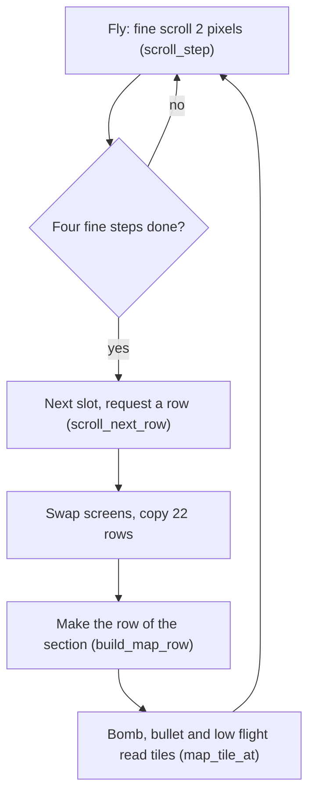
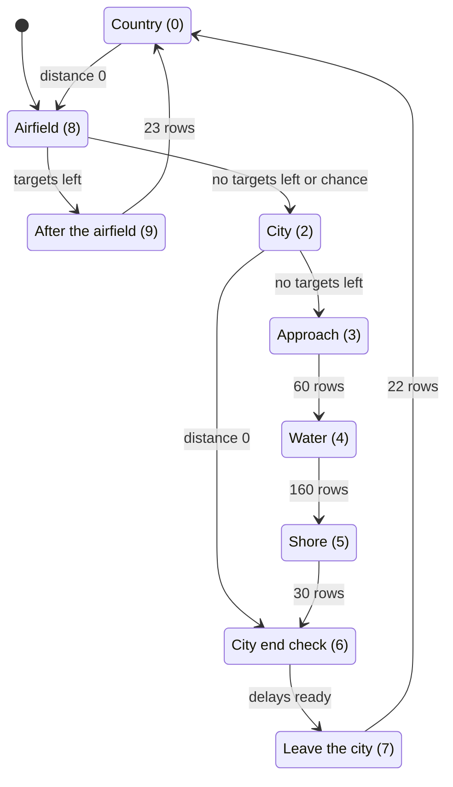
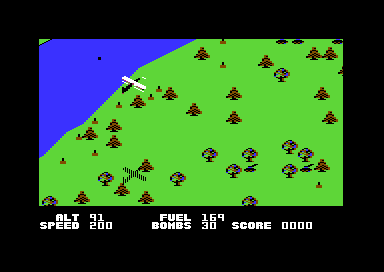
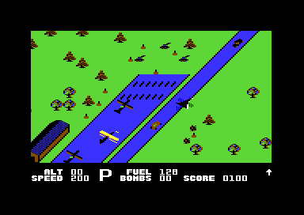
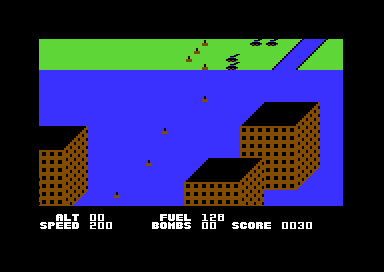
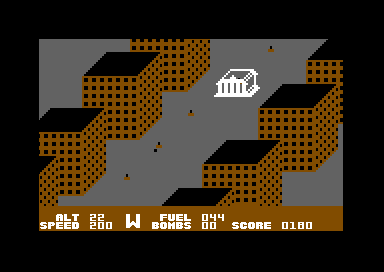

# The map

Blue Max has no stored map. The game makes the landscape one row at a time while the plane flies: river, trees, roads, bridges, ships, buildings, airfields and the city. Each new row goes into a ring buffer of 48 rows. The frame interrupt copies a diagonal window of the buffer to the screen. This page tells how the buffer gives the diagonal scroll and which characters the map uses. Then it tells how the map sections follow each other and how the game makes each part of the landscape. It ends with what a bomb or a bullet does to each tile.

**Conventions.**
- Addresses are C64 addresses. Names are the names of the knowledge.
- A *tile* is one character code in the map buffer. The screen shows it as one multicolour character cell.
- A *map row* is 64 tiles that one call of `build_map_row` makes. A *slot* is the place of a map row in the buffer.
- A *map column* is the index Y of a tile in its map row, 1-64. Some shapes write beyond column 64, into bytes that the screen never shows.
- A *scroll step* is one map row of movement: four fine steps of 2 pixels down and 2 pixels left.
- A *section* is the value of `map_section`. It selects the routine that makes the next map row.
- *Points* are the points on the score line. `add_score` adds A to the tens digit, so A = 1 gives 10 points.
- **Observed** marks a fact that a run showed. **Code** marks a fact from the code only. **Conclusion** marks an interpretation.

## How it works

The map moves one scroll step for each row that the plane flies. At each step, the game makes one new map row out of view at the top. Then the interrupt copies the buffer to the hidden screen and shows it.

1. **The plane state moves the scroll.** The interrupt runs the plane state on every second frame, when `frame_odd` is 0. In flight, [`scroll_step` `$6E22`](../src/plane/plane_states.asm#L21) then adds 2 to `scroll_fine_y` and subtracts 2 from `scroll_fine_x`. After four fine steps it resets the fine scroll and continues in `scroll_next_row` (**Code**).
2. **The next slot.** `scroll_next_row` moves `map_row_ptr` back `$7F` bytes and decrements `map_row_index`. After 48 slots it starts again at `$977F`. It also sets `map_row_request` and clears `screen_copy_done` (**Code**).
3. **The screen copy.** In the same frame, [`irq_frame` `$456D`](../src/irq/frame_irq.asm#L6) swaps the screens `$0400` and `$0800`. It writes 22 source and 22 target addresses into an unrolled copy loop and copies 22 rows of 40 tiles (**Code**).
4. **The new row.** On a frame of the game routines with the fine X scroll at 4, the interrupt calls [`build_map_row` `$4879`](../src/ground/map_row.asm#L6). It writes the slot address into the tables `map_row_lo` and `map_row_hi`, and jumps to the routine of the section (**Code**). The new row is one slot above the window, so it shows only after the next scroll step.
5. **The tile reads.** The bomb, the bullets, the low-flight check and the water section read tiles through `map_tile_at`. It changes a sprite position into a tile address (**Code**).

A scroll step thus takes 8 frames. The map moves about 6 rows each second on a PAL machine (**Conclusion** from the code).

## The map buffer and the diagonal scroll

The buffer has 48 slots, `$7F` (127) bytes apart. Slot k starts at `$802E` + k × `$7F`, so the slots go from `$802E` to `$977F`. A map row fills the first 64 bytes of its slot. The other 63 bytes of each slot are a gap that no screen row shows (**Code**).

Two strides make the diagonal scroll. The game makes the map rows `$7F` bytes apart. The screen copy reads its rows `$80` bytes apart, one slot and one tile more. Screen row j thus shows the map row of slot i + j, from map column j + 1 (**Code**). No byte moves in the buffer. At each scroll step a new row comes in at the top. The larger offset on each lower row then moves the landscape one cell down and one cell left.

[`irq_frame_copy_rows` `$4788`](../src/irq/frame_irq.asm#L254) is the copy loop. It has 22 pairs of `LDA abs,X` and `STA abs,X`, and X counts 39 to 0. Before the copy, the interrupt adds `$80` to the source address for each row. When the count of rows reaches the end of the buffer, the source goes on in slot 0 at `$802E` + j. The number of rows, 22, comes from `$0101`, a byte that the loader leaves (**Code**). The page [protection.md](protection.md) tells about the loader bytes.

A feature at one map column thus shows as a diagonal line on the screen. The river, the roads and the runway run from the lower left to the upper right. A shape of two rows puts its upper row one map column to the left. Then both rows show in the same screen columns (**Code**). The tree, the ship and the boat use this rule. The 2x2 objects use `$80` from the upper row to the lower row for the same reason.

[`map_tile_addr` `$5CE3`](../src/ground/map_tile.asm#L12) does the reverse. It gets the row from (Y − fine Y − `$27`) / 8 + `map_row_index`, modulo 48. It gets the column from (X − fine X / 2 − 12) / 4. Then it adds the row number on the screen again to give the diagonal offset. It gets the high byte through the routine at `$0200` that the loader leaves (**Code**).

The music player uses `$9000-$9016` as its workspace. This range is in the gap of slot 31, but `$900E-$9016` are the first 9 bytes of slot 32 (**Code**). The game plays music only on the title and on the frozen rank screen. `sound_init` sets the workspace again before each tune. Thus the two uses do not meet (**Conclusion**).

## The tile characters

The game copies the charset from `$3000` to `$2000` at the start. The map uses multicolour text. Background colour 0 is `ground_colour` (5, green). Multicolour 1 is `ground_colour2`, normally 6 (blue). Multicolour 2 is 9 (brown) (**Code**).

| Tiles | Meaning | Source |
|---|---|---|
| `$00`, `$20` | Empty ground (both are empty characters) | `fill_map_row`, shapes |
| `$01` | River water, all pixels multicolour 1 | `river_patterns` |
| `$02-$0B` | River banks | `river_patterns` |
| `$0C-$0F` | Round tree, 2x2 | `place_trees` |
| `$10-$13` | Conifer, 2x2 | `place_trees` |
| `$21` | City water, all pixels multicolour 1 | city routines |
| `$22-$2B` | City river banks | `city_river_shape` |
| `$5B`, `$5C`, `$5D`, `$5E` | Crater and ruin tiles | bomb hits |
| `$61-$64` | Runway: middle `$61`, edges `$62`/`$63`, end row `$64` | `runway_shape` |
| `$6A` | Crater | bomb and bullet hits |
| `$70-$75` | Wreck and water burst, with random pixels | hits |
| `$78-$7F` | Broken bridge and rubble, animated | hits |
| `$81-$98` | Buildings: four types of six tiles (roof `+0..+2`, front `+3`, sides `+4`, `+5`) | `building_shape`, `city_build_shape` |
| `$9E`, `$9F` | Ground target pair | `place_ground_targets_any` |
| `$A1` | Flak gun | `place_ground_targets_any` |
| `$A7-$B7` | Hangar | `hangar_shape`, `tile_row_frames` |
| `$B8-$BB` | Ship, 2x2 | `place_ship` |
| `$C1` | Gun on the water | `draw_water_object` |
| `$C4-$CC` | Objects in the canal strip | `tile_row_frames` |
| `$CD-$D8` | City boats: three kinds of 2x2 | `city_place_boat` |
| `$DA` | Road, all pixels multicolour 2 | `road_row` |
| `$DB-$E6` | Bridge | `road_bridge_shape` |
| `$E7`, `$E9`, `$EA` | Canal edges and lines | `tile_row_frames` |
| `$EC-$F1` | Tall buildings in the water section | `water_object_shape` |

The water `$01`, the city water `$21` and the runway middle `$61` all show only multicolour 1 (**Code**). Thus one register colours all three. The airfield sets multicolour 1 to `$0B`, dark grey, for the runway. The colour stays dark grey until the game leaves the airfield or the city (see [The airfields](#the-airfields) and [The city](#the-city)).

[`animate_chars` `$7001`](../src/screen/animate_chars.asm#L6) changes some tiles each pass of the main loop (**Code**):
- `$70-$75` get random pixels, so wrecks and bursts flicker.
- `$78-$7F` use bytes of the code of `build_map_row` and `city_row` as masks. The frame counter moves the masks, so rubble and broken bridges flicker.
- The six tiles of a building type flicker when the flag `building_kind_hit` of the type is set. A bomb on one building thus makes all buildings of the same type burn. A new building of the type clears the flag (**Conclusion** from the code).
- The hangar tiles flicker when `airfield_bombed` is set.

## The state machine of the sections

`map_section` selects the routine of the next row. [`next_map_section` `$5DE4`](../src/ground/map_section.asm#L6) makes the changes at the end of an airfield and of the city. The row routines make the other changes. The main loop calls `next_map_section` on each pass, and it acts only when `section_end` is set (**Code**).

| State | Condition | Next state | Code |
|---|---|---|---|
| Country 0 | `airfield_countdown` gets to 0. It counts on every second row. | Airfield 8 | `build_map_row_plain` |
| Airfield 8 | Airfield done, `targets_left` not 0 and `targets_hit` below 2 | After the airfield 9 | `next_map_section` |
| Airfield 8 | Airfield done, `targets_hit` 2 or more, random value negative | City 2 | `next_map_section` |
| Airfield 8 | Airfield done, `targets_left` = 0 | City 2 | `next_map_section` |
| After the airfield 9 | `section_step` counts 23 rows to 0 | Country 0 | `map_airfield_end_rows` |
| City 2 | `airfield_countdown` gets to 0 | City end check 6 | `city_row` |
| City 2 | `targets_left` = 0 and the strip delay runs | Approach 3 | `city_row`, `next_map_section` |
| Approach 3 | `section_step` = 60. It counts only while the river runs straight. | Water 4 | `city_approach_row` |
| Water 4 | `section_step` = 160 | Shore 5 | `city_water_row` |
| Shore 5 | `section_step` = 30 | City end check 6 | `city_shore_row` |
| City end check 6 | `city_strip_wait`, `city_building_wait` and `building_wait` are all not 0 | Leave the city 7 | `city_exit_check` |
| Leave the city 7 | River at the edge, then 22 rows | Country 0 | `city_exit_row` |

Section 1 has an entry in the jump table, the same `city_row` as section 2. No code of the game writes 1 to `map_section`. The title uses the variable as a counter, but `game_start` sets it to 8 (**Code**). A value of 10 or more resets the section to 0. No run executed that code (**Observed** in the coverage).

The branch from section 2 to section 6 in `next_map_section` needs `section_end` with targets left. `city_row` sets `section_end` only when no target is left. No run executed the branch (**Code**, **Observed** in the coverage).

A game thus has this order. Country and airfields alternate. After the player destroys two marked targets, each airfield leads to the city with a chance of one half. The city without the last targets ends after a distance. When no target is left, the city goes on to the water section with the three special targets (**Conclusion** from the code).

## The open country

[`country_row` `$4B16`](../src/ground/country_row.asm#L6) makes a row of section 0. It clears the row and then adds the parts in this order: river, road, trees, ship, building and ground targets. Each part has its own delay counter in rows. A part starts only when its delay is 0 and the other parts let it (**Code**).

The river and the trees in the open country.

### The river

[`draw_river_row` `$4920`](../src/ground/river.asm#L6) copies 20 tiles of one of four patterns. The pattern ends at the map column `river_column`. `river_dir` gives the direction: 1 straight, 2 left, 3 right. `river_steps` counts the rows of the direction (**Code**).

| Pattern | Use | Tiles |
|---|---|---|
| 0 | Left, on the rows where the column moves | `$00 $03`, 17 × `$01`, `$05` |
| 1 | Left, on the other rows | `$00 $02`, 17 × `$01`, `$04` |
| 2 | Straight | `$00 $06`, 17 × `$01`, `$07` |
| 3 | Right | `$08 $09`, 16 × `$01`, `$0A $0B` |

A straight run lasts 2 to 5 rows. A turn to the right moves the column one tile each row. A turn to the left moves it one tile on every second row. On the screen a left turn thus goes down to the left at a steeper angle (**Conclusion**). Below column 18 the river always turns right. At column 40 or more it always turns left. Between them, a random value selects the direction (**Code**).

Other parts can ask for a direction through `river_turn_request`. A road and a building need a straight river. The airfield asks the river to leave the map row. [`river_steer_off_screen` `$4AE6`](../src/ground/river_steer.asm#L6) asks for the nearer edge and returns C = 1 when the column is below 2 or at `$4F` or more (**Code**).

### The trees

[`place_trees` `$4B2E`](../src/ground/country_row.asm#L17) first completes the trees of the last row. It writes the top tiles one map column to the left of the lower tiles. Then, when `trees_enabled` is not 0, it makes up to 6 tries at random columns for 0-7 new trees. A tree needs three empty tiles. No tree goes from 10 columns left of `river_column` to the river column (**Code**). Each row selects one kind for all its new trees: round tree or conifer. The airfield, the road, the building and the city switch the trees off for some rows.

### The road and the bridge

[`road_row` `$4DCE`](../src/ground/road.asm#L6) starts a road when its delay `road_wait` is 0 and the river runs straight. It also needs `road_block` and `airfield_active` at 0 and `boat_wait` at 20 or more. The road sequence takes 7 rows (**Code**):

1. The start row switches the trees off. It can make the new bridge a marked target (see [Ground targets and special targets](#ground-targets-and-special-targets)).
2. Phase 6: two groups of ground targets and a road vehicle.
3. Phases 4 to 1: one bridge row each. Phases 3 and 2 first fill the row with the road tile `$DA`.
4. The last row: the next road after 16-80 rows. Two groups of ground targets, trees on, and 4 more straight river rows.

`road_bridge_shape` has 20 tiles for each bridge row. The routine copies them from right to left. The last tile is at `river_column`, so the bridge is always on the river. The bridge rows use the tiles `$DB-$E6`, and the row of phase 2 is 20 tiles of `$DB` (**Code**). The road fill writes Y = `$40` down to 0. Y = 0 is the byte before the slot, a gap byte that the screen never shows (**Code**).

### The ship

[`place_ship` `$4BB3`](../src/ground/country_row.asm#L100) puts a 2x2 ship on the river, 4 to 7 columns left of `river_column`. It writes the lower half `$BA $BB` in one row and the upper half `$B8 $B9` in the next row. The next ship comes after 16-63 rows. A ship waits while `road_wait` is below 5 or `boat_wait` is below 10 (**Code**). `add_flak_gun` records the ship as a gun position (**Code**). The page [enemies.md](enemies.md) tells about the flak.

The CLC and ADC at `$4BE4` have no effect: the next LDA replaces the result (**Code**).

### The buildings

[`place_building` `$4C13`](../src/ground/country_row.asm#L151) puts a building to the right of a straight river. In section 2 it goes 5 columns further left. It needs `quiet_timer` at 0, a road delay of 8 or more and a river column below 48. The building sequence takes 8 rows. Phases 7 to 4 put ground target pairs at random free tiles right of the building. Phases 3 to 0 draw the rows 3 to 0 of `building_shape`, so the roof comes last and is on top. The routine adds the type offset to each tile, `$20` stays as it is, and 0 keeps the tile below (**Code**).

| Row of `building_shape` | Tiles (type 0) |
|---|---|
| 0 | `$81 $82 $82 $82 $82 $83 $20`: roof |
| 1 | `$81 $82 $82 $82 $82 $83 $85 $20`: roof and side |
| 2 | `$84 $84 $84 $84 $84 $85 $86 $20`: front and side |
| 3 | `$84 $84 $84 $84 $84 $86 $20`: front and side |

`pick_building_type` selects one of four types at random. The type gives a tile offset of type × 6. The country building never has the type of the city building (**Code**). In phase 5, before the building shows, `place_building_special` can make it a marked target (see [Ground targets and special targets](#ground-targets-and-special-targets)).

### The ground targets

[`place_ground_targets_any` `$4D71`](../src/ground/country_row.asm#L324) puts a flak gun `$A1` at a random column left or right of the river. It registers the gun with `add_flak_gun`. Then it adds target pairs `$9E $9F` near the gun while the tiles are empty (**Code**). `place_ground_targets` does nothing while `quiet_timer` runs. The airfield sets that timer.

## The airfields

The game starts on an airfield. `game_start` sets section 8 and makes map rows until the runway counter `airfield_rows` is 14. The plane then stands on the runway, and about 14 runway rows are left in front of it (**Code**).

The start on the runway, with the hangar on the left.

[`map_airfield_rows` `$4A59`](../src/ground/airfield_rows.asm#L6) makes the rows of section 8 in three phases (**Code**):

1. While the river is on the map row, it makes country rows and asks the river to leave.
2. Then it makes 23 empty rows with trees and targets. The first of them sets `plane_state` to 3, so the plane can land, and plays a high beep.
3. Then [`airfield_row` `$4F08`](../src/ground/airfield.asm#L6) makes the airfield. It sets multicolour 1 to dark grey.

`airfield_row` counts `airfield_rows` from 50. Each of the next 49 rows gets the runway at the map columns 27-36: `$62`, seven `$61`, `$63` and `$20`. The first and last runway rows use `$64` for the end. The rows with a counter of 17-24 also get the hangar at the columns 18-25 (**Code**). At the end, the routine sets the next distance, counts `airfields_passed`, delays the road and sets `section_end`.

The main loop sets the distance `airfield_gap` on each pass. It is the base of the skill level plus a random value 0-7, plus 8 for each airfield passed. The bases are 136, 160 and 184, and the limit is 245. `airfield_countdown` counts once on every second row, so the next airfield comes after about twice the gap in rows (**Code**). A higher skill and more airfields thus give longer flights between the airfields.

Section 9 makes 23 empty rows with trees and targets after the airfield. At its end it sets multicolour 1 back to blue (**Code**). Water on the screen thus shows grey until then (**Conclusion**).

## The city

The city has sections 2, 6 and 7 for the streets and buildings. Sections 3, 4 and 5 make the water with the special targets. The game enters the city only from an airfield. Thus multicolour 1 stays dark grey for the full city. Section 7 sets it back to blue at the end (**Code**).

### The city rows

[`city_row` `$5066`](../src/ground/city.asm#L63) makes the rows of sections 2 and 6. It clears the row and moves the city river to the map column 41. `city_river_row` draws 8 tiles of `city_river_shape` that end at the river column. The city river uses the tile `$21` and its own banks (**Code**). In the grey city it shows as a grey street (**Conclusion**).

Then the row gets a city building, the canal strip, trees, a country building, ground targets and a boat. A river bend holds the boats for 5 rows and the buildings for 8 rows (**Code**).

[`city_build_shape` `$522E`](../src/ground/city.asm#L308) makes a random building in `city_shape_buffer` at `$52F6`. It is 1 or 3 tiles deep, 3-6 tiles wide and 1-4 steps high. The buffer rows are 16 tiles plus 1 apart, so each row moves one tile for the diagonal map (**Code**). `city_building_row` then copies one buffer row to each map row, to the left of the river. The bytes of the buffer in the file are stale contents from a run (**Code**). The page [development.md](development.md) tells about them.

`city_place_boat` puts one of three 2x2 boats `$CD-$D8` on the river, 6 columns left of the river column. A row gets a boat with a chance of 1 in 8. The kind comes from the random seed, and one value of four gives no boat (**Code**).

### The canal strip

[`city_strip_row` `$5659`](../src/ground/city_strip.asm#L6) draws a strip of 20 rows at the map columns 18-33. It copies the rows from `tile_row_frames`, 16 tiles each. The left half is a hangar `$A7-$B7`. The right half is a canal of `$21` with the edges `$E7` and `$E9`, lines of `$EA` and diagonal objects `$C4-$CC` (**Code**). A bomb on the objects `$C4-$CC` gives 100 points.

The strip uses `airfield_rows` as its row counter, from 20 down to 1. The index is the counter × 16 in 8 bits. Rows 20 to 16 thus use frames 4 to 0, and rows 15 to 1 use frames 15 to 1 (**Code**). The table has only 16 frames, and the overflow of the shift keeps the index in the table.

The canal strip with the hangar and the objects in the water. The run wrote section 2 after the take-off. Multicolour 1 was blue again, so the canal and the river show blue (**Observed**).

### The water section

[`city_approach_row` `$5384`](../src/ground/city_water.asm#L6) makes section 3. It steers the river to column 41 and adds city buildings and ground targets. After 60 straight rows it starts section 4 and sets the counters of the water objects (**Code**).

[`city_water_row` `$53F1`](../src/ground/city_water.asm#L55) fills each row of section 4 with `$21`. `draw_water_objects` then draws four tall buildings from `water_object_shape`. Two buildings end at the map column 26, and two end at column 52. Each building has 12 rows of `$EC-$F1` (**Code**). The picture below shows a black roof and a brown front with windows (**Observed**). After the building, a counter restarts it, so the buildings come again and again. After 144 rows no new building starts, and after 160 rows section 5 starts. On some rows the routine also puts a gun `$C1` at the columns 27-30 (**Code**).

The water section with the tall buildings. This run wrote section 3 without an airfield before it, so multicolour 1 was blue (**Observed**).

The same section later in the same run, after the plane passed an airfield. Multicolour 1 is dark grey, and the white special target is in the centre (**Observed**).

The two pictures show the same tiles in two colours. In a normal game the water section always comes after an airfield. Thus a player sees a grey city square with tall buildings, not water (**Conclusion**).

From row 20 of section 4 to row 11 of section 5, [`check_plane_zone` `$55E4`](../src/ground/city_water_55e4.asm#L6) reads the position of the plane shadow across the map. It uses `map_diagonal`, X + Y / 2 (**Code**). Four zones set the sprite priority of the plane and its shadow. In two zones, an altitude below 64 sets `crash_flag` (**Code**). Thus the plane must fly above the tall buildings (**Conclusion**). No run executed the zone of 239 or more.

[`city_shore_row` `$5432`](../src/ground/city_water.asm#L91) makes section 5: the river and ground targets on empty ground, 30 rows. Then section 6 checks the delays, and section 7 steers the river to the right edge. After 22 rows, section 7 returns to the open country with the river at column 4 (**Code**).

### The special targets

[`special_targets_update` `$5876`](../src/ground/special_targets.asm#L6) shows the three special targets in sections 4 and 5. They are sprites, not tiles. Each target is sprite 7, expanded, image `$F9`, white. It starts at the upper right. On each frame of the game routines it moves with the landscape: `enemy_shadow_x` − 1 and `enemy_shadow_y` + 2. At Y `$FA` the next target follows. A destroyed target shows the black wreck `$F8` (**Code**).

[`bomb_impact` `$57CB`](../src/ground/bomb_impact.asm#L6) checks the bomb only in section 4 (**Code**). A target that is still on the screen in section 5 thus cannot take a bomb (**Conclusion**). A bomb below height 2 within 20 units of the target X and in the Y box hits it. The flags `special_targets` record the three hits. The hit gives 500 points (**Code**). After the three hits, a landing completes the mission. The page [game.md](game.md) tells about the mission end.

At fall height 40, a bomb in section 4 also hits the roof tile `$ED` of a tall building. The roof becomes `$5C` and gives 20 points (**Code**). Below height 2 without a target, the bomb makes a crater `$5B` and gives 10 points (**Code**). No run executed these bomb paths.

## Ground targets and special targets

The map has two kinds of target. Each tile object takes bombs and bullets for points. A *marked target* also counts for the mission. `targets_left` starts at 8 or 9 (**Code**).

[`pick_special_target` `$6B72`](../src/enemy/special_targets.asm#L6) decides if the next object is a marked target. A new building and a new road call it. The count `special_wait` must get to 0, no marked target may be on the map, and no enemy plane may fly (**Code**). The game then puts sprite 7 as a flashing cross box on the object:
- A building in phase 5 of its sequence, through `place_building_special`. `special_kind` is the type of the building.
- A bridge at the start of a road. `special_kind` is `$80`. The start row sets the sprite image `$D3`, but `update_special_marker` sets the cross box `$F3` on the next frame (**Code**).

A bomb on any building of the marked type counts the target. The type, not the building, is the key (**Conclusion** from `update_weapons_target`). A bomb on the bridge counts a marked bridge. `count_target` then increments `targets_hit`, decrements `targets_left` and gives 50 points (**Code**). The page [enemies.md](enemies.md) tells about the cross box.

## Hits on the map

[`update_weapons` `$6382`](../src/plane/weapons.asm#L6) ends the fall of a bomb on the map. It reads the tile under the bomb, at sprite X + 2, and the tile to the right of it. A tile of `$80` or more is an object. Else the tiles are ground (**Code**).

| Tiles under the bomb | Effect | Points |
|---|---|---|
| Both 0 | Crater `$6A` on both tiles | 0 |
| `$01` (water) and 0, or both `$01` | Burst `$74 $75` for 8 frames, then water again | 0 |
| Other ground | Crater `$6A`, but not on water tiles | 0 |
| `$A7-$B7` hangar | Hangar burns. When the plane is not in flight, `flood_colour_ram` fills the colour RAM and sets the crash state | 100 |
| `$C4-$CC` canal objects | Rubble | 100 |
| `$B8-$BB` ship | Wreck `$70-$73` and gun removed | 50 |
| `$81-$98` building | All buildings of the type burn, marked target counts | 50 |
| `$CD-$D8` boat | Ruin `$5D $5E` / `$5B $5C` | 30 |
| `$9E`, `$9F`, `$A1` in the row above | Rubble `$7C-$7F` | 30 |
| `$DB-$E6` bridge | Broken bridge `$78-$7B`, marked bridge counts | 50 |
| `$DA` road | Broken road `$78-$7B` | 10 |
| Other tiles of `$80` or more | Rubble one row above, the bomb does not end | 0 |

The hits on an object also make the screen flash and shake (**Code**). The page [game.md](game.md) tells about the bombs and the bullets.

The last row of the table is a defect. `draw_rubble` returns without `end_bomb`, so the bomb stays on the ground (**Code**). The hangar path has the same result. After `add_score`, A holds a score digit and not the tile, so the tile tests go on to `draw_rubble` (**Code**). No run executed these paths. A bomb on the hangar can thus hit again on the next frames and give 100 points each time (**Conclusion**, not checked in a run).

[`bullet_hit_ground` `$6660`](../src/ground/ground_hits.asm#L6) checks the tile under a bullet only in low flight (`low_flight`). A target pair or a gun becomes a crater `$6A` for 10 points. A ship takes three bullets. The third bullet gives 50 points, and `destroy_object` gives 50 more. A boat becomes a ruin for 10 points. Below altitude 6 a bullet passes under a bridge (**Code**).

[`check_ground_obstacle` `$69B2`](../src/ground/obstacles.asm#L6) reads the tiles under the shadow, at X + 5. Trees `$0C-$19` and the tiles of `$80` or more are obstacles, except the road `$DA`. The tile to the right counts only as a tree. Below `obstacle_altitude` an obstacle sets `crash_flag`. The main loop sets `obstacle_altitude` to 16-19 at random (**Code**). Below altitude 6, the bridge tiles `$DB`, `$DF` and `$E3` are safe and start 17 frames of bonus, 10 points each frame. The plane flies under the bridge (**Code**). No run flew under a bridge.

## A worked example

The BANDIT release is a memory dump of a running game. Its copy loop at `$4788` and its bytes at `$8000-$804C` show the buffer in use (**Observed**: the bytes of the release, as the switch `RUN_STATE_BANDIT` puts them in).

The 22 source operands of the copy loop are these (**Observed**):

| Screen rows | Source addresses | Step |
|---|---|---|
| 0-15 | `$900E`, `$908E`, `$910E` ... `$978E` | `$80` |
| 16-21 | `$803E`, `$80BE`, `$813E`, `$81BE`, `$823E`, `$82BE` | `$80` |

The formula gives the same addresses (**Code**):
1. `$900E` = `$802E` + 32 × `$7F`. The window starts in slot 32, so `map_row_index` was 32.
2. Screen row 15 reads slot 47 at `$977F` + 15 = `$978E`.
3. Screen row 16 goes past slot 47. The code sets the source to `$5E` − 32 = `$3E` in page `$80`. That is slot 0 at `$802E` + 16.

Slot 0 holds a map row. These are its first bytes in the dump (**Observed**):

| Address | Map column | Tile | Meaning |
|---|---|---|---|
| `$802E-$802F` | 1-2 | `$00 $00` | Empty ground |
| `$8030-$8031` | 3-4 | `$0E $0F` | Lower half of a round tree |
| `$8032-$8047` | 5-26 | `$00` | Empty ground |
| `$8048` | 27 | `$62` | Left edge of the runway |
| `$8049-$804F` | 28-34 | `$61` | Runway |
| `$8050` | 35 | `$63` | Right edge of the runway |
| `$8051` | 36 | `$20` | Empty ground |

The BANDIT file holds `$2800-$8FFF`, so the bytes after `$804C` come from the file and not from the switch. The runway at the map columns 27-36 is the middle row of `runway_shape`, as `airfield_row` writes it (**Observed**: the bytes of the file). The tree tiles agree with the lower row of a round tree (**Code**). The ANON release has stale code at `$8000-$804C`, so it shows no map there. Its first map row overwrites the stale bytes from `$802E` (**Code**).

## Still open

- `$8000-$802D` in the BANDIT dump hold `$14 $80 $14 $80 ...` and a rising list `$6C-$77`. No slot starts there. Which code writes these bytes? A watchpoint on `$8000-$802D` in a long flight can show it.
- An object at the wrap from slot 47 to slot 0 has its rows in slots that are not `$80` apart. A hit there writes the second row of rubble or a wreck into the gap after slot 47 (**Conclusion**). A run with a bomb on a ship in slot 47 can show it.
- The hangar hit path is not executed. A run that bombs the hangar of an airfield can show the score and the end of the bomb.
- Only a run that wrote the section executed the change from section 6 to 7 by the distance, without the special targets. A long game that destroys two marked targets can show the normal path.
- The zone values of `check_plane_zone` (`$88`, `$B3`, `$EF`) are not compared with the screen positions of the tall buildings.
- No run flew under a bridge or hit a building, a boat or a canal object with a bomb.

The reference has each routine: [map row](reference/modules/ground/map_row.md), [map section](reference/modules/ground/map_section.md), [map tile](reference/modules/ground/map_tile.md), [river](reference/modules/ground/river.md), [country row](reference/modules/ground/country_row.md), [road](reference/modules/ground/road.md), [airfield](reference/modules/ground/airfield.md), [city](reference/modules/ground/city.md), [city water](reference/modules/ground/city_water.md), [city strip](reference/modules/ground/city_strip.md), [bomb impact](reference/modules/ground/bomb_impact.md), [ground hits](reference/modules/ground/ground_hits.md).
