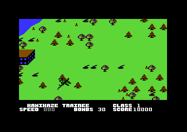

# The copy protection of Blue Max

Blue Max has no disk check in the game code. Its protection is the memory state that the original loader leaves behind. The game reads a table, two bytes and a small routine that only the loader puts in memory, and one byte in the tape buffer. This page tells which marks the game reads, where it reads them, and what happens when a mark is wrong. It also tells what each of the three cracks did, and how the switches of the rebuild turn the protection off.

**Conventions.**
- Addresses are C64 addresses. Names are the names of the knowledge.
- The *loader* is the original loader of the disk. No release of the project has it as a file.
- A *mark* is a value that the loader leaves in memory and that the game reads but never writes.
- The *identity table* is a page that holds the bytes `$00, $01, ... $FF`: each byte has the value of its offset.
- The *starter* is the small program of a crack that writes the marks and jumps to the game entry `$4000`.
- **Observed** marks a fact that a run or a read of a file showed. **Code** marks a fact from the code only. **Conclusion** marks an interpretation.

## The scheme

The game file holds `$2800-$804C`. It does not hold the pages 0-3 or the RAM under the I/O area. The game reads these marks there (**Code**):

| Mark | Value | Read by | What the game does with it |
|---|---|---|---|
| `$D100-$D1FF` | identity table | `copy_d100_table` | Copies it to `$1000-$10FF` at each start of the title |
| `$1000-$10FF` | identity table | game start, frame interrupt | Reads `$1000` as the start value of `engine_damage` and `$10DD` as the raster line `$DD` |
| `$0100` | `$05` | game start | Start value of `plane_state`: 5 is the service on the airfield |
| `$0101` | `$16` | frame interrupt | Number of map rows (22) that the screen copy prepares |
| `$0200-$0204` | `STA $FC / LDA $FB / RTS` | `map_tile_addr` | A subroutine that the game calls for each map tile look-up |
| `$0342` | `$04` | main loop, key F3 | Must be 4, else the game ends |

All marks except `$0342` are silent. The game uses them as normal data and code, and a wrong value damages the play. Only `$0342` has a real check with a compare and a branch (**Code**).

**Conclusion:** the authors replaced constants and two instructions of the game with reads of loader memory. For example, the frame interrupt does `LDA $10DD` in place of `LDA #$DD`. A copy of the game file alone thus has no table, no routine and no start values.

~~~mermaid
flowchart LR
  L["Original loader"] --> T["Identity table at $D100"]
  L --> S["Stack page: $0100, $0101"]
  L --> R["Routine at $0200"]
  L --> B["Tape buffer: $0342 = 4"]
  T --> C["Title start: copy to $1000"]
  C --> I["Frame interrupt and game start"]
  S --> G["Game start and screen copy"]
  R --> M["Map tile look-up"]
  B --> F["F3 in flight: the check"]
~~~

## The original loader in the Bandit dump

No release has the original loader as a file. But the Bandit release holds a memory dump of the pages 0-3 of a game that ran, the file BLUE.B000-B400 on its disk. Its stack page and the start of page 2 hold the code of a disk loader (**Observed**: a read of the file).

```text
$0100  05 16 04                 ; the marks $0100-$0102
$0103  LDA #$02 / LDX #$08 / LDY #$02 / JSR SETLFS
       LDA #$01 / LDX #$A1 / LDY #$01 / JSR SETNAM  ; name "#" at $01A1
       JSR OPEN / LDA #$00 / STA $3000 / RTS        ; open a drive buffer
$011E  read 256 bytes from channel 2 to ($FE)
$012E  send the 12 characters at $0195 on channel 15
$0149  write the sector number $3000 as two digits at $019F
$0163  SEI, $D021 = 0, $D020 = 2, ($FE) = $4000
       loop: open, set the sector, send, read, INC $3000, INC $FF
       until $3000 = $10
$018F  JSR CLRCHN / JMP ($4003)
$0195  "U1:2,0,12,15" "#"
$0200  STA $FC / LDA $FB / RTS  ; the mark $0200
$0205  JMP $0163 / JMP $0180 / JMP $0153
```

The loader reads the sectors 0-15 of track 12 with `U1` block reads. It puts the 16 sectors at `$4000-$4FFF`, and then it jumps through the vector at `$4003` (**Code**: the bytes of the dump). The bytes from about `$01A2` are not loader code. They are the stack of the game that ran (**Conclusion**).

This dump explains the marks of the stack page and of page 2:

- `$0100-$0102` (`05 16 04`) are the first three bytes of the loader. The game reads `$0100` and `$0101` as data. No code reads `$0102` (**Code**).
- `$0200` is the start of the jump area of the loader. The game calls its first 5 bytes as a subroutine (**Code**).
- Page 2 also holds the end of the tokenized command `CLR:LOAD"BLUE*",8,1` in the BASIC input buffer (**Observed**).

**Conclusion:** the player loaded a file "BLUE*" with `,8,1` into the stack page and page 2. That file is the first stage of the loader. Its 16 sectors at `$4000` are most likely the next stage, because the game has a variable block at `$4003`, not a vector. The dump keeps no trace of that next stage.

Page 3 of the same file holds `$20` (space) in each byte, except `$0300` = 2, `$0330` = 3 and `$0342` = 4 (**Observed**). This is the only release file that holds the value 4 at `$0342`.

## The checks

### The identity table

[`copy_d100_table` `$5ED8`](../src/protection/d100_table.asm#L6) copies the RAM under the I/O area at `$D100-$D1FF` to `$1000-$10FF`. It turns the I/O off with `$01`, reads the page with a self-modified operand, and puts `$01` back. `sound_init` calls it, and `sound_init` runs at each start of the title and after the rank screen of a full mission (**Code**).

The game reads the table at two places. [`game_start` `$4126`](../src/init/game_start.asm#L23) reads `$1000` as the start value of `engine_damage`. [`irq_frame` `$456D`](../src/irq/frame_irq.asm#L6) reads `$10DD` and waits for that raster line before it shows the status rows (**Code**).

Without the table, the playfield shows garbage. A recording that had zeros at `$1000` showed brown stripes in place of the landscape (**Observed**). **Conclusion:** with 0 at `$10DD`, the frame interrupt waits for the raster line 0 or 256, not `$DD`. The status split, the frame counters and the screen copy then run at the wrong time.

### The stack page and the routine at `$0200`

These marks have no check. The game uses them, and a wrong value changes the play (**Code**):

- Game start copies `$0100` to `plane_state`. The value 5 starts the service on the airfield. Game start sets the fuel and the bombs to 0, and the service fills them to 200 and 30.
- The frame interrupt reads `$0101` as the number of rows for the screen copy. It writes the source operands of 22 rows of the unrolled copy.
- [`map_tile_addr` `$5CE3`](../src/ground/map_tile.asm#L12) calls `$0200` to store the high byte of the map pointer and to load its low byte. The bombs, the bullets, the obstacles, the boats, the road vehicles and the landing look up map tiles with it.

**Conclusion:** with another value at `$0100`, the plane does not start with the service, so it has no fuel and no bombs. With another value at `$0101`, the operand loop writes past the 22 rows, into the copy code. Without the routine at `$0200`, the first tile look-up runs other bytes. No run tested these three cases.

### The F3 check

The main loop handles the keys after the pause. [`read_keys` `$5D2B`](../src/input/keyboard.asm#L6) puts the function keys into `fkey_code`: 1 for F1, 2 for F3, 3 for F5 and 4 for F7. The main loop goes to the title on F7. Then [`main_loop_check_loader` `$43AA`](../src/protection/loader_check.asm#L5) handles F3 (**Code**):

```text
$43AA  CMP #$02                  ; fkey_code = 2: F3?
$43AC  BNE main_loop_draw_status ; no: draw the status line
$43AE  LDA $0342                 ; the mark in the tape buffer
$43B1  CMP #$04
$43B3  BEQ main_loop_draw_status ; 4: F3 has no effect
$43B5  JSR rank_after_crash_skill ; else: the game ends
$43B8  RTI                       ; never runs
```

The check runs only in play, and only while the player holds F3. On the title, F3 selects an option line, so a cracker who tests the options does not start the check. In flight, F3 has no use for the player (**Conclusion**).

The check hides as a key handler of the main loop, next to the F7 handler. The value is in the tape buffer `$033C-$03FB`. A crack that puts its own code there writes over the mark (**Code**, **Conclusion** for the intent).

### All checks

| Mark | Where the game reads it | When | Passes when | Kind |
|---|---|---|---|---|
| `$D100-$D1FF` | `$5EE7` | Each start of the title | Identity table | Silent |
| `$1000`, `$10DD` | `$42DC`, `$456D` | Game start, each frame | Identity table | Silent |
| `$0100` | `$433A` | Game start | `$05` | Silent |
| `$0101` | `$4744` | Each screen copy | `$16` | Silent |
| `$0200-$0204` | `$5D08` | Each map tile look-up | The routine | Silent |
| `$0342` | `$43AE` | F3 in play | `$04` | Compare and branch |

## The effect of a failed check

When `$0342` is not 4, the main loop calls [`rank_after_crash_skill` `$7D57`](../src/game/rank.asm#L26). The game ends at once, as after a crash. No message shows (**Code**).

~~~mermaid
flowchart TB
  K["F3 in flight"] --> C{"$0342 = 4?"}
  C -- yes --> S["Draw the status line, play on"]
  C -- no --> R["Calculate the rank"]
  R --> V["Rank screen, plane frozen"]
  V --> T["Function key: title"]
  V --> N["Fire: new game"]
~~~

The entry skips the first part of the rank calculation after a crash. That part gives FLYING TIGER for a score of 20000 or more, and it puts the gravity option into `zp_count`. The check thus uses the value that `zp_count` holds at that time (**Code**). `rank_screen` then resets the stack to `$F0`, freezes the game and waits. The frame interrupt reads the keys: a function key starts the title, and fire starts a new game (**Code**).

A run on the anonymous release pressed F3 in flight. The CPU reached `$43AE`, and then the rank screen showed "KAMIKAZE TRAINEE CLASS 1" with the plane frozen in the air (**Observed**). The effect thus shows in the same frame as the key press. The game does not crash, and the player can start again.



The rank screen of a crash run, with KAMIKAZE TRAINEE: a failed check shows the same screen.

**Conclusion:** the effect looks like a normal end of the game. When the player of a bad copy presses F3, the game ends without a visible cause.

## The releases

The three releases have the same build of the game. Each crack writes the marks with its own starter (**Observed**: the captures):

| Release | Identity table | `$0100-$0102` | `$0200` | `$0342` | F3 check |
|---|---|---|---|---|---|
| ANON | at `$1000`, store at `$5EEA` replaced by NOPs | `05 16 04` | routine | `$C8` | fails |
| BANDIT | at `$D100` | `05 16 04` | routine | `$00` | fails |
| DR | at `$D100` | `05 16 04` | routine | `$04` | passes |

### ANON

The starter `.BLUEM 2` loads at `$033C`. It fills `$1000-$10FF` with the identity table, writes the routine at `$0200` and the bytes at `$0100`, and jumps to `$4000` (**Observed**). The crack also put three NOPs over the store of the table copy at [`copy_d100_table` `$5EEA`](../src/protection/d100_table.asm#L26). Thus the game never writes `$1000`, and the table of the starter stays (**Code**).

The starter covers the tape buffer. The byte at `$0342` is `$C8`, the INY of the fill loop of the starter itself (**Observed**). Thus the F3 check fails. The `f3_check` run showed the game end on F3 in flight (**Observed**).

### BANDIT

The Bandit starter at `$C000` copies the dump of the pages 0-2 into place. It fills `$D100-$D1FF` with the identity table and jumps to `$4000` with `$01` = `$2D` (**Code**: the bytes of BLUE.C000). The store at `$5EEA` stays, so the game copies the table to `$1000` (**Code**).

The starter also copies the page 2 of the dump to `$0300` and to `$B300`. It does not copy the page 3 of the dump. Thus `$0342` gets `$00`, and the F3 check fails (**Observed**: the capture). **Conclusion:** this is a copy error. The page 3 of the dump file holds 4 at `$0342`, and a correct copy passes the check.

### DR

The Derbyshire Ram code at `$8000` starts with a CBM80 header. It fills `$D100-$D1FF` with the identity table, writes the routine at `$0200`, the bytes at `$0100` and the values 2, 3 and 4 at `$1100`, `$1130` and `$1142`. It copies `$1100-$11FF` to `$0300` and jumps to `$4000` (**Observed**: the capture). Thus `$0300` = 2, `$0330` = 3 and `$0342` = 4, the same three values as in page 3 of the Bandit dump. DR is the only release that passes all checks (**Observed**).

**Conclusion:** Derbyshire Ram knew these values. The source can be an original, the Bandit dump or the source of the Bandit dump.

## The rebuild

Two switches hold the protection. Both have the default 0 (**Code**):

| Switch | Default | Releases on | Bytes |
|---|---|---|---|
| PROTECTION_LOADER_CHECK | 0 | ANON, BANDIT, DR | `$43AE-$43B0` |
| PROTECTION_TABLE | 0 | BANDIT, DR | `$5EEA-$5EEC` |

- PROTECTION_LOADER_CHECK off puts `JMP main_loop_draw_status` at `$43AE`. F3 then has no effect in flight, as with the original loader. On, the bytes are `LDA $0342`, as in all three releases.
- PROTECTION_TABLE on puts back the store `STA identity_table,Y` at `$5EEA`. Off, the bytes are the NOPs of the anonymous crack, so the game does not need the table at `$D100`.

The program of the knowledge holds the identity table at `$1000` and the pages 0-3 of the anonymous capture. The loader of the rebuild copies them into place. Thus the default build gets the table, the bytes at `$0100`, the routine at `$0200` and `$C8` at `$0342` (**Code**). The default build needs no other loader values, because the F3 check is off.

The build of each release with `--release ANON`, `BANDIT` or `DR` gives the bytes of its capture (**Observed**: the check of the generator).

The tests show that the game works without the protection:

- Eight recordings of the anonymous release replay on the default build. They fly, land, crash, pause and run the demo, and each checkpoint has the same state as the original (**Observed**).
- The `f3_check` run presses F3 in flight on the anonymous release. The game ends at the rank screen (**Observed**).

## Still open

- **F3 in flight on the default build.** No run pressed F3 in flight with PROTECTION_LOADER_CHECK off. — A run of the `f3_check` steps on the default build can show that the game plays on.
- **The second stage of the loader.** The first stage reads track 12, sectors 0-15, to `$4000` and jumps through `$4003`. The game has variables there. — An image of an original disk, best as G64, can show the next stage and if it has a disk check.
- **How the first stage starts.** The file "BLUE*" loads into the stack page. The dump does not show how the LOAD gives control to `$0163`. — The same original disk can show it.
- **The page 3 values.** Page 3 holds spaces with 2, 3 and 4 at `$0300`, `$0330` and `$0342`. No code of the dump writes them. — The second stage of the loader can show which code writes them.
- **The byte `$0102`.** The loader holds 4 there, and each crack writes it, but no code of the game reads it. — A watchpoint on `$0102` in a long run can show a read.
- **The silent marks.** No run showed the effect of a wrong value at `$0100`, `$0101` or `$0200`. — Three runs, each with one wrong value at the entry, can show it.
- **The RAM under `$D100` without a loader.** With PROTECTION_TABLE on, the game copies whatever that RAM holds. — A run of the BANDIT build without the fill of `$D100` can show the effect.
