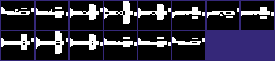
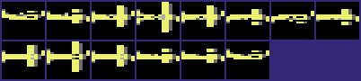
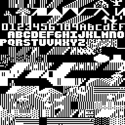
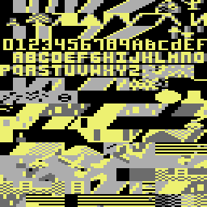
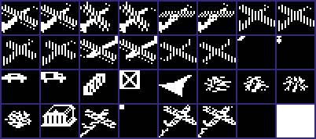
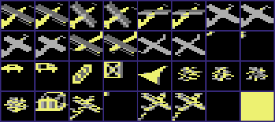

<!-- Generated by c64-docs from knowledge revision 20261024T232120.926-729orp and .c64-re-tools/local/generated/src/source-map.json. Do not edit: change the knowledge, generate the source again, then run docs.ts generate. -->
# Graphics

Each sprite, bitmap, charset and screen region of the knowledge. The knowledge gives no display mode and no colours, so a sprite, bitmap or charset shows in hires and in multicolour, in pattern colours: black is pixel value 0, white is 1 in hires; in multicolour light grey is 1, grey is 2 and yellow is 3. Index: [the reference](index.md).

## [`title_plane_spr_00` `$2800`](../../src/data/title_sprites.asm#L6) `$2800-$2B7F`

*sprite*

Title plane, 12 frames of a roll (sprite pointers $a0-$ab). $70e6 starts at $a0; $74c5 steps sprite 0 every 4th count of $4018.

## [`old_chars_copy_a` `$2B80`](../../src/data/graphics_leftovers.asm#L6) `$2B80-$2BBF`

*charset*

Unused. These 64 bytes are equal to $3380-$33bf of charset_source. No code reads them. Sprite $ae would show them, but no code sets $ae.

## [`status_blank_sprite` `$2BC0`](../../src/data/graphics_leftovers.asm#L16) `$2BC0-$2BFF`

*sprite*

Sprite $af: the empty status letter. The VIC-II shows it when status_sprite_ptr is $af. Byte 63 ($ff) is not shown.

## [`letter_l_sprite` `$2C00`](../../src/data/graphics_leftovers.asm#L40) `$2C00-$2CFF`

*sprite*

Sprites $b0-$b3: large letters L, R, P and W for the status letter (status_sprite_ptr). $b0 L: plane_landing. $b2 P: enemy_plane_draw. $b3 W: update_wind. No code sets $b1 (R).

## [`old_chars_copy_b` `$2D00`](../../src/data/graphics_leftovers.asm#L133) `$2D00-$2F17`

*charset*

Unused. $2d00-$2f17 is equal to $3500-$3717 of charset_source (chars $a0-$e2), except char $da at $2ed0-$2ed7: an older road character (00 ff, four times). No code reads them.

## [`charset_source` `$3000`](../../src/data/charset_source.asm#L6) `$3000-$37FF`

*charset*

Source of the multicolour character set. $4288 copies all 256 chars ($3000-$37ff) to the charset at $2000-$27ff at game start.

## [`plane_level_spr_0` `$3800`](../../src/data/game_sprites.asm#L6) `$3800-$3FFF`

*sprite*

Player plane, level ($e0), set by $599b. $5a7d adds bit 0 from $405e for the propeller frame. The enemy plane also uses it ($6167).

