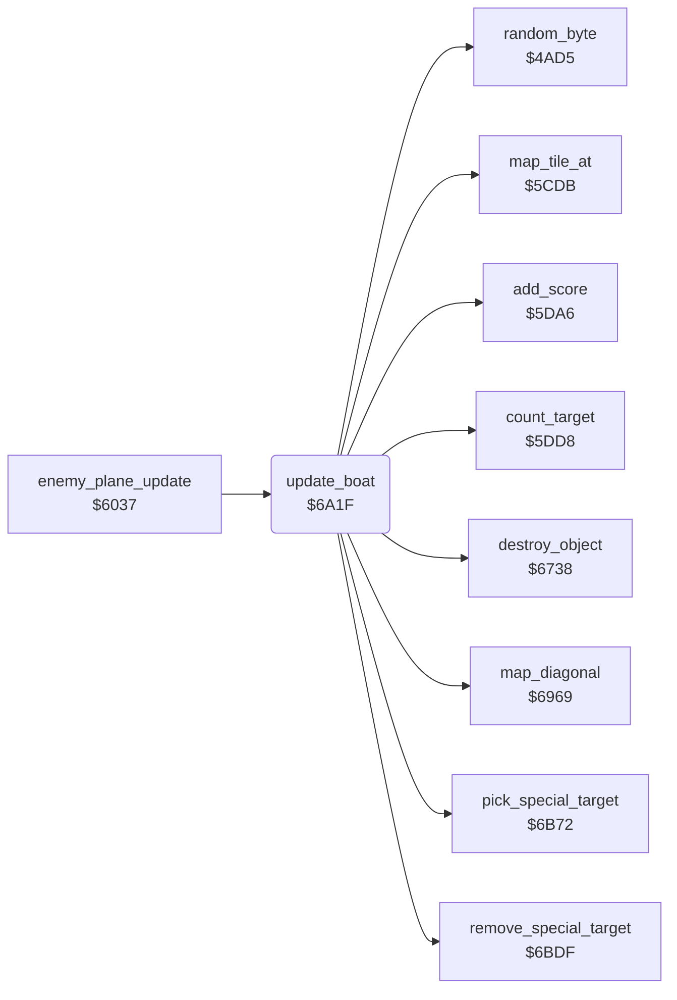

<!-- Generated by c64-docs from knowledge revision 20261024T232120.926-729orp and .c64-re-tools/local/generated/src/source-map.json. Do not edit: change the knowledge, generate the source again, then run docs.ts generate. -->
# enemy/boat.asm: Boat on the river

Range `$6A1F-$6B71`. Source: [enemy/boat.asm](../../../../src/enemy/boat.asm). Index: [the reference](../../index.md).

## Call graph

A solid arrow is a call, a thick arrow a table entry, a dotted arrow a jump. Rounded nodes are in this file.

## Names

### [`update_boat`](../../../../src/enemy/boat.asm#L6) `$6A1F`

*routine*

Starts and moves the boat (sprite 1) on the river. A bomb burst or a bullet sinks it. Timer $4053 sets the next start.

- **Called from:** [`enemy_plane_update`](enemy_plane.md#enemy_plane_update) [`$6042`](../../../../src/enemy/enemy_plane.asm#L12)
- **Calls:** [`random_byte`](../game/random.md#random_byte), [`pick_special_target`](special_targets.md#pick_special_target), [`map_diagonal`](../plane/crash.md#map_diagonal), [`map_tile_at`](../ground/map_tile.md#map_tile_at), [`destroy_object`](../ground/ground_hits.md#destroy_object), [`add_score`](../game/score.md#add_score), [`count_target`](../game/score.md#count_target), [`remove_special_target`](special_targets.md#remove_special_target)
- **Reads:** [`boat_wait`](../data/variables.md#boat_wait), [`scroll_frames`](../data/variables.md#scroll_frames), [`quiet_timer`](../data/variables.md#quiet_timer), [`road_wait`](../data/variables.md#road_wait), [`airfield_countdown`](../data/variables.md#airfield_countdown), [`enemy_timer`](../data/variables.md#enemy_timer), [`vehicle_frame`](../data/variables.md#vehicle_frame), [`map_section`](../data/variables.md#map_section), [`river_column`](../data/variables.md#river_column), [`sprite_enable`](../data/variables.md#sprite_enable), [`sprite_mc_mask`](../data/variables.md#sprite_mc_mask), [`enemy_y`](../data/variables.md#enemy_y), [`enemy_x`](../data/variables.md#enemy_x), [`low_flight`](../data/variables.md#low_flight), [`bullet_active`](../data/variables.md#bullet_active), [`bullet_y`](../data/variables.md#bullet_y), [`bullet_x`](../data/variables.md#bullet_x), [`zp_temp5`](../../memory-map.md#zp_temp5), [`frame_count`](../data/variables.md#frame_count), [`enemy_dx`](../data/variables.md#enemy_dx), [`special_target`](../data/variables.md#special_target)
- **Writes:** [`boat_wait`](../data/variables.md#boat_wait), [`enemy_x`](../data/variables.md#enemy_x), [`enemy_y`](../data/variables.md#enemy_y), [`enemy_dx`](../data/variables.md#enemy_dx), [`sprite_enable`](../data/variables.md#sprite_enable), [`enemy_frame`](../data/variables.md#enemy_frame), [`enemy_colour`](../data/variables.md#enemy_colour), [`special_target`](../data/variables.md#special_target), [`sprite_mc_mask`](../data/variables.md#sprite_mc_mask), [`zp_temp5`](../../memory-map.md#zp_temp5), [`enemy_timer`](../data/variables.md#enemy_timer)

### [`update_boat_wait`](../../../../src/enemy/boat.asm#L10) `$6A27`

*label*

Counts down only when bit 4 of the scroll counter $4017 is 0.

- **Jumped to from:** [`update_boat`](boat.md#update_boat) [`$6A22`](../../../../src/enemy/boat.asm#L8)

### [`update_boat_done`](../../../../src/enemy/boat.asm#L16) `$6A33`

*label*

- **Jumped to from:** [`update_boat`](boat.md#update_boat) [`$6A2C`](../../../../src/enemy/boat.asm#L13)

### [`update_boat_launch`](../../../../src/enemy/boat.asm#L19) `$6A34`

*label*

Starts the boat if $4062 = 0, $402e >= 10, $4058 >= 10, no enemy plane, no vehicle, feature 0, river column < $3d.

- **Jumped to from:** [`update_boat`](boat.md#update_boat) [`$6A31`](../../../../src/enemy/boat.asm#L15)

### [`update_boat_exit`](../../../../src/enemy/boat.asm#L62) `$6A94`

*label*

- **Jumped to from:** [`update_boat`](boat.md#update_boat) [`$6A8D`](../../../../src/enemy/boat.asm#L59)

### [`update_boat_reset`](../../../../src/enemy/boat.asm#L64) `$6A95`

*label*

Sprite 1 to single colour; next start in 63-127 steps.

- **Jumped to from:** [`update_boat`](boat.md#update_boat) [`$6A37`](../../../../src/enemy/boat.asm#L21), [`update_boat`](boat.md#update_boat) [`$6A3E`](../../../../src/enemy/boat.asm#L24), [`update_boat`](boat.md#update_boat) [`$6A45`](../../../../src/enemy/boat.asm#L27), [`update_boat`](boat.md#update_boat) [`$6A4A`](../../../../src/enemy/boat.asm#L29), [`update_boat`](boat.md#update_boat) [`$6A4F`](../../../../src/enemy/boat.asm#L31), [`update_boat`](boat.md#update_boat) [`$6A54`](../../../../src/enemy/boat.asm#L33), [`update_boat`](boat.md#update_boat) [`$6A5B`](../../../../src/enemy/boat.asm#L36), [`update_boat`](boat.md#update_boat) [`$6B6F`](../../../../src/enemy/boat.asm#L171)

### [`update_boat_move`](../../../../src/enemy/boat.asm#L73) `$6AA8`

*label*

- **Jumped to from:** [`update_boat`](boat.md#update_boat) [`$6A24`](../../../../src/enemy/boat.asm#L9)

### [`update_boat_hit`](../../../../src/enemy/boat.asm#L103) `$6AE1`

*label*

- **Jumped to from:** [`update_boat`](boat.md#update_boat) [`$6AC4`](../../../../src/enemy/boat.asm#L88), [`update_boat`](boat.md#update_boat) [`$6AC8`](../../../../src/enemy/boat.asm#L90), [`update_boat`](boat.md#update_boat) [`$6ADB`](../../../../src/enemy/boat.asm#L100), [`update_boat`](boat.md#update_boat) [`$6B0F`](../../../../src/enemy/boat.asm#L127)

### [`update_boat_bullet`](../../../../src/enemy/boat.asm#L110) `$6AEE`

*label*

- **Jumped to from:** [`update_boat`](boat.md#update_boat) [`$6AAD`](../../../../src/enemy/boat.asm#L76), [`update_boat`](boat.md#update_boat) [`$6ADF`](../../../../src/enemy/boat.asm#L102)

### [`update_boat_sail`](../../../../src/enemy/boat.asm#L128) `$6B12`

*label*

- **Jumped to from:** [`update_boat`](boat.md#update_boat) [`$6AF1`](../../../../src/enemy/boat.asm#L112), [`update_boat`](boat.md#update_boat) [`$6AF6`](../../../../src/enemy/boat.asm#L114), [`update_boat`](boat.md#update_boat) [`$6B06`](../../../../src/enemy/boat.asm#L121), [`update_boat`](boat.md#update_boat) [`$6B0D`](../../../../src/enemy/boat.asm#L126)

### [`update_boat_forward`](../../../../src/enemy/boat.asm#L149) `$6B43`

*label*

- **Jumped to from:** [`update_boat`](boat.md#update_boat) [`$6B29`](../../../../src/enemy/boat.asm#L138)

### [`update_boat_end`](../../../../src/enemy/boat.asm#L157) `$6B51`

*label*

Ends the boat: hides sprite 1. A special boat counts as a target and adds 200 to the score.

- **Jumped to from:** [`update_boat`](boat.md#update_boat) [`$6AEB`](../../../../src/enemy/boat.asm#L109), [`update_boat`](boat.md#update_boat) [`$6B4E`](../../../../src/enemy/boat.asm#L154)

### [`update_boat_end_reset`](../../../../src/enemy/boat.asm#L170) `$6B6F`

*label*

- **Jumped to from:** [`update_boat`](boat.md#update_boat) [`$6B5E`](../../../../src/enemy/boat.asm#L163)
