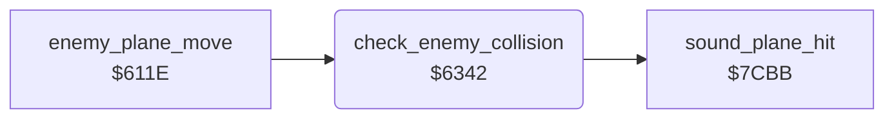

<!-- Generated by c64-docs from knowledge revision 20261024T232120.926-729orp and .c64-re-tools/local/generated/src/source-map.json. Do not edit: change the knowledge, generate the source again, then run docs.ts generate. -->
# enemy/enemy_collision.asm: Enemy plane explosion colours and collision with the plane

Range `$6332-$6381`. Source: [enemy/enemy_collision.asm](../../../../src/enemy/enemy_collision.asm). Index: [the reference](../../index.md).

## Call graph

A solid arrow is a call, a thick arrow a table entry, a dotted arrow a jump. Rounded nodes are in this file.

## Data

| Range | Type | Name | Read by | Written by |
|---|---|---|---|---|
| [`$6332`](../../../../src/enemy/enemy_collision.asm#L7)-`$6341` | bytes of 8 | [`enemy_explosion_colours`](../../../../src/enemy/enemy_collision.asm#L6) | [`enemy_plane_explode`](road_vehicle.md#enemy_plane_explode) |  |
| [`$637E`](../../../../src/enemy/enemy_collision.asm#L40)-`$6381` | bytes of 4 | [`vehicle_colours`](../../../../src/enemy/enemy_collision.asm#L39) | [`road_vehicle_start`](road_vehicle.md#road_vehicle_start) |  |

## Names

### [`enemy_explosion_colours`](../../../../src/enemy/enemy_collision.asm#L6) `$6332-$6341`

*data*

Colours of the exploding enemy plane (sprite 1), indexed by the explosion timer $4051. Timer values 16-19 read the code bytes at $6342.

- **Read by:** [`enemy_plane_explode`](road_vehicle.md#enemy_plane_explode) [`$62F7`](../../../../src/enemy/road_vehicle.asm#L119)

### [`check_enemy_collision`](../../../../src/enemy/enemy_collision.asm#L10) `$6342`

*routine*

Checks if the enemy plane (sprite 1) touches the plane (sprite 0) at the same altitude. A hit starts the explosion and the plane fall.

- **Called from:** [`enemy_plane_move`](enemy_plane.md#enemy_plane_move) [`$61DD`](../../../../src/enemy/enemy_plane.asm#L218)
- **Calls:** [`sound_plane_hit`](../sound/sound_effects.md#sound_plane_hit)
- **Reads:** [`status_bg_colour`](../data/variables.md#status_bg_colour), [`enemy_x`](../data/variables.md#enemy_x), [`plane_x`](../data/variables.md#plane_x), [`enemy_y`](../data/variables.md#enemy_y), [`plane_y`](../data/variables.md#plane_y)
- **Writes:** [`enemy_explode_timer`](../data/variables.md#enemy_explode_timer), [`engine_damage`](../data/variables.md#engine_damage), [`plane_failing`](../data/variables.md#plane_failing)

### [`check_enemy_collision_done`](../../../../src/enemy/enemy_collision.asm#L36) `$637D`

*label*

- **Jumped to from:** [`check_enemy_collision`](enemy_collision.md#check_enemy_collision) [`$6347`](../../../../src/enemy/enemy_collision.asm#L13), [`check_enemy_collision`](enemy_collision.md#check_enemy_collision) [`$6352`](../../../../src/enemy/enemy_collision.asm#L18), [`check_enemy_collision`](enemy_collision.md#check_enemy_collision) [`$6359`](../../../../src/enemy/enemy_collision.asm#L21), [`check_enemy_collision`](enemy_collision.md#check_enemy_collision) [`$6364`](../../../../src/enemy/enemy_collision.asm#L26), [`check_enemy_collision`](enemy_collision.md#check_enemy_collision) [`$636B`](../../../../src/enemy/enemy_collision.asm#L29)

### [`vehicle_colours`](../../../../src/enemy/enemy_collision.asm#L39) `$637E-$6381`

*data*

Colours of the road vehicle. road_vehicle_start ($6246) uses index 0 or 4, so index 4 reads $ad at $6382 (colour 13).

- **Read by:** [`road_vehicle_start`](road_vehicle.md#road_vehicle_start) [`$6246`](../../../../src/enemy/road_vehicle.asm#L33)
