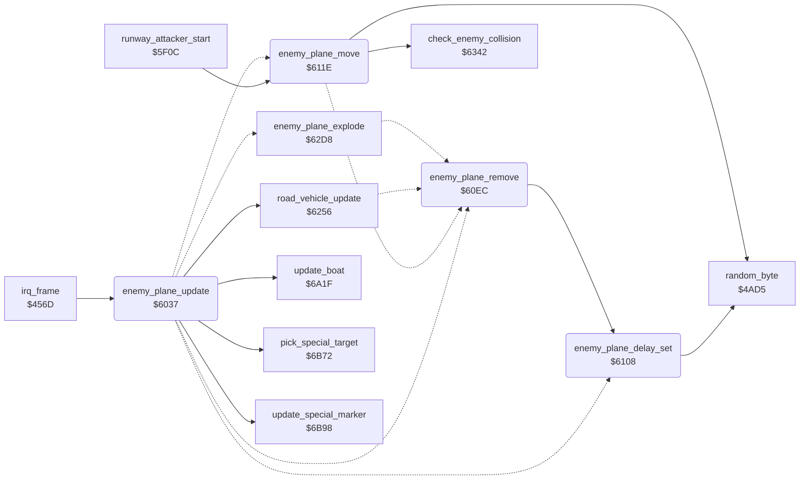

<!-- Generated by c64-docs from knowledge revision 20261024T232120.926-729orp and .c64-re-tools/local/generated/src/source-map.json. Do not edit: change the knowledge, generate the source again, then run docs.ts generate. -->
# enemy/enemy_plane.asm: Enemy plane

Range `$6037-$620E`. Source: [enemy/enemy_plane.asm](../../../../src/enemy/enemy_plane.asm). Index: [the reference](../../index.md).

## Call graph

A solid arrow is a call, a thick arrow a table entry, a dotted arrow a jump. Rounded nodes are in this file.

## Names

### [`enemy_plane_update`](../../../../src/enemy/enemy_plane.asm#L6) `$6037`

*routine*

Updates the enemy plane: road vehicle, routines $6a1f and $6b98, explosion, start delay $4041, start and movement.
$4062 counts down: no enemy plane while it runs.

- **Called from:** [`irq_frame`](../irq/frame_irq.md#irq_frame) [`$46BB`](../../../../src/irq/frame_irq.asm#L168)
- **Calls:** [`road_vehicle_update`](road_vehicle.md#road_vehicle_update), [`update_boat`](boat.md#update_boat), [`update_special_marker`](special_targets.md#update_special_marker), [`pick_special_target`](special_targets.md#pick_special_target)
- **Jumps to:** [`enemy_plane_explode`](road_vehicle.md#enemy_plane_explode), [`enemy_plane_move`](enemy_plane.md#enemy_plane_move), [`enemy_plane_delay_set`](enemy_plane.md#enemy_plane_delay_set), [`enemy_plane_remove`](enemy_plane.md#enemy_plane_remove)
- **Reads:** [`quiet_timer`](../data/variables.md#quiet_timer), [`enemy_explode_timer`](../data/variables.md#enemy_explode_timer), [`enemy_timer`](../data/variables.md#enemy_timer), [`special_target`](../data/variables.md#special_target), [`random_seed`](../../memory-map.md#random_seed), [`altitude`](../data/variables.md#altitude), [`zp_count`](../../memory-map.md#zp_count)
- **Writes:** [`quiet_timer`](../data/variables.md#quiet_timer), [`enemy_timer`](../data/variables.md#enemy_timer), [`special_target`](../data/variables.md#special_target), [`enemy_dx`](../data/variables.md#enemy_dx), [`enemy_colour`](../data/variables.md#enemy_colour), [`enemy_altitude`](../data/variables.md#enemy_altitude), [`zp_count`](../../memory-map.md#zp_count), [`enemy_dy`](../data/variables.md#enemy_dy), [`enemy_shadow_y`](../data/variables.md#enemy_shadow_y), [`enemy_shadow_x`](../data/variables.md#enemy_shadow_x)

### [`enemy_plane_vehicle`](../../../../src/enemy/enemy_plane.asm#L10) `$603F`

*label*

- **Jumped to from:** [`enemy_plane_update`](enemy_plane.md#enemy_plane_update) [`$603A`](../../../../src/enemy/enemy_plane.asm#L8)

### [`enemy_plane_timer`](../../../../src/enemy/enemy_plane.asm#L17) `$6050`

*label*

- **Jumped to from:** [`enemy_plane_update`](enemy_plane.md#enemy_plane_update) [`$604B`](../../../../src/enemy/enemy_plane.asm#L15)

### [`enemy_plane_move_jmp`](../../../../src/enemy/enemy_plane.asm#L23) `$605B`

*label*

- **Jumped to from:** [`enemy_plane_update`](enemy_plane.md#enemy_plane_update) [`$6053`](../../../../src/enemy/enemy_plane.asm#L19)

### [`enemy_plane_spawn_test`](../../../../src/enemy/enemy_plane.asm#L25) `$605E`

*label*

- **Jumped to from:** [`enemy_plane_update`](enemy_plane.md#enemy_plane_update) [`$6058`](../../../../src/enemy/enemy_plane.asm#L21)

### [`enemy_plane_delay`](../../../../src/enemy/enemy_plane.asm#L30) `$6068`

*label*

- **Jumped to from:** [`enemy_plane_update`](enemy_plane.md#enemy_plane_update) [`$6061`](../../../../src/enemy/enemy_plane.asm#L27)

### [`enemy_plane_spawn`](../../../../src/enemy/enemy_plane.asm#L34) `$606B`

*label*

Starts an enemy plane: altitude near the player altitude, direction from the random seed.

- **Jumped to from:** [`enemy_plane_update`](enemy_plane.md#enemy_plane_update) [`$6066`](../../../../src/enemy/enemy_plane.asm#L29)

### [`enemy_plane_spawn_init`](../../../../src/enemy/enemy_plane.asm#L41) `$607A`

*label*

- **Jumped to from:** [`enemy_plane_update`](enemy_plane.md#enemy_plane_update) [`$6073`](../../../../src/enemy/enemy_plane.asm#L38)

### [`enemy_plane_spawn_alt`](../../../../src/enemy/enemy_plane.asm#L52) `$6092`

*label*

- **Jumped to from:** [`enemy_plane_update`](enemy_plane.md#enemy_plane_update) [`$609A`](../../../../src/enemy/enemy_plane.asm#L58)

### [`enemy_plane_spawn_alt_up`](../../../../src/enemy/enemy_plane.asm#L56) `$6098`

*label*

- **Jumped to from:** [`enemy_plane_update`](enemy_plane.md#enemy_plane_update) [`$6092`](../../../../src/enemy/enemy_plane.asm#L53)

### [`enemy_plane_spawn_dir`](../../../../src/enemy/enemy_plane.asm#L59) `$609D`

*label*

- **Jumped to from:** [`enemy_plane_update`](enemy_plane.md#enemy_plane_update) [`$6096`](../../../../src/enemy/enemy_plane.asm#L55)

### [`enemy_plane_spawn_slow`](../../../../src/enemy/enemy_plane.asm#L82) `$60C8`

*label*

Direction $ff: from the bottom, Y $ff.

- **Jumped to from:** [`enemy_plane_update`](enemy_plane.md#enemy_plane_update) [`$60B0`](../../../../src/enemy/enemy_plane.asm#L71)

### [`enemy_plane_spawn_fast`](../../../../src/enemy/enemy_plane.asm#L91) `$60DA`

*label*

Direction $fe: from the bottom, faster.

- **Jumped to from:** [`enemy_plane_update`](enemy_plane.md#enemy_plane_update) [`$60B4`](../../../../src/enemy/enemy_plane.asm#L73)

### [`enemy_plane_remove`](../../../../src/enemy/enemy_plane.asm#L101) `$60EC`

*routine*

Removes the enemy plane: sprites 1 and 7 off, flags cleared, new start delay.

- **Jumped to from:** [`enemy_plane_update`](enemy_plane.md#enemy_plane_update) [`$60AC`](../../../../src/enemy/enemy_plane.asm#L69), [`enemy_plane_move`](enemy_plane.md#enemy_plane_move) [`$61A5`](../../../../src/enemy/enemy_plane.asm#L193), [`enemy_plane_move`](enemy_plane.md#enemy_plane_move) [`$61C2`](../../../../src/enemy/enemy_plane.asm#L206), [`road_vehicle_update`](road_vehicle.md#road_vehicle_update) [`$62D5`](../../../../src/enemy/road_vehicle.asm#L101), [`enemy_plane_explode`](road_vehicle.md#enemy_plane_explode) [`$62EC`](../../../../src/enemy/road_vehicle.asm#L114)
- **Calls:** [`enemy_plane_delay_set`](enemy_plane.md#enemy_plane_delay_set)
- **Reads:** [`sprite_enable`](../data/variables.md#sprite_enable), [`sprite_mc_mask`](../data/variables.md#sprite_mc_mask)
- **Writes:** [`sprite_enable`](../data/variables.md#sprite_enable), [`sprite_mc_mask`](../data/variables.md#sprite_mc_mask), [`enemy_explode_timer`](../data/variables.md#enemy_explode_timer), [`special_target`](../data/variables.md#special_target)

### [`enemy_plane_delay_set`](../../../../src/enemy/enemy_plane.asm#L114) `$6108`

*routine*

Sets a random start delay $1e-$5d in $4041, direction 0, blank status sprite.

- **Called from:** [`enemy_plane_remove`](enemy_plane.md#enemy_plane_remove) [`$60EC`](../../../../src/enemy/enemy_plane.asm#L102)
- **Jumped to from:** [`enemy_plane_update`](enemy_plane.md#enemy_plane_update) [`$6068`](../../../../src/enemy/enemy_plane.asm#L32)
- **Calls:** [`random_byte`](../game/random.md#random_byte)
- **Writes:** [`enemy_timer`](../data/variables.md#enemy_timer), [`enemy_dy`](../data/variables.md#enemy_dy), [`status_sprite_ptr`](../data/variables.md#status_sprite_ptr)

### [`enemy_plane_move`](../../../../src/enemy/enemy_plane.asm#L126) `$611E`

*routine*

Moves the enemy plane by direction $4042 (Y + d, X - d) and side step $4040, and sets its images.

- **Called from:** [`runway_attacker_start`](runway_attacker.md#runway_attacker_start) [`$5F3B`](../../../../src/enemy/runway_attacker.asm#L38)
- **Jumped to from:** [`enemy_plane_update`](enemy_plane.md#enemy_plane_update) [`$605B`](../../../../src/enemy/enemy_plane.asm#L24)
- **Calls:** [`random_byte`](../game/random.md#random_byte), [`check_enemy_collision`](enemy_collision.md#check_enemy_collision)
- **Jumps to:** [`enemy_plane_remove`](enemy_plane.md#enemy_plane_remove)
- **Reads:** [`enemy_dy`](../data/variables.md#enemy_dy), [`enemy_shadow_y`](../data/variables.md#enemy_shadow_y), [`enemy_shadow_x`](../data/variables.md#enemy_shadow_x), [`enemy_dx`](../data/variables.md#enemy_dx), [`random_seed`](../../memory-map.md#random_seed), [`sprite_enable`](../data/variables.md#sprite_enable), [`sprite_mc_mask`](../data/variables.md#sprite_mc_mask), [`frame_count`](../data/variables.md#frame_count), [`enemy_frame`](../data/variables.md#enemy_frame), [`zp_count`](../../memory-map.md#zp_count), [`enemy_shadow_frame`](../data/variables.md#enemy_shadow_frame), [`enemy_altitude`](../data/variables.md#enemy_altitude)
- **Writes:** [`enemy_shadow_y`](../data/variables.md#enemy_shadow_y), [`enemy_shadow_x`](../data/variables.md#enemy_shadow_x), [`enemy_frame`](../data/variables.md#enemy_frame), [`enemy_shadow_frame`](../data/variables.md#enemy_shadow_frame), [`enemy_dx`](../data/variables.md#enemy_dx), [`status_sprite_ptr`](../data/variables.md#status_sprite_ptr), [`sprite_enable`](../data/variables.md#sprite_enable), [`sprite_mc_mask`](../data/variables.md#sprite_mc_mask), [`zp_count`](../../memory-map.md#zp_count), [`enemy_shadow_colour`](../data/variables.md#enemy_shadow_colour), [`enemy_x`](../data/variables.md#enemy_x), [`enemy_y`](../data/variables.md#enemy_y)

### [`enemy_plane_move_side`](../../../../src/enemy/enemy_plane.asm#L139) `$613C`

*label*

- **Jumped to from:** [`enemy_plane_move`](enemy_plane.md#enemy_plane_move) [`$6137`](../../../../src/enemy/enemy_plane.asm#L137)

### [`enemy_plane_move_right`](../../../../src/enemy/enemy_plane.asm#L148) `$6150`

*label*

- **Jumped to from:** [`enemy_plane_move`](enemy_plane.md#enemy_plane_move) [`$6143`](../../../../src/enemy/enemy_plane.asm#L143)

### [`enemy_plane_move_bank`](../../../../src/enemy/enemy_plane.asm#L151) `$6155`

*label*

- **Jumped to from:** [`enemy_plane_move`](enemy_plane.md#enemy_plane_move) [`$614D`](../../../../src/enemy/enemy_plane.asm#L147)

### [`enemy_plane_move_level`](../../../../src/enemy/enemy_plane.asm#L159) `$6167`

*label*

- **Jumped to from:** [`enemy_plane_move`](enemy_plane.md#enemy_plane_move) [`$613F`](../../../../src/enemy/enemy_plane.asm#L141)

### [`enemy_plane_move_turn`](../../../../src/enemy/enemy_plane.asm#L164) `$6171`

*label*

- **Jumped to from:** [`enemy_plane_move`](enemy_plane.md#enemy_plane_move) [`$6164`](../../../../src/enemy/enemy_plane.asm#L158)

### [`enemy_plane_move_turn_r`](../../../../src/enemy/enemy_plane.asm#L176) `$6189`

*label*

- **Jumped to from:** [`enemy_plane_move`](enemy_plane.md#enemy_plane_move) [`$617E`](../../../../src/enemy/enemy_plane.asm#L171)

### [`enemy_plane_move_turn_l`](../../../../src/enemy/enemy_plane.asm#L179) `$618E`

*label*

- **Jumped to from:** [`enemy_plane_move`](enemy_plane.md#enemy_plane_move) [`$6182`](../../../../src/enemy/enemy_plane.asm#L173)

### [`enemy_plane_move_set_turn`](../../../../src/enemy/enemy_plane.asm#L181) `$6190`

*label*

- **Jumped to from:** [`enemy_plane_move`](enemy_plane.md#enemy_plane_move) [`$6186`](../../../../src/enemy/enemy_plane.asm#L175), [`enemy_plane_move`](enemy_plane.md#enemy_plane_move) [`$618B`](../../../../src/enemy/enemy_plane.asm#L178)

### [`enemy_plane_move_limits`](../../../../src/enemy/enemy_plane.asm#L183) `$6193`

*label*

- **Jumped to from:** [`enemy_plane_move`](enemy_plane.md#enemy_plane_move) [`$6176`](../../../../src/enemy/enemy_plane.asm#L167)

### [`enemy_plane_move_gone`](../../../../src/enemy/enemy_plane.asm#L192) `$61A5`

*label*

- **Jumped to from:** [`enemy_plane_move`](enemy_plane.md#enemy_plane_move) [`$6198`](../../../../src/enemy/enemy_plane.asm#L186), [`enemy_plane_move`](enemy_plane.md#enemy_plane_move) [`$619F`](../../../../src/enemy/enemy_plane.asm#L189)

### [`enemy_plane_move_show`](../../../../src/enemy/enemy_plane.asm#L194) `$61A8`

*label*

- **Jumped to from:** [`enemy_plane_move`](enemy_plane.md#enemy_plane_move) [`$61A3`](../../../../src/enemy/enemy_plane.asm#L191)

### [`enemy_plane_move_head_on`](../../../../src/enemy/enemy_plane.asm#L196) `$61AB`

*label*

Head-on images $ea/$ec; Y + 2 more.

- **Jumped to from:** [`enemy_plane_move`](enemy_plane.md#enemy_plane_move) [`$6139`](../../../../src/enemy/enemy_plane.asm#L138)

### [`enemy_plane_move_show2`](../../../../src/enemy/enemy_plane.asm#L207) `$61C5`

*label*

- **Jumped to from:** [`enemy_plane_move`](enemy_plane.md#enemy_plane_move) [`$61C0`](../../../../src/enemy/enemy_plane.asm#L205)

### [`enemy_plane_draw`](../../../../src/enemy/enemy_plane.asm#L209) `$61C8`

*label*

Status sprite $b2: letter P.

- **Jumped to from:** [`enemy_plane_move`](enemy_plane.md#enemy_plane_move) [`$61A8`](../../../../src/enemy/enemy_plane.asm#L195), [`enemy_plane_move`](enemy_plane.md#enemy_plane_move) [`$61C5`](../../../../src/enemy/enemy_plane.asm#L208)
