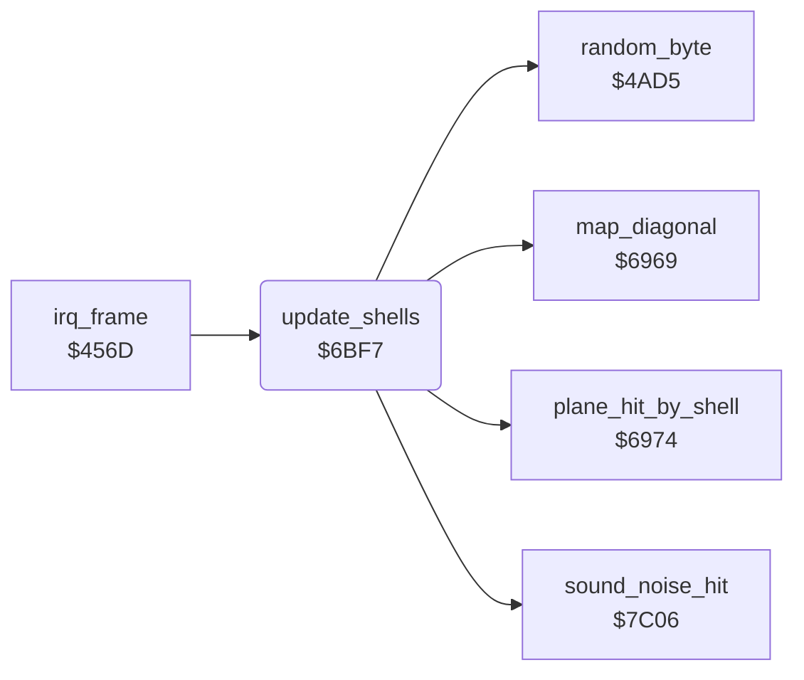

<!-- Generated by c64-docs from knowledge revision 20261025T214620.804-eudhn0 and .c64-re-tools/local/generated/src/source-map.json. Do not edit: change the knowledge, generate the source again, then run docs.ts generate. -->
# enemy/flak_shells.asm: Flak shells (sprites 4 and 5)

Range `$6BF7-$6DB0`. Source: [enemy/flak_shells.asm](../../../../src/enemy/flak_shells.asm). Index: [the reference](../../index.md).

## Routines

| Routine | Address | Reached from | Summary |
|---|---|---|---|
| [`update_shells`](flak_shells.md#update_shells) | `$6BF7` | [`irq_frame`](../irq/frame_irq.md#irq_frame) | Fires, moves and explodes the two flak shells. |

## Data

| Range | Type | Name | Read by | Written by |
|---|---|---|---|---|
| [`$6DA7`](../../../../src/enemy/flak_shells.asm#L208)-`$6DAB` | bytes of 5 | [`shell_step_x`](../../../../src/enemy/flak_shells.asm#L207) | [`update_shells`](flak_shells.md#update_shells) |  |
| [`$6DAC`](../../../../src/enemy/flak_shells.asm#L211)-`$6DB0` | bytes of 5 | [`shell_step_y`](../../../../src/enemy/flak_shells.asm#L210) | [`update_shells`](flak_shells.md#update_shells) |  |

## Call graph

A solid arrow is a call, a thick arrow a table entry. Rounded nodes are in this file.

## Details

### [`update_shells`](../../../../src/enemy/flak_shells.asm#L6) `$6BF7`

*routine*

Fires, moves and explodes the two flak shells. A shell starts at the flak gun nearest the plane line and explodes at the altitude.
$1104 = shell slot, 1 then 0.

- **Called from:** [`irq_frame`](../irq/frame_irq.md#irq_frame)
- **Calls:** [`random_byte`](../game/random.md#random_byte), [`map_diagonal`](../plane/crash.md#map_diagonal), [`sound_noise_hit`](../sound/sound_effects.md#sound_noise_hit), [`plane_hit_by_shell`](../plane/shell_damage.md#plane_hit_by_shell)
- **Reads:** [`flak_slot`](../../memory-map.md#flak_slot), [`flak_state`](../data/variables.md#flak_state), [`quiet_timer`](../data/variables.md#quiet_timer), [`flak_chance`](../data/variables.md#flak_chance), [`altitude`](../data/variables.md#altitude), [`shadow_y`](../data/variables.md#shadow_y), [`flak_ref_y`](../../memory-map.md#flak_ref_y), [`gun_x`](../data/variables.md#gun_x), [`gun_y`](../data/variables.md#gun_y), [`flak_best_dist`](../../memory-map.md#flak_best_dist), [`shadow_x`](../data/variables.md#shadow_x), [`flak_best_gun`](../../memory-map.md#flak_best_gun) and 10 more
- **Writes:** [`flak_slot`](../../memory-map.md#flak_slot), [`zp_temp5`](../../memory-map.md#zp_temp5), [`flak_best_dist`](../../memory-map.md#flak_best_dist), [`flak_ref_y`](../../memory-map.md#flak_ref_y), [`flak_best_gun`](../../memory-map.md#flak_best_gun), [`flak_x`](../data/variables.md#flak_x), [`gun_x`](../data/variables.md#gun_x), [`flak_y`](../data/variables.md#flak_y), [`flak_height`](../data/variables.md#flak_height), [`flak_state`](../data/variables.md#flak_state), [`random_seed`](../../memory-map.md#random_seed), [`flak_dir`](../data/variables.md#flak_dir) and 3 more

| Label | Address | Comment |
|---|---|---|
| [`update_shells_loop`](../../../../src/enemy/flak_shells.asm#L11) | `$6C00` |  |
| [`update_shells_active`](../../../../src/enemy/flak_shells.asm#L15) | `$6C08` |  |
| [`update_shells_try_fire`](../../../../src/enemy/flak_shells.asm#L17) | `$6C0B` |  |
| [`update_shells_find_gun`](../../../../src/enemy/flak_shells.asm#L33) | `$6C30` | $40a9,Y = gun x (0 = no gun), $40b1,Y = gun y. |
| [`update_shells_compare`](../../../../src/enemy/flak_shells.asm#L41) | `$6C40` |  |
| [`update_shells_next_gun`](../../../../src/enemy/flak_shells.asm#L46) | `$6C4B` |  |
| [`update_shells_gun_left`](../../../../src/enemy/flak_shells.asm#L78) | `$6C96` |  |
| [`update_shells_random_dir`](../../../../src/enemy/flak_shells.asm#L81) | `$6C9B` |  |
| [`update_shells_set_dir`](../../../../src/enemy/flak_shells.asm#L89) | `$6CAB` |  |
| [`update_shells_move`](../../../../src/enemy/flak_shells.asm#L94) | `$6CB5` |  |
| [`update_shells_flying`](../../../../src/enemy/flak_shells.asm#L99) | `$6CC0` |  |
| [`update_shells_remove_jmp`](../../../../src/enemy/flak_shells.asm#L116) | `$6CE5` |  |
| [`update_shells_show`](../../../../src/enemy/flak_shells.asm#L118) | `$6CE8` |  |
| [`update_shells_explode`](../../../../src/enemy/flak_shells.asm#L134) | `$6D0F` | Explosion state 12, counted down to 0. |
| [`update_shells_burst`](../../../../src/enemy/flak_shells.asm#L146) | `$6D29` |  |
| [`update_shells_next_jmp`](../../../../src/enemy/flak_shells.asm#L190) | `$6D8A` |  |
| [`update_shells_remove`](../../../../src/enemy/flak_shells.asm#L192) | `$6D8D` |  |
| [`update_shells_next`](../../../../src/enemy/flak_shells.asm#L199) | `$6D9C` |  |
| [`update_shells_done`](../../../../src/enemy/flak_shells.asm#L204) | `$6DA6` |  |

### [`shell_step_x`](../../../../src/enemy/flak_shells.asm#L207) `$6DA7-$6DAB`

*data*

X step of a rising shell, by direction 0-4.

- **Read by:** [`update_shells`](flak_shells.md#update_shells)

### [`shell_step_y`](../../../../src/enemy/flak_shells.asm#L210) `$6DAC-$6DB0`

*data*

Y step of a rising shell, by direction 0-4.

- **Read by:** [`update_shells`](flak_shells.md#update_shells)
