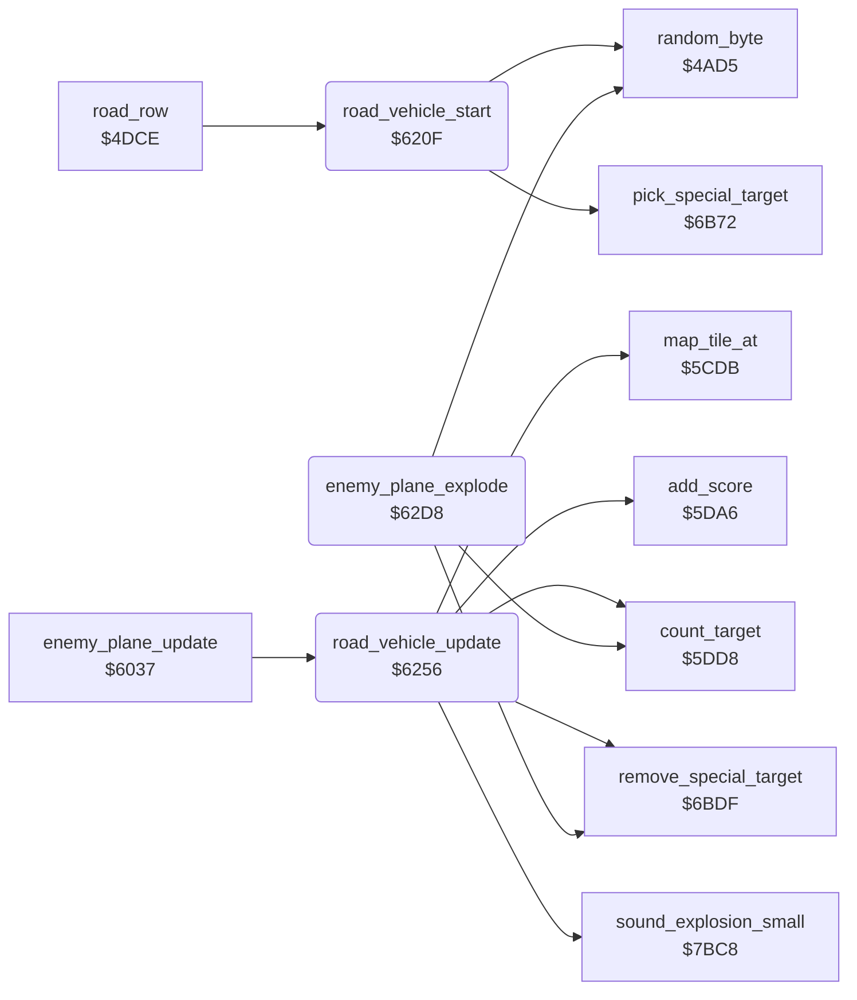

<!-- Generated by c64-docs from knowledge revision 20261025T214620.804-eudhn0 and .c64-re-tools/local/generated/src/source-map.json. Do not edit: change the knowledge, generate the source again, then run docs.ts generate. -->
# enemy/road_vehicle.asm: Road vehicle

Range `$620F-$6331`. Source: [enemy/road_vehicle.asm](../../../../src/enemy/road_vehicle.asm). Index: [the reference](../../index.md).

## Routines

| Routine | Address | Reached from | Summary |
|---|---|---|---|
| [`road_vehicle_start`](road_vehicle.md#road_vehicle_start) | `$620F` | [`road_row`](../ground/road.md#road_row) | While no enemy plane flies and $4053 is nonzero, starts a car or truck (sprite 1) at the top of the road. |
| [`road_vehicle_update`](road_vehicle.md#road_vehicle_update) | `$6256` | [`enemy_plane_update`](enemy_plane.md#enemy_plane_update) | Moves the vehicle down the road: Y + 2, X + 1. |
| [`enemy_plane_explode`](road_vehicle.md#enemy_plane_explode) | `$62D8` | [`enemy_plane_update`](enemy_plane.md#enemy_plane_update) | Counts the enemy plane explosion $4051 down. |

## Call graph

A solid arrow is a call, a thick arrow a table entry. Rounded nodes are in this file.

## Details

### [`road_vehicle_start`](../../../../src/enemy/road_vehicle.asm#L6) `$620F`

*routine*

While no enemy plane flies and $4053 is nonzero, starts a car or truck (sprite 1) at the top of the road.

- **Called from:** [`road_row`](../ground/road.md#road_row)
- **Calls:** [`random_byte`](../game/random.md#random_byte), [`pick_special_target`](special_targets.md#pick_special_target)
- **Jumps to:** [`road_vehicle_update`](road_vehicle.md#road_vehicle_update)
- **Reads:** [`enemy_timer`](../data/variables.md#enemy_timer), [`boat_wait`](../data/variables.md#boat_wait), [`sprite_enable`](../data/variables.md#sprite_enable), [`random_seed`](../../memory-map.md#random_seed), [`vehicle_colours`](enemy_collision.md#vehicle_colours)
- **Writes:** [`sprite_enable`](../data/variables.md#sprite_enable), [`vehicle_frame`](../data/variables.md#vehicle_frame), [`enemy_y`](../data/variables.md#enemy_y), [`enemy_x`](../data/variables.md#enemy_x), [`enemy_dx`](../data/variables.md#enemy_dx), [`enemy_colour`](../data/variables.md#enemy_colour), [`special_target`](../data/variables.md#special_target)

| Label | Address | Comment |
|---|---|---|
| [`road_vehicle_start_exit`](../../../../src/enemy/road_vehicle.asm#L11) | `$6219` |  |
| [`road_vehicle_start_init`](../../../../src/enemy/road_vehicle.asm#L13) | `$621A` |  |

### [`road_vehicle_update`](../../../../src/enemy/road_vehicle.asm#L40) `$6256`

*routine*

Moves the vehicle down the road: Y + 2, X + 1. On a tile below $80 it crashes into wreck tiles and gives points.

- **Called from:** [`enemy_plane_update`](enemy_plane.md#enemy_plane_update)
- **Jumped to from:** [`road_vehicle_start`](road_vehicle.md#road_vehicle_start)
- **Calls:** [`map_tile_at`](../ground/map_tile.md#map_tile_at), [`add_score`](../game/score.md#add_score), [`sound_explosion_small`](../sound/sound_effects.md#sound_explosion_small), [`count_target`](../game/score.md#count_target), [`remove_special_target`](special_targets.md#remove_special_target)
- **Jumps to:** [`enemy_plane_remove`](enemy_plane.md#enemy_plane_remove)
- **Reads:** [`vehicle_frame`](../data/variables.md#vehicle_frame), [`enemy_x`](../data/variables.md#enemy_x), [`enemy_dx`](../data/variables.md#enemy_dx), [`enemy_y`](../data/variables.md#enemy_y), [`map_ptr`](../../memory-map.md#map_ptr), [`map_ptr_hi`](../../memory-map.md#map_ptr_hi), [`special_target`](../data/variables.md#special_target), [`sprite_enable`](../data/variables.md#sprite_enable)
- **Writes:** [`enemy_frame`](../data/variables.md#enemy_frame), [`enemy_x`](../data/variables.md#enemy_x), [`enemy_timer`](../data/variables.md#enemy_timer), [`enemy_y`](../data/variables.md#enemy_y), [`map_ptr`](../../memory-map.md#map_ptr), [`map_ptr_hi`](../../memory-map.md#map_ptr_hi), [`vehicle_frame`](../data/variables.md#vehicle_frame), [`sprite_enable`](../data/variables.md#sprite_enable)

| Label | Address | Comment |
|---|---|---|
| [`road_vehicle_move`](../../../../src/enemy/road_vehicle.asm#L44) | `$625C` |  |
| [`road_vehicle_exit`](../../../../src/enemy/road_vehicle.asm#L93) | `$62C7` |  |
| [`road_vehicle_remove`](../../../../src/enemy/road_vehicle.asm#L95) | `$62C8` |  |

### [`enemy_plane_explode`](../../../../src/enemy/road_vehicle.asm#L103) `$62D8`

*routine*

Counts the enemy plane explosion $4051 down. Colours from $6332, debris image $fa, random jitter. At 0 removes the plane.

- **Jumped to from:** [`enemy_plane_update`](enemy_plane.md#enemy_plane_update)
- **Calls:** [`count_target`](../game/score.md#count_target), [`remove_special_target`](special_targets.md#remove_special_target), [`random_byte`](../game/random.md#random_byte)
- **Jumps to:** [`enemy_plane_remove`](enemy_plane.md#enemy_plane_remove)
- **Reads:** [`enemy_explode_timer`](../data/variables.md#enemy_explode_timer), [`special_target`](../data/variables.md#special_target), [`enemy_explosion_colours`](enemy_collision.md#enemy_explosion_colours), [`sprite_mc_mask`](../data/variables.md#sprite_mc_mask), [`enemy_x`](../data/variables.md#enemy_x), [`random_seed`](../../memory-map.md#random_seed), [`enemy_y`](../data/variables.md#enemy_y)
- **Writes:** [`enemy_explode_timer`](../data/variables.md#enemy_explode_timer), [`enemy_frame`](../data/variables.md#enemy_frame), [`enemy_colour`](../data/variables.md#enemy_colour), [`sprite_mc_mask`](../data/variables.md#sprite_mc_mask), [`enemy_shadow_colour`](../data/variables.md#enemy_shadow_colour), [`enemy_shadow_x`](../data/variables.md#enemy_shadow_x), [`enemy_shadow_y`](../data/variables.md#enemy_shadow_y), [`enemy_shadow_frame`](../data/variables.md#enemy_shadow_frame)

| Label | Address | Comment |
|---|---|---|
| [`enemy_plane_explode_end`](../../../../src/enemy/road_vehicle.asm#L113) | `$62EC` |  |
| [`enemy_plane_explode_draw`](../../../../src/enemy/road_vehicle.asm#L115) | `$62EF` |  |
