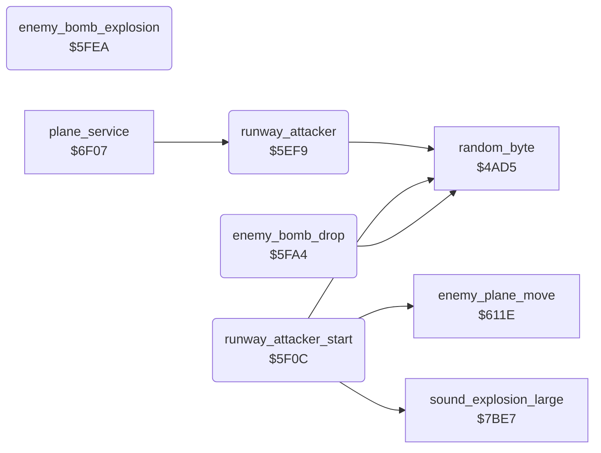

<!-- Generated by c64-docs from knowledge revision 20261025T214620.804-eudhn0 and .c64-re-tools/local/generated/src/source-map.json. Do not edit: change the knowledge, generate the source again, then run docs.ts generate. -->
# enemy/runway_attacker.asm: Enemy plane over the runway

Range `$5EF9-$6036`. Source: [enemy/runway_attacker.asm](../../../../src/enemy/runway_attacker.asm). Index: [the reference](../../index.md).

## Routines

| Routine | Address | Reached from | Summary |
|---|---|---|---|
| [`runway_attacker`](runway_attacker.md#runway_attacker) | `$5EF9` | [`plane_service`](../plane/plane_states.md#plane_service) | Runs while the plane stands on the runway. |
| [`runway_attacker_start`](runway_attacker.md#runway_attacker_start) | `$5F0C` |  | Starts the attacker at the bottom (Y $f0), white, with a random X and a random altitude from $1a. |
| [`enemy_bomb_drop`](runway_attacker.md#enemy_bomb_drop) | `$5FA4` |  | Drops a bomb (sprite 2, image $ef) when the attacker is within 20 lines of the player shadow and random < $400b. |
| [`enemy_bomb_explosion`](runway_attacker.md#enemy_bomb_explosion) | `$5FEA` |  | Counts the explosion down. |

## Call graph

A solid arrow is a call, a thick arrow a table entry. Rounded nodes are in this file.

## Details

### [`runway_attacker`](../../../../src/enemy/runway_attacker.asm#L6) `$5EF9`

*routine*

Runs while the plane stands on the runway. Starts an enemy plane at random (< $4065), moves it, and lets it bomb.

- **Called from:** [`plane_service`](../plane/plane_states.md#plane_service)
- **Calls:** [`random_byte`](../game/random.md#random_byte)
- **Jumps to:** [`runway_attacker_move`](runway_attacker.md#runway_attacker_move), [`runway_attacker_start`](runway_attacker.md#runway_attacker_start)
- **Reads:** [`enemy_dy`](../data/variables.md#enemy_dy), [`airfields_passed`](../data/variables.md#airfields_passed)
- **Writes:** [`enemy_timer`](../data/variables.md#enemy_timer)

### [`runway_attacker_start`](../../../../src/enemy/runway_attacker.asm#L16) `$5F0C`

*routine*

Starts the attacker at the bottom (Y $f0), white, with a random X and a random altitude from $1a.

- **Jumped to from:** [`runway_attacker`](runway_attacker.md#runway_attacker)
- **Calls:** [`random_byte`](../game/random.md#random_byte), [`enemy_plane_move`](enemy_plane.md#enemy_plane_move), [`sound_explosion_large`](../sound/sound_effects.md#sound_explosion_large)
- **Jumps to:** [`enemy_bomb_drop`](runway_attacker.md#enemy_bomb_drop), [`enemy_bomb_explosion`](runway_attacker.md#enemy_bomb_explosion)
- **Reads:** [`random_seed`](../../memory-map.md#random_seed), [`enemy_shadow_x`](../data/variables.md#enemy_shadow_x), [`enemy_shadow_y`](../data/variables.md#enemy_shadow_y), [`sprite_enable`](../data/variables.md#sprite_enable), [`attacker_bomb`](../data/variables.md#attacker_bomb), [`bomb_height`](../data/variables.md#bomb_height), [`bomb_x`](../data/variables.md#bomb_x), [`bomb_ground_y`](../data/variables.md#bomb_ground_y), [`bomb_y`](../data/variables.md#bomb_y)
- **Writes:** [`enemy_dy`](../data/variables.md#enemy_dy), [`enemy_altitude`](../data/variables.md#enemy_altitude), [`enemy_colour`](../data/variables.md#enemy_colour), [`enemy_dx`](../data/variables.md#enemy_dx), [`enemy_shadow_y`](../data/variables.md#enemy_shadow_y), [`enemy_shadow_x`](../data/variables.md#enemy_shadow_x), [`bomb_falling`](../data/variables.md#bomb_falling), [`sprite_enable`](../data/variables.md#sprite_enable), [`bomb_height`](../data/variables.md#bomb_height), [`bomb_x`](../data/variables.md#bomb_x), [`bomb_y`](../data/variables.md#bomb_y), [`bomb_colour`](../data/variables.md#bomb_colour) and 2 more

| Label | Address | Comment |
|---|---|---|
| [`runway_attacker_move`](../../../../src/enemy/runway_attacker.asm#L34) | `$5F33` |  |
| [`runway_attacker_bomb`](../../../../src/enemy/runway_attacker.asm#L52) | `$5F5B` | $4048: 0 no bomb, negative bomb falls, positive explosion timer. |
| [`runway_attacker_explode`](../../../../src/enemy/runway_attacker.asm#L82) | `$5FA0` |  |
| [`runway_attacker_exit`](../../../../src/enemy/runway_attacker.asm#L84) | `$5FA3` |  |

### [`enemy_bomb_drop`](../../../../src/enemy/runway_attacker.asm#L87) `$5FA4`

*routine*

Drops a bomb (sprite 2, image $ef) when the attacker is within 20 lines of the player shadow and random < $400b.

- **Jumped to from:** [`runway_attacker_start`](runway_attacker.md#runway_attacker_start)
- **Calls:** [`random_byte`](../game/random.md#random_byte)
- **Reads:** [`enemy_shadow_y`](../data/variables.md#enemy_shadow_y), [`shadow_y`](../data/variables.md#shadow_y), [`difficulty`](../data/variables.md#difficulty), [`enemy_shadow_x`](../data/variables.md#enemy_shadow_x), [`enemy_altitude`](../data/variables.md#enemy_altitude), [`sprite_enable`](../data/variables.md#sprite_enable)
- **Writes:** [`bomb_ground_y`](../data/variables.md#bomb_ground_y), [`bomb_x`](../data/variables.md#bomb_x), [`bomb_height`](../data/variables.md#bomb_height), [`sprite_enable`](../data/variables.md#sprite_enable), [`bomb_frame`](../data/variables.md#bomb_frame), [`attacker_bomb`](../data/variables.md#attacker_bomb)

| Label | Address | Comment |
|---|---|---|
| [`enemy_bomb_drop_near`](../../../../src/enemy/runway_attacker.asm#L93) | `$5FAF` |  |
| [`enemy_bomb_drop_exit`](../../../../src/enemy/runway_attacker.asm#L99) | `$5FBB` |  |
| [`enemy_bomb_drop_start`](../../../../src/enemy/runway_attacker.asm#L101) | `$5FBC` |  |

### [`enemy_bomb_explosion`](../../../../src/enemy/runway_attacker.asm#L123) `$5FEA`

*routine*

Counts the explosion down. Shows images $f5-$f8 in yellow and sets the hit flag $4050 when the player plane is in the box.

- **Jumped to from:** [`runway_attacker_start`](runway_attacker.md#runway_attacker_start)
- **Reads:** [`attacker_bomb`](../data/variables.md#attacker_bomb), [`sprite_enable`](../data/variables.md#sprite_enable), [`bomb_x`](../data/variables.md#bomb_x), [`plane_x`](../data/variables.md#plane_x), [`bomb_y`](../data/variables.md#bomb_y), [`plane_y`](../data/variables.md#plane_y)
- **Writes:** [`attacker_bomb`](../data/variables.md#attacker_bomb), [`sprite_enable`](../data/variables.md#sprite_enable), [`bomb_frame`](../data/variables.md#bomb_frame), [`bomb_colour`](../data/variables.md#bomb_colour), [`crash_flag`](../data/variables.md#crash_flag)

| Label | Address | Comment |
|---|---|---|
| [`enemy_bomb_explosion_draw`](../../../../src/enemy/runway_attacker.asm#L132) | `$5FFD` |  |
| [`enemy_bomb_explosion_exit`](../../../../src/enemy/runway_attacker.asm#L158) | `$6036` |  |
