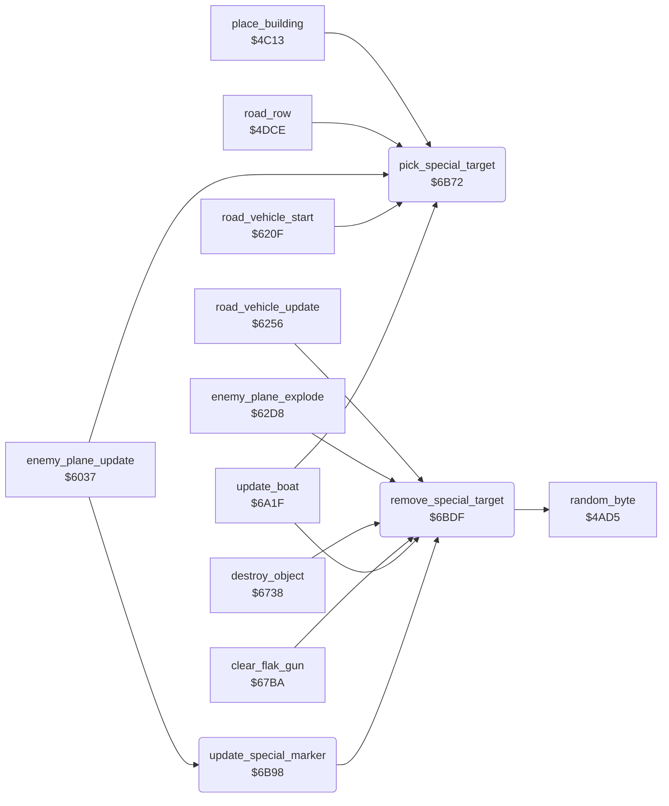

<!-- Generated by c64-docs from knowledge revision 20261024T232120.926-729orp and .c64-re-tools/local/generated/src/source-map.json. Do not edit: change the knowledge, generate the source again, then run docs.ts generate. -->
# enemy/special_targets.asm: Selection and marker of the special targets

Range `$6B72-$6BF6`. Source: [enemy/special_targets.asm](../../../../src/enemy/special_targets.asm). Index: [the reference](../../index.md).

## Call graph

A solid arrow is a call, a thick arrow a table entry, a dotted arrow a jump. Rounded nodes are in this file.

## Data

| Range | Type | Name | Read by | Written by |
|---|---|---|---|---|
| [`$6BDB`](../../../../src/enemy/special_targets.asm#L64)-`$6BDE` | bytes of 4 | [`special_marker_colours`](../../../../src/enemy/special_targets.asm#L63) | [`update_special_marker`](special_targets.md#update_special_marker) |  |

## Names

### [`pick_special_target`](../../../../src/enemy/special_targets.asm#L6) `$6B72`

*routine*

Selects if the next enemy object is a special target. Out: A = 0 (Z set) for a special target, else A = 1.

- **Called from:** [`place_building`](../ground/country_row.md#place_building) [`$4C97`](../../../../src/ground/country_row.asm#L218), [`road_row`](../ground/road.md#road_row) [`$4E0F`](../../../../src/ground/road.asm#L38), [`enemy_plane_update`](enemy_plane.md#enemy_plane_update) [`$6070`](../../../../src/enemy/enemy_plane.asm#L37), [`road_vehicle_start`](road_vehicle.md#road_vehicle_start) [`$624C`](../../../../src/enemy/road_vehicle.asm#L35), [`update_boat`](boat.md#update_boat) [`$6A8A`](../../../../src/enemy/boat.asm#L58)
- **Reads:** [`special_target`](../data/variables.md#special_target), [`targets_left`](../data/variables.md#targets_left), [`special_wait`](../data/variables.md#special_wait), [`map_section`](../data/variables.md#map_section), [`enemy_timer`](../data/variables.md#enemy_timer)
- **Writes:** [`special_wait`](../data/variables.md#special_wait)

### [`pick_special_target_no`](../../../../src/enemy/special_targets.asm#L23) `$6B95`

*label*

- **Jumped to from:** [`pick_special_target`](special_targets.md#pick_special_target) [`$6B75`](../../../../src/enemy/special_targets.asm#L8), [`pick_special_target`](special_targets.md#pick_special_target) [`$6B7A`](../../../../src/enemy/special_targets.asm#L10), [`pick_special_target`](special_targets.md#pick_special_target) [`$6B7F`](../../../../src/enemy/special_targets.asm#L12), [`pick_special_target`](special_targets.md#pick_special_target) [`$6B90`](../../../../src/enemy/special_targets.asm#L20)

### [`update_special_marker`](../../../../src/enemy/special_targets.asm#L27) `$6B98`

*routine*

Flashes the special target. $4055 = 1: moves the cross box (sprite 7) with the ground. Else flashes the colour of sprite 1.

- **Called from:** [`enemy_plane_update`](enemy_plane.md#enemy_plane_update) [`$6045`](../../../../src/enemy/enemy_plane.asm#L13)
- **Calls:** [`remove_special_target`](special_targets.md#remove_special_target)
- **Reads:** [`special_target`](../data/variables.md#special_target), [`frame_count`](../data/variables.md#frame_count), [`sprite_enable`](../data/variables.md#sprite_enable), [`enemy_shadow_y`](../data/variables.md#enemy_shadow_y), [`enemy_shadow_x`](../data/variables.md#enemy_shadow_x)
- **Writes:** [`enemy_shadow_colour`](../data/variables.md#enemy_shadow_colour), [`enemy_shadow_frame`](../data/variables.md#enemy_shadow_frame), [`sprite_enable`](../data/variables.md#sprite_enable), [`enemy_shadow_y`](../data/variables.md#enemy_shadow_y), [`enemy_shadow_x`](../data/variables.md#enemy_shadow_x), [`enemy_colour`](../data/variables.md#enemy_colour)

### [`update_special_marker_colour`](../../../../src/enemy/special_targets.asm#L31) `$6B9E`

*label*

- **Jumped to from:** [`update_special_marker`](special_targets.md#update_special_marker) [`$6B9B`](../../../../src/enemy/special_targets.asm#L29)

### [`update_special_marker_done`](../../../../src/enemy/special_targets.asm#L56) `$6BD3`

*label*

- **Jumped to from:** [`update_special_marker`](special_targets.md#update_special_marker) [`$6BCC`](../../../../src/enemy/special_targets.asm#L52)

### [`update_special_marker_plane`](../../../../src/enemy/special_targets.asm#L58) `$6BD4`

*label*

- **Jumped to from:** [`update_special_marker`](special_targets.md#update_special_marker) [`$6BA9`](../../../../src/enemy/special_targets.asm#L39)

### [`special_marker_colours`](../../../../src/enemy/special_targets.asm#L63) `$6BDB-$6BDE`

*data*

Flash colours of the special target, by bits 3-4 of the frame counter.

- **Read by:** [`update_special_marker`](special_targets.md#update_special_marker) [`$6BAB`](../../../../src/enemy/special_targets.asm#L40), [`update_special_marker`](special_targets.md#update_special_marker) [`$6BD4`](../../../../src/enemy/special_targets.asm#L59)

### [`remove_special_target`](../../../../src/enemy/special_targets.asm#L66) `$6BDF`

*routine*

Ends the special target. In: A = sprite enable mask. Sets $4054 = 2 and $4055 = 0.

- **Called from:** [`road_vehicle_update`](road_vehicle.md#road_vehicle_update) [`$62BC`](../../../../src/enemy/road_vehicle.asm#L89), [`enemy_plane_explode`](road_vehicle.md#enemy_plane_explode) [`$62E9`](../../../../src/enemy/road_vehicle.asm#L112), [`destroy_object`](../ground/ground_hits.md#destroy_object) [`$67B4`](../../../../src/ground/ground_hits.asm#L188), [`clear_flak_gun`](../ground/ground_hits.md#clear_flak_gun) [`$67EA`](../../../../src/ground/ground_hits.asm#L220), [`update_boat`](boat.md#update_boat) [`$6B67`](../../../../src/enemy/boat.asm#L167), [`update_special_marker`](special_targets.md#update_special_marker) [`$6BD0`](../../../../src/enemy/special_targets.asm#L55)
- **Calls:** [`random_byte`](../game/random.md#random_byte)
- **Reads:** [`sprite_enable`](../data/variables.md#sprite_enable)
- **Writes:** [`sprite_enable`](../data/variables.md#sprite_enable), [`special_wait`](../data/variables.md#special_wait), [`special_target`](../data/variables.md#special_target)
