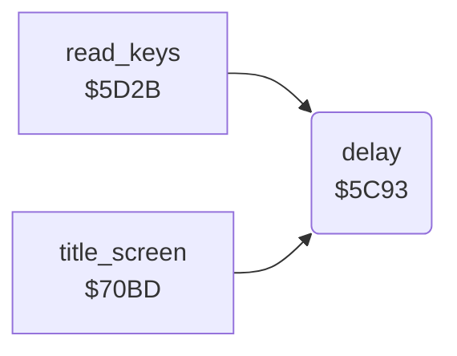

<!-- Generated by c64-docs from knowledge revision 20261025T214620.804-eudhn0 and .c64-re-tools/local/generated/src/source-map.json. Do not edit: change the knowledge, generate the source again, then run docs.ts generate. -->
# game/delay.asm: Delay loop

Range `$5C93-$5CA4`. Source: [game/delay.asm](../../../../src/game/delay.asm). Index: [the reference](../../index.md).

## Routines

| Routine | Address | Reached from | Summary |
|---|---|---|---|
| [`delay`](delay.md#delay) | `$5C93` | [`read_keys`](../input/keyboard.md#read_keys), [`title_screen`](../screen/title_screen.md#title_screen) | Waits Y * 256 loops (Y = 0 gives 256 * 256). |

## Call graph

A solid arrow is a call, a thick arrow a table entry. Rounded nodes are in this file.

## Details

### [`delay`](../../../../src/game/delay.asm#L6) `$5C93`

*routine*

Waits Y * 256 loops (Y = 0 gives 256 * 256). Keeps A and X.

- **Called from:** [`read_keys`](../input/keyboard.md#read_keys), [`title_screen`](../screen/title_screen.md#title_screen)

| Label | Address | Comment |
|---|---|---|
| [`delay_outer`](../../../../src/game/delay.asm#L11) | `$5C98` |  |
| [`delay_inner`](../../../../src/game/delay.asm#L14) | `$5C9B` |  |
| [`delay_done`](../../../../src/game/delay.asm#L18) | `$5CA1` |  |
