<!-- Generated by c64-docs from knowledge revision 20261025T214620.804-eudhn0 and .c64-re-tools/local/generated/src/source-map.json. Do not edit: change the knowledge, generate the source again, then run docs.ts generate. -->
# game/random.asm: Random number generator

Range `$4AD5-$4AE5`. Source: [game/random.asm](../../../../src/game/random.asm). Index: [the reference](../../index.md).

## Routines

| Routine | Address | Reached from | Summary |
|---|---|---|---|
| [`random_byte`](random.md#random_byte) | `$4AD5` | [`cold_start`](../init/game_start.md#cold_start), [`draw_river_row`](../ground/river.md#draw_river_row), [`place_trees`](../ground/country_row.md#place_trees), [`place_ship`](../ground/country_row.md#place_ship), [`place_building`](../ground/country_row.md#place_building), [`pick_building_type`](../ground/country_row.md#pick_building_type), [`place_ground_targets_any`](../ground/country_row.md#place_ground_targets_any), [`random_spread`](../ground/country_row.md#random_spread), [`road_row`](../ground/road.md#road_row), [`city_place_boat`](../ground/city.md#city_place_boat), [`city_building_row`](../ground/city.md#city_building_row), [`city_build_shape`](../ground/city.md#city_build_shape) and 21 more | Returns a new random byte in A and in the seed $d9. |

## Call graph

A solid arrow is a call, a thick arrow a table entry. Rounded nodes are in this file.

The graph shows 30 of the 31 edges.

```mermaid
flowchart LR
  n40f8["cold_start<br/>$40F8"]
  n4920["draw_river_row<br/>$4920"]
  n4ad5("random_byte<br/>$4AD5")
  n4b2e["place_trees<br/>$4B2E"]
  n4bb3["place_ship<br/>$4BB3"]
  n4c13["place_building<br/>$4C13"]
  n4d48["pick_building_type<br/>$4D48"]
  n4d71["place_ground_targets_any<br/>$4D71"]
  n4db4["random_spread<br/>$4DB4"]
  n4dce["road_row<br/>$4DCE"]
  n518a["city_place_boat<br/>$518A"]
  n51dd["city_building_row<br/>$51DD"]
  n522e["city_build_shape<br/>$522E"]
  n5912["plane_control<br/>$5912"]
  n5c10["autopilot_joystick<br/>$5C10"]
  n5de4["next_map_section<br/>$5DE4"]
  n5e3f["update_wind<br/>$5E3F"]
  n5ef9["runway_attacker<br/>$5EF9"]
  n5f0c["runway_attacker_start<br/>$5F0C"]
  n5fa4["enemy_bomb_drop<br/>$5FA4"]
  n6108["enemy_plane_delay_set<br/>$6108"]
  n611e["enemy_plane_move<br/>$611E"]
  n620f["road_vehicle_start<br/>$620F"]
  n62d8["enemy_plane_explode<br/>$62D8"]
  n6382["update_weapons<br/>$6382"]
  n6974["plane_hit_by_shell<br/>$6974"]
  n6a1f["update_boat<br/>$6A1F"]
  n6bdf["remove_special_target<br/>$6BDF"]
  n6bf7["update_shells<br/>$6BF7"]
  n6f07["plane_service<br/>$6F07"]
  n7001["animate_chars<br/>$7001"]
  n40f8 --> n4ad5
  n4920 --> n4ad5
  n4b2e --> n4ad5
  n4bb3 --> n4ad5
  n4c13 --> n4ad5
  n4d48 --> n4ad5
  n4d71 --> n4ad5
  n4db4 --> n4ad5
  n4dce --> n4ad5
  n518a --> n4ad5
  n51dd --> n4ad5
  n522e --> n4ad5
  n5912 --> n4ad5
  n5c10 --> n4ad5
  n5de4 --> n4ad5
  n5e3f --> n4ad5
  n5ef9 --> n4ad5
  n5f0c --> n4ad5
  n5fa4 --> n4ad5
  n6108 --> n4ad5
  n611e --> n4ad5
  n620f --> n4ad5
  n62d8 --> n4ad5
  n6382 --> n4ad5
  n6974 --> n4ad5
  n6a1f --> n4ad5
  n6bdf --> n4ad5
  n6bf7 --> n4ad5
  n6f07 --> n4ad5
  n7001 --> n4ad5
```

## Details

### [`random_byte`](../../../../src/game/random.asm#L6) `$4AD5`

*routine*

Returns a new random byte in A and in the seed $d9. Mixes the seed with RASTER, $4017 and $4018. The entry carry changes it.

- **Called from:** [`cold_start`](../init/game_start.md#cold_start), [`$4491`](../../../../src/screen/status_line.asm#L113), [`$4496`](../../../../src/screen/status_line.asm#L115), [`draw_river_row`](../ground/river.md#draw_river_row), [`place_trees`](../ground/country_row.md#place_trees), [`place_ship`](../ground/country_row.md#place_ship), [`place_building`](../ground/country_row.md#place_building), [`pick_building_type`](../ground/country_row.md#pick_building_type), [`place_ground_targets_any`](../ground/country_row.md#place_ground_targets_any), [`random_spread`](../ground/country_row.md#random_spread), [`road_row`](../ground/road.md#road_row), [`city_place_boat`](../ground/city.md#city_place_boat) and 21 more
- **Reads:** [`random_seed`](../../memory-map.md#random_seed), [`RASTER`](../../memory-map.md#RASTER), [`loop_count`](../data/variables.md#loop_count), [`scroll_frames`](../data/variables.md#scroll_frames)
- **Writes:** [`random_seed`](../../memory-map.md#random_seed)
