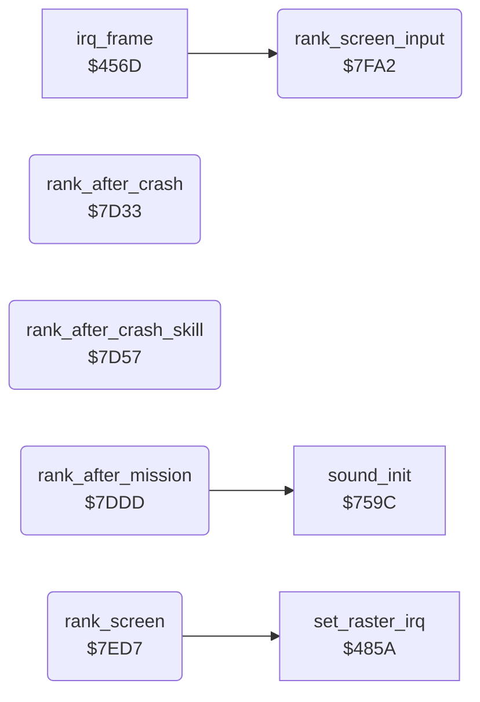

<!-- Generated by c64-docs from knowledge revision 20261025T214620.804-eudhn0 and .c64-re-tools/local/generated/src/source-map.json. Do not edit: change the knowledge, generate the source again, then run docs.ts generate. -->
# game/rank.asm: Rank and class at the end of a game

Range `$7D33-$7FFF`. Source: [game/rank.asm](../../../../src/game/rank.asm). Index: [the reference](../../index.md).

## Routines

| Routine | Address | Reached from | Summary |
|---|---|---|---|
| [`rank_after_crash`](rank.md#rank_after_crash) | `$7D33` | [`update_crash`](../plane/crash.md#update_crash) | After a crash: calculates rank $408e and class $408f from score, gravity, skill level and $4073, then shows the rank screen. |
| [`rank_after_crash_skill`](rank.md#rank_after_crash_skill) | `$7D57` | [`$43B5`](../../../../src/protection/loader_check.asm#L22) | Entry from $43b5 (loader check fails): uses the value in $d3 as it is. |
| [`rank_after_mission`](rank.md#rank_after_mission) | `$7DDD` | [`update_mission_end`](../plane/crash.md#update_mission_end) | After the mission is complete: subtracts gravity, skill level and score digits from the score $408c/$408d and selects FLYING TIGER, SQUADRON LEADER or BLUE MAX. |
| [`rank_screen`](rank.md#rank_screen) | `$7ED7` |  | Shows rank text and CLASS digit in the status line at $0f70, sets the game interrupt ($456d, line $db) and waits for ever. |
| [`rank_screen_input`](rank.md#rank_screen_input) | `$7FA2` | [`irq_frame`](../irq/frame_irq.md#irq_frame) | Rank screen interrupt part. |

## Data

| Range | Type | Name | Read by | Written by |
|---|---|---|---|---|
| [`$7F3C`](../../../../src/game/rank.asm#L284)-`$7FA1` | petscii of 17 | [`rank_texts`](../../../../src/game/rank.asm#L283) | [`rank_screen`](rank.md#rank_screen) |  |
| [`$7FCA`](../../../../src/game/rank.asm#L314)-`$7FF1` | petscii | [`text_class_line`](../../../../src/game/rank.asm#L313) | [`rank_screen`](rank.md#rank_screen) |  |
| [`$7FF2`](../../../../src/game/rank.asm#L318)-`$7FFF` | bytes | [`leftover_code_bytes`](../../../../src/game/rank.asm#L317) |  |  |

## Call graph

A solid arrow is a call, a thick arrow a table entry. Rounded nodes are in this file.

## Details

### [`rank_after_crash`](../../../../src/game/rank.asm#L6) `$7D33`

*routine*

After a crash: calculates rank $408e and class $408f from score, gravity, skill level and $4073, then shows the rank screen.
No special target left or score >= 20000: FLYING TIGER, class 4.

- **Jumped to from:** [`update_crash`](../plane/crash.md#update_crash)
- **Jumps to:** [`rank_store_class`](rank.md#rank_store_class)
- **Reads:** [`special_targets`](../data/variables.md#special_targets), [`special_targets_1`](../data/variables.md#special_targets_1), [`special_targets_2`](../data/variables.md#special_targets_2), [`score_10000`](../data/variables.md#score_10000), [`opt_gravity`](../data/variables.md#opt_gravity)
- **Writes:** [`rank_index`](../data/variables.md#rank_index), [`zp_count`](../../memory-map.md#zp_count)

| Label | Address | Comment |
|---|---|---|
| [`rank_after_crash_tiger`](../../../../src/game/rank.asm#L14) | `$7D45` |  |
| [`rank_after_crash_points`](../../../../src/game/rank.asm#L19) | `$7D4F` | $d3 = gravity * 8. |

### [`rank_after_crash_skill`](../../../../src/game/rank.asm#L26) `$7D57`

*label*

Entry from $43b5 (loader check fails): uses the value in $d3 as it is.
$d3 += skill level * 4 + $4073.

- **Called from:** [`$43B5`](../../../../src/protection/loader_check.asm#L22)
- **Jumps to:** [`rank_screen`](rank.md#rank_screen)
- **Reads:** [`opt_skill_level`](../data/variables.md#opt_skill_level), [`zp_count`](../../memory-map.md#zp_count), [`targets_hit`](../data/variables.md#targets_hit), [`score_10000`](../data/variables.md#score_10000), [`score_1000`](../data/variables.md#score_1000), [`zp_temp5`](../../memory-map.md#zp_temp5), [`score_100`](../data/variables.md#score_100), [`zp_temp4`](../../memory-map.md#zp_temp4)
- **Writes:** [`zp_count`](../../memory-map.md#zp_count), [`zp_temp4`](../../memory-map.md#zp_temp4), [`zp_temp5`](../../memory-map.md#zp_temp5), [`rank_index`](../data/variables.md#rank_index), [`rank_class`](../data/variables.md#rank_class)

| Label | Address | Comment |
|---|---|---|
| [`rank_after_crash_score`](../../../../src/game/rank.asm#L37) | `$7D6C` | Score digits: thousands * 10 + hundreds. |
| [`rank_after_crash_sweeper`](../../../../src/game/rank.asm#L51) | `$7D87` |  |
| [`rank_sweeper_class3`](../../../../src/game/rank.asm#L62) | `$7D9A` |  |
| [`rank_sweeper_class2`](../../../../src/game/rank.asm#L67) | `$7DA3` |  |
| [`rank_sweeper_class1`](../../../../src/game/rank.asm#L73) | `$7DAC` |  |
| [`rank_cadet`](../../../../src/game/rank.asm#L78) | `$7DB5` | AIR CADET: below 33 class 4, below 48 class 3, below 65 class 2, else class 1. |
| [`rank_cadet_class3`](../../../../src/game/rank.asm#L85) | `$7DC3` |  |
| [`rank_cadet_class2`](../../../../src/game/rank.asm#L90) | `$7DCC` |  |
| [`rank_cadet_class1`](../../../../src/game/rank.asm#L95) | `$7DD5` |  |
| [`rank_store_class`](../../../../src/game/rank.asm#L97) | `$7DD7` |  |

### [`rank_after_mission`](../../../../src/game/rank.asm#L101) `$7DDD`

*routine*

After the mission is complete: subtracts gravity, skill level and score digits from the score $408c/$408d and selects FLYING TIGER, SQUADRON LEADER or BLUE MAX.

- **Jumped to from:** [`update_mission_end`](../plane/crash.md#update_mission_end)
- **Calls:** [`sound_init`](../music/music_player.md#sound_init)
- **Reads:** [`opt_gravity`](../data/variables.md#opt_gravity), [`opt_skill_level`](../data/variables.md#opt_skill_level), [`zp_count`](../../memory-map.md#zp_count), [`play_time_mid`](../data/variables.md#play_time_mid), [`play_time_hi`](../data/variables.md#play_time_hi), [`score_10000`](../data/variables.md#score_10000), [`score_1000`](../data/variables.md#score_1000), [`score_100`](../data/variables.md#score_100)
- **Writes:** [`zp_count`](../../memory-map.md#zp_count), [`play_time_hi`](../data/variables.md#play_time_hi), [`play_time_mid`](../data/variables.md#play_time_mid), [`score_1000`](../data/variables.md#score_1000), [`rank_index`](../data/variables.md#rank_index), [`rank_class`](../data/variables.md#rank_class), [`music_on`](../data/variables.md#music_on)

| Label | Address | Comment |
|---|---|---|
| [`rank_mission_sub_hundreds`](../../../../src/game/rank.asm#L121) | `$7E02` | Subtracts 100 for each ten-thousands digit $40be. |
| [`rank_mission_tens`](../../../../src/game/rank.asm#L134) | `$7E1C` |  |
| [`rank_mission_sub_tens`](../../../../src/game/rank.asm#L137) | `$7E21` | The loop tests $d3 but decrements $40bf; with $40bf non-zero it does not end. |
| [`rank_mission_units`](../../../../src/game/rank.asm#L150) | `$7E3C` |  |
| [`rank_mission_check_high`](../../../../src/game/rank.asm#L167) | `$7E61` |  |
| [`rank_mission_tiger2`](../../../../src/game/rank.asm#L173) | `$7E6A` | FLYING TIGER, class 2. |
| [`rank_mission_tiger1`](../../../../src/game/rank.asm#L178) | `$7E74` |  |
| [`rank_mission_leader`](../../../../src/game/rank.asm#L186) | `$7E82` | SQUADRON LEADER: class 4 from 120, 3 from 100, 2 from 80, 1 from 60. |
| [`rank_mission_leader3`](../../../../src/game/rank.asm#L193) | `$7E90` |  |
| [`rank_mission_leader2`](../../../../src/game/rank.asm#L198) | `$7E99` |  |
| [`rank_mission_leader1`](../../../../src/game/rank.asm#L203) | `$7EA2` |  |
| [`rank_mission_leader_low`](../../../../src/game/rank.asm#L208) | `$7EAB` | Below 60: SQUADRON LEADER, class 4 from 40, else class 3 or 2 by skill level. |
| [`rank_mission_low_check`](../../../../src/game/rank.asm#L215) | `$7EB9` |  |
| [`rank_mission_class3`](../../../../src/game/rank.asm#L218) | `$7EBD` |  |
| [`rank_mission_beginner`](../../../../src/game/rank.asm#L221) | `$7EC2` |  |
| [`rank_mission_store`](../../../../src/game/rank.asm#L226) | `$7ECC` |  |

### [`rank_screen`](../../../../src/game/rank.asm#L232) `$7ED7`

*routine*

Shows rank text and CLASS digit in the status line at $0f70, sets the game interrupt ($456d, line $db) and waits for ever.
Unused load; A changes in the loop.

- **Jumped to from:** [`rank_after_crash_skill`](rank.md#rank_after_crash_skill)
- **Calls:** [`set_raster_irq`](../irq/raster.md#set_raster_irq)
- **Reads:** [`text_class_line`](rank.md#text_class_line), [`rank_class`](../data/variables.md#rank_class), [`rank_index`](../data/variables.md#rank_index)
- **Writes:** [`status_rows`](../../memory-map.md#status_rows), [`status_sprite_ptr`](../data/variables.md#status_sprite_ptr), [`rank_delay`](../data/variables.md#rank_delay), [`rank_screen_on`](../data/variables.md#rank_screen_on), [`game_frozen`](../data/variables.md#game_frozen), `$DB99`, `$DB9A`, `$DB9B`, `$DB9C`, `$DB9D`, [`mission_done`](../data/variables.md#mission_done)

| Label | Address | Comment |
|---|---|---|
| [`rank_screen_line_loop`](../../../../src/game/rank.asm#L235) | `$7EDB` |  |
| [`rank_screen_text_loop`](../../../../src/game/rank.asm#L255) | `$7EFF` |  |
| [`rank_screen_wait`](../../../../src/game/rank.asm#L280) | `$7F39` |  |

### [`rank_texts`](../../../../src/game/rank.asm#L283) `$7F3C-$7FA1`

*data*

Six rank texts, 17 characters each, index $408e: KAMIKAZE TRAINEE, RUNWAY SWEEPER, AIR CADET, FLYING TIGER, SQUADRON LEADER, BLUE MAX.

- **Read by:** [`rank_screen`](rank.md#rank_screen)

### [`rank_screen_input`](../../../../src/game/rank.asm#L291) `$7FA2`

*routine*

Rank screen interrupt part. After the delay, a function key or demo mode goes to the title ($411d), fire restarts the game ($4126).

- **Called from:** [`irq_frame`](../irq/frame_irq.md#irq_frame)
- **Jumps to:** [`restart_title`](../init/game_start.md#restart_title), [`game_start`](../init/game_start.md#game_start)
- **Reads:** [`rank_delay`](../data/variables.md#rank_delay), [`fkey_code`](../data/variables.md#fkey_code), [`demo_mode`](../data/variables.md#demo_mode), [`CIAPRA`](../../memory-map.md#CIAPRA)
- **Writes:** [`rank_delay`](../data/variables.md#rank_delay), [`SCROLY`](../../memory-map.md#SCROLY)

| Label | Address | Comment |
|---|---|---|
| [`rank_screen_check_keys`](../../../../src/game/rank.asm#L296) | `$7FAD` |  |
| [`rank_screen_check_fire`](../../../../src/game/rank.asm#L302) | `$7FB9` |  |
| [`rank_screen_input_done`](../../../../src/game/rank.asm#L310) | `$7FC9` |  |

### [`text_class_line`](../../../../src/game/rank.asm#L313) `$7FCA-$7FF1`

*data*

Status line of the rank screen, 40 characters: spaces and 'CLASS'.

- **Read by:** [`rank_screen`](rank.md#rank_screen)

### [`leftover_code_bytes`](../../../../src/game/rank.asm#L317) `$7FF2-$7FFF`

*data*

Never used. Bytes of old code: STA $4087, STA $D40B, RTS, ... The bytes from $8000 copy $7e04-$7e4f.
