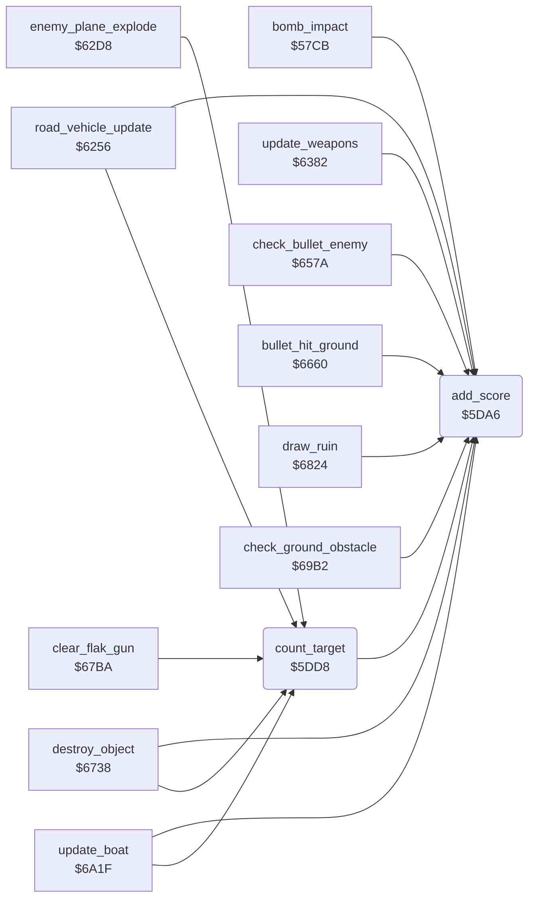

<!-- Generated by c64-docs from knowledge revision 20261024T232120.926-729orp and .c64-re-tools/local/generated/src/source-map.json. Do not edit: change the knowledge, generate the source again, then run docs.ts generate. -->
# game/score.asm: Score

Range `$5DA6-$5DE3`. Source: [game/score.asm](../../../../src/game/score.asm). Index: [the reference](../../index.md).

## Call graph

A solid arrow is a call, a thick arrow a table entry, a dotted arrow a jump. Rounded nodes are in this file.

## Names

### [`add_score`](../../../../src/game/score.asm#L6) `$5DA6`

*routine*

Adds A to the score digits $40be-$40c1 (one decimal digit per byte, $40c1 lowest). Changes A.

- **Called from:** [`bomb_impact`](../ground/bomb_impact.md#bomb_impact) [`$57F1`](../../../../src/ground/bomb_impact.asm#L28), [`bomb_impact`](../ground/bomb_impact.md#bomb_impact) [`$5850`](../../../../src/ground/bomb_impact.asm#L72), [`bomb_impact`](../ground/bomb_impact.md#bomb_impact) [`$586C`](../../../../src/ground/bomb_impact.asm#L87), [`count_target`](score.md#count_target) [`$5DE0`](../../../../src/game/score.asm#L39), [`road_vehicle_update`](../enemy/road_vehicle.md#road_vehicle_update) [`$62AA`](../../../../src/enemy/road_vehicle.asm#L82), [`road_vehicle_update`](../enemy/road_vehicle.md#road_vehicle_update) [`$62C1`](../../../../src/enemy/road_vehicle.asm#L91), [`update_weapons`](../plane/weapons.md#update_weapons) [`$648E`](../../../../src/plane/weapons.asm#L149), [`update_weapons`](../plane/weapons.md#update_weapons) [`$6573`](../../../../src/plane/weapons.asm#L263), [`check_bullet_enemy`](../plane/weapons.md#check_bullet_enemy) [`$65E3`](../../../../src/plane/weapons.asm#L328), [`check_bullet_enemy`](../plane/weapons.md#check_bullet_enemy) [`$661A`](../../../../src/plane/weapons.asm#L358), [`check_bullet_enemy`](../plane/weapons.md#check_bullet_enemy) [`$662E`](../../../../src/plane/weapons.asm#L368), [`check_bullet_enemy`](../plane/weapons.md#check_bullet_enemy) [`$663D`](../../../../src/plane/weapons.asm#L375), [`bullet_hit_ground`](../ground/ground_hits.md#bullet_hit_ground) [`$669E`](../../../../src/ground/ground_hits.asm#L42), [`bullet_hit_ground`](../ground/ground_hits.md#bullet_hit_ground) [`$66CC`](../../../../src/ground/ground_hits.asm#L66), [`bullet_hit_ground`](../ground/ground_hits.md#bullet_hit_ground) [`$66E7`](../../../../src/ground/ground_hits.asm#L78), [`bullet_hit_ground`](../ground/ground_hits.md#bullet_hit_ground) [`$670C`](../../../../src/ground/ground_hits.asm#L95), [`destroy_object`](../ground/ground_hits.md#destroy_object) [`$677F`](../../../../src/ground/ground_hits.asm#L160), [`destroy_object`](../ground/ground_hits.md#destroy_object) [`$679B`](../../../../src/ground/ground_hits.asm#L178), [`draw_ruin`](../ground/ground_hits.md#draw_ruin) [`$6856`](../../../../src/ground/ground_hits.asm#L293), [`check_ground_obstacle`](../ground/obstacles.md#check_ground_obstacle) [`$69C1`](../../../../src/ground/obstacles.asm#L14), [`update_boat`](../enemy/boat.md#update_boat) [`$6AE8`](../../../../src/enemy/boat.asm#L108), [`update_boat`](../enemy/boat.md#update_boat) [`$6B6C`](../../../../src/enemy/boat.asm#L169)
- **Reads:** [`score_10`](../data/variables.md#score_10), [`score_100`](../data/variables.md#score_100), [`score_1000`](../data/variables.md#score_1000), [`score_10000`](../data/variables.md#score_10000)
- **Writes:** [`score_100`](../data/variables.md#score_100), [`score_10`](../data/variables.md#score_10), [`score_1000`](../data/variables.md#score_1000), [`score_10000`](../data/variables.md#score_10000)

### [`add_score_carry`](../../../../src/game/score.asm#L9) `$5DAA`

*label*

- **Jumped to from:** [`add_score`](score.md#add_score) [`$5DB3`](../../../../src/game/score.asm#L14)

### [`add_score_tens`](../../../../src/game/score.asm#L15) `$5DB6`

*label*

- **Jumped to from:** [`add_score`](score.md#add_score) [`$5DAC`](../../../../src/game/score.asm#L11)

### [`add_score_hundreds`](../../../../src/game/score.asm#L23) `$5DC5`

*label*

- **Jumped to from:** [`add_score`](score.md#add_score) [`$5DBE`](../../../../src/game/score.asm#L19)

### [`add_score_done`](../../../../src/game/score.asm#L31) `$5DD4`

*label*

- **Jumped to from:** [`add_score`](score.md#add_score) [`$5DCD`](../../../../src/game/score.asm#L27)

### [`count_target`](../../../../src/game/score.asm#L35) `$5DD8`

*routine*

Counts a destroyed target: $4073 + 1, $4075 - 1, 5 score units (50 points).

- **Called from:** [`road_vehicle_update`](../enemy/road_vehicle.md#road_vehicle_update) [`$62B7`](../../../../src/enemy/road_vehicle.asm#L87), [`enemy_plane_explode`](../enemy/road_vehicle.md#enemy_plane_explode) [`$62E4`](../../../../src/enemy/road_vehicle.asm#L110), [`destroy_object`](../ground/ground_hits.md#destroy_object) [`$67AF`](../../../../src/ground/ground_hits.asm#L186), [`clear_flak_gun`](../ground/ground_hits.md#clear_flak_gun) [`$67E5`](../../../../src/ground/ground_hits.asm#L218), [`update_boat`](../enemy/boat.md#update_boat) [`$6B62`](../../../../src/enemy/boat.asm#L165)
- **Calls:** [`add_score`](score.md#add_score)
- **Reads:** [`targets_hit`](../data/variables.md#targets_hit), [`targets_left`](../data/variables.md#targets_left)
- **Writes:** [`targets_hit`](../data/variables.md#targets_hit), [`targets_left`](../data/variables.md#targets_left)
