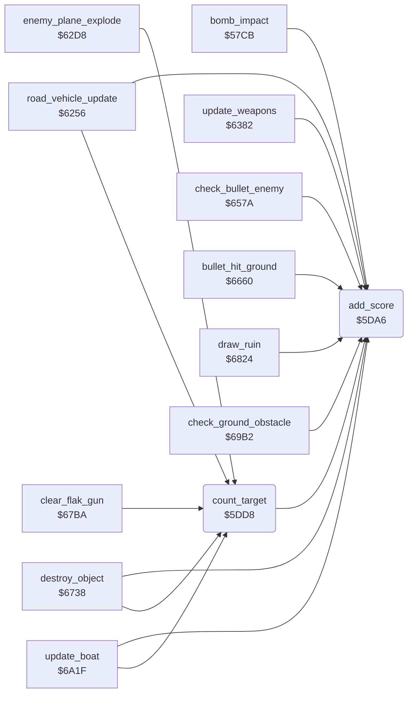

<!-- Generated by c64-docs from knowledge revision 20261025T214620.804-eudhn0 and .c64-re-tools/local/generated/src/source-map.json. Do not edit: change the knowledge, generate the source again, then run docs.ts generate. -->
# game/score.asm: Score

Range `$5DA6-$5DE3`. Source: [game/score.asm](../../../../src/game/score.asm). Index: [the reference](../../index.md).

## Routines

| Routine | Address | Reached from | Summary |
|---|---|---|---|
| [`add_score`](score.md#add_score) | `$5DA6` | [`bomb_impact`](../ground/bomb_impact.md#bomb_impact), [`count_target`](score.md#count_target), [`road_vehicle_update`](../enemy/road_vehicle.md#road_vehicle_update), [`update_weapons`](../plane/weapons.md#update_weapons), [`check_bullet_enemy`](../plane/weapons.md#check_bullet_enemy), [`bullet_hit_ground`](../ground/ground_hits.md#bullet_hit_ground), [`destroy_object`](../ground/ground_hits.md#destroy_object), [`draw_ruin`](../ground/ground_hits.md#draw_ruin), [`check_ground_obstacle`](../ground/obstacles.md#check_ground_obstacle), [`update_boat`](../enemy/boat.md#update_boat) | Adds A to the score digits $40be-$40c1 (one decimal digit per byte, $40c1 lowest). |
| [`count_target`](score.md#count_target) | `$5DD8` | [`road_vehicle_update`](../enemy/road_vehicle.md#road_vehicle_update), [`enemy_plane_explode`](../enemy/road_vehicle.md#enemy_plane_explode), [`destroy_object`](../ground/ground_hits.md#destroy_object), [`clear_flak_gun`](../ground/ground_hits.md#clear_flak_gun), [`update_boat`](../enemy/boat.md#update_boat) | Counts a destroyed target: $4073 + 1, $4075 - 1, 5 score units (50 points). |

## Call graph

A solid arrow is a call, a thick arrow a table entry. Rounded nodes are in this file.

## Details

### [`add_score`](../../../../src/game/score.asm#L6) `$5DA6`

*routine*

Adds A to the score digits $40be-$40c1 (one decimal digit per byte, $40c1 lowest). Changes A.

- **Called from:** [`bomb_impact`](../ground/bomb_impact.md#bomb_impact), [`count_target`](score.md#count_target), [`road_vehicle_update`](../enemy/road_vehicle.md#road_vehicle_update), [`update_weapons`](../plane/weapons.md#update_weapons), [`check_bullet_enemy`](../plane/weapons.md#check_bullet_enemy), [`bullet_hit_ground`](../ground/ground_hits.md#bullet_hit_ground), [`destroy_object`](../ground/ground_hits.md#destroy_object), [`draw_ruin`](../ground/ground_hits.md#draw_ruin), [`check_ground_obstacle`](../ground/obstacles.md#check_ground_obstacle), [`update_boat`](../enemy/boat.md#update_boat)
- **Reads:** [`score_10`](../data/variables.md#score_10), [`score_100`](../data/variables.md#score_100), [`score_1000`](../data/variables.md#score_1000), [`score_10000`](../data/variables.md#score_10000)
- **Writes:** [`score_100`](../data/variables.md#score_100), [`score_10`](../data/variables.md#score_10), [`score_1000`](../data/variables.md#score_1000), [`score_10000`](../data/variables.md#score_10000)

| Label | Address | Comment |
|---|---|---|
| [`add_score_carry`](../../../../src/game/score.asm#L9) | `$5DAA` |  |
| [`add_score_tens`](../../../../src/game/score.asm#L15) | `$5DB6` |  |
| [`add_score_hundreds`](../../../../src/game/score.asm#L23) | `$5DC5` |  |
| [`add_score_done`](../../../../src/game/score.asm#L31) | `$5DD4` |  |

### [`count_target`](../../../../src/game/score.asm#L35) `$5DD8`

*routine*

Counts a destroyed target: $4073 + 1, $4075 - 1, 5 score units (50 points).

- **Called from:** [`road_vehicle_update`](../enemy/road_vehicle.md#road_vehicle_update), [`enemy_plane_explode`](../enemy/road_vehicle.md#enemy_plane_explode), [`destroy_object`](../ground/ground_hits.md#destroy_object), [`clear_flak_gun`](../ground/ground_hits.md#clear_flak_gun), [`update_boat`](../enemy/boat.md#update_boat)
- **Calls:** [`add_score`](score.md#add_score)
- **Reads:** [`targets_hit`](../data/variables.md#targets_hit), [`targets_left`](../data/variables.md#targets_left)
- **Writes:** [`targets_hit`](../data/variables.md#targets_hit), [`targets_left`](../data/variables.md#targets_left)
