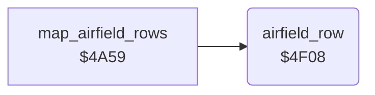

<!-- Generated by c64-docs from knowledge revision 20261025T214620.804-eudhn0 and .c64-re-tools/local/generated/src/source-map.json. Do not edit: change the knowledge, generate the source again, then run docs.ts generate. -->
# ground/airfield.asm: Airfield: runway and hangar rows

Range `$4F08-$4FEC`. Source: [ground/airfield.asm](../../../../src/ground/airfield.asm). Index: [the reference](../../index.md).

## Routines

| Routine | Address | Reached from | Summary |
|---|---|---|---|
| [`airfield_row`](airfield.md#airfield_row) | `$4F08` | [`map_airfield_rows`](airfield_rows.md#map_airfield_rows) | Draws one airfield row: $4031 counts 50 rows. |

## Data

| Range | Type | Name | Read by | Written by |
|---|---|---|---|---|
| [`$4F99`](../../../../src/ground/airfield.asm#L84)-`$4FAC` | bytes of 10 | [`runway_shape`](../../../../src/ground/airfield.asm#L83) | [`airfield_row`](airfield.md#airfield_row) |  |
| [`$4FAD`](../../../../src/ground/airfield.asm#L88)-`$4FEC` | bytes of 8 | [`hangar_shape`](../../../../src/ground/airfield.asm#L87) | [`airfield_row`](airfield.md#airfield_row) |  |

## Call graph

A solid arrow is a call, a thick arrow a table entry. Rounded nodes are in this file.

## Details

### [`airfield_row`](../../../../src/ground/airfield.asm#L6) `$4F08`

*routine*

Draws one airfield row: $4031 counts 50 rows. Runway at columns $1b-$24, hangar at $12-$19 in rows $11-$18. Sets $4062 (airfield on map).

- **Called from:** [`map_airfield_rows`](airfield_rows.md#map_airfield_rows)
- **Reads:** [`airfield_rows`](../data/variables.md#airfield_rows), [`airfield_gap`](../data/variables.md#airfield_gap), [`airfields_passed`](../data/variables.md#airfields_passed), [`road_wait`](../data/variables.md#road_wait), [`row_ptr`](../../memory-map.md#row_ptr), [`zp_count`](../../memory-map.md#zp_count)
- **Writes:** [`quiet_timer`](../data/variables.md#quiet_timer), [`airfield_rows`](../data/variables.md#airfield_rows), [`airfield_active`](../data/variables.md#airfield_active), [`airfield_bombed`](../data/variables.md#airfield_bombed), [`trees_enabled`](../data/variables.md#trees_enabled), [`river_turn_request`](../data/variables.md#river_turn_request), [`airfield_countdown`](../data/variables.md#airfield_countdown), [`airfields_passed`](../data/variables.md#airfields_passed), [`road_wait`](../data/variables.md#road_wait), [`section_end`](../data/variables.md#section_end), [`zp_count`](../../memory-map.md#zp_count)

| Label | Address | Comment |
|---|---|---|
| [`airfield_row_running`](../../../../src/ground/airfield.asm#L20) | `$4F27` |  |
| [`airfield_row_runway`](../../../../src/ground/airfield.asm#L37) | `$4F4D` |  |
| [`airfield_row_edge`](../../../../src/ground/airfield.asm#L47) | `$4F62` | First and last row use the runway edge chars. |
| [`airfield_row_draw`](../../../../src/ground/airfield.asm#L49) | `$4F64` |  |
| [`airfield_row_draw_loop`](../../../../src/ground/airfield.asm#L53) | `$4F6A` |  |
| [`airfield_row_hangar_loop`](../../../../src/ground/airfield.asm#L71) | `$4F88` |  |
| [`airfield_row_done`](../../../../src/ground/airfield.asm#L78) | `$4F93` |  |

### [`runway_shape`](../../../../src/ground/airfield.asm#L83) `$4F99-$4FAC`

*data*

Runway rows, 10 bytes: middle row ($61), then edge row ($64).

- **Read by:** [`airfield_row`](airfield.md#airfield_row)

### [`hangar_shape`](../../../../src/ground/airfield.asm#L87) `$4FAD-$4FEC`

*data*

Hangar rows, 8 bytes each (chars $a7-$b7), row = $4031 - $11.

- **Read by:** [`airfield_row`](airfield.md#airfield_row)
