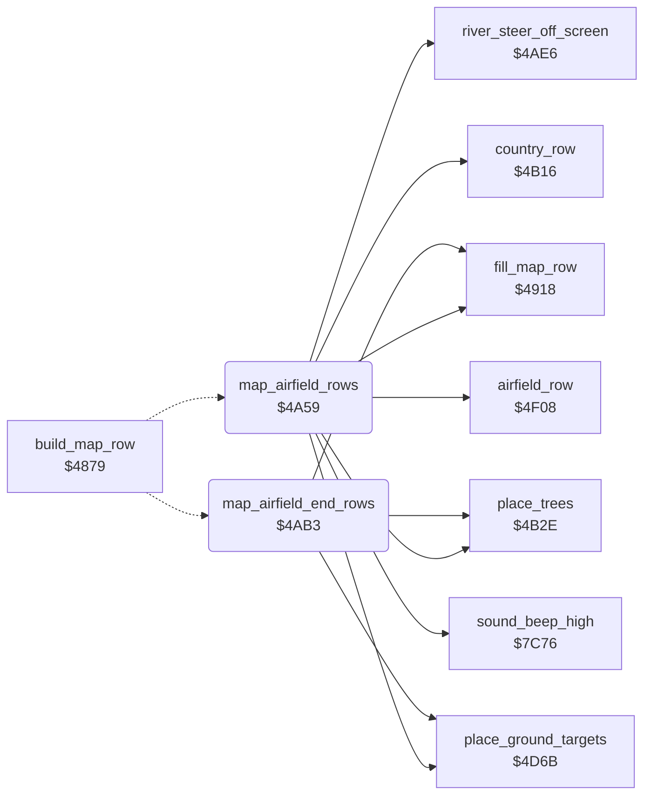

<!-- Generated by c64-docs from knowledge revision 20261024T232120.926-729orp and .c64-re-tools/local/generated/src/source-map.json. Do not edit: change the knowledge, generate the source again, then run docs.ts generate. -->
# ground/airfield_rows.asm: Airfield rows

Range `$4A59-$4AD4`. Source: [ground/airfield_rows.asm](../../../../src/ground/airfield_rows.asm). Index: [the reference](../../index.md).

## Call graph

A solid arrow is a call, a thick arrow a table entry, a dotted arrow a jump. Rounded nodes are in this file.

## Names

### [`map_airfield_rows`](../../../../src/ground/airfield_rows.asm#L6) `$4A59`

*routine*

Feature 8: grows the airfield area $4036 to 23 rows, then draws the airfield with $4f08 and sets multicolour 1 to $0b.

- **Jumped to from:** [`build_map_row`](map_row.md#build_map_row) [`$48FB`](../../../../src/ground/map_row.asm#L77)
- **Entry of:** [`$48E3-$4900`](../../tables.md#table_48e3)
- **Calls:** [`river_steer_off_screen`](river_steer.md#river_steer_off_screen), [`country_row`](country_row.md#country_row), [`sound_beep_high`](../sound/sound_effects.md#sound_beep_high), [`fill_map_row`](map_row.md#fill_map_row), [`place_trees`](country_row.md#place_trees), [`place_ground_targets`](country_row.md#place_ground_targets), [`airfield_row`](airfield.md#airfield_row)
- **Reads:** [`enemy_timer`](../data/variables.md#enemy_timer), [`building_wait`](../data/variables.md#building_wait), [`section_end`](../data/variables.md#section_end), [`section_step`](../data/variables.md#section_step)
- **Writes:** [`enemy_timer`](../data/variables.md#enemy_timer), [`building_wait`](../data/variables.md#building_wait), [`section_step`](../data/variables.md#section_step), [`plane_state`](../data/variables.md#plane_state), [`ground_colour2`](../data/variables.md#ground_colour2)

### [`map_airfield_rows_mark`](../../../../src/ground/airfield_rows.asm#L11) `$4A63`

*label*

- **Jumped to from:** [`map_airfield_rows`](airfield_rows.md#map_airfield_rows) [`$4A5C`](../../../../src/ground/airfield_rows.asm#L8)

### [`map_airfield_rows_check`](../../../../src/ground/airfield_rows.asm#L16) `$4A6D`

*label*

$4074 set: the airfield is complete, draws plain rows.

- **Jumped to from:** [`map_airfield_rows`](airfield_rows.md#map_airfield_rows) [`$4A66`](../../../../src/ground/airfield_rows.asm#L13)

### [`map_airfield_rows_plain`](../../../../src/ground/airfield_rows.asm#L23) `$4A7C`

*label*

- **Jumped to from:** [`map_airfield_rows`](airfield_rows.md#map_airfield_rows) [`$4A70`](../../../../src/ground/airfield_rows.asm#L18)

### [`map_airfield_rows_grow`](../../../../src/ground/airfield_rows.asm#L26) `$4A80`

*label*

- **Jumped to from:** [`map_airfield_rows`](airfield_rows.md#map_airfield_rows) [`$4A75`](../../../../src/ground/airfield_rows.asm#L20), [`map_airfield_rows`](airfield_rows.md#map_airfield_rows) [`$4A7A`](../../../../src/ground/airfield_rows.asm#L22)

### [`map_airfield_rows_draw`](../../../../src/ground/airfield_rows.asm#L36) `$4A96`

*label*

- **Jumped to from:** [`map_airfield_rows`](airfield_rows.md#map_airfield_rows) [`$4A8C`](../../../../src/ground/airfield_rows.asm#L32)

### [`map_airfield_rows_last`](../../../../src/ground/airfield_rows.asm#L42) `$4AA2`

*label*

- **Jumped to from:** [`map_airfield_rows`](airfield_rows.md#map_airfield_rows) [`$4A82`](../../../../src/ground/airfield_rows.asm#L28)

### [`map_airfield_end_rows`](../../../../src/ground/airfield_rows.asm#L51) `$4AB3`

*routine*

Feature 9: counts the airfield area $4036 down. At 0, sets multicolour 1 back to blue and the feature to 0.

- **Jumped to from:** [`build_map_row`](map_row.md#build_map_row) [`$48FE`](../../../../src/ground/map_row.asm#L79)
- **Entry of:** [`$48E3-$4900`](../../tables.md#table_48e3)
- **Calls:** [`fill_map_row`](map_row.md#fill_map_row), [`place_trees`](country_row.md#place_trees), [`place_ground_targets`](country_row.md#place_ground_targets)
- **Reads:** [`section_step`](../data/variables.md#section_step)
- **Writes:** [`section_step`](../data/variables.md#section_step), [`ground_colour2`](../data/variables.md#ground_colour2), [`map_section`](../data/variables.md#map_section)

### [`map_airfield_end_rows_done`](../../../../src/ground/airfield_rows.asm#L59) `$4AC4`

*label*

- **Jumped to from:** [`map_airfield_end_rows`](airfield_rows.md#map_airfield_end_rows) [`$4ABB`](../../../../src/ground/airfield_rows.asm#L55)
