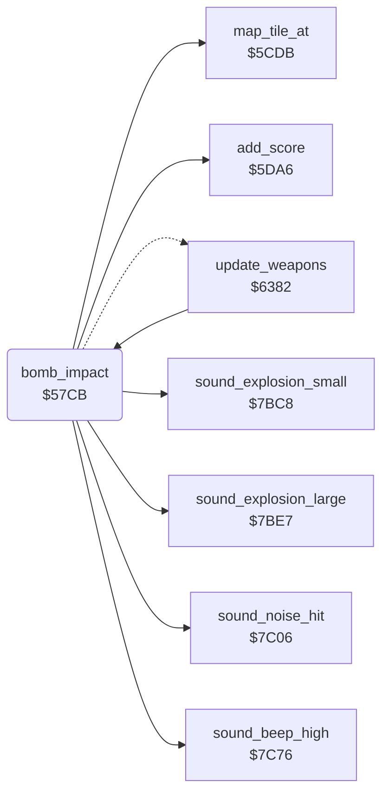

<!-- Generated by c64-docs from knowledge revision 20261024T232120.926-729orp and .c64-re-tools/local/generated/src/source-map.json. Do not edit: change the knowledge, generate the source again, then run docs.ts generate. -->
# ground/bomb_impact.asm: Bomb impact on the map and the special targets

Range `$57CB-$5875`. Source: [ground/bomb_impact.asm](../../../../src/ground/bomb_impact.asm). Index: [the reference](../../index.md).

## Call graph

A solid arrow is a call, a thick arrow a table entry, a dotted arrow a jump. Rounded nodes are in this file.

## Names

### [`bomb_impact`](../../../../src/ground/bomb_impact.asm#L6) `$57CB`

*routine*

Checks the falling bomb (sprite 2, height $4049) against the map tiles and the special target. Adds points and ends the bomb at $64d3.

- **Called from:** [`update_weapons`](../plane/weapons.md#update_weapons) [`$642A`](../../../../src/plane/weapons.asm#L95)
- **Calls:** [`map_tile_at`](map_tile.md#map_tile_at), [`add_score`](../game/score.md#add_score), [`sound_explosion_small`](../sound/sound_effects.md#sound_explosion_small), [`sound_explosion_large`](../sound/sound_effects.md#sound_explosion_large), [`sound_beep_high`](../sound/sound_effects.md#sound_beep_high), [`sound_noise_hit`](../sound/sound_effects.md#sound_noise_hit)
- **Jumps to:** [`end_bomb`](../plane/weapons.md#end_bomb)
- **Reads:** [`bomb_height`](../data/variables.md#bomb_height), [`bomb_x`](../data/variables.md#bomb_x), [`bomb_y`](../data/variables.md#bomb_y), [`map_ptr`](../../memory-map.md#map_ptr), [`special_drop_timer`](../data/variables.md#special_drop_timer), [`special_index`](../data/variables.md#special_index), [`special_targets`](../data/variables.md#special_targets), [`enemy_shadow_x`](../data/variables.md#enemy_shadow_x), [`enemy_shadow_y`](../data/variables.md#enemy_shadow_y)
- **Writes:** [`special_targets`](../data/variables.md#special_targets), [`enemy_shadow_frame`](../data/variables.md#enemy_shadow_frame), [`enemy_shadow_colour`](../data/variables.md#enemy_shadow_colour), [`flash_timer`](../data/variables.md#flash_timer)

### [`bomb_impact_tall_hit`](../../../../src/ground/bomb_impact.asm#L22) `$57E8`

*label*

Tile $5c: destroyed tall object.

- **Jumped to from:** [`bomb_impact`](bomb_impact.md#bomb_impact) [`$57E0`](../../../../src/ground/bomb_impact.asm#L18)

### [`bomb_impact_none`](../../../../src/ground/bomb_impact.asm#L31) `$57FA`

*label*

- **Jumped to from:** [`bomb_impact`](bomb_impact.md#bomb_impact) [`$57E6`](../../../../src/ground/bomb_impact.asm#L21)

### [`bomb_impact_ground`](../../../../src/ground/bomb_impact.asm#L34) `$57FB`

*label*

Height below 2: the bomb is on the ground. First test the special target (sprite 7).

- **Jumped to from:** [`bomb_impact`](bomb_impact.md#bomb_impact) [`$57D0`](../../../../src/ground/bomb_impact.asm#L9)

### [`bomb_impact_crater`](../../../../src/ground/bomb_impact.asm#L75) `$5856`

*label*

The bomb hits the map: tiles with bit 7 set stay, other tiles become crater tiles $5b.

- **Jumped to from:** [`bomb_impact`](bomb_impact.md#bomb_impact) [`$5802`](../../../../src/ground/bomb_impact.asm#L39), [`bomb_impact`](bomb_impact.md#bomb_impact) [`$580A`](../../../../src/ground/bomb_impact.asm#L42), [`bomb_impact`](bomb_impact.md#bomb_impact) [`$5815`](../../../../src/ground/bomb_impact.asm#L47), [`bomb_impact`](bomb_impact.md#bomb_impact) [`$581C`](../../../../src/ground/bomb_impact.asm#L50), [`bomb_impact`](bomb_impact.md#bomb_impact) [`$5827`](../../../../src/ground/bomb_impact.asm#L55), [`bomb_impact`](bomb_impact.md#bomb_impact) [`$582F`](../../../../src/ground/bomb_impact.asm#L59)

### [`bomb_impact_end`](../../../../src/ground/bomb_impact.asm#L89) `$5872`

*label*

- **Jumped to from:** [`bomb_impact`](bomb_impact.md#bomb_impact) [`$5861`](../../../../src/ground/bomb_impact.asm#L81)

### [`bomb_impact_exit`](../../../../src/ground/bomb_impact.asm#L91) `$5875`

*label*

- **Jumped to from:** [`bomb_impact`](bomb_impact.md#bomb_impact) [`$57FD`](../../../../src/ground/bomb_impact.asm#L36)
