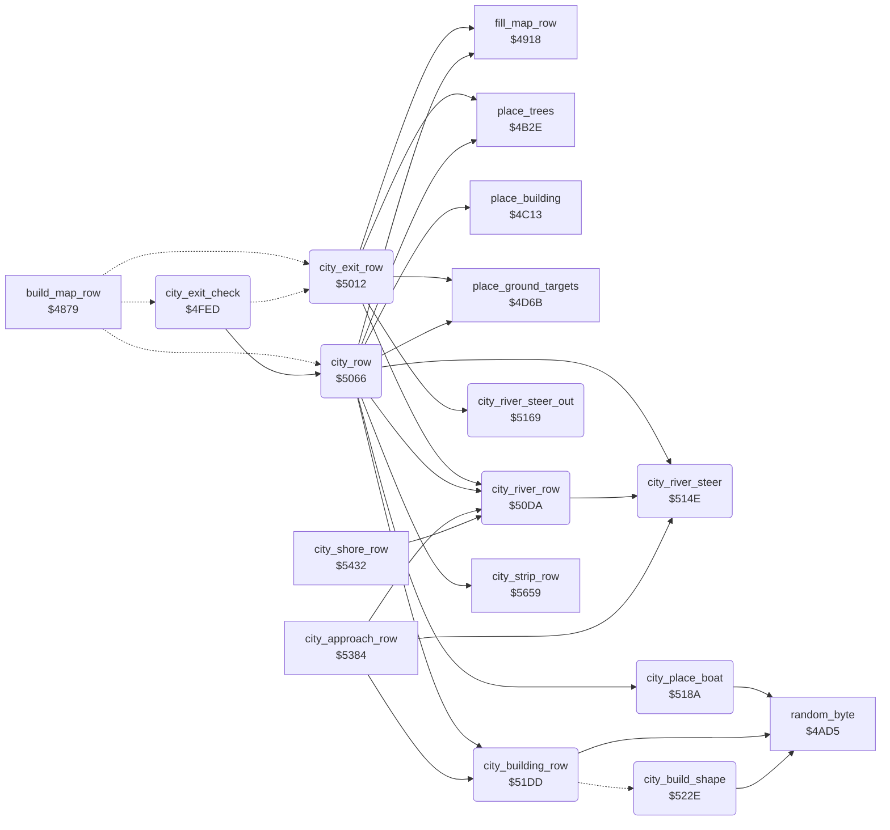

<!-- Generated by c64-docs from knowledge revision 20261024T232120.926-729orp and .c64-re-tools/local/generated/src/source-map.json. Do not edit: change the knowledge, generate the source again, then run docs.ts generate. -->
# ground/city.asm: City section of the map (map states 1, 2, 6 and 7)

Range `$4FED-$537E`. Source: [ground/city.asm](../../../../src/ground/city.asm). Index: [the reference](../../index.md).

## Call graph

A solid arrow is a call, a thick arrow a table entry, a dotted arrow a jump. Rounded nodes are in this file.

## Data

| Range | Type | Name | Read by | Written by |
|---|---|---|---|---|
| [`$50E5`](../../../../src/ground/city.asm#L123)-`$50ED` | jumps | [`city_river_row_straight`](../../../../src/ground/city.asm#L122) |  |  |
| [`$512E`](../../../../src/ground/city.asm#L168)-`$514D` | bytes of 8 | [`city_river_shape`](../../../../src/ground/city.asm#L167) | [`city_river_row`](city.md#city_river_row) |  |
| [`$52F6`](../../../../src/ground/city.asm#L419)-`$537E` | workspace | [`city_shape_buffer`](../../../../src/ground/city.asm#L418) | [`city_building_row`](city.md#city_building_row) | [`city_build_shape`](city.md#city_build_shape) |

## Names

### [`city_exit_check`](../../../../src/ground/city.asm#L6) `$4FED`

*routine*

Map state 6. Changes to state 7 (leave the city) when $4030, $403a and $4029 are all not 0; else makes a normal city row.

- **Jumped to from:** [`build_map_row`](map_row.md#build_map_row) [`$48F5`](../../../../src/ground/map_row.asm#L73)
- **Entry of:** [`$48E3-$4900`](../../tables.md#table_48e3)
- **Calls:** [`city_row`](city.md#city_row)
- **Jumps to:** [`city_exit_row`](city.md#city_exit_row)
- **Reads:** [`city_strip_wait`](../data/variables.md#city_strip_wait), [`city_building_wait`](../data/variables.md#city_building_wait), [`building_wait`](../data/variables.md#building_wait)
- **Writes:** [`section_exit_set`](../data/variables.md#section_exit_set), [`map_section`](../data/variables.md#map_section), [`section_step`](../data/variables.md#section_step)

### [`city_exit_check_stay`](../../../../src/ground/city.asm#L20) `$500E`

*label*

- **Jumped to from:** [`city_exit_check`](city.md#city_exit_check) [`$4FF5`](../../../../src/ground/city.asm#L10), [`city_exit_check`](city.md#city_exit_check) [`$4FFA`](../../../../src/ground/city.asm#L12), [`city_exit_check`](city.md#city_exit_check) [`$4FFF`](../../../../src/ground/city.asm#L14)

### [`city_exit_row`](../../../../src/ground/city.asm#L24) `$5012`

*routine*

Map state 7: steers the river to the side $4037. Then after $16 rows returns to open country: state 0, river column 4, distance $4066/4.

- **Jumped to from:** [`build_map_row`](map_row.md#build_map_row) [`$48F8`](../../../../src/ground/map_row.asm#L75), [`city_exit_check`](city.md#city_exit_check) [`$500B`](../../../../src/ground/city.asm#L19)
- **Entry of:** [`$48E3-$4900`](../../tables.md#table_48e3)
- **Calls:** [`fill_map_row`](map_row.md#fill_map_row), [`city_river_steer_out`](city.md#city_river_steer_out), [`city_river_row`](city.md#city_river_row), [`place_trees`](country_row.md#place_trees), [`place_ground_targets`](country_row.md#place_ground_targets)
- **Reads:** [`section_step`](../data/variables.md#section_step), [`airfield_gap`](../data/variables.md#airfield_gap)
- **Writes:** [`airfield_active`](../data/variables.md#airfield_active), [`section_exit_set`](../data/variables.md#section_exit_set), [`section_step`](../data/variables.md#section_step), [`river_column`](../data/variables.md#river_column), [`ground_colour2`](../data/variables.md#ground_colour2), [`map_section`](../data/variables.md#map_section), [`road_wait`](../data/variables.md#road_wait), [`airfield_countdown`](../data/variables.md#airfield_countdown)

### [`city_exit_row_count`](../../../../src/ground/city.asm#L39) `$5035`

*label*

- **Jumped to from:** [`city_exit_row`](city.md#city_exit_row) [`$5024`](../../../../src/ground/city.asm#L32), [`city_exit_row`](city.md#city_exit_row) [`$5029`](../../../../src/ground/city.asm#L34)

### [`city_exit_row_done`](../../../../src/ground/city.asm#L47) `$5046`

*label*

- **Jumped to from:** [`city_exit_row`](city.md#city_exit_row) [`$5043`](../../../../src/ground/city.asm#L45)

### [`city_row`](../../../../src/ground/city.asm#L63) `$5066`

*routine*

Map states 1 and 2: one city row: river, buildings, side strip, trees. Ends at $4075 = 0 or at distance $4058 = 0.

- **Called from:** [`city_exit_check`](city.md#city_exit_check) [`$500E`](../../../../src/ground/city.asm#L21)
- **Jumped to from:** [`build_map_row`](map_row.md#build_map_row) [`$48E6`](../../../../src/ground/map_row.asm#L63), [`build_map_row`](map_row.md#build_map_row) [`$48E9`](../../../../src/ground/map_row.asm#L65)
- **Read by:** [`animate_chars`](../screen/animate_chars.md#animate_chars) [`$7012`](../../../../src/screen/animate_chars.asm#L15)
- **Entry of:** [`$48E3-$4900`](../../tables.md#table_48e3)
- **Calls:** [`fill_map_row`](map_row.md#fill_map_row), [`city_river_steer`](city.md#city_river_steer), [`city_river_row`](city.md#city_river_row), [`city_building_row`](city.md#city_building_row), [`city_strip_row`](city_strip.md#city_strip_row), [`place_trees`](country_row.md#place_trees), [`place_building`](country_row.md#place_building), [`place_ground_targets`](country_row.md#place_ground_targets), [`city_place_boat`](city.md#city_place_boat)
- **Reads:** [`river_dir`](../data/variables.md#river_dir), [`city_strip_wait`](../data/variables.md#city_strip_wait), [`targets_left`](../data/variables.md#targets_left), [`map_row_index`](../data/variables.md#map_row_index), [`section_exit_set`](../data/variables.md#section_exit_set), [`airfield_countdown`](../data/variables.md#airfield_countdown)
- **Writes:** [`city_building_block`](../data/variables.md#city_building_block), [`city_strip_wait`](../data/variables.md#city_strip_wait), [`city_boat_wait`](../data/variables.md#city_boat_wait), [`city_building_wait`](../data/variables.md#city_building_wait), [`section_end`](../data/variables.md#section_end), [`airfield_countdown`](../data/variables.md#airfield_countdown), [`section_exit_set`](../data/variables.md#section_exit_set), [`map_section`](../data/variables.md#map_section)

### [`city_row_buildings`](../../../../src/ground/city.asm#L77) `$5087`

*label*

- **Jumped to from:** [`city_row`](city.md#city_row) [`$5076`](../../../../src/ground/city.asm#L70), [`city_row`](city.md#city_row) [`$5080`](../../../../src/ground/city.asm#L74)

### [`city_row_bend`](../../../../src/ground/city.asm#L88) `$50A3`

*label*

River bends: hold the boats 5 rows and the buildings 8 rows.

- **Jumped to from:** [`city_row`](city.md#city_row) [`$5095`](../../../../src/ground/city.asm#L83)

### [`city_row_progress`](../../../../src/ground/city.asm#L93) `$50AD`

*label*

- **Jumped to from:** [`city_row`](city.md#city_row) [`$50A0`](../../../../src/ground/city.asm#L87)

### [`city_row_count`](../../../../src/ground/city.asm#L101) `$50BF`

*label*

Every second row ($4010 odd) counts the distance $4058.

- **Jumped to from:** [`city_row`](city.md#city_row) [`$50B5`](../../../../src/ground/city.asm#L97)

### [`city_row_exit`](../../../../src/ground/city.asm#L113) `$50D9`

*label*

- **Jumped to from:** [`city_row`](city.md#city_row) [`$50B0`](../../../../src/ground/city.asm#L95), [`city_row`](city.md#city_row) [`$50BC`](../../../../src/ground/city.asm#L100), [`city_row`](city.md#city_row) [`$50C3`](../../../../src/ground/city.asm#L104), [`city_row`](city.md#city_row) [`$50C8`](../../../../src/ground/city.asm#L106), [`city_row`](city.md#city_row) [`$50CD`](../../../../src/ground/city.asm#L108)

### [`city_river_row`](../../../../src/ground/city.asm#L116) `$50DA`

*routine*

Moves the city river column $4023 by the direction $401b and draws 8 river chars from city_river_shape, ending before the river column.

- **Called from:** [`city_exit_row`](city.md#city_exit_row) [`$502B`](../../../../src/ground/city.asm#L35), [`city_row`](city.md#city_row) [`$506E`](../../../../src/ground/city.asm#L67), [`city_approach_row`](city_water.md#city_approach_row) [`$5398`](../../../../src/ground/city_water.asm#L16), [`city_shore_row`](city_water.md#city_shore_row) [`$5437`](../../../../src/ground/city_water.asm#L94)
- **Calls:** [`city_river_steer`](city.md#city_river_steer)
- **Reads:** [`river_dir`](../data/variables.md#river_dir), [`river_column`](../data/variables.md#river_column), [`row_ptr`](../../memory-map.md#row_ptr), [`zp_count`](../../memory-map.md#zp_count)
- **Writes:** [`river_column`](../data/variables.md#river_column), [`city_building_wait`](../data/variables.md#city_building_wait), [`zp_count`](../../memory-map.md#zp_count)

### [`city_river_row_straight`](../../../../src/ground/city.asm#L122) `$50E5`

*label*

### [`city_river_row_left_j`](../../../../src/ground/city.asm#L124) `$50E8`

*label*

- **Jumped to from:** [`city_river_row`](city.md#city_river_row) [`$50DF`](../../../../src/ground/city.asm#L119)

### [`city_river_row_right_j`](../../../../src/ground/city.asm#L127) `$50EB`

*label*

- **Jumped to from:** [`city_river_row`](city.md#city_river_row) [`$50E3`](../../../../src/ground/city.asm#L121)

### [`city_river_row_plain`](../../../../src/ground/city.asm#L129) `$50EE`

*label*

- **Jumped to from:** [`city_river_row`](city.md#city_river_row) [`$50E5`](../../../../src/ground/city.asm#L123)
- **Entry of:** [`city_river_row_straight`](../../tables.md#city_river_row_straight)

### [`city_river_row_left`](../../../../src/ground/city.asm#L132) `$50F3`

*label*

- **Jumped to from:** [`city_river_row`](city.md#city_river_row) [`$50E8`](../../../../src/ground/city.asm#L126)
- **Entry of:** [`city_river_row_straight`](../../tables.md#city_river_row_straight)

### [`city_river_row_right`](../../../../src/ground/city.asm#L140) `$5103`

*label*

- **Jumped to from:** [`city_river_row`](city.md#city_river_row) [`$50EB`](../../../../src/ground/city.asm#L128)
- **Entry of:** [`city_river_row_straight`](../../tables.md#city_river_row_straight)

### [`city_river_row_draw`](../../../../src/ground/city.asm#L147) `$5113`

*label*

- **Jumped to from:** [`city_river_row`](city.md#city_river_row) [`$50F0`](../../../../src/ground/city.asm#L131), [`city_river_row`](city.md#city_river_row) [`$5100`](../../../../src/ground/city.asm#L139), [`city_river_row`](city.md#city_river_row) [`$5110`](../../../../src/ground/city.asm#L146)

### [`city_river_row_loop`](../../../../src/ground/city.asm#L158) `$5122`

*label*

- **Jumped to from:** [`city_river_row`](city.md#city_river_row) [`$512B`](../../../../src/ground/city.asm#L164)

### [`city_river_shape`](../../../../src/ground/city.asm#L167) `$512E-$514D`

*data*

City river rows, 8 bytes each: 0 bends left, 1 unused, 2 straight, 3 bends right. $21 = water.

- **Read by:** [`city_river_row`](city.md#city_river_row) [`$5122`](../../../../src/ground/city.asm#L159)

### [`city_river_steer`](../../../../src/ground/city.asm#L173) `$514E`

*routine*

Sets the river direction $401b to move the river column $4023 to $29: 1 straight, 2 left, 3 right. Returns the direction in A.

- **Called from:** [`city_row`](city.md#city_row) [`$506B`](../../../../src/ground/city.asm#L66), [`city_river_row`](city.md#city_river_row) [`$50F6`](../../../../src/ground/city.asm#L135), [`city_river_row`](city.md#city_river_row) [`$5106`](../../../../src/ground/city.asm#L142), [`city_approach_row`](city_water.md#city_approach_row) [`$53A1`](../../../../src/ground/city_water.asm#L19)
- **Reads:** [`river_column`](../data/variables.md#river_column)
- **Writes:** [`river_dir`](../data/variables.md#river_dir)

### [`city_river_steer_right`](../../../../src/ground/city.asm#L181) `$515D`

*label*

- **Jumped to from:** [`city_river_steer`](city.md#city_river_steer) [`$5155`](../../../../src/ground/city.asm#L177)

### [`city_river_steer_straight`](../../../../src/ground/city.asm#L185) `$5163`

*label*

- **Jumped to from:** [`city_river_steer`](city.md#city_river_steer) [`$5153`](../../../../src/ground/city.asm#L176)

### [`city_river_steer_out`](../../../../src/ground/city.asm#L190) `$5169`

*routine*

Steers the river to the left edge (column 5) when $4037 is below $29, else to the right edge ($48). Returns A = 0 there.

- **Called from:** [`city_exit_row`](city.md#city_exit_row) [`$5026`](../../../../src/ground/city.asm#L33)
- **Reads:** [`river_column`](../data/variables.md#river_column), [`unwritten_4037`](../data/variables.md#unwritten_4037)
- **Writes:** [`river_dir`](../data/variables.md#river_dir)

### [`city_river_steer_out_right`](../../../../src/ground/city.asm#L201) `$517D`

*label*

- **Jumped to from:** [`city_river_steer_out`](city.md#city_river_steer_out) [`$5171`](../../../../src/ground/city.asm#L194)

### [`city_river_steer_out_done`](../../../../src/ground/city.asm#L207) `$5187`

*label*

- **Jumped to from:** [`city_river_steer_out`](city.md#city_river_steer_out) [`$5175`](../../../../src/ground/city.asm#L197), [`city_river_steer_out`](city.md#city_river_steer_out) [`$517F`](../../../../src/ground/city.asm#L203)

### [`city_place_boat`](../../../../src/ground/city.asm#L211) `$518A`

*routine*

Places a 2x2 boat (chars $cd-$d8, kind in $403e) at the river column - 6. $403d counts the rows between the halves and boats.

- **Called from:** [`city_row`](city.md#city_row) [`$509D`](../../../../src/ground/city.asm#L86)
- **Calls:** [`random_byte`](../game/random.md#random_byte)
- **Reads:** [`city_boat_wait`](../data/variables.md#city_boat_wait), [`random_seed`](../../memory-map.md#random_seed), [`river_column`](../data/variables.md#river_column), [`city_boat_kind`](../data/variables.md#city_boat_kind), [`row_ptr`](../../memory-map.md#row_ptr)
- **Writes:** [`city_boat_kind`](../data/variables.md#city_boat_kind), [`city_boat_wait`](../data/variables.md#city_boat_wait)

### [`city_place_boat_exit`](../../../../src/ground/city.asm#L217) `$5196`

*label*

- **Jumped to from:** [`city_place_boat`](city.md#city_place_boat) [`$519E`](../../../../src/ground/city.asm#L224)

### [`city_place_boat_bottom`](../../../../src/ground/city.asm#L219) `$5197`

*label*

Kind 0, 4 or 8 from the seed; $0c is no boat.

- **Jumped to from:** [`city_place_boat`](city.md#city_place_boat) [`$5194`](../../../../src/ground/city.asm#L216)

### [`city_place_boat_wait`](../../../../src/ground/city.asm#L240) `$51BD`

*label*

- **Jumped to from:** [`city_place_boat`](city.md#city_place_boat) [`$518D`](../../../../src/ground/city.asm#L213)

### [`city_place_boat_top`](../../../../src/ground/city.asm#L244) `$51C3`

*label*

- **Jumped to from:** [`city_place_boat`](city.md#city_place_boat) [`$51C0`](../../../../src/ground/city.asm#L242)

### [`city_building_row`](../../../../src/ground/city.asm#L260) `$51DD`

*routine*

Draws the city building in city_shape_buffer one row at a time left of the river. $403a is the delay, $403b the rows left.

- **Called from:** [`city_row`](city.md#city_row) [`$5087`](../../../../src/ground/city.asm#L78), [`city_approach_row`](city_water.md#city_approach_row) [`$539B`](../../../../src/ground/city_water.asm#L17)
- **Calls:** [`random_byte`](../game/random.md#random_byte)
- **Jumps to:** [`city_build_shape`](city.md#city_build_shape)
- **Reads:** [`city_building_wait`](../data/variables.md#city_building_wait), [`city_building_block`](../data/variables.md#city_building_block), [`city_building_rows`](../data/variables.md#city_building_rows), [`city_building_col`](../data/variables.md#city_building_col), [`city_shape_buffer`](city.md#city_shape_buffer), [`city_building_chars`](../data/variables.md#city_building_chars), [`row_ptr`](../../memory-map.md#row_ptr), [`zp_count`](../../memory-map.md#zp_count)
- **Writes:** [`city_building_wait`](../data/variables.md#city_building_wait), [`zp_count`](../../memory-map.md#zp_count), [`trees_enabled`](../data/variables.md#trees_enabled), [`city_building_rows`](../data/variables.md#city_building_rows)

### [`city_building_row_due`](../../../../src/ground/city.asm#L266) `$51E8`

*label*

- **Jumped to from:** [`city_building_row`](city.md#city_building_row) [`$51E5`](../../../../src/ground/city.asm#L264)

### [`city_building_row_wait`](../../../../src/ground/city.asm#L270) `$51F0`

*label*

$403f holds the new building while a river bend or side strip is on.

- **Jumped to from:** [`city_building_row`](city.md#city_building_row) [`$51EB`](../../../../src/ground/city.asm#L268)

### [`city_building_row_draw`](../../../../src/ground/city.asm#L274) `$51F6`

*label*

- **Jumped to from:** [`city_building_row`](city.md#city_building_row) [`$51E0`](../../../../src/ground/city.asm#L262)

### [`city_building_row_loop`](../../../../src/ground/city.asm#L284) `$5205`

*label*

- **Jumped to from:** [`city_building_row`](city.md#city_building_row) [`$5216`](../../../../src/ground/city.asm#L295)

### [`city_building_row_skip`](../../../../src/ground/city.asm#L291) `$5212`

*label*

- **Jumped to from:** [`city_building_row`](city.md#city_building_row) [`$520A`](../../../../src/ground/city.asm#L287)

### [`city_building_row_end`](../../../../src/ground/city.asm#L301) `$5223`

*label*

- **Jumped to from:** [`city_building_row`](city.md#city_building_row) [`$5220`](../../../../src/ground/city.asm#L299)

### [`city_build_shape`](../../../../src/ground/city.asm#L308) `$522E`

*routine*

Builds a random building in city_shape_buffer: type differs from $4057, depth 1-3, width 3-6, height 1-4 rows. Sets $4039, $403b, $403c.

- **Jumped to from:** [`city_building_row`](city.md#city_building_row) [`$51ED`](../../../../src/ground/city.asm#L269)
- **Calls:** [`random_byte`](../game/random.md#random_byte)
- **Reads:** [`building_kind_last`](../data/variables.md#building_kind_last), [`zp_count`](../../memory-map.md#zp_count), [`river_column`](../data/variables.md#river_column), [`zp_temp4`](../../memory-map.md#zp_temp4), [`map_ptr`](../../memory-map.md#map_ptr), [`map_ptr_hi`](../../memory-map.md#map_ptr_hi), [`zp_temp6`](../../memory-map.md#zp_temp6), [`zp_temp7`](../../memory-map.md#zp_temp7), [`zp_temp5`](../../memory-map.md#zp_temp5)
- **Writes:** [`trees_enabled`](../data/variables.md#trees_enabled), [`city_building_rows`](../data/variables.md#city_building_rows), [`zp_count`](../../memory-map.md#zp_count), [`city_building_chars`](../data/variables.md#city_building_chars), [`building_kind_hit`](../data/variables.md#building_kind_hit), [`zp_temp4`](../../memory-map.md#zp_temp4), [`zp_temp5`](../../memory-map.md#zp_temp5), [`city_building_col`](../data/variables.md#city_building_col), [`map_ptr`](../../memory-map.md#map_ptr), [`zp_temp6`](../../memory-map.md#zp_temp6), [`map_ptr_hi`](../../memory-map.md#map_ptr_hi), [`zp_temp7`](../../memory-map.md#zp_temp7)

### [`city_build_shape_type`](../../../../src/ground/city.asm#L314) `$523B`

*label*

- **Jumped to from:** [`city_build_shape`](city.md#city_build_shape) [`$5243`](../../../../src/ground/city.asm#L319)

### [`city_build_shape_clear`](../../../../src/ground/city.asm#L349) `$527F`

*label*

- **Jumped to from:** [`city_build_shape`](city.md#city_build_shape) [`$5283`](../../../../src/ground/city.asm#L352)

### [`city_build_shape_front`](../../../../src/ground/city.asm#L360) `$5293`

*label*

- **Jumped to from:** [`city_build_shape`](city.md#city_build_shape) [`$52AA`](../../../../src/ground/city.asm#L375)

### [`city_build_shape_front_loop`](../../../../src/ground/city.asm#L363) `$5297`

*label*

- **Jumped to from:** [`city_build_shape`](city.md#city_build_shape) [`$529A`](../../../../src/ground/city.asm#L366)

### [`city_build_shape_side`](../../../../src/ground/city.asm#L376) `$52AC`

*label*

- **Jumped to from:** [`city_build_shape`](city.md#city_build_shape) [`$52F3`](../../../../src/ground/city.asm#L415)

### [`city_build_shape_side_loop`](../../../../src/ground/city.asm#L382) `$52BC`

*label*

- **Jumped to from:** [`city_build_shape`](city.md#city_build_shape) [`$52D0`](../../../../src/ground/city.asm#L394)

### [`city_build_shape_roof`](../../../../src/ground/city.asm#L395) `$52D3`

*label*

- **Jumped to from:** [`city_build_shape`](city.md#city_build_shape) [`$52CA`](../../../../src/ground/city.asm#L391)

### [`city_build_shape_roof_loop`](../../../../src/ground/city.asm#L400) `$52DA`

*label*

- **Jumped to from:** [`city_build_shape`](city.md#city_build_shape) [`$52DD`](../../../../src/ground/city.asm#L403)

### [`city_shape_buffer`](../../../../src/ground/city.asm#L418) `$52F6-$537E`

*data*

Work buffer for the city building ($52f7-$537e), filled by city_build_shape. The bytes in the file are stale contents.

- **Read by:** [`city_building_row`](city.md#city_building_row) [`$5205`](../../../../src/ground/city.asm#L285)
- **Written by:** [`city_build_shape`](city.md#city_build_shape) [`$527F`](../../../../src/ground/city.asm#L350)
- **Referred to by:** [`city_build_shape`](city.md#city_build_shape) [`$5285`](../../../../src/ground/city.asm#L353), [`city_build_shape`](city.md#city_build_shape) [`$528B`](../../../../src/ground/city.asm#L356)
