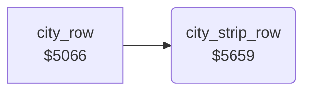

<!-- Generated by c64-docs from knowledge revision 20261024T232120.926-729orp and .c64-re-tools/local/generated/src/source-map.json. Do not edit: change the knowledge, generate the source again, then run docs.ts generate. -->
# ground/city_strip.asm: City side strip (hangar and water)

Range `$5659-$56CA`. Source: [ground/city_strip.asm](../../../../src/ground/city_strip.asm). Index: [the reference](../../index.md).

## Call graph

A solid arrow is a call, a thick arrow a table entry, a dotted arrow a jump. Rounded nodes are in this file.

## Names

### [`city_strip_row`](../../../../src/ground/city_strip.asm#L6) `$5659`

*routine*

After the delay $4030, draws 20 rows ($4031) of the side strip from $56cb at columns $12-$21. Holds the buildings ($403f) while it runs.

- **Called from:** [`city_row`](city.md#city_row) [`$508A`](../../../../src/ground/city.asm#L79)
- **Reads:** [`city_strip_wait`](../data/variables.md#city_strip_wait), [`airfield_rows`](../data/variables.md#airfield_rows), [`city_building_wait`](../data/variables.md#city_building_wait), [`random_seed`](../../memory-map.md#random_seed), [`building_wait`](../data/variables.md#building_wait), [`tile_row_frames`](../data/tile_row_frames.md#tile_row_frames), [`row_ptr`](../../memory-map.md#row_ptr), [`zp_count`](../../memory-map.md#zp_count)
- **Writes:** [`city_strip_wait`](../data/variables.md#city_strip_wait), [`airfield_rows`](../data/variables.md#airfield_rows), [`trees_enabled`](../data/variables.md#trees_enabled), [`airfield_bombed`](../data/variables.md#airfield_bombed), [`city_building_block`](../data/variables.md#city_building_block), [`building_wait`](../data/variables.md#building_wait), [`zp_count`](../../memory-map.md#zp_count)

### [`city_strip_row_idle`](../../../../src/ground/city_strip.asm#L11) `$5662`

*label*

- **Jumped to from:** [`city_strip_row`](city_strip.md#city_strip_row) [`$565C`](../../../../src/ground/city_strip.asm#L8)

### [`city_strip_row_exit`](../../../../src/ground/city_strip.asm#L23) `$567E`

*label*

- **Jumped to from:** [`city_strip_row`](city_strip.md#city_strip_row) [`$566A`](../../../../src/ground/city_strip.asm#L15)

### [`city_strip_row_running`](../../../../src/ground/city_strip.asm#L25) `$567F`

*label*

- **Jumped to from:** [`city_strip_row`](city_strip.md#city_strip_row) [`$5665`](../../../../src/ground/city_strip.asm#L13)

### [`city_strip_row_draw`](../../../../src/ground/city_strip.asm#L38) `$569A`

*label*

- **Jumped to from:** [`city_strip_row`](city_strip.md#city_strip_row) [`$5681`](../../../../src/ground/city_strip.asm#L27)

### [`city_strip_row_next`](../../../../src/ground/city_strip.asm#L43) `$56A4`

*label*

- **Jumped to from:** [`city_strip_row`](city_strip.md#city_strip_row) [`$569D`](../../../../src/ground/city_strip.asm#L40)

### [`city_strip_row_loop`](../../../../src/ground/city_strip.asm#L54) `$56B5`

*label*

- **Jumped to from:** [`city_strip_row`](city_strip.md#city_strip_row) [`$56BE`](../../../../src/ground/city_strip.asm#L60)
