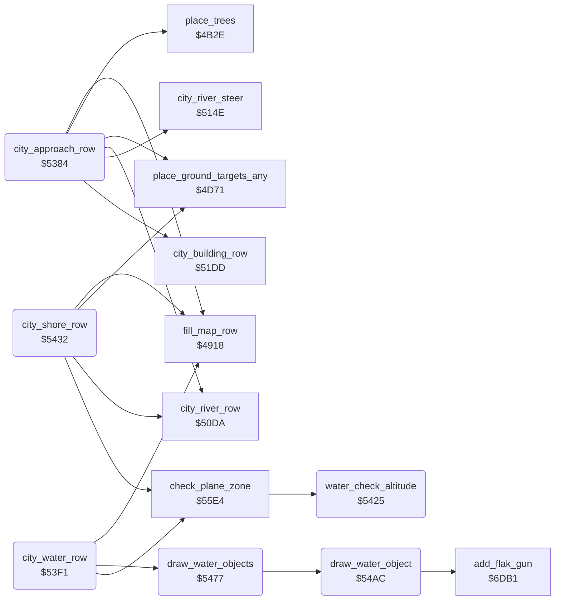

<!-- Generated by c64-docs from knowledge revision 20261025T214620.804-eudhn0 and .c64-re-tools/local/generated/src/source-map.json. Do not edit: change the knowledge, generate the source again, then run docs.ts generate. -->
# ground/city_water.asm: City water section (map states 3, 4 and 5)

Range `$5384-$55C2`. Source: [ground/city_water.asm](../../../../src/ground/city_water.asm). Index: [the reference](../../index.md).

## Routines

| Routine | Address | Reached from | Summary |
|---|---|---|---|
| [`city_approach_row`](city_water.md#city_approach_row) | `$5384` | [`build_map_row`](map_row.md#build_map_row) | Map state 3: city rows with the river steered to $29. |
| [`city_water_row`](city_water.md#city_water_row) | `$53F1` | [`build_map_row`](map_row.md#build_map_row) | Map state 4: fills the row with water ($21), draws the water objects. |
| [`water_check_altitude`](city_water.md#water_check_altitude) | `$5425` | [`check_plane_zone`](city_water_55e4.md#check_plane_zone) | Sets $4050 to 1 when $40da is below $40. |
| [`city_shore_row`](city_water.md#city_shore_row) | `$5432` | [`build_map_row`](map_row.md#build_map_row) | Map state 5: city rows with targets. |
| [`draw_water_objects`](city_water.md#draw_water_objects) | `$5477` | [`city_water_row`](city_water.md#city_water_row) | Draws the four water objects: two at column $1a (counters $40f6/$40f7), two at column $34 ($40f4/$40f5). |
| [`draw_water_object`](city_water.md#draw_water_object) | `$54AC` | [`draw_water_objects`](city_water.md#draw_water_objects) | Draws row $40f4,x of a water object (from water_object_shape) ending at column Y. |

## Data

| Range | Type | Name | Read by | Written by |
|---|---|---|---|---|
| [`$5503`](../../../../src/ground/city_water.asm#L205)-`$55C2` | bytes of 16 | [`water_object_shape`](../../../../src/ground/city_water.asm#L204) | [`draw_water_object`](city_water.md#draw_water_object) |  |

## Call graph

A solid arrow is a call, a thick arrow a table entry. Rounded nodes are in this file.

## Details

### [`city_approach_row`](../../../../src/ground/city_water.asm#L6) `$5384`

*routine*

Map state 3: city rows with the river steered to $29. After $3c rows sets state 4 and the water object counters $40f4-$40f7.
Sets $4041 to $1e only when it is not 0.

- **Jumped to from:** [`build_map_row`](map_row.md#build_map_row)
- **Entry of:** [`$48E3-$4900`](../../tables.md#table_48e3)
- **Calls:** [`fill_map_row`](map_row.md#fill_map_row), [`city_river_row`](city.md#city_river_row), [`city_building_row`](city.md#city_building_row), [`place_trees`](country_row.md#place_trees), [`city_river_steer`](city.md#city_river_steer), [`place_ground_targets_any`](country_row.md#place_ground_targets_any)
- **Reads:** [`enemy_timer`](../data/variables.md#enemy_timer), [`section_step`](../data/variables.md#section_step)
- **Writes:** [`enemy_timer`](../data/variables.md#enemy_timer), [`city_building_block`](../data/variables.md#city_building_block), [`trees_enabled`](../data/variables.md#trees_enabled), [`section_step`](../data/variables.md#section_step), [`flak_chance`](../data/variables.md#flak_chance), [`map_section`](../data/variables.md#map_section), [`water_timers`](../data/variables.md#water_timers), [`water_timers_2`](../data/variables.md#water_timers_2), [`water_timers_1`](../data/variables.md#water_timers_1), [`water_timers_3`](../data/variables.md#water_timers_3), [`water_objects_stop`](../data/variables.md#water_objects_stop), [`special_index`](../data/variables.md#special_index) and 1 more

| Label | Address | Comment |
|---|---|---|
| [`city_approach_row_go`](../../../../src/ground/city_water.asm#L11) | `$538E` |  |
| [`city_approach_row_count`](../../../../src/ground/city_water.asm#L31) | `$53BF` |  |
| [`city_approach_row_done`](../../../../src/ground/city_water.asm#L36) | `$53C7` |  |

### [`city_water_row`](../../../../src/ground/city_water.asm#L55) `$53F1`

*routine*

Map state 4: fills the row with water ($21), draws the water objects. Checks the plane zone after $14 rows. State 5 after $a0 rows.

- **Jumped to from:** [`build_map_row`](map_row.md#build_map_row)
- **Entry of:** [`$48E3-$4900`](../../tables.md#table_48e3)
- **Calls:** [`fill_map_row`](map_row.md#fill_map_row), [`draw_water_objects`](city_water.md#draw_water_objects), [`check_plane_zone`](city_water_55e4.md#check_plane_zone)
- **Reads:** [`section_step`](../data/variables.md#section_step), [`map_section`](../data/variables.md#map_section)
- **Writes:** [`enemy_timer`](../data/variables.md#enemy_timer), [`section_step`](../data/variables.md#section_step), [`water_objects_stop`](../data/variables.md#water_objects_stop), [`map_section`](../data/variables.md#map_section)

| Label | Address | Comment |
|---|---|---|
| [`city_water_row_late`](../../../../src/ground/city_water.asm#L66) | `$540B` |  |
| [`city_water_row_check_end`](../../../../src/ground/city_water.asm#L72) | `$5417` |  |
| [`city_water_row_done`](../../../../src/ground/city_water.asm#L76) | `$541C` |  |

### [`water_check_altitude`](../../../../src/ground/city_water.asm#L82) `$5425`

*routine*

Sets $4050 to 1 when $40da is below $40.

- **Called from:** [`check_plane_zone`](city_water_55e4.md#check_plane_zone)
- **Reads:** [`altitude`](../data/variables.md#altitude)
- **Writes:** [`crash_flag`](../data/variables.md#crash_flag)

| Label | Address | Comment |
|---|---|---|
| [`water_check_altitude_exit`](../../../../src/ground/city_water.asm#L88) | `$5431` |  |

### [`city_shore_row`](../../../../src/ground/city_water.asm#L91) `$5432`

*routine*

Map state 5: city rows with targets. Checks the plane zone for $0c rows, then clears $406a. After $1e rows sets state 6.

- **Jumped to from:** [`build_map_row`](map_row.md#build_map_row)
- **Entry of:** [`$48E3-$4900`](../../tables.md#table_48e3)
- **Calls:** [`fill_map_row`](map_row.md#fill_map_row), [`city_river_row`](city.md#city_river_row), [`place_ground_targets_any`](country_row.md#place_ground_targets_any), [`check_plane_zone`](city_water_55e4.md#check_plane_zone)
- **Reads:** [`section_step`](../data/variables.md#section_step), [`sprite_enable`](../data/variables.md#sprite_enable)
- **Writes:** [`flak_chance`](../data/variables.md#flak_chance), [`section_step`](../data/variables.md#section_step), [`sprite_prio_mask`](../data/variables.md#sprite_prio_mask), [`sprite_enable`](../data/variables.md#sprite_enable), [`map_section`](../data/variables.md#map_section), [`section_exit_set`](../data/variables.md#section_exit_set), [`trees_enabled`](../data/variables.md#trees_enabled)

| Label | Address | Comment |
|---|---|---|
| [`city_shore_row_late`](../../../../src/ground/city_water.asm#L104) | `$5452` |  |
| [`city_shore_row_count`](../../../../src/ground/city_water.asm#L110) | `$545F` |  |
| [`city_shore_row_done`](../../../../src/ground/city_water.asm#L115) | `$5467` |  |

### [`draw_water_objects`](../../../../src/ground/city_water.asm#L124) `$5477`

*routine*

Draws the four water objects: two at column $1a (counters $40f6/$40f7), two at column $34 ($40f4/$40f5). The higher counter goes first.

- **Called from:** [`city_water_row`](city_water.md#city_water_row)
- **Calls:** [`draw_water_object`](city_water.md#draw_water_object)
- **Reads:** [`water_timers_2`](../data/variables.md#water_timers_2), [`water_timers_3`](../data/variables.md#water_timers_3), [`water_timers`](../data/variables.md#water_timers), [`water_timers_1`](../data/variables.md#water_timers_1)

| Label | Address | Comment |
|---|---|---|
| [`draw_water_objects_first`](../../../../src/ground/city_water.asm#L130) | `$5483` |  |
| [`draw_water_objects_second`](../../../../src/ground/city_water.asm#L143) | `$549D` |  |

### [`draw_water_object`](../../../../src/ground/city_water.asm#L153) `$54AC`

*routine*

Draws row $40f4,x of a water object (from water_object_shape) ending at column Y. Counts the row down; restarts at $0c unless $407f is set.

- **Called from:** [`draw_water_objects`](city_water.md#draw_water_objects)
- **Calls:** [`add_flak_gun`](flak_guns.md#add_flak_gun)
- **Reads:** [`frame_count`](../data/variables.md#frame_count), [`random_seed`](../../memory-map.md#random_seed), [`row_ptr`](../../memory-map.md#row_ptr), [`water_slot`](../../memory-map.md#water_slot), [`water_timers`](../data/variables.md#water_timers), [`zp_count`](../../memory-map.md#zp_count), [`water_objects_stop`](../data/variables.md#water_objects_stop)
- **Writes:** [`water_slot`](../../memory-map.md#water_slot), [`zp_count`](../../memory-map.md#zp_count), [`water_timers`](../data/variables.md#water_timers)

| Label | Address | Comment |
|---|---|---|
| [`draw_water_object_shape`](../../../../src/ground/city_water.asm#L170) | `$54CD` |  |
| [`draw_water_object_loop`](../../../../src/ground/city_water.asm#L184) | `$54E3` |  |
| [`draw_water_object_skip`](../../../../src/ground/city_water.asm#L188) | `$54EA` |  |
| [`draw_water_object_next`](../../../../src/ground/city_water.asm#L194) | `$54F3` |  |
| [`draw_water_object_exit`](../../../../src/ground/city_water.asm#L201) | `$5502` |  |

### [`water_object_shape`](../../../../src/ground/city_water.asm#L204) `$5503-$55C2`

*data*

Water object rows, 16 bytes each, rows 0-11 (chars $ec-$f1). Drawn right to left. 0 = keep.

- **Read by:** [`draw_water_object`](city_water.md#draw_water_object)
