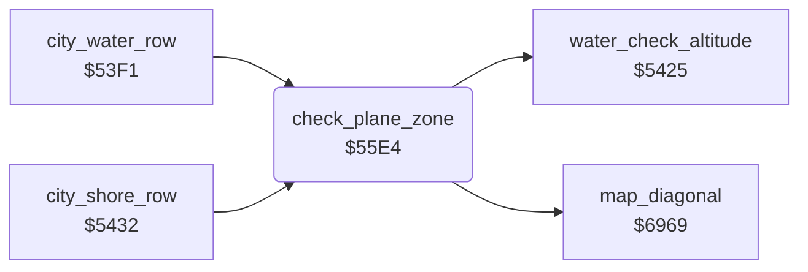

<!-- Generated by c64-docs from knowledge revision 20261024T232120.926-729orp and .c64-re-tools/local/generated/src/source-map.json. Do not edit: change the knowledge, generate the source again, then run docs.ts generate. -->
# ground/city_water_55e4.asm

Range `$55E4-$5658`. Source: [ground/city_water_55e4.asm](../../../../src/ground/city_water_55e4.asm). Index: [the reference](../../index.md).

## Call graph

A solid arrow is a call, a thick arrow a table entry, a dotted arrow a jump. Rounded nodes are in this file.

## Names

### [`check_plane_zone`](../../../../src/ground/city_water_55e4.asm#L6) `$55E4`

*routine*

Gets the map column under the plane ($6969 with $40ca, $40d2). Sets bits 0 and 6 of $406a and $40c3 by limits $88, $b3, $ef.

- **Called from:** [`city_water_row`](city_water.md#city_water_row) [`$5408`](../../../../src/ground/city_water.asm#L65), [`city_shore_row`](city_water.md#city_shore_row) [`$544C`](../../../../src/ground/city_water.asm#L102)
- **Calls:** [`map_diagonal`](../plane/crash.md#map_diagonal), [`water_check_altitude`](city_water.md#water_check_altitude)
- **Reads:** [`sprite_prio_mask`](../data/variables.md#sprite_prio_mask), [`shadow_x`](../data/variables.md#shadow_x), [`shadow_y`](../data/variables.md#shadow_y), [`sprite_enable`](../data/variables.md#sprite_enable), [`altitude`](../data/variables.md#altitude)
- **Writes:** [`sprite_prio_mask`](../data/variables.md#sprite_prio_mask), [`sprite_enable`](../data/variables.md#sprite_enable)

### [`check_plane_zone_mid`](../../../../src/ground/city_water_55e4.asm#L29) `$5619`

*label*

- **Jumped to from:** [`check_plane_zone`](city_water_55e4.md#check_plane_zone) [`$5601`](../../../../src/ground/city_water_55e4.asm#L19)

### [`check_plane_zone_low`](../../../../src/ground/city_water_55e4.asm#L37) `$562C`

*label*

- **Jumped to from:** [`check_plane_zone`](city_water_55e4.md#check_plane_zone) [`$55FD`](../../../../src/ground/city_water_55e4.asm#L17)

### [`check_plane_zone_left`](../../../../src/ground/city_water_55e4.asm#L43) `$5639`

*label*

- **Jumped to from:** [`check_plane_zone`](city_water_55e4.md#check_plane_zone) [`$55F9`](../../../../src/ground/city_water_55e4.asm#L15)

### [`check_plane_zone_high`](../../../../src/ground/city_water_55e4.asm#L50) `$5649`

*label*

$40da >= $40 always clears bit 0 of $406a.

- **Jumped to from:** [`check_plane_zone`](city_water_55e4.md#check_plane_zone) [`$5616`](../../../../src/ground/city_water_55e4.asm#L28), [`check_plane_zone`](city_water_55e4.md#check_plane_zone) [`$5629`](../../../../src/ground/city_water_55e4.asm#L36), [`check_plane_zone`](city_water_55e4.md#check_plane_zone) [`$5636`](../../../../src/ground/city_water_55e4.asm#L42), [`check_plane_zone`](city_water_55e4.md#check_plane_zone) [`$5646`](../../../../src/ground/city_water_55e4.asm#L49)

### [`check_plane_zone_exit`](../../../../src/ground/city_water_55e4.asm#L58) `$5658`

*label*

- **Jumped to from:** [`check_plane_zone`](city_water_55e4.md#check_plane_zone) [`$564E`](../../../../src/ground/city_water_55e4.asm#L53)
