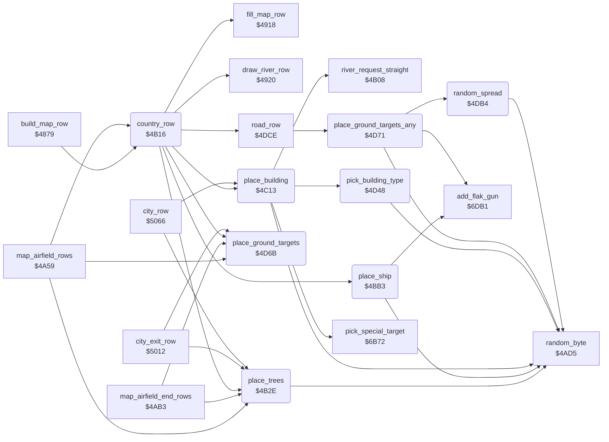

<!-- Generated by c64-docs from knowledge revision 20261025T214620.804-eudhn0 and .c64-re-tools/local/generated/src/source-map.json. Do not edit: change the knowledge, generate the source again, then run docs.ts generate. -->
# ground/country_row.asm: Open-country map row: trees, ship, building, ground targets

Range `$4B16-$4DCD`. Source: [ground/country_row.asm](../../../../src/ground/country_row.asm). Index: [the reference](../../index.md).

## Routines

| Routine | Address | Reached from | Summary |
|---|---|---|---|
| [`country_row`](country_row.md#country_row) | `$4B16` | [`build_map_row`](map_row.md#build_map_row), [`map_airfield_rows`](airfield_rows.md#map_airfield_rows) | Makes one open-country map row (map state 0) at ($fd): clears it, draws the river, adds road, trees, ship, building and ground targets. |
| [`place_trees`](country_row.md#place_trees) | `$4B2E` | [`map_airfield_rows`](airfield_rows.md#map_airfield_rows), [`map_airfield_end_rows`](airfield_rows.md#map_airfield_end_rows), [`country_row`](country_row.md#country_row), [`city_exit_row`](city.md#city_exit_row), [`city_row`](city.md#city_row), [`city_approach_row`](city_water.md#city_approach_row) | Completes the tree tops from the last row ($1300,x column, $1400,x kind). |
| [`place_ship`](country_row.md#place_ship) | `$4BB3` | [`country_row`](country_row.md#country_row) | Places a ship (chars $b8-$bb) on the river. |
| [`place_building`](country_row.md#place_building) | `$4C13` | [`country_row`](country_row.md#country_row), [`city_row`](city.md#city_row) | Places a building beside a straight river: 8-row sequence counted by $4028, column $402a. |
| [`pick_building_type`](country_row.md#pick_building_type) | `$4D48` | [`place_building`](country_row.md#place_building) | Selects a random building type 0-3 that differs from the city building type ($4039). |
| [`place_ground_targets`](country_row.md#place_ground_targets) | `$4D6B` | [`map_airfield_rows`](airfield_rows.md#map_airfield_rows), [`map_airfield_end_rows`](airfield_rows.md#map_airfield_end_rows), [`country_row`](country_row.md#country_row), [`city_exit_row`](city.md#city_exit_row), [`city_row`](city.md#city_row) | Does nothing while an airfield is on the map ($4062 not 0); else continues in place_ground_targets_any. |
| [`place_ground_targets_any`](country_row.md#place_ground_targets_any) | `$4D71` | [`road_row`](road.md#road_row), [`city_approach_row`](city_water.md#city_approach_row), [`city_shore_row`](city_water.md#city_shore_row) | Puts a gun ($a1) left or right of the river and registers it ($6db1). |
| [`random_spread`](country_row.md#random_spread) | `$4DB4` | [`place_ground_targets_any`](country_row.md#place_ground_targets_any) | Returns A plus or minus a random value 0-7. |

## Data

| Range | Type | Name | Read by | Written by |
|---|---|---|---|---|
| [`$4D08`](../../../../src/ground/country_row.asm#L292)-`$4D47` | bytes of 16 | [`building_shape`](../../../../src/ground/country_row.asm#L291) | [`place_building`](country_row.md#place_building) |  |

## Call graph

A solid arrow is a call, a thick arrow a table entry. Rounded nodes are in this file.

The graph shows 30 of the 34 edges.

## Details

### [`country_row`](../../../../src/ground/country_row.asm#L6) `$4B16`

*routine*

Makes one open-country map row (map state 0) at ($fd): clears it, draws the river, adds road, trees, ship, building and ground targets.

- **Called from:** [`build_map_row`](map_row.md#build_map_row), [`map_airfield_rows`](airfield_rows.md#map_airfield_rows)
- **Calls:** [`fill_map_row`](map_row.md#fill_map_row), [`draw_river_row`](river.md#draw_river_row), [`road_row`](road.md#road_row), [`place_trees`](country_row.md#place_trees), [`place_ship`](country_row.md#place_ship), [`place_building`](country_row.md#place_building), [`place_ground_targets`](country_row.md#place_ground_targets)

### [`place_trees`](../../../../src/ground/country_row.asm#L17) `$4B2E`

*routine*

Completes the tree tops from the last row ($1300,x column, $1400,x kind). When $4024 is not 0, places up to 7 new trees.

- **Called from:** [`map_airfield_rows`](airfield_rows.md#map_airfield_rows), [`map_airfield_end_rows`](airfield_rows.md#map_airfield_end_rows), [`country_row`](country_row.md#country_row), [`city_exit_row`](city.md#city_exit_row), [`city_row`](city.md#city_row), [`city_approach_row`](city_water.md#city_approach_row)
- **Calls:** [`random_byte`](../game/random.md#random_byte)
- **Reads:** [`tree_column`](../../memory-map.md#tree_column), [`tree_kind`](../../memory-map.md#tree_kind), [`row_ptr`](../../memory-map.md#row_ptr), [`trees_enabled`](../data/variables.md#trees_enabled), [`river_column`](../data/variables.md#river_column), [`zp_count`](../../memory-map.md#zp_count), [`zp_temp4`](../../memory-map.md#zp_temp4), [`zp_temp5`](../../memory-map.md#zp_temp5), [`zp_temp6`](../../memory-map.md#zp_temp6)
- **Writes:** [`zp_temp6`](../../memory-map.md#zp_temp6), [`tree_column`](../../memory-map.md#tree_column), [`zp_temp4`](../../memory-map.md#zp_temp4), [`zp_temp5`](../../memory-map.md#zp_temp5), [`zp_count`](../../memory-map.md#zp_count), [`tree_kind`](../../memory-map.md#tree_kind), [`flash_timer`](../data/variables.md#flash_timer)

| Label | Address | Comment |
|---|---|---|
| [`place_trees_top_loop`](../../../../src/ground/country_row.asm#L22) | `$4B37` |  |
| [`place_trees_next`](../../../../src/ground/country_row.asm#L35) | `$4B4F` |  |
| [`place_trees_done`](../../../../src/ground/country_row.asm#L40) | `$4B57` |  |
| [`place_trees_new`](../../../../src/ground/country_row.asm#L43) | `$4B58` | New trees: count = random AND 7. No tree goes between $d5 (river column - $0b) and $d4 (river column + 1). |
| [`place_trees_set_left`](../../../../src/ground/country_row.asm#L56) | `$4B6F` |  |
| [`place_trees_try`](../../../../src/ground/country_row.asm#L60) | `$4B75` |  |
| [`place_trees_check`](../../../../src/ground/country_row.asm#L69) | `$4B86` | Three cells must be empty for the tree. |
| [`place_trees_exit`](../../../../src/ground/country_row.asm#L91) | `$4BAA` |  |
| [`place_trees_flash`](../../../../src/ground/country_row.asm#L94) | `$4BAB` | Dead code: X is never negative after DEX here. Sets the screen flash counter $4092 to 2 and tries again. |

### [`place_ship`](../../../../src/ground/country_row.asm#L100) `$4BB3`

*routine*

Places a ship (chars $b8-$bb) on the river. Bottom half when the delay $4025 ends, top half in the next row from column $4026.

- **Called from:** [`country_row`](country_row.md#country_row)
- **Calls:** [`random_byte`](../game/random.md#random_byte), [`add_flak_gun`](flak_guns.md#add_flak_gun)
- **Reads:** [`ship_row`](../data/variables.md#ship_row), [`ship_wait`](../data/variables.md#ship_wait), [`road_wait`](../data/variables.md#road_wait), [`boat_wait`](../data/variables.md#boat_wait), [`river_column`](../data/variables.md#river_column), [`zp_count`](../../memory-map.md#zp_count), [`row_ptr`](../../memory-map.md#row_ptr)
- **Writes:** [`ship_wait`](../data/variables.md#ship_wait), [`zp_count`](../../memory-map.md#zp_count), [`ship_row`](../data/variables.md#ship_row), [`ship_hits`](../data/variables.md#ship_hits)

| Label | Address | Comment |
|---|---|---|
| [`place_ship_due`](../../../../src/ground/country_row.asm#L106) | `$4BBE` | Needs road delay $402e >= 5 and $4053 >= $0a. |
| [`place_ship_wait`](../../../../src/ground/country_row.asm#L114) | `$4BCF` | Try again after $0f rows. |
| [`place_ship_bottom`](../../../../src/ground/country_row.asm#L118) | `$4BD5` | Column = river column - (4 to 7). |
| [`place_ship_top`](../../../../src/ground/country_row.asm#L136) | `$4BF7` |  |

### [`place_building`](../../../../src/ground/country_row.asm#L151) `$4C13`

*routine*

Places a building beside a straight river: 8-row sequence counted by $4028, column $402a. Phase 5 can make the building the special target.

- **Called from:** [`country_row`](country_row.md#country_row), [`city_row`](city.md#city_row)
- **Calls:** [`river_request_straight`](river_steer.md#river_request_straight), [`pick_building_type`](country_row.md#pick_building_type), [`random_byte`](../game/random.md#random_byte), [`pick_special_target`](../enemy/special_targets.md#pick_special_target)
- **Reads:** [`building_wait`](../data/variables.md#building_wait), [`building_rows`](../data/variables.md#building_rows), [`quiet_timer`](../data/variables.md#quiet_timer), [`road_wait`](../data/variables.md#road_wait), [`river_column`](../data/variables.md#river_column), [`map_section`](../data/variables.md#map_section), [`river_steps`](../data/variables.md#river_steps), [`building_column`](../data/variables.md#building_column), [`sprite_enable`](../data/variables.md#sprite_enable), [`building_kind_last`](../data/variables.md#building_kind_last), [`random_seed`](../../memory-map.md#random_seed), [`row_ptr`](../../memory-map.md#row_ptr) and 2 more
- **Writes:** [`building_wait`](../data/variables.md#building_wait), [`building_rows`](../data/variables.md#building_rows), [`building_column`](../data/variables.md#building_column), [`river_steps`](../data/variables.md#river_steps), [`trees_enabled`](../data/variables.md#trees_enabled), [`river_turn_request`](../data/variables.md#river_turn_request), [`enemy_shadow_x`](../data/variables.md#enemy_shadow_x), [`enemy_shadow_y`](../data/variables.md#enemy_shadow_y), [`sprite_enable`](../data/variables.md#sprite_enable), [`special_target`](../data/variables.md#special_target), [`special_kind`](../data/variables.md#special_kind), [`random_seed`](../../memory-map.md#random_seed) and 1 more

| Label | Address | Comment |
|---|---|---|
| [`place_building_idle`](../../../../src/ground/country_row.asm#L157) | `$4C1C` | Starts a building when the river runs straight, no airfield ($4062 = 0), road delay $402e >= 8 and river column below $30. |
| [`place_building_delay`](../../../../src/ground/country_row.asm#L171) | `$4C3C` |  |
| [`place_building_exit`](../../../../src/ground/country_row.asm#L174) | `$4C41` |  |
| [`place_building_start`](../../../../src/ground/country_row.asm#L176) | `$4C42` |  |
| [`place_building_set_col`](../../../../src/ground/country_row.asm#L187) | `$4C57` |  |
| [`place_building_row`](../../../../src/ground/country_row.asm#L192) | `$4C63` |  |
| [`place_building_phase`](../../../../src/ground/country_row.asm#L208) | `$4C87` |  |
| [`place_building_special`](../../../../src/ground/country_row.asm#L215) | `$4C92` | Phase 5: stops trees. When pick_special_target returns 0, puts the special-target marker (sprite 7) at the building: special_target = 1, special_kind = the building kind. |
| [`place_building_targets`](../../../../src/ground/country_row.asm#L236) | `$4CBF` | Puts ground target pairs ($9e/$9f) in random empty cells right of the building. |
| [`place_building_tgt_loop`](../../../../src/ground/country_row.asm#L243) | `$4CC8` |  |
| [`place_building_tgt_next`](../../../../src/ground/country_row.asm#L256) | `$4CDD` |  |
| [`place_building_rts`](../../../../src/ground/country_row.asm#L260) | `$4CE1` |  |
| [`place_building_low`](../../../../src/ground/country_row.asm#L262) | `$4CE2` |  |
| [`place_building_draw`](../../../../src/ground/country_row.asm#L266) | `$4CE6` | Draws building row $4028 (0-3) from building_shape: 0 skips the cell, $20 stays, other chars get the style offset $4038. |
| [`place_building_draw_loop`](../../../../src/ground/country_row.asm#L275) | `$4CF2` |  |
| [`place_building_store`](../../../../src/ground/country_row.asm#L282) | `$4CFF` |  |
| [`place_building_skip`](../../../../src/ground/country_row.asm#L284) | `$4D01` |  |

### [`building_shape`](../../../../src/ground/country_row.asm#L291) `$4D08-$4D47`

*data*

Building rows, 16 bytes each, index = phase $4028: 0 roof ($81-$83), 1 roof and side, 2-3 front ($84) and side ($85/$86). 0 = keep.

- **Read by:** [`place_building`](country_row.md#place_building)

### [`pick_building_type`](../../../../src/ground/country_row.asm#L297) `$4D48`

*routine*

Selects a random building type 0-3 that differs from the city building type ($4039). Sets $4038 = type * 6, clears $4003+type, $4057 = type.

- **Called from:** [`place_building`](country_row.md#place_building)
- **Calls:** [`random_byte`](../game/random.md#random_byte)
- **Reads:** [`zp_count`](../../memory-map.md#zp_count), [`city_building_chars`](../data/variables.md#city_building_chars)
- **Writes:** [`zp_count`](../../memory-map.md#zp_count), [`building_chars`](../data/variables.md#building_chars), [`building_kind_hit`](../data/variables.md#building_kind_hit), [`building_kind_last`](../data/variables.md#building_kind_last)

| Label | Address | Comment |
|---|---|---|
| [`pick_building_type_loop`](../../../../src/ground/country_row.asm#L300) | `$4D4C` |  |
| [`pick_building_type_ok`](../../../../src/ground/country_row.asm#L313) | `$4D62` |  |

### [`place_ground_targets`](../../../../src/ground/country_row.asm#L319) `$4D6B`

*routine*

Does nothing while an airfield is on the map ($4062 not 0); else continues in place_ground_targets_any.

- **Called from:** [`map_airfield_rows`](airfield_rows.md#map_airfield_rows), [`map_airfield_end_rows`](airfield_rows.md#map_airfield_end_rows), [`country_row`](country_row.md#country_row), [`city_exit_row`](city.md#city_exit_row), [`city_row`](city.md#city_row)
- **Jumps to:** [`place_ground_targets_any`](country_row.md#place_ground_targets_any)
- **Reads:** [`quiet_timer`](../data/variables.md#quiet_timer)

### [`place_ground_targets_any`](../../../../src/ground/country_row.asm#L324) `$4D71`

*routine*

Puts a gun ($a1) left or right of the river and registers it ($6db1). Adds target pairs ($9e/$9f) near it while cells are empty.

- **Called from:** [`road_row`](road.md#road_row), [`city_approach_row`](city_water.md#city_approach_row), [`city_shore_row`](city_water.md#city_shore_row)
- **Jumped to from:** [`place_ground_targets`](country_row.md#place_ground_targets)
- **Calls:** [`random_byte`](../game/random.md#random_byte), [`random_spread`](country_row.md#random_spread), [`add_flak_gun`](flak_guns.md#add_flak_gun)
- **Reads:** [`river_column`](../data/variables.md#river_column), [`row_ptr`](../../memory-map.md#row_ptr)

| Label | Address | Comment |
|---|---|---|
| [`place_ground_targets_right`](../../../../src/ground/country_row.asm#L331) | `$4D81` |  |
| [`place_ground_targets_gun`](../../../../src/ground/country_row.asm#L335) | `$4D89` |  |
| [`place_ground_targets_pair`](../../../../src/ground/country_row.asm#L343) | `$4D97` |  |
| [`place_ground_targets_done`](../../../../src/ground/country_row.asm#L359) | `$4DB3` |  |

### [`random_spread`](../../../../src/ground/country_row.asm#L362) `$4DB4`

*routine*

Returns A plus or minus a random value 0-7. Changes $d3 and $d4.

- **Called from:** [`place_ground_targets_any`](country_row.md#place_ground_targets_any)
- **Calls:** [`random_byte`](../game/random.md#random_byte)
- **Reads:** [`zp_count`](../../memory-map.md#zp_count), [`zp_temp4`](../../memory-map.md#zp_temp4)
- **Writes:** [`zp_count`](../../memory-map.md#zp_count), [`zp_temp4`](../../memory-map.md#zp_temp4)

| Label | Address | Comment |
|---|---|---|
| [`random_spread_minus`](../../../../src/ground/country_row.asm#L373) | `$4DC8` |  |
