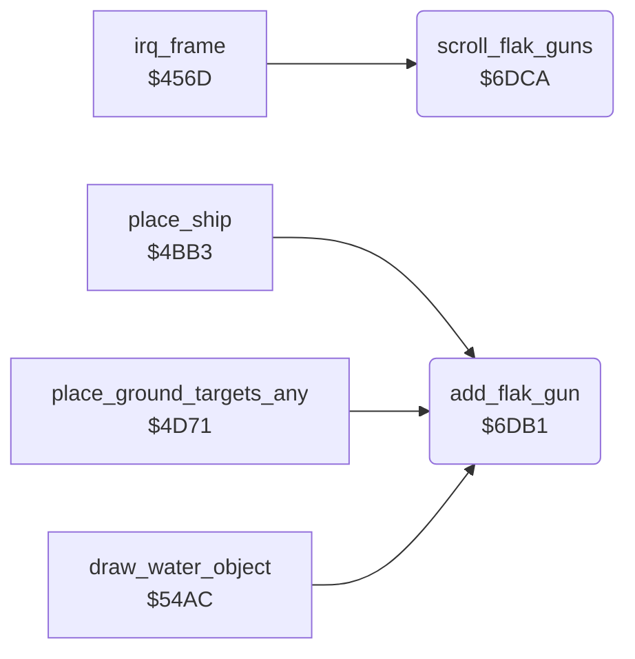

<!-- Generated by c64-docs from knowledge revision 20261024T232120.926-729orp and .c64-re-tools/local/generated/src/source-map.json. Do not edit: change the knowledge, generate the source again, then run docs.ts generate. -->
# ground/flak_guns.asm: Flak gun positions

Range `$6DB1-$6DEC`. Source: [ground/flak_guns.asm](../../../../src/ground/flak_guns.asm). Index: [the reference](../../index.md).

## Call graph

A solid arrow is a call, a thick arrow a table entry, a dotted arrow a jump. Rounded nodes are in this file.

## Names

### [`add_flak_gun`](../../../../src/ground/flak_guns.asm#L6) `$6DB1`

*routine*

Adds a flak gun of the new map row. In: Y = map column. Uses the first free slot 7-1, else slot 0.

- **Called from:** [`place_ship`](country_row.md#place_ship) [`$4BF3`](../../../../src/ground/country_row.asm#L134), [`place_ground_targets_any`](country_row.md#place_ground_targets_any) [`$4D94`](../../../../src/ground/country_row.asm#L342), [`draw_water_object`](city_water.md#draw_water_object) [`$54C5`](../../../../src/ground/city_water.asm#L167)
- **Reads:** [`gun_x`](../data/variables.md#gun_x)
- **Writes:** [`gun_x`](../data/variables.md#gun_x), [`gun_y`](../data/variables.md#gun_y)

### [`add_flak_gun_find`](../../../../src/ground/flak_guns.asm#L8) `$6DB3`

*label*

- **Jumped to from:** [`add_flak_gun`](flak_guns.md#add_flak_gun) [`$6DB9`](../../../../src/ground/flak_guns.asm#L12)

### [`add_flak_gun_store`](../../../../src/ground/flak_guns.asm#L13) `$6DBB`

*label*

Gun x = column * 4 + 15, gun y = $2b.

- **Jumped to from:** [`add_flak_gun`](flak_guns.md#add_flak_gun) [`$6DB4`](../../../../src/ground/flak_guns.asm#L10)

### [`scroll_flak_guns`](../../../../src/ground/flak_guns.asm#L24) `$6DCA`

*routine*

Moves the eight flak gun positions with the ground: x - 1, y + 2. Clears a gun at y >= $c8.

- **Called from:** [`irq_frame`](../irq/frame_irq.md#irq_frame) [`$46BE`](../../../../src/irq/frame_irq.asm#L169)
- **Reads:** [`gun_x`](../data/variables.md#gun_x), [`gun_y`](../data/variables.md#gun_y)
- **Writes:** [`gun_x`](../data/variables.md#gun_x), [`gun_y`](../data/variables.md#gun_y)

### [`scroll_flak_guns_loop`](../../../../src/ground/flak_guns.asm#L26) `$6DCC`

*label*

- **Jumped to from:** [`scroll_flak_guns`](flak_guns.md#scroll_flak_guns) [`$6DEA`](../../../../src/ground/flak_guns.asm#L40)

### [`scroll_flak_guns_next`](../../../../src/ground/flak_guns.asm#L38) `$6DE9`

*label*

- **Jumped to from:** [`scroll_flak_guns`](flak_guns.md#scroll_flak_guns) [`$6DCF`](../../../../src/ground/flak_guns.asm#L28), [`scroll_flak_guns`](flak_guns.md#scroll_flak_guns) [`$6DDF`](../../../../src/ground/flak_guns.asm#L34), [`scroll_flak_guns`](flak_guns.md#scroll_flak_guns) [`$6DE6`](../../../../src/ground/flak_guns.asm#L37)
