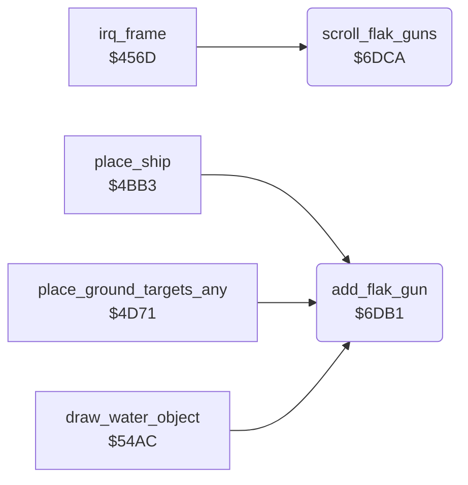

<!-- Generated by c64-docs from knowledge revision 20261025T214620.804-eudhn0 and .c64-re-tools/local/generated/src/source-map.json. Do not edit: change the knowledge, generate the source again, then run docs.ts generate. -->
# ground/flak_guns.asm: Flak gun positions

Range `$6DB1-$6DEC`. Source: [ground/flak_guns.asm](../../../../src/ground/flak_guns.asm). Index: [the reference](../../index.md).

## Routines

| Routine | Address | Reached from | Summary |
|---|---|---|---|
| [`add_flak_gun`](flak_guns.md#add_flak_gun) | `$6DB1` | [`place_ship`](country_row.md#place_ship), [`place_ground_targets_any`](country_row.md#place_ground_targets_any), [`draw_water_object`](city_water.md#draw_water_object) | Adds a flak gun of the new map row. |
| [`scroll_flak_guns`](flak_guns.md#scroll_flak_guns) | `$6DCA` | [`irq_frame`](../irq/frame_irq.md#irq_frame) | Moves the eight flak gun positions with the ground: x - 1, y + 2. |

## Call graph

A solid arrow is a call, a thick arrow a table entry. Rounded nodes are in this file.

## Details

### [`add_flak_gun`](../../../../src/ground/flak_guns.asm#L6) `$6DB1`

*routine*

Adds a flak gun of the new map row. In: Y = map column. Uses the first free slot 7-1, else slot 0.

- **Called from:** [`place_ship`](country_row.md#place_ship), [`place_ground_targets_any`](country_row.md#place_ground_targets_any), [`draw_water_object`](city_water.md#draw_water_object)
- **Reads:** [`gun_x`](../data/variables.md#gun_x)
- **Writes:** [`gun_x`](../data/variables.md#gun_x), [`gun_y`](../data/variables.md#gun_y)

| Label | Address | Comment |
|---|---|---|
| [`add_flak_gun_find`](../../../../src/ground/flak_guns.asm#L8) | `$6DB3` |  |
| [`add_flak_gun_store`](../../../../src/ground/flak_guns.asm#L13) | `$6DBB` | Gun x = column * 4 + 15, gun y = $2b. |

### [`scroll_flak_guns`](../../../../src/ground/flak_guns.asm#L24) `$6DCA`

*routine*

Moves the eight flak gun positions with the ground: x - 1, y + 2. Clears a gun at y >= $c8.

- **Called from:** [`irq_frame`](../irq/frame_irq.md#irq_frame)
- **Reads:** [`gun_x`](../data/variables.md#gun_x), [`gun_y`](../data/variables.md#gun_y)
- **Writes:** [`gun_x`](../data/variables.md#gun_x), [`gun_y`](../data/variables.md#gun_y)

| Label | Address | Comment |
|---|---|---|
| [`scroll_flak_guns_loop`](../../../../src/ground/flak_guns.asm#L26) | `$6DCC` |  |
| [`scroll_flak_guns_next`](../../../../src/ground/flak_guns.asm#L38) | `$6DE9` |  |
