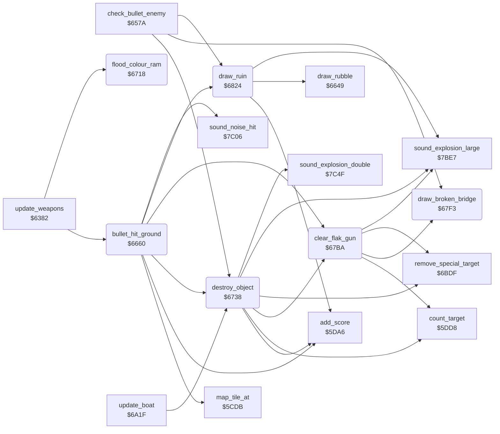

<!-- Generated by c64-docs from knowledge revision 20261025T214620.804-eudhn0 and .c64-re-tools/local/generated/src/source-map.json. Do not edit: change the knowledge, generate the source again, then run docs.ts generate. -->
# ground/ground_hits.asm: Bullet hits on the ground and destroyed objects

Range `$6660-$6861`. Source: [ground/ground_hits.asm](../../../../src/ground/ground_hits.asm). Index: [the reference](../../index.md).

## Routines

| Routine | Address | Reached from | Summary |
|---|---|---|---|
| [`bullet_hit_ground`](ground_hits.md#bullet_hit_ground) | `$6660` | [`update_weapons`](../plane/weapons.md#update_weapons) | Checks the map tile under the bullet when the plane flies low ($406f). |
| [`flood_colour_ram`](ground_hits.md#flood_colour_ram) | `$6718` | [`update_weapons`](../plane/weapons.md#update_weapons) | Fills the colour RAM $d800-$dbff with the colour (random seed AND 7). |
| [`destroy_object`](ground_hits.md#destroy_object) | `$6738` | [`check_bullet_enemy`](../plane/weapons.md#check_bullet_enemy), [`bullet_hit_ground`](ground_hits.md#bullet_hit_ground), [`update_boat`](../enemy/boat.md#update_boat) | Destroys a 2x2 object of tiles $b8-$bb. |
| [`update_weapons_target`](ground_hits.md#update_weapons_target) | `$6786` | [`check_bullet_enemy`](../plane/weapons.md#check_bullet_enemy) | The bomb hits a target building (tiles $81-$98). |
| [`clear_flak_gun`](ground_hits.md#clear_flak_gun) | `$67BA` | [`bullet_hit_ground`](ground_hits.md#bullet_hit_ground), [`destroy_object`](ground_hits.md#destroy_object) | Removes flak guns at the bullet line. |
| [`update_weapons_bridge`](ground_hits.md#update_weapons_bridge) | `$67D4` | [`check_bullet_enemy`](../plane/weapons.md#check_bullet_enemy) | The bomb hits a bridge: draws the broken bridge and checks the special bridge target ($4056 negative). |
| [`draw_broken_bridge`](ground_hits.md#draw_broken_bridge) | `$67F3` | [`check_bullet_enemy`](../plane/weapons.md#check_bullet_enemy), [`clear_flak_gun`](ground_hits.md#clear_flak_gun) | Draws a broken bridge at $fb/$fc: tile 0 becomes $7c/$7d, tiles other than 0 and 1 become $78/$79, the lower row becomes $7a $7b. |
| [`draw_ruin`](ground_hits.md#draw_ruin) | `$6824` | [`check_bullet_enemy`](../plane/weapons.md#check_bullet_enemy), [`bullet_hit_ground`](ground_hits.md#bullet_hit_ground) | Draws ruin tiles $5d $5e and $5b $5c for a 2x2 object of tiles $cd-$d8. |
| [`update_weapons_object_c4`](ground_hits.md#update_weapons_object_c4) | `$6854` | [`check_bullet_enemy`](../plane/weapons.md#check_bullet_enemy) | The bomb hits tiles $c4-$cc: score + 100, rubble and a large explosion sound. |

## Data

| Range | Type | Name | Read by | Written by |
|---|---|---|---|---|
| [`$6850`](../../../../src/ground/ground_hits.asm#L288)-`$6853` | bytes of 4 | [`ruin_offsets`](../../../../src/ground/ground_hits.asm#L287) | [`draw_ruin`](ground_hits.md#draw_ruin) |  |

## Call graph

A solid arrow is a call, a thick arrow a table entry. Rounded nodes are in this file.

## Details

### [`bullet_hit_ground`](../../../../src/ground/ground_hits.asm#L6) `$6660`

*routine*

Checks the map tile under the bullet when the plane flies low ($406f). Destroys the tile object and ends the bullet.

- **Called from:** [`update_weapons`](../plane/weapons.md#update_weapons)
- **Calls:** [`map_tile_at`](map_tile.md#map_tile_at), [`draw_ruin`](ground_hits.md#draw_ruin), [`add_score`](../game/score.md#add_score), [`sound_noise_hit`](../sound/sound_effects.md#sound_noise_hit), [`clear_flak_gun`](ground_hits.md#clear_flak_gun), [`destroy_object`](ground_hits.md#destroy_object)
- **Jumps to:** [`end_bullet`](../plane/weapons.md#end_bullet)
- **Reads:** [`low_flight`](../data/variables.md#low_flight), [`bullet_y`](../data/variables.md#bullet_y), [`bullet_x`](../data/variables.md#bullet_x), [`altitude`](../data/variables.md#altitude), [`map_ptr`](../../memory-map.md#map_ptr), [`map_ptr_hi`](../../memory-map.md#map_ptr_hi), [`ship_hits`](../data/variables.md#ship_hits)
- **Writes:** [`bullet_y`](../data/variables.md#bullet_y), [`flash_timer`](../data/variables.md#flash_timer), [`map_ptr`](../../memory-map.md#map_ptr), [`map_ptr_hi`](../../memory-map.md#map_ptr_hi), [`ship_hits`](../data/variables.md#ship_hits)

| Label | Address | Comment |
|---|---|---|
| [`bullet_hit_ground_done`](../../../../src/ground/ground_hits.asm#L13) | `$6670` |  |
| [`bullet_hit_ground_tile`](../../../../src/ground/ground_hits.asm#L15) | `$6671` |  |
| [`bullet_hit_ground_bridge`](../../../../src/ground/ground_hits.asm#L24) | `$6681` |  |
| [`bullet_hit_ground_stop`](../../../../src/ground/ground_hits.asm#L32) | `$668E` |  |
| [`bullet_hit_ground_cd`](../../../../src/ground/ground_hits.asm#L34) | `$6691` | Tiles $cd-$d8. |
| [`bullet_hit_ground_9e`](../../../../src/ground/ground_hits.asm#L47) | `$66AC` | Tiles below $9e: no effect. |
| [`bullet_hit_ground_crater`](../../../../src/ground/ground_hits.asm#L60) | `$66C3` | Crater tile $6a on two tiles. |
| [`bullet_hit_ground_a1`](../../../../src/ground/ground_hits.asm#L71) | `$66DA` |  |
| [`bullet_hit_ground_b8`](../../../../src/ground/ground_hits.asm#L83) | `$66F5` | Tiles $b8-$bb: three bullets destroy the object. |
| [`bullet_hit_ground_flash`](../../../../src/ground/ground_hits.asm#L96) | `$670F` |  |
| [`bullet_hit_ground_exit`](../../../../src/ground/ground_hits.asm#L100) | `$6717` |  |

### [`flood_colour_ram`](../../../../src/ground/ground_hits.asm#L103) `$6718`

*routine*

Fills the colour RAM $d800-$dbff with the colour (random seed AND 7). Sets crash state $4069 = 1 and all sprites behind the background.

- **Called from:** [`update_weapons`](../plane/weapons.md#update_weapons)
- **Reads:** [`random_seed`](../../memory-map.md#random_seed)
- **Writes:** `$D800`, `$D900`, `$DA00`, `$DB00`, [`plane_failing`](../data/variables.md#plane_failing), [`sprite_prio_mask`](../data/variables.md#sprite_prio_mask)

| Label | Address | Comment |
|---|---|---|
| [`flood_colour_ram_loop`](../../../../src/ground/ground_hits.asm#L106) | `$671A` |  |

### [`destroy_object`](../../../../src/ground/ground_hits.asm#L121) `$6738`

*routine*

Destroys a 2x2 object of tiles $b8-$bb. In: A = tile, $fb/$fc = its address. Draws wreck tiles $70-$73 and adds 50 to the score.
$4092 + 2: longer screen flash.

- **Called from:** [`check_bullet_enemy`](../plane/weapons.md#check_bullet_enemy), [`bullet_hit_ground`](ground_hits.md#bullet_hit_ground), [`update_boat`](../enemy/boat.md#update_boat)
- **Calls:** [`clear_flak_gun`](ground_hits.md#clear_flak_gun), [`add_score`](../game/score.md#add_score), [`sound_explosion_double`](../sound/sound_effects.md#sound_explosion_double), [`sound_explosion_large`](../sound/sound_effects.md#sound_explosion_large), [`count_target`](../game/score.md#count_target), [`remove_special_target`](../enemy/special_targets.md#remove_special_target)
- **Jumps to:** [`end_bomb`](../plane/weapons.md#end_bomb)
- **Reads:** [`flash_timer`](../data/variables.md#flash_timer), [`map_ptr`](../../memory-map.md#map_ptr), [`map_ptr_hi`](../../memory-map.md#map_ptr_hi), [`zp_count`](../../memory-map.md#zp_count), [`special_target`](../data/variables.md#special_target), [`special_kind`](../data/variables.md#special_kind)
- **Writes:** [`flash_timer`](../data/variables.md#flash_timer), [`zp_count`](../../memory-map.md#zp_count), [`map_ptr`](../../memory-map.md#map_ptr), [`map_ptr_hi`](../../memory-map.md#map_ptr_hi), [`building_kind_hit`](../data/variables.md#building_kind_hit)

| Label | Address | Comment |
|---|---|---|
| [`destroy_object_row`](../../../../src/ground/ground_hits.asm#L134) | `$6751` |  |
| [`destroy_object_draw`](../../../../src/ground/ground_hits.asm#L145) | `$6764` |  |
| [`update_weapons_target_div`](../../../../src/ground/ground_hits.asm#L168) | `$678B` |  |
| [`update_weapons_target_flag`](../../../../src/ground/ground_hits.asm#L174) | `$6794` |  |
| [`update_weapons_target_done`](../../../../src/ground/ground_hits.asm#L189) | `$67B7` |  |

### [`update_weapons_target`](../../../../src/ground/ground_hits.asm#L164) `$6786`

*label*

The bomb hits a target building (tiles $81-$98). Sets flag $4003+X with X = (tile - $81) / 6 and adds 50 to the score.

- **Jumped to from:** [`check_bullet_enemy`](../plane/weapons.md#check_bullet_enemy)

### [`clear_flak_gun`](../../../../src/ground/ground_hits.asm#L192) `$67BA`

*routine*

Removes flak guns at the bullet line. For each gun slot with y >= $404d - 5, clears $40ab.

- **Called from:** [`bullet_hit_ground`](ground_hits.md#bullet_hit_ground), [`destroy_object`](ground_hits.md#destroy_object)
- **Calls:** [`draw_broken_bridge`](ground_hits.md#draw_broken_bridge), [`count_target`](../game/score.md#count_target), [`remove_special_target`](../enemy/special_targets.md#remove_special_target), [`sound_explosion_large`](../sound/sound_effects.md#sound_explosion_large)
- **Jumps to:** [`end_bomb`](../plane/weapons.md#end_bomb)
- **Reads:** [`bullet_ground_y`](../data/variables.md#bullet_ground_y), [`gun_y`](../data/variables.md#gun_y), [`zp_count`](../../memory-map.md#zp_count), [`special_target`](../data/variables.md#special_target), [`special_kind`](../data/variables.md#special_kind)
- **Writes:** [`zp_count`](../../memory-map.md#zp_count), [`gun_x_2`](../data/variables.md#gun_x_2)

| Label | Address | Comment |
|---|---|---|
| [`clear_flak_gun_loop`](../../../../src/ground/ground_hits.asm#L198) | `$67C4` |  |
| [`clear_flak_gun_next`](../../../../src/ground/ground_hits.asm#L204) | `$67D0` |  |
| [`update_weapons_bridge_sound`](../../../../src/ground/ground_hits.asm#L221) | `$67ED` |  |

### [`update_weapons_bridge`](../../../../src/ground/ground_hits.asm#L209) `$67D4`

*label*

The bomb hits a bridge: draws the broken bridge and checks the special bridge target ($4056 negative).

- **Jumped to from:** [`check_bullet_enemy`](../plane/weapons.md#check_bullet_enemy)

### [`draw_broken_bridge`](../../../../src/ground/ground_hits.asm#L225) `$67F3`

*routine*

Draws a broken bridge at $fb/$fc: tile 0 becomes $7c/$7d, tiles other than 0 and 1 become $78/$79, the lower row becomes $7a $7b.

- **Called from:** [`check_bullet_enemy`](../plane/weapons.md#check_bullet_enemy), [`clear_flak_gun`](ground_hits.md#clear_flak_gun)
- **Reads:** [`map_ptr`](../../memory-map.md#map_ptr)

| Label | Address | Comment |
|---|---|---|
| [`draw_broken_bridge_left`](../../../../src/ground/ground_hits.asm#L232) | `$67FE` |  |
| [`draw_broken_bridge_store_left`](../../../../src/ground/ground_hits.asm#L236) | `$6804` |  |
| [`draw_broken_bridge_right`](../../../../src/ground/ground_hits.asm#L238) | `$6806` |  |
| [`draw_broken_bridge_check_right`](../../../../src/ground/ground_hits.asm#L245) | `$6810` |  |
| [`draw_broken_bridge_store_right`](../../../../src/ground/ground_hits.asm#L249) | `$6816` |  |
| [`draw_broken_bridge_lower`](../../../../src/ground/ground_hits.asm#L251) | `$6818` |  |

### [`draw_ruin`](../../../../src/ground/ground_hits.asm#L260) `$6824`

*routine*

Draws ruin tiles $5d $5e and $5b $5c for a 2x2 object of tiles $cd-$d8. In: A = tile, $fb/$fc = its address.

- **Called from:** [`check_bullet_enemy`](../plane/weapons.md#check_bullet_enemy), [`bullet_hit_ground`](ground_hits.md#bullet_hit_ground)
- **Calls:** [`add_score`](../game/score.md#add_score), [`draw_rubble`](../plane/weapons.md#draw_rubble), [`sound_explosion_large`](../sound/sound_effects.md#sound_explosion_large)
- **Jumps to:** [`end_bomb`](../plane/weapons.md#end_bomb)
- **Reads:** [`map_ptr`](../../memory-map.md#map_ptr), [`zp_count`](../../memory-map.md#zp_count), [`map_ptr_hi`](../../memory-map.md#map_ptr_hi)
- **Writes:** [`zp_count`](../../memory-map.md#zp_count), [`map_ptr`](../../memory-map.md#map_ptr), [`map_ptr_hi`](../../memory-map.md#map_ptr_hi)

### [`ruin_offsets`](../../../../src/ground/ground_hits.asm#L287) `$6850-$6853`

*data*

Offset back to the top left tile, by tile AND 3.

- **Read by:** [`draw_ruin`](ground_hits.md#draw_ruin)

### [`update_weapons_object_c4`](../../../../src/ground/ground_hits.asm#L290) `$6854`

*label*

The bomb hits tiles $c4-$cc: score + 100, rubble and a large explosion sound.

- **Jumped to from:** [`check_bullet_enemy`](../plane/weapons.md#check_bullet_enemy)
