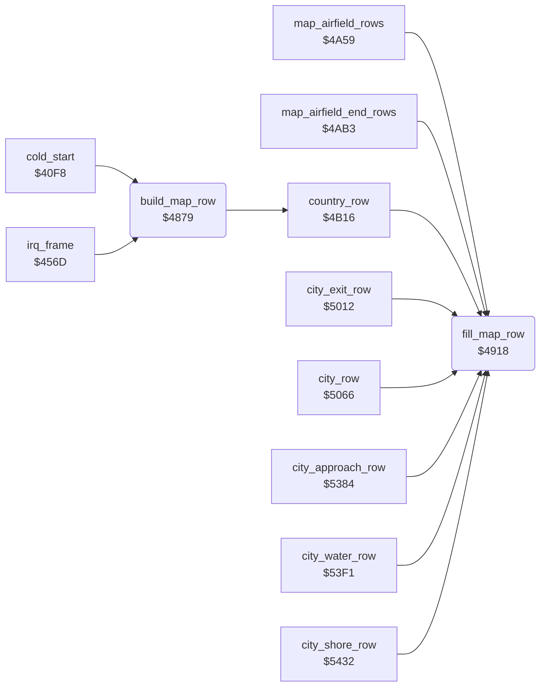

<!-- Generated by c64-docs from knowledge revision 20261025T214620.804-eudhn0 and .c64-re-tools/local/generated/src/source-map.json. Do not edit: change the knowledge, generate the source again, then run docs.ts generate. -->
# ground/map_row.asm: Map row builder

Range `$4879-$491F`. Source: [ground/map_row.asm](../../../../src/ground/map_row.asm). Index: [the reference](../../index.md).

## Routines

| Routine | Address | Reached from | Summary |
|---|---|---|---|
| [`build_map_row`](map_row.md#build_map_row) | `$4879` | [`cold_start`](../init/game_start.md#cold_start), [`irq_frame`](../irq/frame_irq.md#irq_frame) | Builds the next map row when $407b is set. |
| [`fill_map_row`](map_row.md#fill_map_row) | `$4918` | [`map_airfield_rows`](airfield_rows.md#map_airfield_rows), [`map_airfield_end_rows`](airfield_rows.md#map_airfield_end_rows), [`country_row`](country_row.md#country_row), [`city_exit_row`](city.md#city_exit_row), [`city_row`](city.md#city_row), [`city_approach_row`](city_water.md#city_approach_row), [`city_water_row`](city_water.md#city_water_row), [`city_shore_row`](city_water.md#city_shore_row) | Writes A to the 64 bytes at ($fd)+1 to ($fd)+$40, the current map row. |

## Data

| Range | Type | Name | Read by | Written by |
|---|---|---|---|---|
| [`$48E3`](../../../../src/ground/map_row.asm#L61)-`$4900` | jumps |  |  |  |

## Call graph

A solid arrow is a call, a thick arrow a table entry. Rounded nodes are in this file.

## Details

### [`build_map_row`](../../../../src/ground/map_row.asm#L6) `$4879`

*routine*

Builds the next map row when $407b is set. Stores the row address in $1200/$1280, then draws the row of the current feature $4035.

- **Called from:** [`cold_start`](../init/game_start.md#cold_start), [`irq_frame`](../irq/frame_irq.md#irq_frame)
- **Read by:** [`animate_chars`](../screen/animate_chars.md#animate_chars)
- **Calls:** [`country_row`](country_row.md#country_row)
- **Jumps to:** [`city_row`](city.md#city_row), [`city_approach_row`](city_water.md#city_approach_row), [`city_water_row`](city_water.md#city_water_row), [`city_shore_row`](city_water.md#city_shore_row), [`city_exit_check`](city.md#city_exit_check), [`city_exit_row`](city.md#city_exit_row), [`map_airfield_rows`](airfield_rows.md#map_airfield_rows), [`map_airfield_end_rows`](airfield_rows.md#map_airfield_end_rows)
- **Reads:** [`map_row_request`](../data/variables.md#map_row_request), [`map_row_ptr`](../data/variables.md#map_row_ptr), [`map_row_ptr_hi`](../data/variables.md#map_row_ptr_hi), [`map_row_index`](../data/variables.md#map_row_index), [`row_ptr`](../../memory-map.md#row_ptr), [`row_ptr_hi`](../../memory-map.md#row_ptr_hi), [`map_section`](../data/variables.md#map_section), [`airfield_countdown`](../data/variables.md#airfield_countdown)
- **Writes:** [`map_row_request`](../data/variables.md#map_row_request), [`row_ptr`](../../memory-map.md#row_ptr), [`row_ptr_hi`](../../memory-map.md#row_ptr_hi), [`map_row_lo`](../../memory-map.md#map_row_lo), [`map_row_hi`](../../memory-map.md#map_row_hi), [`map_section`](../data/variables.md#map_section), [`airfield_countdown`](../data/variables.md#airfield_countdown)
- **Refers to:** [`map_buffer_top`](../../memory-map.md#map_buffer_top)

| Label | Address | Comment |
|---|---|---|
| [`build_map_row_start`](../../../../src/ground/map_row.asm#L10) | `$487F` |  |
| [`build_map_row_ptr`](../../../../src/ground/map_row.asm#L26) | `$489F` |  |
| [`build_map_row_feature1`](../../../../src/ground/map_row.asm#L62) | `$48E6` |  |
| [`build_map_row_feature2`](../../../../src/ground/map_row.asm#L64) | `$48E9` |  |
| [`build_map_row_feature3`](../../../../src/ground/map_row.asm#L66) | `$48EC` |  |
| [`build_map_row_feature4`](../../../../src/ground/map_row.asm#L68) | `$48EF` |  |
| [`build_map_row_feature5`](../../../../src/ground/map_row.asm#L70) | `$48F2` |  |
| [`build_map_row_feature6`](../../../../src/ground/map_row.asm#L72) | `$48F5` |  |
| [`build_map_row_feature7`](../../../../src/ground/map_row.asm#L74) | `$48F8` |  |
| [`build_map_row_feature8`](../../../../src/ground/map_row.asm#L76) | `$48FB` |  |
| [`build_map_row_feature9`](../../../../src/ground/map_row.asm#L78) | `$48FE` |  |
| [`build_map_row_plain`](../../../../src/ground/map_row.asm#L81) | `$4901` | Draws a plain row. On odd rows, counts down $4058. At 0 the next airfield starts (feature 8). |
| [`build_map_row_done`](../../../../src/ground/map_row.asm#L91) | `$4917` |  |

### [`fill_map_row`](../../../../src/ground/map_row.asm#L94) `$4918`

*routine*

Writes A to the 64 bytes at ($fd)+1 to ($fd)+$40, the current map row.

- **Called from:** [`map_airfield_rows`](airfield_rows.md#map_airfield_rows), [`map_airfield_end_rows`](airfield_rows.md#map_airfield_end_rows), [`country_row`](country_row.md#country_row), [`city_exit_row`](city.md#city_exit_row), [`city_row`](city.md#city_row), [`city_approach_row`](city_water.md#city_approach_row), [`city_water_row`](city_water.md#city_water_row), [`city_shore_row`](city_water.md#city_shore_row)
- **Reads:** [`row_ptr`](../../memory-map.md#row_ptr)

| Label | Address | Comment |
|---|---|---|
| [`fill_map_row_loop`](../../../../src/ground/map_row.asm#L96) | `$491A` |  |
