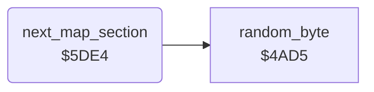

<!-- Generated by c64-docs from knowledge revision 20261025T214620.804-eudhn0 and .c64-re-tools/local/generated/src/source-map.json. Do not edit: change the knowledge, generate the source again, then run docs.ts generate. -->
# ground/map_section.asm: Map section change

Range `$5DE4-$5E3E`. Source: [ground/map_section.asm](../../../../src/ground/map_section.asm). Index: [the reference](../../index.md).

## Routines

| Routine | Address | Reached from | Summary |
|---|---|---|---|
| [`next_map_section`](map_section.md#next_map_section) | `$5DE4` | [`$448E`](../../../../src/screen/status_line.asm#L112) | When the section end flag $4074 is set, selects the next map section $4035 from the targets left $4075 and hit $4073. |

## Call graph

A solid arrow is a call, a thick arrow a table entry. Rounded nodes are in this file.

## Details

### [`next_map_section`](../../../../src/ground/map_section.asm#L6) `$5DE4`

*routine*

When the section end flag $4074 is set, selects the next map section $4035 from the targets left $4075 and hit $4073.

- **Called from:** [`$448E`](../../../../src/screen/status_line.asm#L112)
- **Calls:** [`random_byte`](../game/random.md#random_byte)
- **Reads:** [`section_end`](../data/variables.md#section_end), [`map_section`](../data/variables.md#map_section), [`targets_left`](../data/variables.md#targets_left), [`targets_hit`](../data/variables.md#targets_hit)
- **Writes:** [`section_step`](../data/variables.md#section_step), [`map_section`](../data/variables.md#map_section), [`section_exit_set`](../data/variables.md#section_exit_set), [`section_end`](../data/variables.md#section_end)

| Label | Address | Comment |
|---|---|---|
| [`next_map_section_test`](../../../../src/ground/map_section.asm#L10) | `$5DEA` | Section 8: no target left gives 2, fewer than 2 hits give 9, else 9 or 2 at random. |
| [`next_map_section_to_2`](../../../../src/ground/map_section.asm#L22) | `$5E02` |  |
| [`next_map_section_to_9`](../../../../src/ground/map_section.asm#L27) | `$5E0C` |  |
| [`next_map_section_set`](../../../../src/ground/map_section.asm#L29) | `$5E0E` |  |
| [`next_map_section_done`](../../../../src/ground/map_section.asm#L33) | `$5E16` |  |
| [`next_map_section_from_2`](../../../../src/ground/map_section.asm#L37) | `$5E1C` | Section 2 goes to 3 when no target is left, else to 6. |
| [`next_map_section_to_6`](../../../../src/ground/map_section.asm#L47) | `$5E32` |  |
| [`next_map_section_exit`](../../../../src/ground/map_section.asm#L53) | `$5E3C` |  |
