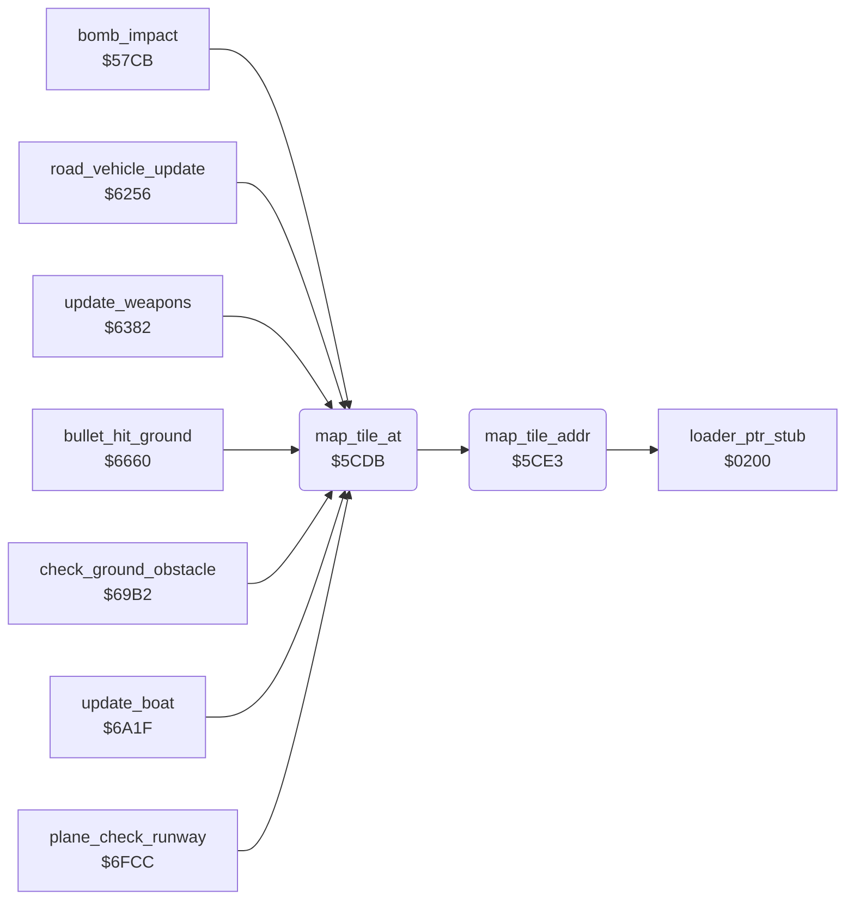

<!-- Generated by c64-docs from knowledge revision 20261024T232120.926-729orp and .c64-re-tools/local/generated/src/source-map.json. Do not edit: change the knowledge, generate the source again, then run docs.ts generate. -->
# ground/map_tile.asm: Map tile address

Range `$5CDB-$5D2A`. Source: [ground/map_tile.asm](../../../../src/ground/map_tile.asm). Index: [the reference](../../index.md).

## Call graph

A solid arrow is a call, a thick arrow a table entry, a dotted arrow a jump. Rounded nodes are in this file.

## Names

### [`map_tile_at`](../../../../src/ground/map_tile.asm#L6) `$5CDB`

*routine*

Returns in A the map tile at sprite position X, Y. $fb/$fc points to the tile; Y = 0.

- **Called from:** [`bomb_impact`](bomb_impact.md#bomb_impact) [`$57DA`](../../../../src/ground/bomb_impact.asm#L15), [`bomb_impact`](bomb_impact.md#bomb_impact) [`$585E`](../../../../src/ground/bomb_impact.asm#L80), [`road_vehicle_update`](../enemy/road_vehicle.md#road_vehicle_update) [`$6280`](../../../../src/enemy/road_vehicle.asm#L59), [`update_weapons`](../plane/weapons.md#update_weapons) [`$644C`](../../../../src/plane/weapons.asm#L112), [`bullet_hit_ground`](ground_hits.md#bullet_hit_ground) [`$666B`](../../../../src/ground/ground_hits.asm#L11), [`check_ground_obstacle`](obstacles.md#check_ground_obstacle) [`$69DC`](../../../../src/ground/obstacles.asm#L28), [`update_boat`](../enemy/boat.md#update_boat) [`$6ABF`](../../../../src/enemy/boat.asm#L86), [`update_boat`](../enemy/boat.md#update_boat) [`$6AD6`](../../../../src/enemy/boat.asm#L98), [`plane_check_runway`](../plane/plane_states.md#plane_check_runway) [`$6FD6`](../../../../src/plane/plane_states.asm#L235)
- **Calls:** [`map_tile_addr`](map_tile.md#map_tile_addr)
- **Reads:** [`map_ptr`](../../memory-map.md#map_ptr)

### [`map_tile_addr`](../../../../src/ground/map_tile.asm#L12) `$5CE3`

*routine*

Sets $fb/$fc to the map tile at sprite position X, Y. Uses the scroll values $400e, $400f and the row $4010.

- **Called from:** [`map_tile_at`](map_tile.md#map_tile_at) [`$5CDB`](../../../../src/ground/map_tile.asm#L7)
- **Calls:** [`loader_ptr_stub`](../../memory-map.md#loader_ptr_stub)
- **Reads:** [`scroll_fine_x`](../data/variables.md#scroll_fine_x), [`scroll_fine_y`](../data/variables.md#scroll_fine_y), [`map_row_index`](../data/variables.md#map_row_index), [`map_row_lo`](../../memory-map.md#map_row_lo), [`map_row_hi`](../../memory-map.md#map_row_hi), [`zp_count`](../../memory-map.md#zp_count), [`map_ptr_hi`](../../memory-map.md#map_ptr_hi), [`zp_temp4`](../../memory-map.md#zp_temp4), [`map_ptr`](../../memory-map.md#map_ptr)
- **Writes:** [`zp_temp4`](../../memory-map.md#zp_temp4), [`zp_count`](../../memory-map.md#zp_count), [`map_ptr`](../../memory-map.md#map_ptr), [`map_ptr_hi`](../../memory-map.md#map_ptr_hi)

### [`map_tile_addr_row`](../../../../src/ground/map_tile.asm#L29) `$5CFF`

*label*

- **Jumped to from:** [`map_tile_addr`](map_tile.md#map_tile_addr) [`$5CFB`](../../../../src/ground/map_tile.asm#L27)
