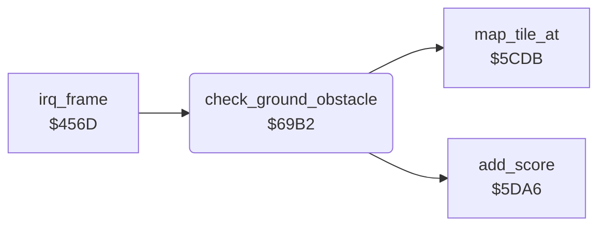

<!-- Generated by c64-docs from knowledge revision 20261024T232120.926-729orp and .c64-re-tools/local/generated/src/source-map.json. Do not edit: change the knowledge, generate the source again, then run docs.ts generate. -->
# ground/obstacles.asm: Low flight over obstacles and under bridges

Range `$69B2-$6A1E`. Source: [ground/obstacles.asm](../../../../src/ground/obstacles.asm). Index: [the reference](../../index.md).

## Call graph

A solid arrow is a call, a thick arrow a table entry, a dotted arrow a jump. Rounded nodes are in this file.

## Names

### [`check_ground_obstacle`](../../../../src/ground/obstacles.asm#L6) `$69B2`

*routine*

Counts the under-bridge bonus. Checks the map tiles under the shadow: low flight over an obstacle crashes the plane.
$406b = under-bridge frames left.

- **Called from:** [`irq_frame`](../irq/frame_irq.md#irq_frame) [`$46CA`](../../../../src/irq/frame_irq.asm#L173)
- **Calls:** [`add_score`](../game/score.md#add_score), [`map_tile_at`](map_tile.md#map_tile_at)
- **Reads:** [`touch_timer`](../data/variables.md#touch_timer), [`sprite_prio_mask`](../data/variables.md#sprite_prio_mask), [`shadow_y`](../data/variables.md#shadow_y), [`shadow_x`](../data/variables.md#shadow_x), [`map_ptr`](../../memory-map.md#map_ptr), [`altitude`](../data/variables.md#altitude), [`obstacle_altitude`](../data/variables.md#obstacle_altitude)
- **Writes:** [`sprite_prio_mask`](../data/variables.md#sprite_prio_mask), [`touch_timer`](../data/variables.md#touch_timer), [`crash_flag`](../data/variables.md#crash_flag)

### [`check_ground_obstacle_tile`](../../../../src/ground/obstacles.asm#L20) `$69D1`

*label*

- **Jumped to from:** [`check_ground_obstacle`](obstacles.md#check_ground_obstacle) [`$69B5`](../../../../src/ground/obstacles.asm#L8), [`check_ground_obstacle`](obstacles.md#check_ground_obstacle) [`$69C7`](../../../../src/ground/obstacles.asm#L16)

### [`check_ground_obstacle_right`](../../../../src/ground/obstacles.asm#L34) `$69E9`

*label*

- **Jumped to from:** [`check_ground_obstacle`](obstacles.md#check_ground_obstacle) [`$69E3`](../../../../src/ground/obstacles.asm#L31)

### [`check_ground_obstacle_done`](../../../../src/ground/obstacles.asm#L41) `$69F4`

*label*

- **Jumped to from:** [`check_ground_obstacle`](obstacles.md#check_ground_obstacle) [`$69EE`](../../../../src/ground/obstacles.asm#L38)

### [`check_ground_obstacle_height`](../../../../src/ground/obstacles.asm#L43) `$69F5`

*label*

- **Jumped to from:** [`check_ground_obstacle`](obstacles.md#check_ground_obstacle) [`$69DF`](../../../../src/ground/obstacles.asm#L29), [`check_ground_obstacle`](obstacles.md#check_ground_obstacle) [`$69E7`](../../../../src/ground/obstacles.asm#L33), [`check_ground_obstacle`](obstacles.md#check_ground_obstacle) [`$69F2`](../../../../src/ground/obstacles.asm#L40)

### [`check_ground_obstacle_low`](../../../../src/ground/obstacles.asm#L48) `$69FE`

*label*

Tile $da: no obstacle.

- **Jumped to from:** [`check_ground_obstacle`](obstacles.md#check_ground_obstacle) [`$69FB`](../../../../src/ground/obstacles.asm#L46)

### [`check_ground_obstacle_bridge`](../../../../src/ground/obstacles.asm#L52) `$6A03`

*label*

- **Jumped to from:** [`check_ground_obstacle`](obstacles.md#check_ground_obstacle) [`$6A00`](../../../../src/ground/obstacles.asm#L50)

### [`check_ground_obstacle_crash`](../../../../src/ground/obstacles.asm#L55) `$6A07`

*label*

$4050 = 1: crash.

- **Jumped to from:** [`check_ground_obstacle`](obstacles.md#check_ground_obstacle) [`$6A17`](../../../../src/ground/obstacles.asm#L65)

### [`check_ground_obstacle_under`](../../../../src/ground/obstacles.asm#L59) `$6A0D`

*label*

Below altitude 6 only bridge tiles $db, $df, $e3 are safe.

- **Jumped to from:** [`check_ground_obstacle`](obstacles.md#check_ground_obstacle) [`$6A05`](../../../../src/ground/obstacles.asm#L54)

### [`check_ground_obstacle_bonus`](../../../../src/ground/obstacles.asm#L66) `$6A19`

*label*

17 frames of under-bridge bonus.

- **Jumped to from:** [`check_ground_obstacle`](obstacles.md#check_ground_obstacle) [`$6A0F`](../../../../src/ground/obstacles.asm#L61), [`check_ground_obstacle`](obstacles.md#check_ground_obstacle) [`$6A13`](../../../../src/ground/obstacles.asm#L63)
