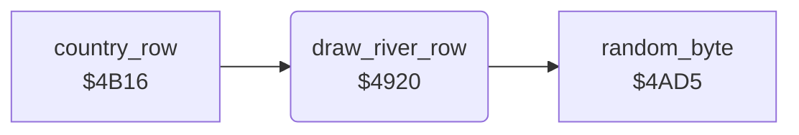

<!-- Generated by c64-docs from knowledge revision 20261024T232120.926-729orp and .c64-re-tools/local/generated/src/source-map.json. Do not edit: change the knowledge, generate the source again, then run docs.ts generate. -->
# ground/river.asm: River

Range `$4920-$4A58`. Source: [ground/river.asm](../../../../src/ground/river.asm). Index: [the reference](../../index.md).

## Call graph

A solid arrow is a call, a thick arrow a table entry, a dotted arrow a jump. Rounded nodes are in this file.

## Data

| Range | Type | Name | Read by | Written by |
|---|---|---|---|---|
| [`$492B`](../../../../src/ground/river.asm#L12)-`$4933` | jumps |  |  |  |
| [`$4A09`](../../../../src/ground/river.asm#L130)-`$4A58` | bytes of 20 | [`river_patterns`](../../../../src/ground/river.asm#L129) | [`draw_river_row`](river.md#draw_river_row) |  |

## Names

### [`draw_river_row`](../../../../src/ground/river.asm#L6) `$4920`

*routine*

Draws the river into the current map row. $401b is the direction (1 straight, 2 left, 3 right), $401c the steps left, $4023 the column.

- **Called from:** [`country_row`](country_row.md#country_row) [`$4B1B`](../../../../src/ground/country_row.asm#L9)
- **Calls:** [`random_byte`](../game/random.md#random_byte)
- **Reads:** [`river_dir`](../data/variables.md#river_dir), [`river_turn_request`](../data/variables.md#river_turn_request), [`river_column`](../data/variables.md#river_column), [`river_steps`](../data/variables.md#river_steps), [`zp_count`](../../memory-map.md#zp_count), [`row_ptr`](../../memory-map.md#row_ptr)
- **Writes:** [`river_turn_request`](../data/variables.md#river_turn_request), [`river_steps`](../data/variables.md#river_steps), [`river_dir`](../data/variables.md#river_dir), [`river_column`](../data/variables.md#river_column), [`zp_count`](../../memory-map.md#zp_count)

### [`draw_river_row_left_jmp`](../../../../src/ground/river.asm#L13) `$492E`

*label*

- **Jumped to from:** [`draw_river_row`](river.md#draw_river_row) [`$4925`](../../../../src/ground/river.asm#L9)

### [`draw_river_row_right_jmp`](../../../../src/ground/river.asm#L15) `$4931`

*label*

- **Jumped to from:** [`draw_river_row`](river.md#draw_river_row) [`$4929`](../../../../src/ground/river.asm#L11)

### [`draw_river_row_clear_request`](../../../../src/ground/river.asm#L17) `$4934`

*label*

- **Jumped to from:** [`draw_river_row`](river.md#draw_river_row) [`$4952`](../../../../src/ground/river.asm#L33)

### [`draw_river_row_straight`](../../../../src/ground/river.asm#L20) `$4939`

*label*

Straight for 2 or 3 steps.

- **Jumped to from:** [`draw_river_row`](river.md#draw_river_row) [`$4969`](../../../../src/ground/river.asm#L44), [`draw_river_row`](river.md#draw_river_row) [`$49D0`](../../../../src/ground/river.asm#L92), [`draw_river_row`](river.md#draw_river_row) [`$49DD`](../../../../src/ground/river.asm#L99)

### [`draw_river_row_new_dir`](../../../../src/ground/river.asm#L29) `$494B`

*label*

Selects a new direction. $401e = 1 forces straight, 3 right, 2 left. With 0, the column and a random value select it.

- **Jumped to from:** [`draw_river_row`](river.md#draw_river_row) [`$49B2`](../../../../src/ground/river.asm#L77)

### [`draw_river_row_by_column`](../../../../src/ground/river.asm#L37) `$495B`

*label*

- **Jumped to from:** [`draw_river_row`](river.md#draw_river_row) [`$494E`](../../../../src/ground/river.asm#L31)

### [`draw_river_row_turn_right`](../../../../src/ground/river.asm#L47) `$496E`

*label*

- **Jumped to from:** [`draw_river_row`](river.md#draw_river_row) [`$4956`](../../../../src/ground/river.asm#L35), [`draw_river_row`](river.md#draw_river_row) [`$4960`](../../../../src/ground/river.asm#L40)

### [`draw_river_row_turn_left`](../../../../src/ground/river.asm#L60) `$498C`

*label*

- **Jumped to from:** [`draw_river_row`](river.md#draw_river_row) [`$4958`](../../../../src/ground/river.asm#L36), [`draw_river_row`](river.md#draw_river_row) [`$4964`](../../../../src/ground/river.asm#L42), [`draw_river_row`](river.md#draw_river_row) [`$496C`](../../../../src/ground/river.asm#L46)

### [`draw_river_row_go_straight`](../../../../src/ground/river.asm#L74) `$49AD`

*label*

- **Jumped to from:** [`draw_river_row`](river.md#draw_river_row) [`$492B`](../../../../src/ground/river.asm#L12), [`draw_river_row`](river.md#draw_river_row) [`$4948`](../../../../src/ground/river.asm#L27)
- **Entry of:** [`$492B-$4933`](../../tables.md#table_492b)

### [`draw_river_row_straight_pat`](../../../../src/ground/river.asm#L78) `$49B5`

*label*

- **Jumped to from:** [`draw_river_row`](river.md#draw_river_row) [`$49B0`](../../../../src/ground/river.asm#L76)

### [`draw_river_row_go_left`](../../../../src/ground/river.asm#L81) `$49BA`

*label*

- **Jumped to from:** [`draw_river_row`](river.md#draw_river_row) [`$492E`](../../../../src/ground/river.asm#L14), [`draw_river_row`](river.md#draw_river_row) [`$49AA`](../../../../src/ground/river.asm#L73)
- **Entry of:** [`$492B-$4933`](../../tables.md#table_492b)

### [`draw_river_row_left_odd`](../../../../src/ground/river.asm#L89) `$49CB`

*label*

- **Jumped to from:** [`draw_river_row`](river.md#draw_river_row) [`$49C1`](../../../../src/ground/river.asm#L85)

### [`draw_river_row_left_pat1`](../../../../src/ground/river.asm#L93) `$49D3`

*label*

- **Jumped to from:** [`draw_river_row`](river.md#draw_river_row) [`$49CE`](../../../../src/ground/river.asm#L91)

### [`draw_river_row_go_right`](../../../../src/ground/river.asm#L96) `$49D8`

*label*

- **Jumped to from:** [`draw_river_row`](river.md#draw_river_row) [`$4931`](../../../../src/ground/river.asm#L16), [`draw_river_row`](river.md#draw_river_row) [`$4989`](../../../../src/ground/river.asm#L59)
- **Entry of:** [`$492B-$4933`](../../tables.md#table_492b)

### [`draw_river_row_right_step`](../../../../src/ground/river.asm#L100) `$49E0`

*label*

- **Jumped to from:** [`draw_river_row`](river.md#draw_river_row) [`$49DB`](../../../../src/ground/river.asm#L98)

### [`draw_river_row_pattern`](../../../../src/ground/river.asm#L105) `$49E8`

*label*

Copies 20 bytes of pattern A from river_patterns to the map row, from column $4023 - 20.

- **Jumped to from:** [`draw_river_row`](river.md#draw_river_row) [`$49B7`](../../../../src/ground/river.asm#L80), [`draw_river_row`](river.md#draw_river_row) [`$49C8`](../../../../src/ground/river.asm#L88), [`draw_river_row`](river.md#draw_river_row) [`$49D5`](../../../../src/ground/river.asm#L95), [`draw_river_row`](river.md#draw_river_row) [`$49E5`](../../../../src/ground/river.asm#L103)

### [`draw_river_row_copy`](../../../../src/ground/river.asm#L120) `$49FD`

*label*

- **Jumped to from:** [`draw_river_row`](river.md#draw_river_row) [`$4A06`](../../../../src/ground/river.asm#L126)

### [`river_patterns`](../../../../src/ground/river.asm#L129) `$4A09-$4A58`

*data*

Four river row patterns of 20 characters: left step, left, straight, right. Character 1 is water, the others are the banks.

- **Read by:** [`draw_river_row`](river.md#draw_river_row) [`$49FD`](../../../../src/ground/river.asm#L121)
