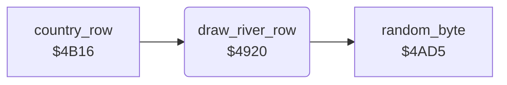

<!-- Generated by c64-docs from knowledge revision 20261025T214620.804-eudhn0 and .c64-re-tools/local/generated/src/source-map.json. Do not edit: change the knowledge, generate the source again, then run docs.ts generate. -->
# ground/river.asm: River

Range `$4920-$4A58`. Source: [ground/river.asm](../../../../src/ground/river.asm). Index: [the reference](../../index.md).

## Routines

| Routine | Address | Reached from | Summary |
|---|---|---|---|
| [`draw_river_row`](river.md#draw_river_row) | `$4920` | [`country_row`](country_row.md#country_row) | Draws the river into the current map row. |

## Data

| Range | Type | Name | Read by | Written by |
|---|---|---|---|---|
| [`$492B`](../../../../src/ground/river.asm#L12)-`$4933` | jumps |  |  |  |
| [`$4A09`](../../../../src/ground/river.asm#L130)-`$4A58` | bytes of 20 | [`river_patterns`](../../../../src/ground/river.asm#L129) | [`draw_river_row`](river.md#draw_river_row) |  |

## Call graph

A solid arrow is a call, a thick arrow a table entry. Rounded nodes are in this file.

## Details

### [`draw_river_row`](../../../../src/ground/river.asm#L6) `$4920`

*routine*

Draws the river into the current map row. $401b is the direction (1 straight, 2 left, 3 right), $401c the steps left, $4023 the column.

- **Called from:** [`country_row`](country_row.md#country_row)
- **Calls:** [`random_byte`](../game/random.md#random_byte)
- **Reads:** [`river_dir`](../data/variables.md#river_dir), [`river_turn_request`](../data/variables.md#river_turn_request), [`river_column`](../data/variables.md#river_column), [`river_steps`](../data/variables.md#river_steps), [`zp_count`](../../memory-map.md#zp_count), [`row_ptr`](../../memory-map.md#row_ptr)
- **Writes:** [`river_turn_request`](../data/variables.md#river_turn_request), [`river_steps`](../data/variables.md#river_steps), [`river_dir`](../data/variables.md#river_dir), [`river_column`](../data/variables.md#river_column), [`zp_count`](../../memory-map.md#zp_count)

| Label | Address | Comment |
|---|---|---|
| [`draw_river_row_left_jmp`](../../../../src/ground/river.asm#L13) | `$492E` |  |
| [`draw_river_row_right_jmp`](../../../../src/ground/river.asm#L15) | `$4931` |  |
| [`draw_river_row_clear_request`](../../../../src/ground/river.asm#L17) | `$4934` |  |
| [`draw_river_row_straight`](../../../../src/ground/river.asm#L20) | `$4939` | Straight for 2 or 3 steps. |
| [`draw_river_row_new_dir`](../../../../src/ground/river.asm#L29) | `$494B` | Selects a new direction. $401e = 1 forces straight, 3 right, 2 left. With 0, the column and a random value select it. |
| [`draw_river_row_by_column`](../../../../src/ground/river.asm#L37) | `$495B` |  |
| [`draw_river_row_turn_right`](../../../../src/ground/river.asm#L47) | `$496E` |  |
| [`draw_river_row_turn_left`](../../../../src/ground/river.asm#L60) | `$498C` |  |
| [`draw_river_row_go_straight`](../../../../src/ground/river.asm#L74) | `$49AD` |  |
| [`draw_river_row_straight_pat`](../../../../src/ground/river.asm#L78) | `$49B5` |  |
| [`draw_river_row_go_left`](../../../../src/ground/river.asm#L81) | `$49BA` |  |
| [`draw_river_row_left_odd`](../../../../src/ground/river.asm#L89) | `$49CB` |  |
| [`draw_river_row_left_pat1`](../../../../src/ground/river.asm#L93) | `$49D3` |  |
| [`draw_river_row_go_right`](../../../../src/ground/river.asm#L96) | `$49D8` |  |
| [`draw_river_row_right_step`](../../../../src/ground/river.asm#L100) | `$49E0` |  |
| [`draw_river_row_pattern`](../../../../src/ground/river.asm#L105) | `$49E8` | Copies 20 bytes of pattern A from river_patterns to the map row, from column $4023 - 20. |
| [`draw_river_row_copy`](../../../../src/ground/river.asm#L120) | `$49FD` |  |

### [`river_patterns`](../../../../src/ground/river.asm#L129) `$4A09-$4A58`

*data*

Four river row patterns of 20 characters: left step, left, straight, right. Character 1 is water, the others are the banks.

- **Read by:** [`draw_river_row`](river.md#draw_river_row)
