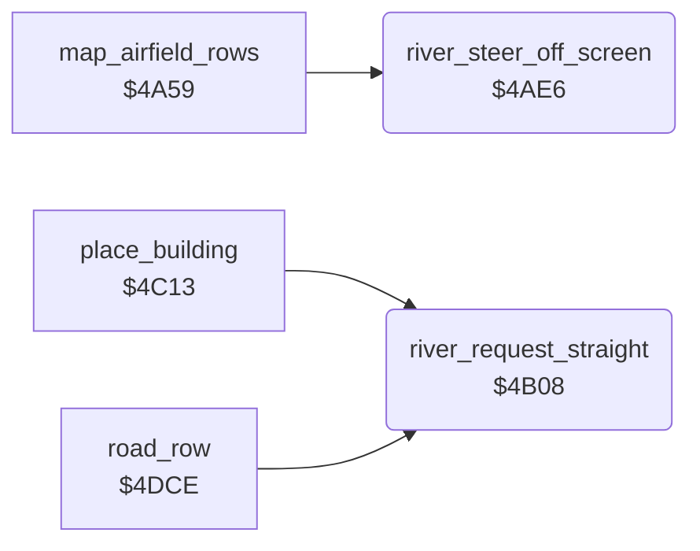

<!-- Generated by c64-docs from knowledge revision 20261024T232120.926-729orp and .c64-re-tools/local/generated/src/source-map.json. Do not edit: change the knowledge, generate the source again, then run docs.ts generate. -->
# ground/river_steer.asm: River steering requests

Range `$4AE6-$4B15`. Source: [ground/river_steer.asm](../../../../src/ground/river_steer.asm). Index: [the reference](../../index.md).

## Call graph

A solid arrow is a call, a thick arrow a table entry, a dotted arrow a jump. Rounded nodes are in this file.

## Names

### [`river_steer_off_screen`](../../../../src/ground/river_steer.asm#L6) `$4AE6`

*routine*

Sets the steer request $401e to the nearer screen edge: 2 (left) when the river column $4023 is below $21, else 3 (right). Returns C=0.

- **Called from:** [`map_airfield_rows`](airfield_rows.md#map_airfield_rows) [`$4A77`](../../../../src/ground/airfield_rows.asm#L21)
- **Reads:** [`river_column`](../data/variables.md#river_column)
- **Writes:** [`river_turn_request`](../data/variables.md#river_turn_request)

### [`river_steer_off_screen_right`](../../../../src/ground/river_steer.asm#L16) `$4AFA`

*label*

- **Jumped to from:** [`river_steer_off_screen`](river_steer.md#river_steer_off_screen) [`$4AF3`](../../../../src/ground/river_steer.asm#L13)

### [`river_steer_off_screen_store`](../../../../src/ground/river_steer.asm#L18) `$4AFC`

*label*

- **Jumped to from:** [`river_steer_off_screen`](river_steer.md#river_steer_off_screen) [`$4AF7`](../../../../src/ground/river_steer.asm#L15)

### [`river_steer_off_screen_done`](../../../../src/ground/river_steer.asm#L23) `$4B01`

*label*

Returns C=1 and $401e = 1 (straight) when the river column $4023 is below 2 or at $4f or more (off the map row).

- **Jumped to from:** [`river_steer_off_screen`](river_steer.md#river_steer_off_screen) [`$4AEB`](../../../../src/ground/river_steer.asm#L9), [`river_steer_off_screen`](river_steer.md#river_steer_off_screen) [`$4AEF`](../../../../src/ground/river_steer.asm#L11)

### [`river_request_straight`](../../../../src/ground/river_steer.asm#L29) `$4B08`

*routine*

Sets the steer request $401e to 1 (straight). Returns C=1 when the river runs straight now ($401b = 1). A is 1 on exit.

- **Called from:** [`place_building`](country_row.md#place_building) [`$4C21`](../../../../src/ground/country_row.asm#L160), [`road_row`](road.md#road_row) [`$4DE3`](../../../../src/ground/road.asm#L18), [`road_row`](road.md#road_row) [`$4EB4`](../../../../src/ground/road.asm#L127)
- **Reads:** [`river_dir`](../data/variables.md#river_dir)
- **Writes:** [`river_turn_request`](../data/variables.md#river_turn_request)

### [`river_request_straight_yes`](../../../../src/ground/river_steer.asm#L36) `$4B14`

*label*

- **Jumped to from:** [`river_request_straight`](river_steer.md#river_request_straight) [`$4B10`](../../../../src/ground/river_steer.asm#L33)
