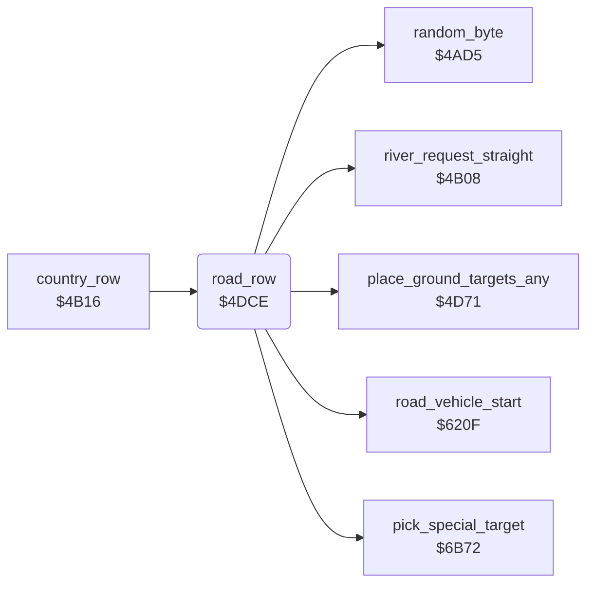

<!-- Generated by c64-docs from knowledge revision 20261025T214620.804-eudhn0 and .c64-re-tools/local/generated/src/source-map.json. Do not edit: change the knowledge, generate the source again, then run docs.ts generate. -->
# ground/road.asm: Road and bridge across the map

Range `$4DCE-$4F07`. Source: [ground/road.asm](../../../../src/ground/road.asm). Index: [the reference](../../index.md).

## Routines

| Routine | Address | Reached from | Summary |
|---|---|---|---|
| [`road_row`](road.md#road_row) | `$4DCE` | [`country_row`](country_row.md#country_row) | Road sequence: after the delay $402e, a straight river and enough $4053, draws 6 rows ($402f) of road with a bridge over the river. |

## Data

| Range | Type | Name | Read by | Written by |
|---|---|---|---|---|
| [`$4EB8`](../../../../src/ground/road.asm#L131)-`$4F07` | bytes of 20 | [`road_bridge_shape`](../../../../src/ground/road.asm#L130) | [`road_row`](road.md#road_row) |  |

## Call graph

A solid arrow is a call, a thick arrow a table entry. Rounded nodes are in this file.

## Details

### [`road_row`](../../../../src/ground/road.asm#L6) `$4DCE`

*routine*

Road sequence: after the delay $402e, a straight river and enough $4053, draws 6 rows ($402f) of road with a bridge over the river.

- **Called from:** [`country_row`](country_row.md#country_row)
- **Calls:** [`river_request_straight`](river_steer.md#river_request_straight), [`pick_special_target`](../enemy/special_targets.md#pick_special_target), [`place_ground_targets_any`](country_row.md#place_ground_targets_any), [`road_vehicle_start`](../enemy/road_vehicle.md#road_vehicle_start), [`random_byte`](../game/random.md#random_byte)
- **Reads:** [`road_wait`](../data/variables.md#road_wait), [`road_rows`](../data/variables.md#road_rows), [`road_block`](../data/variables.md#road_block), [`airfield_active`](../data/variables.md#airfield_active), [`boat_wait`](../data/variables.md#boat_wait), [`river_steps`](../data/variables.md#river_steps), [`river_column`](../data/variables.md#river_column), [`sprite_enable`](../data/variables.md#sprite_enable), [`ship_wait`](../data/variables.md#ship_wait), [`row_ptr`](../../memory-map.md#row_ptr), [`zp_count`](../../memory-map.md#zp_count)
- **Writes:** [`road_wait`](../data/variables.md#road_wait), [`trees_enabled`](../data/variables.md#trees_enabled), [`river_steps`](../data/variables.md#river_steps), [`road_rows`](../data/variables.md#road_rows), [`enemy_shadow_y`](../data/variables.md#enemy_shadow_y), [`enemy_shadow_x`](../data/variables.md#enemy_shadow_x), [`enemy_shadow_frame`](../data/variables.md#enemy_shadow_frame), [`sprite_enable`](../data/variables.md#sprite_enable), [`special_target`](../data/variables.md#special_target), [`special_kind`](../data/variables.md#special_kind), [`river_turn_request`](../data/variables.md#river_turn_request), [`ship_wait`](../data/variables.md#ship_wait) and 1 more

| Label | Address | Comment |
|---|---|---|
| [`road_row_active`](../../../../src/ground/road.asm#L11) | `$4DD7` |  |
| [`road_row_try`](../../../../src/ground/road.asm#L17) | `$4DE3` |  |
| [`road_row_delay`](../../../../src/ground/road.asm#L26) | `$4DF7` |  |
| [`road_row_start`](../../../../src/ground/road.asm#L30) | `$4DFD` |  |
| [`road_row_exit`](../../../../src/ground/road.asm#L59) | `$4E3B` |  |
| [`road_row_first`](../../../../src/ground/road.asm#L62) | `$4E3C` | Phase 6: no trees, two ground target groups and a road vehicle ($620f). |
| [`road_row_next`](../../../../src/ground/road.asm#L70) | `$4E4E` |  |
| [`road_row_end`](../../../../src/ground/road.asm#L74) | `$4E53` | Last phase: next road after $10-$4f rows, trees on, straight river 4 rows more, ship delay at least 2. |
| [`road_row_draw`](../../../../src/ground/road.asm#L93) | `$4E7F` |  |
| [`road_row_fill`](../../../../src/ground/road.asm#L99) | `$4E8A` | Phases 3 and 2 fill the full row with road char $da. |
| [`road_row_fill_loop`](../../../../src/ground/road.asm#L102) | `$4E8E` |  |
| [`road_row_bridge`](../../../../src/ground/road.asm#L107) | `$4E96` | X = phase * 20 - 1: last byte of the bridge row. |
| [`road_row_bridge_loop`](../../../../src/ground/road.asm#L120) | `$4EA9` |  |

### [`road_bridge_shape`](../../../../src/ground/road.asm#L130) `$4EB8-$4F07`

*data*

Bridge rows over the river, 20 bytes each, for road phases 1-4. Drawn right to left, ending at the river column $4023.

- **Read by:** [`road_row`](road.md#road_row)
