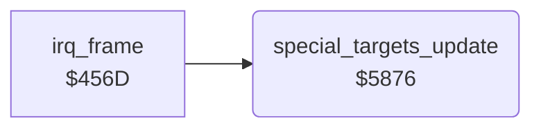

<!-- Generated by c64-docs from knowledge revision 20261024T232120.926-729orp and .c64-re-tools/local/generated/src/source-map.json. Do not edit: change the knowledge, generate the source again, then run docs.ts generate. -->
# ground/special_targets.asm: Special targets

Range `$5876-$5911`. Source: [ground/special_targets.asm](../../../../src/ground/special_targets.asm). Index: [the reference](../../index.md).

## Call graph

A solid arrow is a call, a thick arrow a table entry, a dotted arrow a jump. Rounded nodes are in this file.

## Names

### [`special_targets_update`](../../../../src/ground/special_targets.asm#L6) `$5876`

*routine*

In map sections 4 and 5 ($4035), moves the three special targets (sprite 7, expanded) across the screen one after the other.

- **Called from:** [`irq_frame`](../irq/frame_irq.md#irq_frame) [`$46D0`](../../../../src/irq/frame_irq.asm#L175)
- **Reads:** [`map_section`](../data/variables.md#map_section), [`special_drop_timer`](../data/variables.md#special_drop_timer), [`frame_count`](../data/variables.md#frame_count), [`sprite_enable`](../data/variables.md#sprite_enable), [`special_index`](../data/variables.md#special_index), [`special_targets`](../data/variables.md#special_targets), [`enemy_shadow_x`](../data/variables.md#enemy_shadow_x), [`enemy_shadow_y`](../data/variables.md#enemy_shadow_y), [`sprite_xexp_mask`](../data/variables.md#sprite_xexp_mask), [`sprite_yexp_mask`](../data/variables.md#sprite_yexp_mask)
- **Writes:** [`special_drop_timer`](../data/variables.md#special_drop_timer), [`enemy_shadow_y`](../data/variables.md#enemy_shadow_y), [`enemy_shadow_x`](../data/variables.md#enemy_shadow_x), [`enemy_shadow_frame`](../data/variables.md#enemy_shadow_frame), [`enemy_shadow_colour`](../data/variables.md#enemy_shadow_colour), [`sprite_enable`](../data/variables.md#sprite_enable), [`special_index`](../data/variables.md#special_index), [`sprite_xexp_mask`](../data/variables.md#sprite_xexp_mask), [`sprite_yexp_mask`](../data/variables.md#sprite_yexp_mask)

### [`special_targets_active`](../../../../src/ground/special_targets.asm#L13) `$5882`

*label*

$4081 = delay before the next special target appears.

- **Jumped to from:** [`special_targets_update`](special_targets.md#special_targets_update) [`$587B`](../../../../src/ground/special_targets.asm#L9), [`special_targets_update`](special_targets.md#special_targets_update) [`$587F`](../../../../src/ground/special_targets.asm#L11)

### [`special_targets_wait`](../../../../src/ground/special_targets.asm#L21) `$5893`

*label*

- **Jumped to from:** [`special_targets_update`](special_targets.md#special_targets_update) [`$588C`](../../../../src/ground/special_targets.asm#L18)

### [`special_targets_start`](../../../../src/ground/special_targets.asm#L24) `$5894`

*label*

Starts special target $4082 at the top right of the screen: Y $0a, X $8c, image $f9, white.

- **Jumped to from:** [`special_targets_update`](special_targets.md#special_targets_update) [`$5891`](../../../../src/ground/special_targets.asm#L20)

### [`special_targets_move`](../../../../src/ground/special_targets.asm#L46) `$58C3`

*label*

Moves the special target with the landscape: X - 1, Y + 2. At Y >= $fa it goes to the next target.

- **Jumped to from:** [`special_targets_update`](special_targets.md#special_targets_update) [`$5885`](../../../../src/ground/special_targets.asm#L15), [`special_targets_update`](special_targets.md#special_targets_update) [`$58B6`](../../../../src/ground/special_targets.asm#L38)

### [`special_targets_done`](../../../../src/ground/special_targets.asm#L63) `$58EB`

*label*

- **Jumped to from:** [`special_targets_update`](special_targets.md#special_targets_update) [`$58E3`](../../../../src/ground/special_targets.asm#L59)

### [`special_targets_expand`](../../../../src/ground/special_targets.asm#L73) `$5901`

*label*

Set the X and Y expansion of sprite 7.

- **Jumped to from:** [`special_targets_update`](special_targets.md#special_targets_update) [`$58D1`](../../../../src/ground/special_targets.asm#L52)
