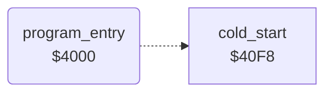

<!-- Generated by c64-docs from knowledge revision 20261024T232120.926-729orp and .c64-re-tools/local/generated/src/source-map.json. Do not edit: change the knowledge, generate the source again, then run docs.ts generate. -->
# init/entry.asm: Program entry

Range `$4000-$4002`. Source: [init/entry.asm](../../../../src/init/entry.asm). Index: [the reference](../../index.md).

## Call graph

A solid arrow is a call, a thick arrow a table entry, a dotted arrow a jump. Rounded nodes are in this file.

## Names

### [`program_entry`](../../../../src/init/entry.asm#L6) `$4000`

*routine*

Entry of the game. Jumps over the variable block $4003-$40f7 to cold_start.

- **Jumps to:** [`cold_start`](game_start.md#cold_start)
