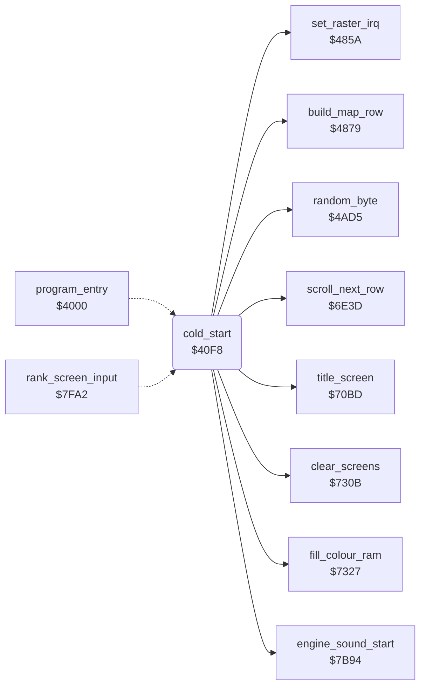

<!-- Generated by c64-docs from knowledge revision 20261024T232120.926-729orp and .c64-re-tools/local/generated/src/source-map.json. Do not edit: change the knowledge, generate the source again, then run docs.ts generate. -->
# init/game_start.asm: Cold start and game start

Range `$40F8-$4348`. Source: [init/game_start.asm](../../../../src/init/game_start.asm). Index: [the reference](../../index.md).

## Call graph

A solid arrow is a call, a thick arrow a table entry, a dotted arrow a jump. Rounded nodes are in this file.

## Names

### [`cold_start`](../../../../src/init/game_start.asm#L6) `$40F8`

*routine*

Clears the options $4008-$400a, sets the RAM IRQ and NMI vectors, sets the volume $409c to $ff, then continues at restart_title.
NOP: all three cracks have it.

- **Jumped to from:** [`program_entry`](entry.md#program_entry) [`$4000`](../../../../src/init/entry.asm#L7)
- **Calls:** [`title_screen`](../screen/title_screen.md#title_screen), [`fill_colour_ram`](../screen/screen_fill.md#fill_colour_ram), [`clear_screens`](../screen/screen_fill.md#clear_screens), [`set_raster_irq`](../irq/raster.md#set_raster_irq), [`random_byte`](../game/random.md#random_byte), [`scroll_next_row`](../plane/plane_states.md#scroll_next_row), [`build_map_row`](../ground/map_row.md#build_map_row), [`engine_sound_start`](../sound/sound_effects.md#engine_sound_start)
- **Reads:** [`charset_source`](../data/charset_source.md#charset_source), [`charset_source_p1`](../data/charset_source.md#charset_source_p1), [`charset_source_p2`](../data/charset_source.md#charset_source_p2), [`charset_source_p3`](../data/charset_source.md#charset_source_p3), [`charset_source_p4`](../data/charset_source.md#charset_source_p4), [`charset_source_p5`](../data/charset_source.md#charset_source_p5), [`charset_source_p6`](../data/charset_source.md#charset_source_p6), [`charset_source_p7`](../data/charset_source.md#charset_source_p7), [`status_text`](../screen/status_line.md#status_text), [`identity_table`](../protection/identity_table.md#identity_table), [`airfield_rows`](../data/variables.md#airfield_rows), [`loader_start_state`](../../memory-map.md#loader_start_state)
- **Writes:** [`opt_gravity`](../data/variables.md#opt_gravity), [`opt_reverse_control`](../data/variables.md#opt_reverse_control), [`opt_skill_level`](../data/variables.md#opt_skill_level), `$FFFE`, `$FFFF`, `$FFFA`, `$FFFB`, [`sound_volume`](../data/variables.md#sound_volume), [`SPENA`](../../memory-map.md#SPENA), [`screen_copy_done`](../data/variables.md#screen_copy_done), [`unread_4021`](../data/variables.md#unread_4021), [`ship_row`](../data/variables.md#ship_row), [`building_rows`](../data/variables.md#building_rows), [`unread_402b`](../data/variables.md#unread_402b), [`river_turn_request`](../data/variables.md#river_turn_request), [`airfield_rows`](../data/variables.md#airfield_rows), [`road_block`](../data/variables.md#road_block), [`airfield_active`](../data/variables.md#airfield_active), [`section_step`](../data/variables.md#section_step), [`game_frozen`](../data/variables.md#game_frozen), [`crash_flag`](../data/variables.md#crash_flag), [`special_target`](../data/variables.md#special_target), [`sprite_prio_mask`](../data/variables.md#sprite_prio_mask), [`sprite_mc_mask`](../data/variables.md#sprite_mc_mask), [`enemy_explode_timer`](../data/variables.md#enemy_explode_timer), [`refuel_stage`](../data/variables.md#refuel_stage), [`vehicle_frame`](../data/variables.md#vehicle_frame), [`plane_failing`](../data/variables.md#plane_failing), [`damage_fuel`](../data/variables.md#damage_fuel), [`damage_bombs`](../data/variables.md#damage_bombs), [`damage_motor`](../data/variables.md#damage_motor), [`damage_gun`](../data/variables.md#damage_gun), [`touch_timer`](../data/variables.md#touch_timer), [`score_10000`](../data/variables.md#score_10000), [`score_1000`](../data/variables.md#score_1000), [`score_100`](../data/variables.md#score_100), [`score_10`](../data/variables.md#score_10), [`score_1`](../data/variables.md#score_1), [`fuel`](../data/variables.md#fuel), [`bombs`](../data/variables.md#bombs) and 88 more

### [`restart_title`](../../../../src/init/game_start.asm#L17) `$411D`

*label*

Turns off the sprites and runs the title screen at $70bd. $43a7 and $7fb6 jump here after a game.

- **Jumped to from:** [`$43A7`](../../../../src/game/main_loop.asm#L51), [`rank_screen_input`](../game/rank.md#rank_screen_input) [`$7FB6`](../../../../src/game/rank.asm#L301)

### [`game_start`](../../../../src/init/game_start.asm#L23) `$4126`

*label*

Starts a new game: sets the game variables, clears the SID and screens, sets the raster IRQ, copies charset and status text, fills the map.
Entry from $7fc6: fire on the rank screen starts a new game.

- **Jumped to from:** [`rank_screen_input`](../game/rank.md#rank_screen_input) [`$7FC6`](../../../../src/game/rank.asm#L309)

### [`game_start_clear_sid`](../../../../src/init/game_start.asm#L138) `$426B`

*label*

Clears the SID registers $d400-$d418.

- **Jumped to from:** [`cold_start`](game_start.md#cold_start) [`$426F`](../../../../src/init/game_start.asm#L141)

### [`game_start_copy_charset`](../../../../src/init/game_start.asm#L154) `$428A`

*label*

Copies the charset $3000-$37ff to $2000-$27ff and clears $0f00-$0fff (status screen page).

- **Jumped to from:** [`cold_start`](game_start.md#cold_start) [`$42C0`](../../../../src/init/game_start.asm#L174)

### [`game_start_status_text`](../../../../src/init/game_start.asm#L177) `$42C4`

*label*

Copies status_text to the status rows $0f71-$0fbf with colour 1 (white). Y = 0 is not copied.

- **Jumped to from:** [`cold_start`](game_start.md#cold_start) [`$42D0`](../../../../src/init/game_start.asm#L183)

### [`game_start_clear_sid2`](../../../../src/init/game_start.asm#L186) `$42D6`

*label*

- **Jumped to from:** [`cold_start`](game_start.md#cold_start) [`$42DA`](../../../../src/init/game_start.asm#L189)

### [`game_start_fill_map`](../../../../src/init/game_start.asm#L224) `$432D`

*label*

Scrolls the map and builds map rows until the airfield row counter $4031 is $0e: the game starts on the airfield.

- **Jumped to from:** [`cold_start`](game_start.md#cold_start) [`$4338`](../../../../src/init/game_start.asm#L229)
