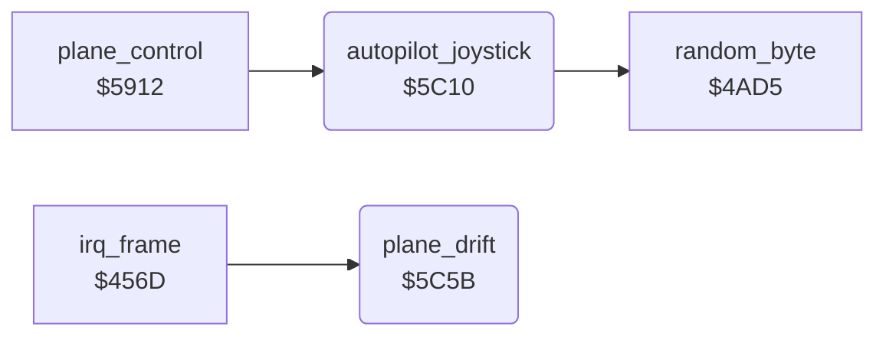

<!-- Generated by c64-docs from knowledge revision 20261025T214620.804-eudhn0 and .c64-re-tools/local/generated/src/source-map.json. Do not edit: change the knowledge, generate the source again, then run docs.ts generate. -->
# input/autopilot.asm: Autopilot joystick

Range `$5C10-$5C92`. Source: [input/autopilot.asm](../../../../src/input/autopilot.asm). Index: [the reference](../../index.md).

## Routines

| Routine | Address | Reached from | Summary |
|---|---|---|---|
| [`autopilot_joystick`](autopilot.md#autopilot_joystick) | `$5C10` | [`plane_control`](../plane/plane_control.md#plane_control) | Makes a joystick value in $4094 and A. |
| [`plane_drift`](autopilot.md#plane_drift) | `$5C5B` | [`irq_frame`](../irq/frame_irq.md#irq_frame) | Sinks the plane in crash states. |

## Data

| Range | Type | Name | Read by | Written by |
|---|---|---|---|---|
| [`$5C4B`](../../../../src/input/autopilot.asm#L40)-`$5C5A` | bytes | [`autopilot_dirs`](../../../../src/input/autopilot.asm#L39) | [`autopilot_joystick`](autopilot.md#autopilot_joystick) |  |

## Call graph

A solid arrow is a call, a thick arrow a table entry. Rounded nodes are in this file.

## Details

### [`autopilot_joystick`](../../../../src/input/autopilot.asm#L6) `$5C10`

*routine*

Makes a joystick value in $4094 and A. Below altitude $14 it climbs at speed >= 100. Else a random direction from autopilot_dirs.

- **Called from:** [`plane_control`](../plane/plane_control.md#plane_control)
- **Calls:** [`random_byte`](../game/random.md#random_byte)
- **Reads:** [`altitude`](../data/variables.md#altitude), [`speed`](../data/variables.md#speed), [`random_seed`](../../memory-map.md#random_seed), [`demo_joy`](../data/variables.md#demo_joy), [`zp_count`](../../memory-map.md#zp_count)
- **Writes:** [`zp_count`](../../memory-map.md#zp_count), [`demo_joy`](../data/variables.md#demo_joy)

| Label | Address | Comment |
|---|---|---|
| [`autopilot_joystick_climb`](../../../../src/input/autopilot.asm#L15) | `$5C23` | $0d: bit 1 pressed (climb). |
| [`autopilot_joystick_keep`](../../../../src/input/autopilot.asm#L18) | `$5C28` | Keep the last value on 15 of 16 random values. |
| [`autopilot_joystick_new`](../../../../src/input/autopilot.asm#L24) | `$5C34` |  |
| [`autopilot_joystick_set`](../../../../src/input/autopilot.asm#L35) | `$5C47` |  |

### [`autopilot_dirs`](../../../../src/input/autopilot.asm#L39) `$5C4B-$5C5A`

*data*

Sixteen joystick direction values (bits 0-3, low = pressed).

- **Read by:** [`autopilot_joystick`](autopilot.md#autopilot_joystick)

### [`plane_drift`](../../../../src/input/autopilot.asm#L43) `$5C5B`

*routine*

Sinks the plane in crash states. Without vertical input, moves the plane down and left on the screen by 2 and 1.
$4069 nonzero: altitude - 1.

- **Called from:** [`irq_frame`](../irq/frame_irq.md#irq_frame)
- **Reads:** [`plane_failing`](../data/variables.md#plane_failing), [`altitude`](../data/variables.md#altitude), [`plane_moved_y`](../data/variables.md#plane_moved_y), [`joy_state`](../data/variables.md#joy_state), [`plane_state`](../data/variables.md#plane_state), [`shadow_y`](../data/variables.md#shadow_y), [`shadow_x`](../data/variables.md#shadow_x)
- **Writes:** [`altitude`](../data/variables.md#altitude), [`shadow_y`](../data/variables.md#shadow_y), [`shadow_x`](../data/variables.md#shadow_x), [`plane_moved_y`](../data/variables.md#plane_moved_y)

| Label | Address | Comment |
|---|---|---|
| [`plane_drift_test`](../../../../src/input/autopilot.asm#L47) | `$5C63` | $4063 = 0: no vertical move in this frame. |
| [`plane_drift_done`](../../../../src/input/autopilot.asm#L65) | `$5C8D` |  |
