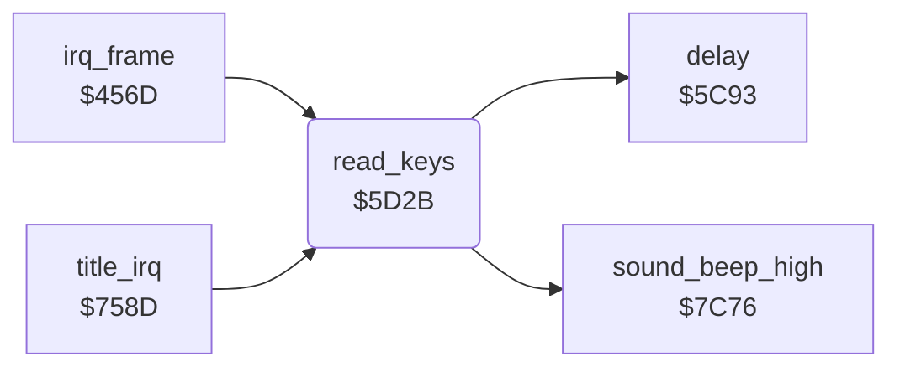

<!-- Generated by c64-docs from knowledge revision 20261025T214620.804-eudhn0 and .c64-re-tools/local/generated/src/source-map.json. Do not edit: change the knowledge, generate the source again, then run docs.ts generate. -->
# input/keyboard.asm: Keyboard

Range `$5D2B-$5DA5`. Source: [input/keyboard.asm](../../../../src/input/keyboard.asm). Index: [the reference](../../index.md).

## Routines

| Routine | Address | Reached from | Summary |
|---|---|---|---|
| [`read_keys`](keyboard.md#read_keys) | `$5D2B` | [`irq_frame`](../irq/frame_irq.md#irq_frame), [`title_irq`](../irq/title_irq.md#title_irq) | On alternate frames reads F1/F3/F5/F7 into $4086 (1-4, 0 none) or SPACE into $4090. |

## Call graph

A solid arrow is a call, a thick arrow a table entry. Rounded nodes are in this file.

## Details

### [`read_keys`](../../../../src/input/keyboard.asm#L6) `$5D2B`

*routine*

On alternate frames reads F1/F3/F5/F7 into $4086 (1-4, 0 none) or SPACE into $4090.

- **Called from:** [`irq_frame`](../irq/frame_irq.md#irq_frame), [`title_irq`](../irq/title_irq.md#title_irq)
- **Calls:** [`sound_beep_high`](../sound/sound_effects.md#sound_beep_high), [`delay`](../game/delay.md#delay)
- **Reads:** [`frame_count`](../data/variables.md#frame_count), [`CIAPRB`](../../memory-map.md#CIAPRB), [`invincible`](../data/variables.md#invincible), [`map_ptr_hi`](../../memory-map.md#map_ptr_hi)
- **Writes:** [`CIADDRA`](../../memory-map.md#CIADDRA), [`CIADDRB`](../../memory-map.md#CIADDRB), [`CIAPRA`](../../memory-map.md#CIAPRA), [`map_ptr_hi`](../../memory-map.md#map_ptr_hi), [`invincible`](../data/variables.md#invincible), [`screen_a`](../../memory-map.md#screen_a), [`fkey_code`](../data/variables.md#fkey_code), [`space_key`](../data/variables.md#space_key)

| Label | Address | Comment |
|---|---|---|
| [`read_keys_f1`](../../../../src/input/keyboard.asm#L38) | `$5D5D` |  |
| [`read_keys_f3`](../../../../src/input/keyboard.asm#L44) | `$5D68` |  |
| [`read_keys_f5`](../../../../src/input/keyboard.asm#L50) | `$5D73` |  |
| [`read_keys_f7`](../../../../src/input/keyboard.asm#L56) | `$5D7E` |  |
| [`read_keys_none`](../../../../src/input/keyboard.asm#L62) | `$5D89` |  |
| [`read_keys_store`](../../../../src/input/keyboard.asm#L64) | `$5D8B` |  |
| [`read_keys_space`](../../../../src/input/keyboard.asm#L67) | `$5D8F` | Row 7, $ef: only SPACE pressed. |
| [`read_keys_no_space`](../../../../src/input/keyboard.asm#L75) | `$5DA0` |  |
| [`read_keys_space_store`](../../../../src/input/keyboard.asm#L77) | `$5DA2` |  |
