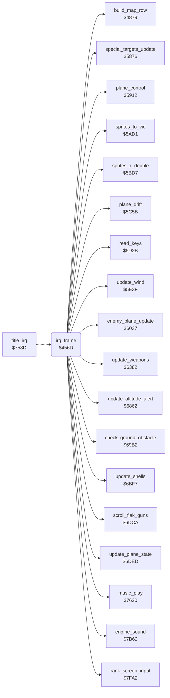

<!-- Generated by c64-docs from knowledge revision 20261024T232120.926-729orp and .c64-re-tools/local/generated/src/source-map.json. Do not edit: change the knowledge, generate the source again, then run docs.ts generate. -->
# irq/frame_irq.asm: Frame interrupt

Range `$456D-$4851`. Source: [irq/frame_irq.asm](../../../../src/irq/frame_irq.asm). Index: [the reference](../../index.md).

## Call graph

A solid arrow is a call, a thick arrow a table entry, a dotted arrow a jump. Rounded nodes are in this file.

## Names

### [`irq_frame`](../../../../src/irq/frame_irq.asm#L6) `$456D`

*routine*

Raster IRQ at line $db: shows the status rows. At line $f8 it sets the play area, counts time and fuel, and runs the game.
$10dd in the identity table holds $dd.

- **Calls:** [`rank_screen_input`](../game/rank.md#rank_screen_input), [`sprites_x_double`](../screen/sprite_positions.md#sprites_x_double), [`sprites_to_vic`](../screen/sprite_registers.md#sprites_to_vic), [`read_keys`](../input/keyboard.md#read_keys), [`update_weapons`](../plane/weapons.md#update_weapons), [`update_plane_state`](../plane/plane_state.md#update_plane_state), [`engine_sound`](../sound/sound_effects.md#engine_sound), [`enemy_plane_update`](../enemy/enemy_plane.md#enemy_plane_update), [`scroll_flak_guns`](../ground/flak_guns.md#scroll_flak_guns), [`plane_control`](../plane/plane_control.md#plane_control), [`update_altitude_alert`](../screen/altitude_alert.md#update_altitude_alert), [`update_shells`](../enemy/flak_shells.md#update_shells), [`check_ground_obstacle`](../ground/obstacles.md#check_ground_obstacle), [`update_wind`](../plane/wind.md#update_wind), [`special_targets_update`](../ground/special_targets.md#special_targets_update), [`build_map_row`](../ground/map_row.md#build_map_row), [`plane_drift`](../input/autopilot.md#plane_drift), [`music_play`](../music/music_player.md#music_play)
- **Reads:** [`identity_table_dd`](../protection/identity_table.md#identity_table_dd), [`RASTER`](../../memory-map.md#RASTER), [`status_bg_colour`](../data/variables.md#status_bg_colour), [`status_sprite_ptr`](../data/variables.md#status_sprite_ptr), [`rank_screen_on`](../data/variables.md#rank_screen_on), [`frame_count`](../data/variables.md#frame_count), [`game_frozen`](../data/variables.md#game_frozen), [`play_time`](../data/variables.md#play_time), [`play_time_mid`](../data/variables.md#play_time_mid), [`play_time_hi`](../data/variables.md#play_time_hi), [`fuel_tick`](../data/variables.md#fuel_tick), [`fuel`](../data/variables.md#fuel), [`damage_fuel`](../data/variables.md#damage_fuel), [`sprite_mc_mask`](../data/variables.md#sprite_mc_mask), [`sprite_prio_mask`](../data/variables.md#sprite_prio_mask), [`sprite_xexp_mask`](../data/variables.md#sprite_xexp_mask), [`sprite_yexp_mask`](../data/variables.md#sprite_yexp_mask), [`scroll_fine_x`](../data/variables.md#scroll_fine_x), [`scroll_fine_y`](../data/variables.md#scroll_fine_y), [`screen_page_hi`](../data/variables.md#screen_page_hi), [`ground_colour2`](../data/variables.md#ground_colour2), [`ground_colour`](../data/variables.md#ground_colour), [`flash_timer`](../data/variables.md#flash_timer), [`flash_colours`](raster.md#flash_colours), [`random_seed`](../../memory-map.md#random_seed), [`frame_odd`](../data/variables.md#frame_odd), [`screen_copy_done`](../data/variables.md#screen_copy_done), [`map_row_ptr`](../data/variables.md#map_row_ptr), [`map_row_ptr_hi`](../data/variables.md#map_row_ptr_hi), [`map_row_index`](../data/variables.md#map_row_index), [`loader_copy_rows`](../../memory-map.md#loader_copy_rows), [`map_copy_ptr`](../data/variables.md#map_copy_ptr), [`map_copy_ptr_hi`](../data/variables.md#map_copy_ptr_hi), [`zp_count`](../../memory-map.md#zp_count), [`zp_temp4`](../../memory-map.md#zp_temp4), [`map_window`](../data/map_buffer_leftover.md#map_window), `$80AE`, `$812E`, `$81AE`, `$822E` and 19 more
- **Writes:** [`SCROLY`](../../memory-map.md#SCROLY), [`VMCSB`](../../memory-map.md#VMCSB), [`BGCOL0`](../../memory-map.md#BGCOL0), [`SCROLX`](../../memory-map.md#SCROLX), [`status_sprite_ptrs+1`](../../memory-map.md#status_sprite_ptrs), [`status_sprite_ptrs+2`](../../memory-map.md#status_sprite_ptrs), [`status_sprite_ptrs+3`](../../memory-map.md#status_sprite_ptrs), [`status_sprite_ptrs+4`](../../memory-map.md#status_sprite_ptrs), [`status_sprite_ptrs+5`](../../memory-map.md#status_sprite_ptrs), [`status_sprite_ptrs+6`](../../memory-map.md#status_sprite_ptrs), [`status_sprite_ptrs+7`](../../memory-map.md#status_sprite_ptrs), [`XXPAND`](../../memory-map.md#XXPAND), [`EXTCOL`](../../memory-map.md#EXTCOL), [`SPMC`](../../memory-map.md#SPMC), [`SPENA`](../../memory-map.md#SPENA), [`status_sprite_ptrs`](../../memory-map.md#status_sprite_ptrs), [`SP0COL`](../../memory-map.md#SP0COL), [`SP0X`](../../memory-map.md#SP0X), [`SP0Y`](../../memory-map.md#SP0Y), [`frame_count`](../data/variables.md#frame_count), [`play_time`](../data/variables.md#play_time), [`play_time_mid`](../data/variables.md#play_time_mid), [`play_time_hi`](../data/variables.md#play_time_hi), [`fuel_tick`](../data/variables.md#fuel_tick), [`fuel`](../data/variables.md#fuel), [`plane_failing`](../data/variables.md#plane_failing), [`VCREG1`](../../memory-map.md#VCREG1), [`SPBGPR`](../../memory-map.md#SPBGPR), [`YXPAND`](../../memory-map.md#YXPAND), [`BGCOL1`](../../memory-map.md#BGCOL1), [`flash_timer`](../data/variables.md#flash_timer), [`screen_page_hi`](../data/variables.md#screen_page_hi), [`map_copy_ptr`](../data/variables.md#map_copy_ptr), [`map_copy_ptr_hi`](../data/variables.md#map_copy_ptr_hi), [`zp_count`](../../memory-map.md#zp_count), [`zp_temp4`](../../memory-map.md#zp_temp4), [`screen_copy_done`](../data/variables.md#screen_copy_done), [`screen_a`](../../memory-map.md#screen_a), [`screen_a+40`](../../memory-map.md#screen_a), [`screen_a+80`](../../memory-map.md#screen_a) and 24 more

### [`irq_frame_wait_status`](../../../../src/irq/frame_irq.asm#L8) `$4570`

*label*

- **Jumped to from:** [`irq_frame`](frame_irq.md#irq_frame) [`$4573`](../../../../src/irq/frame_irq.asm#L10)

### [`irq_frame_wait_bottom`](../../../../src/irq/frame_irq.asm#L59) `$45D9`

*label*

Waits for raster line $f8.

- **Jumped to from:** [`irq_frame`](frame_irq.md#irq_frame) [`$45DC`](../../../../src/irq/frame_irq.asm#L61)

### [`irq_frame_counters`](../../../../src/irq/frame_irq.asm#L65) `$45E6`

*label*

Frame counter.

- **Jumped to from:** [`irq_frame`](frame_irq.md#irq_frame) [`$45E1`](../../../../src/irq/frame_irq.asm#L63)

### [`irq_frame_fuel`](../../../../src/irq/frame_irq.asm#L73) `$45FB`

*label*

Uses one fuel unit every 50 frames, or every 25 frames with fuel damage ($40b9). At fuel 0, sets $4069 and stops the motor sound.

- **Jumped to from:** [`irq_frame`](frame_irq.md#irq_frame) [`$45F1`](../../../../src/irq/frame_irq.asm#L70), [`irq_frame`](frame_irq.md#irq_frame) [`$45F6`](../../../../src/irq/frame_irq.asm#L71)

### [`irq_frame_fuel_slow`](../../../../src/irq/frame_irq.asm#L92) `$4612`

*label*

- **Jumped to from:** [`irq_frame`](frame_irq.md#irq_frame) [`$460B`](../../../../src/irq/frame_irq.asm#L89)

### [`irq_frame_fuel_timer`](../../../../src/irq/frame_irq.asm#L94) `$4614`

*label*

- **Jumped to from:** [`irq_frame`](frame_irq.md#irq_frame) [`$460F`](../../../../src/irq/frame_irq.asm#L91)

### [`irq_frame_fuel_empty`](../../../../src/irq/frame_irq.asm#L97) `$461A`

*label*

- **Jumped to from:** [`irq_frame`](frame_irq.md#irq_frame) [`$4603`](../../../../src/irq/frame_irq.asm#L77)

### [`irq_frame_set_vic`](../../../../src/irq/frame_irq.asm#L103) `$4624`

*label*

Sets the play area: sprite modes, fine scroll, screen $0400 or $0800 from $401a, background colours $4019 and $4097.

- **Jumped to from:** [`irq_frame`](frame_irq.md#irq_frame) [`$45EC`](../../../../src/irq/frame_irq.asm#L68), [`irq_frame`](frame_irq.md#irq_frame) [`$45FE`](../../../../src/irq/frame_irq.asm#L75), [`irq_frame`](frame_irq.md#irq_frame) [`$4617`](../../../../src/irq/frame_irq.asm#L96)

### [`irq_frame_game`](../../../../src/irq/frame_irq.asm#L155) `$469C`

*label*

- **Jumped to from:** [`irq_frame`](frame_irq.md#irq_frame) [`$4669`](../../../../src/irq/frame_irq.asm#L131), [`irq_frame`](frame_irq.md#irq_frame) [`$467B`](../../../../src/irq/frame_irq.asm#L138), [`irq_frame`](frame_irq.md#irq_frame) [`$4680`](../../../../src/irq/frame_irq.asm#L140), [`irq_frame`](frame_irq.md#irq_frame) [`$4684`](../../../../src/irq/frame_irq.asm#L142)

### [`irq_frame_play`](../../../../src/irq/frame_irq.asm#L162) `$46AD`

*label*

- **Jumped to from:** [`irq_frame`](frame_irq.md#irq_frame) [`$46A8`](../../../../src/irq/frame_irq.asm#L160)

### [`irq_frame_odd`](../../../../src/irq/frame_irq.asm#L178) `$46D6`

*label*

Odd frames: when the map scrolled ($4011 = 0), swaps the screens and copies the map to the hidden screen.

- **Jumped to from:** [`irq_frame`](frame_irq.md#irq_frame) [`$46B6`](../../../../src/irq/frame_irq.asm#L166)

### [`irq_frame_swap_screen`](../../../../src/irq/frame_irq.asm#L182) `$46DE`

*label*

- **Jumped to from:** [`irq_frame`](frame_irq.md#irq_frame) [`$46D9`](../../../../src/irq/frame_irq.asm#L180)

### [`irq_frame_patch_rows`](../../../../src/irq/frame_irq.asm#L222) `$4749`

*label*

- **Jumped to from:** [`irq_frame`](frame_irq.md#irq_frame) [`$477F`](../../../../src/irq/frame_irq.asm#L249)

### [`irq_frame_patch_next`](../../../../src/irq/frame_irq.asm#L247) `$477E`

*label*

- **Jumped to from:** [`irq_frame`](frame_irq.md#irq_frame) [`$476D`](../../../../src/irq/frame_irq.asm#L239)

### [`irq_frame_copy_rows`](../../../../src/irq/frame_irq.asm#L254) `$4788`

*label*

Unrolled copy of 22 rows of 40 bytes from the map buffer to the hidden screen. The code above writes all operands.
Operand = map address of row 0, written at $474c and $4752.

- **Jumped to from:** [`irq_frame`](frame_irq.md#irq_frame) [`$480F`](../../../../src/irq/frame_irq.asm#L341)
- **Written by:** [`irq_frame`](frame_irq.md#irq_frame) [`$474C`](../../../../src/irq/frame_irq.asm#L224)

### [`irq_frame_copy_src`](../../../../src/irq/frame_irq.asm#L255) `$4789-$478C`

*variable*

- **Written by:** [`irq_frame`](frame_irq.md#irq_frame) [`$4752`](../../../../src/irq/frame_irq.asm#L226)

### [`irq_frame_dst_row00`](../../../../src/irq/frame_irq.asm#L256) `$478D-$4792`

*variable*

- **Written by:** [`irq_frame`](frame_irq.md#irq_frame) [`$46F5`](../../../../src/irq/frame_irq.asm#L189)

### [`irq_frame_dst_row01`](../../../../src/irq/frame_irq.asm#L257) `$4793-$4798`

*variable*

- **Written by:** [`irq_frame`](frame_irq.md#irq_frame) [`$46F8`](../../../../src/irq/frame_irq.asm#L190)

### [`irq_frame_dst_row02`](../../../../src/irq/frame_irq.asm#L258) `$4799-$479E`

*variable*

- **Written by:** [`irq_frame`](frame_irq.md#irq_frame) [`$46FB`](../../../../src/irq/frame_irq.asm#L191)

### [`irq_frame_dst_row03`](../../../../src/irq/frame_irq.asm#L259) `$479F-$47A4`

*variable*

- **Written by:** [`irq_frame`](frame_irq.md#irq_frame) [`$46FE`](../../../../src/irq/frame_irq.asm#L192)

### [`irq_frame_dst_row04`](../../../../src/irq/frame_irq.asm#L260) `$47A5-$47AA`

*variable*

- **Written by:** [`irq_frame`](frame_irq.md#irq_frame) [`$4701`](../../../../src/irq/frame_irq.asm#L193)

### [`irq_frame_dst_row05`](../../../../src/irq/frame_irq.asm#L261) `$47AB-$47B0`

*variable*

- **Written by:** [`irq_frame`](frame_irq.md#irq_frame) [`$4704`](../../../../src/irq/frame_irq.asm#L194)

### [`irq_frame_dst_row06`](../../../../src/irq/frame_irq.asm#L262) `$47B1-$47B6`

*variable*

- **Written by:** [`irq_frame`](frame_irq.md#irq_frame) [`$4707`](../../../../src/irq/frame_irq.asm#L195)

### [`irq_frame_dst_row07`](../../../../src/irq/frame_irq.asm#L263) `$47B7-$47BC`

*variable*

- **Written by:** [`irq_frame`](frame_irq.md#irq_frame) [`$470B`](../../../../src/irq/frame_irq.asm#L197)

### [`irq_frame_dst_row08`](../../../../src/irq/frame_irq.asm#L264) `$47BD-$47C2`

*variable*

- **Written by:** [`irq_frame`](frame_irq.md#irq_frame) [`$470E`](../../../../src/irq/frame_irq.asm#L198)

### [`irq_frame_dst_row09`](../../../../src/irq/frame_irq.asm#L265) `$47C3-$47C8`

*variable*

- **Written by:** [`irq_frame`](frame_irq.md#irq_frame) [`$4711`](../../../../src/irq/frame_irq.asm#L199)

### [`irq_frame_dst_row10`](../../../../src/irq/frame_irq.asm#L266) `$47C9-$47CE`

*variable*

- **Written by:** [`irq_frame`](frame_irq.md#irq_frame) [`$4714`](../../../../src/irq/frame_irq.asm#L200)

### [`irq_frame_dst_row11`](../../../../src/irq/frame_irq.asm#L267) `$47CF-$47D4`

*variable*

- **Written by:** [`irq_frame`](frame_irq.md#irq_frame) [`$4717`](../../../../src/irq/frame_irq.asm#L201)

### [`irq_frame_dst_row12`](../../../../src/irq/frame_irq.asm#L268) `$47D5-$47DA`

*variable*

- **Written by:** [`irq_frame`](frame_irq.md#irq_frame) [`$471A`](../../../../src/irq/frame_irq.asm#L202)

### [`irq_frame_dst_row13`](../../../../src/irq/frame_irq.asm#L269) `$47DB-$47E0`

*variable*

- **Written by:** [`irq_frame`](frame_irq.md#irq_frame) [`$471E`](../../../../src/irq/frame_irq.asm#L204)

### [`irq_frame_dst_row14`](../../../../src/irq/frame_irq.asm#L270) `$47E1-$47E6`

*variable*

- **Written by:** [`irq_frame`](frame_irq.md#irq_frame) [`$4721`](../../../../src/irq/frame_irq.asm#L205)

### [`irq_frame_dst_row15`](../../../../src/irq/frame_irq.asm#L271) `$47E7-$47EC`

*variable*

- **Written by:** [`irq_frame`](frame_irq.md#irq_frame) [`$4724`](../../../../src/irq/frame_irq.asm#L206)

### [`irq_frame_dst_row16`](../../../../src/irq/frame_irq.asm#L272) `$47ED-$47F2`

*variable*

- **Written by:** [`irq_frame`](frame_irq.md#irq_frame) [`$4727`](../../../../src/irq/frame_irq.asm#L207)

### [`irq_frame_dst_row17`](../../../../src/irq/frame_irq.asm#L273) `$47F3-$47F8`

*variable*

- **Written by:** [`irq_frame`](frame_irq.md#irq_frame) [`$472A`](../../../../src/irq/frame_irq.asm#L208)

### [`irq_frame_dst_row18`](../../../../src/irq/frame_irq.asm#L274) `$47F9-$47FE`

*variable*

- **Written by:** [`irq_frame`](frame_irq.md#irq_frame) [`$472D`](../../../../src/irq/frame_irq.asm#L209)

### [`irq_frame_dst_row19`](../../../../src/irq/frame_irq.asm#L275) `$47FF-$4804`

*variable*

- **Written by:** [`irq_frame`](frame_irq.md#irq_frame) [`$4730`](../../../../src/irq/frame_irq.asm#L210)

### [`irq_frame_dst_row20`](../../../../src/irq/frame_irq.asm#L276) `$4805-$480A`

*variable*

- **Written by:** [`irq_frame`](frame_irq.md#irq_frame) [`$4734`](../../../../src/irq/frame_irq.asm#L212)

### [`irq_frame_dst_row21`](../../../../src/irq/frame_irq.asm#L337) `$480B-$4811`

*variable*

- **Written by:** [`irq_frame`](frame_irq.md#irq_frame) [`$4737`](../../../../src/irq/frame_irq.asm#L213)

### [`irq_frame_scroll_step`](../../../../src/irq/frame_irq.asm#L342) `$4812`

*label*

Fine X scroll 4: builds a new map row.

- **Jumped to from:** [`irq_frame`](frame_irq.md#irq_frame) [`$46D3`](../../../../src/irq/frame_irq.asm#L176)

### [`irq_frame_check_x2`](../../../../src/irq/frame_irq.asm#L348) `$481F`

*label*

- **Jumped to from:** [`irq_frame`](frame_irq.md#irq_frame) [`$4817`](../../../../src/irq/frame_irq.asm#L345)

### [`irq_frame_no_step`](../../../../src/irq/frame_irq.asm#L353) `$4829`

*label*

- **Jumped to from:** [`irq_frame`](frame_irq.md#irq_frame) [`$4821`](../../../../src/irq/frame_irq.asm#L350)

### [`irq_frame_sprite_colours`](../../../../src/irq/frame_irq.asm#L355) `$482A`

*label*

Sprite multicolour 1 = red, 2 = black.

- **Jumped to from:** [`irq_frame`](frame_irq.md#irq_frame) [`$46AA`](../../../../src/irq/frame_irq.asm#L161), [`irq_frame`](frame_irq.md#irq_frame) [`$46DB`](../../../../src/irq/frame_irq.asm#L181), [`irq_frame`](frame_irq.md#irq_frame) [`$480D`](../../../../src/irq/frame_irq.asm#L340), [`irq_frame`](frame_irq.md#irq_frame) [`$481C`](../../../../src/irq/frame_irq.asm#L347), [`irq_frame`](frame_irq.md#irq_frame) [`$4826`](../../../../src/irq/frame_irq.asm#L352)

### [`irq_exit`](../../../../src/irq/frame_irq.asm#L364) `$483C`

*label*

Common end of the raster IRQ handlers: sets the next raster line, acknowledges the IRQ and returns. $7599 jumps here too.
Operand = next raster line, written by set_raster_irq.

- **Jumped to from:** [`irq_frame`](frame_irq.md#irq_frame) [`$4837`](../../../../src/irq/frame_irq.asm#L361), [`title_irq`](title_irq.md#title_irq) [`$7599`](../../../../src/irq/title_irq.asm#L11)

### [`irq_next_line`](../../../../src/irq/frame_irq.asm#L365) `$483D-$4850`

*variable*

- **Written by:** [`set_raster_irq`](raster.md#set_raster_irq) [`$485E`](../../../../src/irq/raster.asm#L18)

### [`nmi_return`](../../../../src/irq/frame_irq.asm#L386) `$4851`

*label*

NMI vector $fffa points here.
