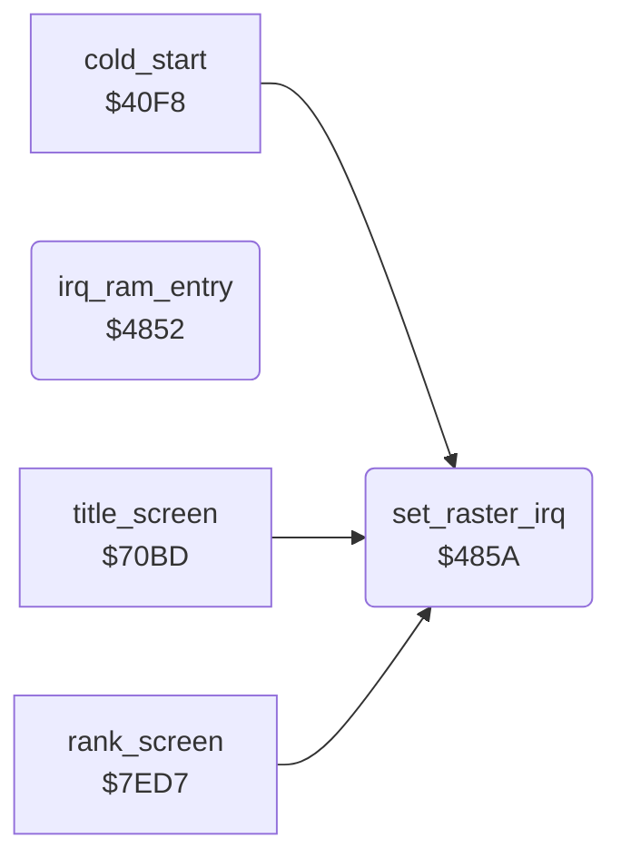

<!-- Generated by c64-docs from knowledge revision 20261024T232120.926-729orp and .c64-re-tools/local/generated/src/source-map.json. Do not edit: change the knowledge, generate the source again, then run docs.ts generate. -->
# irq/raster.asm: Raster interrupt set-up

Range `$4852-$4878`. Source: [irq/raster.asm](../../../../src/irq/raster.asm). Index: [the reference](../../index.md).

## Call graph

A solid arrow is a call, a thick arrow a table entry, a dotted arrow a jump. Rounded nodes are in this file.

## Data

| Range | Type | Name | Read by | Written by |
|---|---|---|---|---|
| [`$4875`](../../../../src/irq/raster.asm#L29)-`$4878` | bytes | [`flash_colours`](../../../../src/irq/raster.asm#L28) | [`irq_frame`](frame_irq.md#irq_frame) |  |

## Names

### [`irq_ram_entry`](../../../../src/irq/raster.asm#L6) `$4852`

*routine*

IRQ entry through the hardware vector $fffe when the KERNAL is banked out. Saves A, X, Y and jumps through CINV.

- **Jumps to:** `$EA31`
- **Reads:** [`CINV`](../../memory-map.md#CINV)

### [`set_raster_irq`](../../../../src/irq/raster.asm#L15) `$485A`

*routine*

Sets the next raster interrupt: line in A, handler in X (low) and Y (high). Turns off the CIA 1 interrupts.

- **Called from:** [`cold_start`](../init/game_start.md#cold_start) [`$4285`](../../../../src/init/game_start.asm#L151), [`title_screen`](../screen/title_screen.md#title_screen) [`$7181`](../../../../src/screen/title_screen.asm#L90), [`rank_screen`](../game/rank.md#rank_screen) [`$7F35`](../../../../src/game/rank.asm#L278)
- **Writes:** [`RASTER`](../../memory-map.md#RASTER), [`irq_next_line`](frame_irq.md#irq_next_line), [`CINV`](../../memory-map.md#CINV), [`CINV+1`](../../memory-map.md#CINV), [`VICIRQ`](../../memory-map.md#VICIRQ), [`IRQMSK`](../../memory-map.md#IRQMSK), [`CIAICR`](../../memory-map.md#CIAICR)

### [`flash_colours`](../../../../src/irq/raster.asm#L28) `$4875-$4878`

*data*

Background colours of the flash, indexed by the counter $4092: white, red, yellow, light red.

- **Read by:** [`irq_frame`](frame_irq.md#irq_frame) [`$466B`](../../../../src/irq/frame_irq.asm#L132)
