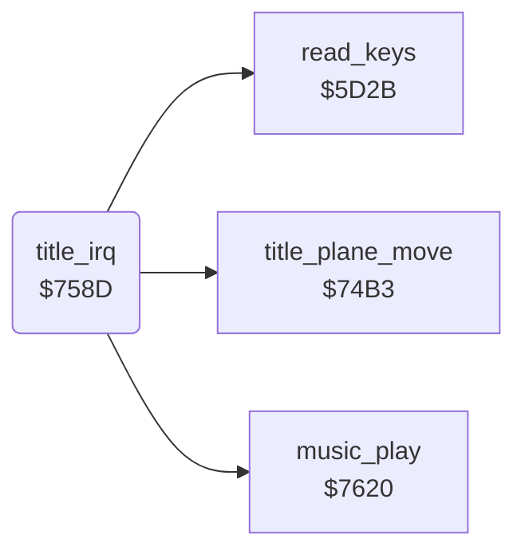

<!-- Generated by c64-docs from knowledge revision 20261025T214620.804-eudhn0 and .c64-re-tools/local/generated/src/source-map.json. Do not edit: change the knowledge, generate the source again, then run docs.ts generate. -->
# irq/title_irq.asm: Title raster interrupt

Range `$758D-$759B`. Source: [irq/title_irq.asm](../../../../src/irq/title_irq.asm). Index: [the reference](../../index.md).

## Routines

| Routine | Address | Reached from | Summary |
|---|---|---|---|
| [`title_irq`](title_irq.md#title_irq) | `$758D` |  | Title raster interrupt: counts frames, plays the tune, moves the title plane, reads the keys, then ends through $483c. |

## Call graph

A solid arrow is a call, a thick arrow a table entry. Rounded nodes are in this file.

## Details

### [`title_irq`](../../../../src/irq/title_irq.asm#L6) `$758D`

*routine*

Title raster interrupt: counts frames, plays the tune, moves the title plane, reads the keys, then ends through $483c.

- **Calls:** [`music_play`](../music/music_player.md#music_play), [`title_plane_move`](../screen/title_plane.md#title_plane_move), [`read_keys`](../input/keyboard.md#read_keys)
- **Jumps to:** [`irq_exit`](frame_irq.md#irq_exit)
- **Reads:** [`frame_count`](../data/variables.md#frame_count)
- **Writes:** [`frame_count`](../data/variables.md#frame_count)
